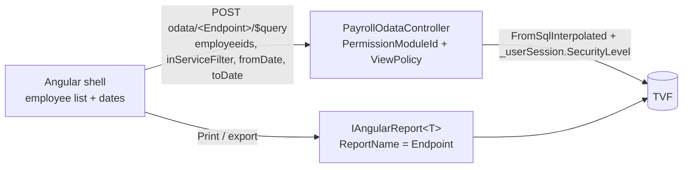

# CR-125294 — OData reports (as built)

Data flow for each report:

`Endpoint` = `ReportName` = OData EntitySet = DbSet name. ApplicationId = 4 (Payroll).

## Query options (front → backend)

| Key | Format | Sent when |
|---|---|---|
| `fromDate`, `toDate` | `yyyy-MM-dd` | always |
| `employeeids` | CSV of ids | a list is picked and it is not "select all" |
| `inServiceFilter` | `AllInService` / `AllTerminated` | Unpaid only: the pick equals all in-service / all terminated employees under the picker toggle (then `employeeids` is not sent) — same rule as the legacy form |

The backend passes `GetDayStart()` / `GetDayEnd()`; the TVFs normalise again to 00:00:00 / 23:59:59.

## 1. Unpaid Advance Payments — `UnpaidAdvancePayments` (ModuleId 549)

- TVF `PR_UnpaidAdvancePaymentsReport(@EmployeeIds, @InServiceFilter, @from, @to, @SecurityLevel)`
- Screen: `report-grid`, key `RowNo`, order `RowNo`
- Columns: `RowNo`, `EmployeeId`, `EmployeeNumber`, `EmployeeName`, `JobName`, `ProjectName`, `BranchName`, `DepartmentName`, `BeforeDateAmount`, `PeriodAdvance`, `PeriodPayment`, `EndDateAmount`, `TotalEmployeeAmount`
- Visible by default: number, name, job, the four balances (money). Hidden: total advances, project, branch, department.

## 2. Employees Advance — `EmployeesAdvance` (ModuleId 551)

- Header TVF `PR_EmployeesAdvanceReport(@EmployeeIds, @from, @to, @SecurityLevel)` — `IsAdvance = 1`, `Confirmed = 1`, `ApplayingStartDate` in range
- Detail TVF `PR_EmployeesAdvanceRepaymentReport(...)` = `PR_AdvanceRepayment` ⋈ header TVF (same params); `PaiedAmount = Amount` as in legacy
- Screen: `report-grid-multi-request`, grouped by `EmployeeName`, one detail tab "Installments"; on expand the detail is filtered `AdvanceId eq <row>`
- Header columns: `AdvanceId`, `EmployeeId`, `EmployeeNumber`, `EmployeeName`, `ProjectName`, `JobName`, `DepartmentName`, `BranchName`, `AdvanceAmount`, `AdvanceAmountCurrency`, `EnglishLetter`, `ArabicLetter`, `Discription`, `NoRepayment`, `Approved`, `ApplayingStartDate`, `ApproxEndDate`, `Returned`, `RequestDate`
- Detail columns: `RepaymentId`, `AdvanceId`, `EmployeeId`, `EmployeeName`, `PaymentDate`, `Amount`, `PaidDate`, `Paid`, `PaiedAmount`, `PaidInSalaryMainId`
- Print: `EmployeesAdvanceRptAng` returns headers with `EmployeesAdvanceRepayment` list filled (EF-ignored navigation).

## 3. Employee Purchase — `EmployeePurchase` (ModuleId 547)

- Header TVF `PR_EmployeePurchaseReport(@EmployeeIds, @from, @to, @SecurityLevel)` — `ApplayingStartDate` in range (no `Accepted` filter, as legacy)
- Detail TVF `PR_EmployeePurchaseRepaymentReport(...)` = `PR_PurchaseRepayment` ⋈ header TVF; real `PaiedAmount` column
- Screen: as report 2, detail filtered `PurchaseId eq <row>`
- Header columns: same shape as report 2 with `PurchaseId`, `PurchaseAmount`, `PurchaseAmountCurrency`, `Accepted` instead of the advance fields
- Print: `EmployeePurchaseRptAng`, headers carry `EmployeePurchaseRepayment`.

## Common rules

- Every TVF: `ROW_NUMBER() … AS RowNo` first, `EmployeeSecurityLevel <= @SecurityLevel`, empty/NULL `@EmployeeIds` = all employees, list parsed with `Acc_ConvertIntListToTable`.
- Backend returns an empty list when a date fails to parse (never throws).
- Translations: `ADVANCEPURCHASEREPORTS.*` in `payroll.json` (en-US, ar-EG). Screen titles reuse existing keys (`ACCOUNTINGREPORTS._UnpaidAdvancedPayments_`, `EMPLOYEE._AdvanceCount_`, `ACCOUNTINGREPORTS._EmployeeDeduction_`).

Legacy behaviour and differences: [[CR-125294 - Legacy Analysis]], [[decisions]].
