# CR-125294 — Work log (everything done so far)

**Ticket:** تحويل تقارير السلف والمشتريات الى ODATA — Change Request, PayRoll. Move three payroll reports off the legacy MVC iframe print viewer onto AnalyticsReader OData with a Report Grid. Details: [[CR-125294 - Source]].

Related notes: [[HANDOFF]] · [[CR-125294 - Legacy Analysis]] · [[CR-125294 - OData Reports]] · [[decisions]] · [[open-questions]] · [[review-1]] · [[review-2]] · `parity-125294.sql`

```mermaid
flowchart LR
  A[Read ticket] --> B[Dissect legacy MVC reports]
  B --> C[Decisions D1–D4]
  C --> D[Worktree set cr125294]
  D --> E[5 TVFs + sqlproj]
  E --> F[AnalyticsReader: entities, configs, DbSets, actions, print reports]
  F --> G[3 Angular screens + routes + i18n]
  G --> H[Gates: DB / API / Front builds]
  H --> I[Vault notes + parity script]
  I --> J[D5–D7: layouts, tenant, Merge Desk]
  J --> K[Merge Desk #12458, ERP fast-forward]
  K --> L[Review rounds 1–2: pass]
  L --> M[Cleanup: nothing to remove]
  M --> N[Commit x3, not pushed]
  N -.blocked.-> O[Number check on UnitedPlastic]
  O -.-> P[Ship: push + Solved]
```

---

## 1. Reading the ticket (2026-10-13)

- Read ADO 125294 through the `azure-devops` MCP (`az boards` was unusable: the `azure-devops` CLI extension isn't installed and the install prompt fails non-interactively). Project `AccFlex_ERP` from `.agent-readiness\issue-tracker.md`.
- Three reports, four acceptance criteria (A1 OData not iframe, A2 same filters and numbers, A3 print/export ar+en, A4 same ModuleId). No comments or attachments.
- The playbook used was `mvc-to-odata-report-migration` (the user named it). `onboard-ticket` was not loaded in the session at the time.

## 2. Dissecting the legacy reports

Full notes: [[CR-125294 - Legacy Analysis]].

- The web iframe calls `AccFlexContainer.MVC\Controllers\PayrollReports\AccountingReportsController.cs`, which builds reports from **`HRManagement\Payroll.Reports\HR\*`** — a separate copy from the desktop `PayRoll\Accounting\Reports\*` (different signatures, e.g. `inServiceFilter`). The first grep found the desktop copy; the controller's namespaces pointed to the real one.
- SQL pulled from the three `.xsd` files with PowerShell XML (Python is not installed on this machine).
- Findings:
  - **Unpaid advance payments**: one CTE query, no C# rollups, from 00:00:00 / to 23:59:59, `< @to`.
  - **Employees advance** and **Employee purchase**: master-detail (header + repayment schedule). Both have an **AND/OR precedence bug**: with no employee selected, the date range is skipped (and the advance one also skips `IsAdvance` / `Confirmed`).
  - The Angular filter form sends no employee list on "select all", so the bug path is the common case.
  - `iter$simple_intlist_to_tbl` is not in the cloud DB; `Acc_ConvertIntListToTable` is the equivalent.
- ModuleIds from `PayRoll\Classes\Modules\Module.cs`: **547** Employee Deduction (purchase), **549** UnPaid Advanced Payments, **551** Advance Report. The web routes had no `ModuleId`, so `CanActivateRouteGuard` let only admins in.
- Sibling template: the already-migrated `advance-transactions` (`report-grid`, `PR_EmployeeAdvanceTransactionsReport`), and `employee-accurals-details-shell` for master-detail.

## 3. Decisions with the engineer

Recorded in [[decisions]].

| # | Decision |
|---|---|
| D1 | **Fix** the legacy precedence bug: the date range (and IsAdvance/Confirmed) always apply |
| D2 | **Interactive grid** (ticket wins over the skill's print-only default): `report-grid` for unpaid, `report-grid-multi-request` for advance and purchase |
| D3 | **Server-side security level**: `EmployeeSecurityLevel <= _userSession.SecurityLevel` (the sibling takes it from the client, spoofable) |
| D4 | Create the worktree set locally with `scripts\new-cr.ps1` |
| D5 | Build Arabic + English print layouts |
| D6 | Parity tenant UnitedPlastic (first `support-db2`, then the engineer said `web-test`) |
| D7 | Create the Merge Desk ticket now |

## 4. Worktree set

- `new-cr.ps1 -Id 125294 -Repos db,erp,front` → `D:\Hadaf\worktrees\cr125294`, branch `cr125294` off `origin/Master_Stable`, port offset 100.
- Front `package.json` differed from the main checkout (line endings + two local client pins), so `node_modules` was not linked.

## 5. Database (AccFlex_Cloud_Database)

Five inline TVFs under `dbo\Functions\`, all `PR_` prefixed, `ROW_NUMBER() … AS RowNo` first, `EmployeeSecurityLevel <= @SecurityLevel`, empty/NULL employee list = all:

| TVF | Notes |
|---|---|
| `PR_UnpaidAdvancePaymentsReport(@EmployeeIds, @InServiceFilter, @from, @to, @SecurityLevel)` | Legacy CTEs line for line; day boundaries normalised inside the TVF so any caller gets legacy semantics |
| `PR_EmployeesAdvanceReport(@EmployeeIds, @from, @to, @SecurityLevel)` | `IsAdvance = 1 AND Confirmed = 1`, date range always applied (D1) |
| `PR_EmployeesAdvanceRepaymentReport(...)` | `PR_AdvanceRepayment` ⋈ the header TVF with the same params, so header and detail can't disagree; `Amount AS PaiedAmount` kept from legacy |
| `PR_EmployeePurchaseReport(...)` | Date range always applied (D1); no `Accepted` filter, as legacy |
| `PR_EmployeePurchaseRepaymentReport(...)` | `PR_PurchaseRepayment` ⋈ the header TVF; real `PaiedAmount` column, as legacy |

- 5 `<Build Include>` lines in the `.sqlproj` (functions are listed one by one; a missing line silently drops the object from the dacpac).
- Layout seed `Scripts\ReferenceDataScripts\0413_PR_AdvanceAndPurchaseReportsLayout.sql` (added for D5): 6 `dbo.InsertLayout` calls — 3 reports × ar + en, `@ApplicationId = 4`, `@ReportName` = the backend ReportName; `<None Include>` in the sqlproj.

## 6. Backend (AccFlex_Cloud_ERP / AnalyticsReader.Api)

- **Entities**: `ODataViews\Payroll\UnpaidAdvancePaymentsRpt\UnpaidAdvancePayments.cs`, `EmployeesAdvanceRpt\EmployeesAdvance.cs` (+ `EmployeesAdvanceRepayment`), `EmployeePurchaseRpt\EmployeePurchase.cs` (+ `EmployeePurchaseRepayment`). `long RowNo` key, every other property nullable. Headers carry a `List<…Repayment>` for print, ignored in EF.
- **EF configs**: `ODataViewsConfigurations\Payroll\AdvanceAndPurchaseRptConfigs\AdvanceAndPurchaseRptConfigs.cs` — 5 `ToFunction` mappings.
- **DataContext**: 5 DbSets next to the other Payroll ones.
- **Grid data**: 5 actions in `ODataControllers\Payroll\PayrollOdataController.cs` (`odata/UnpaidAdvancePayments`, `EmployeesAdvance`, `EmployeesAdvanceRepayment`, `EmployeePurchase`, `EmployeePurchaseRepayment`), each `[PermissionModuleId]` 547 / 549 / 551 + `ViewPolicy`, empty list when a date doesn't parse. Discovery: in AnalyticsReader the **grid** reads through these OData controller actions, while `IAngularReport<T>` only serves **print/export** — so the permission check (A4) lives on the actions.
- **Print**: `AngularReports\Payroll\AdvanceAndPurchaseReports\{UnpaidAdvancePayments,EmployeesAdvance,EmployeePurchase}RptAng.cs`; `ReportName` = `nameof(entity)` = endpoint; header lists filled from the repayment TVF with `ToLookup`.

## 7. Front (AccFlex_Cloud_Front / payroll)

- The three existing shells were rewritten in place (same routes, same menu entries): `unpaid-advanced-payments-shell` (`report-grid`), `advance-report-shell` and `employee-deduction-shell` (`report-grid-multi-request`, grouped by employee, detail filtered by `AdvanceId` / `PurchaseId` on expand).
- Filters reuse `pay-shared-employee-list` + two date boxes, like the sibling. Dates sent as `yyyy-MM-dd` (no timezone shift). Unpaid reproduces the legacy in-service rule: send `AllInService` / `AllTerminated` only when the pick equals all in-service / all terminated employees, otherwise the list, nothing on select-all.
- `accounting-reports.module.ts`: `data: { ModuleId }` 547 / 549 / 551.
- `payroll.json` en-US + ar-EG: new `ADVANCEPURCHASEREPORTS` block (28 keys each).

## 8. Gates (and the environment traps found)

| Gate | Result | Trap |
|---|---|---|
| DB build | dacpac OK | VS 2022 **Community** MSBuild, not Enterprise |
| AnalyticsReader build | 0 errors | Needs `-p:LibraryRestore=false -p:BundleMinifyEnabled=false` in a fresh worktree; otherwise libman fails and the bundler rewrites 5 `wwwroot` bundles (restored with `git checkout`). Build output redirected with `BaseOutputPath` |
| Front `npm run testing` | 0 payroll errors | Main checkout's `node_modules` junctioned in temporarily (removed after); `node scripts/write-build-info.cjs` first. 4 baseline errors in logistics `SalesQuotation` from the main checkout's `logistics.api.client 1.0.3898-local.1` vs `1.0.3893` |

## 9. Vault notes (2026-10-14)

- Written to this vault (the workspace's `D:\accflex-features` doesn't exist here): Source, Legacy Analysis, OData Reports, decisions, open-questions, HANDOFF, parity script. The folder was later moved by the engineer into `Oct\OData Reports\`.
- `parity-125294.sql`: runs the verbatim legacy SQL and the new TVFs with the same parameters and diffs them both ways with `EXCEPT` (unpaid, advance + repayments, purchase + repayments). Pass = every diff empty.

## 10. Merge Desk and branch

- Merge Desk ticket **#12458** created through the `merge-desk` MCP: Beta, Acknowledge, owner Mohamed Saeed, repos Database / API / WebContainer, contract change off, components left for Merge Desk to detect. It created `origin/cr125294` in the three repos.
- Local branches set to track `origin/cr125294`. ERP was **39 commits behind** (Merge Desk cut from a newer `Master_Stable`); none touched the CR files, so it was fast-forwarded with the uncommitted work intact, then rebuilt clean.

## 11. Number check — blocked

- `support-db2` is unreachable from this machine (login timeout).
- The engineer chose UnitedPlastic on `web-test` and added the credentials to `.env.local`. `web-test` is reachable (192.168.1.211:1433).
- The **`accflex-env-pin`** plugin (`plugins\accflex-env-pin\hooks\register.ts`) denies every command targeting `web-test` ("web-test is retired"), even after `/env unretire web-test`. Its own defaults pin `web-test` / UnitedPlastic *and* list `web-test` as retired. Not bypassed. `.agent-readiness\workflow.md` line 148 also still says `web-test` is retired.
- Until it runs: data fidelity (A2) is checked by review (the SQL reviewer confirmed the unpaid TVF is numerically identical to legacy), not by data.

## 12. Review (2026-10-14)

- Fable 5.1 reviewers failed at once (out of credits); rerun on **Opus 5.5**. The code was written by Sonnet 5.5, so the reviewer is still a different model.
- Round 1 ([[review-1]]): **pass** — 0 block, 1 should, 6 nit (main reviewer + backend-reviewer + sql-reviewer merged).
  - Row 1 (should): `getLang()` subscription never unsubscribed → applied (SubSink + `ngOnDestroy`).
  - Row 2 (nit): new `any` → applied (`DetailExpandEventArgs`, typed employee change).
  - Rows 3–7 (nits: config file split, ProducesResponseType style, `$expand` on the header list, in-service filter in print parameters, `= NULL` defaults): kept as sibling style, reviewer accepted.
- Round 2 ([[review-2]]): **pass**, 0 / 0 / 0.
- Answered for the backend reviewer: `ar.Amount AS PaiedAmount` in the advance repayment TVF is legacy-verbatim (`dsEmployeeAdvance2.xsd`), not a bug.

## 13. Cleanup

`remove-redundant`: nothing to remove — every added comment is a why-comment (deliberate legacy deviations), no debug leftovers, no unused imports, nothing orphaned (`EmployeeFromToFormComponent`, `AccflexReportShellComponent` are still used by other shells).

## 14. Commit (2026-10-14, on the engineer's word)

| Repo | Commit | Message |
|---|---|---|
| AccFlex_Cloud_Database | `a2a2ac3aa` | cr125294: report TVFs for unpaid advance payments, employees advance and employee purchase, with ar/en print layouts |
| AccFlex_Cloud_ERP | `277ebf7d56` | cr125294: AnalyticsReader OData endpoints and print reports for unpaid advance payments, employees advance and employee purchase |
| AccFlex_Cloud_Front | `1ef801747b` | cr125294: unpaid advance payments, advance and purchase reports on the OData report grid instead of the iframe |

Staged by path (25 files), no Co-Authored-By line, all hooks passed; the front pre-commit (pretty-quick) reformatted 6 files inside the commit. **Not pushed.**

## 15. What's left

1. Fix the env-pin (or run the scripts by hand): publish preview of the 5 functions + seed on UnitedPlastic, publish, run `parity-125294.sql`, write `parity-results.md`.
2. In-app check: the three screens in Arabic and English — grid, expand, group, Excel/PDF, print with the seeded layouts.
3. Ship with `release-ticket`: push, Merge Desk #12458 → Solved (it opens the `Stage_Beta` and `Master_Stable` PRs), ADO → Solved.
4. Optional doc fix once `web-test` is confirmed back in service: `.agent-readiness\workflow.md` line 148 and the `db-change` skill.

## Lessons worth keeping

- MVC container reports live in `HRManagement\Payroll.Reports\`, not the desktop `PayRoll\` copy — follow the controller's namespace.
- In AnalyticsReader, grid data = OData controller actions (`[PermissionModuleId]`), print = `IAngularReport<T>`; a migrated grid report needs both.
- Legacy typed-DataSet WHERE clauses often hide AND/OR precedence bugs; read them with parentheses before promising "same numbers".
- Route `data: { ModuleId }` missing means non-admins are blocked by `CanActivateRouteGuard`, not allowed.
