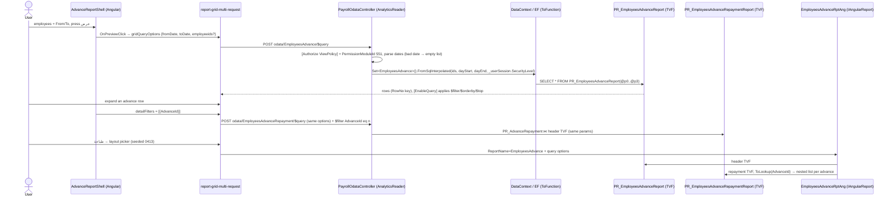

# CR-125294 — How the advance & purchase reports work on OData (dev)

Three Payroll accounting reports moved from the legacy MVC print viewer (an iframe that posts to `/mvc/AccountingReports/*`) to the AnalyticsReader OData pattern: **SQL TVF → AnalyticsReader (OData + print) → Angular report grid**. Routes and menu entries are unchanged. Scope = the CR commits since the merge base: DB 7 files, ERP 9, Front 10 (+ local F1 commit `8c1accad0e`).

| # | Screen (ar / en) | Route | Grid | Endpoint = ReportName | TVF(s) | ModuleId |
|---|---|---|---|---|---|---|
| 1 | رصيد سلف الموظفين / Unpaid Advance Payments | `accounting-reports/unpaid-advanced-payments` | `report-grid` | `UnpaidAdvancePayments` | `PR_UnpaidAdvancePaymentsReport` | 549 |
| 2 | تقرير السلف / Employees Advance | `accounting-reports/advance-report` | `report-grid-multi-request` | `EmployeesAdvance` (+ `EmployeesAdvanceRepayment`) | `PR_EmployeesAdvanceReport` (+ `…RepaymentReport`) | 551 |
| 3 | المشتريات / Employee Purchase | `accounting-reports/employee-purchase` | `report-grid-multi-request` | `EmployeePurchase` (+ `EmployeePurchaseRepayment`) | `PR_EmployeePurchaseReport` (+ `…RepaymentReport`) | 547 |

ApplicationId 4 (Payroll) everywhere.

## Call chain (Employees Advance; the other two are the same shape)

### Step by step, with code locations

Paths: Front `P` = `worktrees\cr125294\AccFlex_Cloud_Front\accflex-erp`; ERP `A` = `worktrees\cr125294\AccFlex_Cloud_ERP\AccFlex_Cloud_ERP\AnalyticsReader\AnalyticsReader.Api`; DB `D` = `AccFlex_Cloud_Database_State\…\dbo\Functions` on `origin/cr125294`.

1. **Route + permission.** `P\projects\payroll\…\accounting-reports\accounting-reports.module.ts` now gives each route `data: { ModuleId }` (547/549/551). Before, they had none, so `CanActivateRouteGuard` let only admins in.
2. **Shell builds query options.** `advance-report-shell.component.ts:50-58` builds `{ fromDate, toDate }` as `yyyy-MM-dd`. It adds `employeeids` only when a list is picked and it is not "select all". Unpaid (`unpaid-advanced-payments-shell.component.ts:51-73`) keeps the legacy in-service contract: a pick equal to all in-service or all terminated employees sends `inServiceFilter=AllInService|AllTerminated` instead of ids.
3. **Detail on expand.** `advance-report-shell.component.ts:60-62` sends `[{AdvanceId}]`; the purchase shell sends `[{PurchaseId}]`. The detail request reuses the header's query options (`[detailqueryoptions]="[gridQueryOptions]"`).
4. **Controller.** `A\ODataControllers\Payroll\PayrollOdataController.cs`, 5 `[HttpGet]` actions, `odata/<Name>`. Each action:
   - is guarded by `[EnableQuery]`, `[Authorize(ViewPolicy)]` and `[PermissionModuleId]`;
   - cleans the strings (`RemoveQuotes…`) and `TryParse`s the dates;
   - passes `GetDayStart()` / `GetDayEnd()` and `_userSession.SecurityLevel` (always the last argument);
   - returns an `IQueryable`.

   The only `-` line in the diff is the trailing comma added to the `ModuleIds` enum.
5. **EF mapping.** `A\ODataViewsConfigurations\Payroll\AdvanceAndPurchaseRptConfigs\AdvanceAndPurchaseRptConfigs.cs:14-52`: 5 configs, `HasKey(RowNo)`, `ToFunction("PR_…")`. Header configs `Ignore` the nested repayment list. DbSets: `A\Models\DataContext.cs:579-583`.
6. **TVFs.** All are inline TVFs, `RowNo = ROW_NUMBER()` first, empty `@EmployeeIds` = all employees (`Acc_ConvertIntListToTable`), `EmployeeSecurityLevel <= @SecurityLevel`.
   - `D\PR_UnpaidAdvancePaymentsReport.sql` (:16-118):
     - day window: start of the from-day to the end of the to-day;
     - 3-way `UNION ALL` over advances with `IsAdvance=1, Approved=1, IsPaid=1`:
       - `BeforeDateAmount` (unpaid installments before the window);
       - `PeriodPayment` (paid installments in the window);
       - `PeriodAdvance` (all installments in the window);
     - `EndDateAmount = Before + PeriodAdvance − PeriodPayment`;
     - `TotalEmployeeAmount` = Σ `AdvanceAmount` with no filter (as legacy).
   - `D\PR_EmployeesAdvanceReport.sql` (:49-65): one row per advance, `IsAdvance=1 AND Confirmed=1`, `ApplayingStartDate` in the window.
   - `D\PR_EmployeePurchaseReport.sql` (:49-63): one row per purchase, date window only. There's no status filter, as in legacy, and `Acc_Currency` is a LEFT join.
   - Repayment TVFs (`…RepaymentReport.sql:25-27`) join `PR_AdvanceRepayment` / `PR_PurchaseRepayment` to the header TVF **with the same parameters**, so the detail can never cover other advances or purchases than the header. Advance `PaiedAmount = Amount` (as legacy); Purchase uses the real `PaiedAmount` column.
7. **Print / export.** `A\AngularReports\Payroll\AdvanceAndPurchaseReports\*RptAng.cs`: `ReportName = nameof(entity)`. Advance and Purchase run both TVFs and nest the repayments with `ToLookup(AdvanceId|PurchaseId)` (`EmployeesAdvanceRptAng.cs:33-42`). Parameters are `{fromDate, toDate}`. Layouts: `Scripts\ReferenceDataScripts\0413_PR_AdvanceAndPurchaseReportsLayout.sql`, 6 `InsertLayout` calls (3 reports × `الافتراضي` ar-EG / `Default` en-US), ApplicationId 4. `InsertLayout` upserts on Name + DesignName.

## Invariants and where they are enforced

| Invariant | Where |
|---|---|
| Only users with the report's view permission open it | route `data.ModuleId` (Front) + `[PermissionModuleId]` + `ViewPolicy` (API) |
| A user never sees employees above their security level | every TVF `EmployeeSecurityLevel <= @SecurityLevel`; the level comes from the server session, not the client (the sibling `advance-transactions` takes it from a spoofable query option) |
| The date range always applies (decision D1, fixes the legacy AND/OR precedence bug) | Advance / Purchase header TVFs |
| Detail rows belong to the header rows | repayment TVFs join the header TVF with the same params |
| Day boundaries can't drift with time zones | Front sends `yyyy-MM-dd`; API `GetDayStart/End`; TVFs normalise again |
| A bad date returns an empty result, never an error | controller actions and `*RptAng.GetDataSource` |

## Data touched

Read only, no writes at runtime: `PR_Advance`, `PR_AdvanceRepayment`, `PR_Purchase`, `PR_PurchaseRepayment`, `PR_Employee`, `Acc_Currency`, `PR_Job`, `PR_Projects`, `PR_Department`, `PR_Branch`. Deploy-time writes: 5 new functions (`<Build Include>`) and 6 rows in `ACFX_ReportLayout` (0413, `<None Include>`).

## What changed per layer, and why

| Layer | Change | Why |
|---|---|---|
| DB | 5 TVFs, 1 layout seed, sqlproj entries | legacy SQL lived in desktop `.xsd` DataSets (`AccFlex_ERP\HRManagement\Payroll.Reports\HR\*`); the cloud needs TVFs ([[CR-125294 - Legacy Analysis]]) |
| ERP | 5 entities + configs + DbSets + 5 actions + 3 print classes | the 4-artifact report backend |
| Front | 3 shells rewritten from `pay-employee-from-to-form` + `accflex-report-iframe-post` (MVC URL) to employee list + dates + report grid; ModuleIds on routes; 28 `ADVANCEPURCHASEREPORTS` keys in ar/en `payroll.json` | ticket: no iframe; interactive grid (decision D2) |
| Front, shared | `src\app\shared\components\report-grid\report-grid.component.ts:871`: the PDF export URL drops the extra `/` when `analyticsreaderapi` ends with `/` (`…//angular/AngularReportPdf` → `…/angular/AngularReportPdf`) | fixes PDF export for that config. **Blast radius:** PDF export on every `<report-grid>` screen (116 templates: logistics 49, construction 26, cash-control 16, GL 15, payroll 10). Only the trailing-slash branch changed; the other branch already added `/`. Not listed in HANDOFF's file list; worth a line in the PR |
| Front, F1 (`8c1accad0e`) | `details = ['Repayments']` + `[customTransalatePropertyList]="detailTitles"` | the grid translates `details` as `ODATAREPORTS.<name>`; passing an already-translated label showed `ODATAREPORTS.الأقساط` |

Verification: [[parity-results]] (legacy SQL vs TVF, 2 = 2 / 11 = 11 (139,436.23) / 2 = 2 (4,900), no differences), [[in-app-check]], video [[CR-125294-before-after.mp4]].

## Rule files governing each layer

- DB: `AccFlex_Cloud_Database\.claude\rules\report-database-functions.md`. The TVF name equals the C# `ToFunction`, with the `PR_` prefix. **Followed.**
- ERP: `AccFlex_Cloud_ERP\.claude\rules\report-backend.md:26`, the 4-artifact checklist (entity, `ToFunction` config, DbSet, `IAngularReport<T>`, `long RowNo`, EntitySet = class name). **Followed** for all 5 entities.
- Front: `AccFlex_Cloud_Front\.claude\rules\report-module.md`. Unpaid follows Pattern 1 (`report-grid`); Advance and Purchase follow Pattern 2 (master-detail, `report-grid-multi-request`). `core.md` rules (SubSink, no new `any`) were applied in review round 1.

## Business meaning (KG)

- **Advance — سلفة:** a loan repaid in installments deducted from monthly salary. `Accflex_KG\Payroll\5 - Wages & Salaries\3_2_2 Advance\3_2_2 Advance.business.md:17`.
- **Installment — قسط / دفعة** (`PR_AdvanceRepayment`): a salary run deducts the installments whose `PaymentDate` falls in its period. Same folder, `.technical.md:227, :239`.
- **Employee purchase — مشتريات الموظف:** goods bought on credit from the company and repaid in installments; same mechanics as an advance, with its own limit and account. `3_2_3 Purchase\3_2_3 Purchase.business.md:17-18`.
- **Flags:**
  - `Approved` (اعتماد) needs `Confirmed` first. The entity's `Accepted` is mapped to the column `Confirmed`.
  - `IsPaid` = received by the employee (تم التسليم للموظف; `_glossary.md:35`).
  - Installment `Paid` / `Returned` = repaid (تم السداد). `Advance.technical.md:77, :78, :109, :272`.
- **Employee security level:** levels 1–5; a user sees only employees at or below their own level. The screen caption is **الحماية** (not السرية). `1 - Organization & Policies\5_3_1 Users and Permissions\…business.md:18`.
- **Feeds:** the salary run deducts the installments and credits the advances account (or the employee-purchases account for purchases). Cash handover follows the "accrual for advance" company setting. `Advance.business.md:24`, `Purchase.business.md:25`.

Existing graphs (not redrawn): `Accflex_KG\Payroll\5 - Wages & Salaries\wages-context-graph.html`, `Accflex_KG\Payroll\payroll-application-graph.html`, `Accflex_KG\Payroll\payroll-screens-graph.html`, `Accflex_KG\_system\system-graph.html`.

## Open points

- **Missing from both glossaries:** Advance, Installment (AdvanceRepayment), Employee purchase, Employee security level, Unpaid Advance Payments, IsAdvance, Approved, Confirmed, Returned, PaidInSalaryMainId. Only "Received by employee" (`IsPaid`) and "Posting a salary" exist.
- **`IsAdvance`:** a flag on `PR_Advance` with no documented business meaning. Both legacy and new filter `IsAdvance = 1`. Ask the PO what `IsAdvance = 0` rows are.
- **`PaidInSalaryMainId`:** a detail column with no KG note (the KG only documents `RaiseSalaryMainId` and `LinkToSalary`).
- **KG contradictions with the code:** none found.
