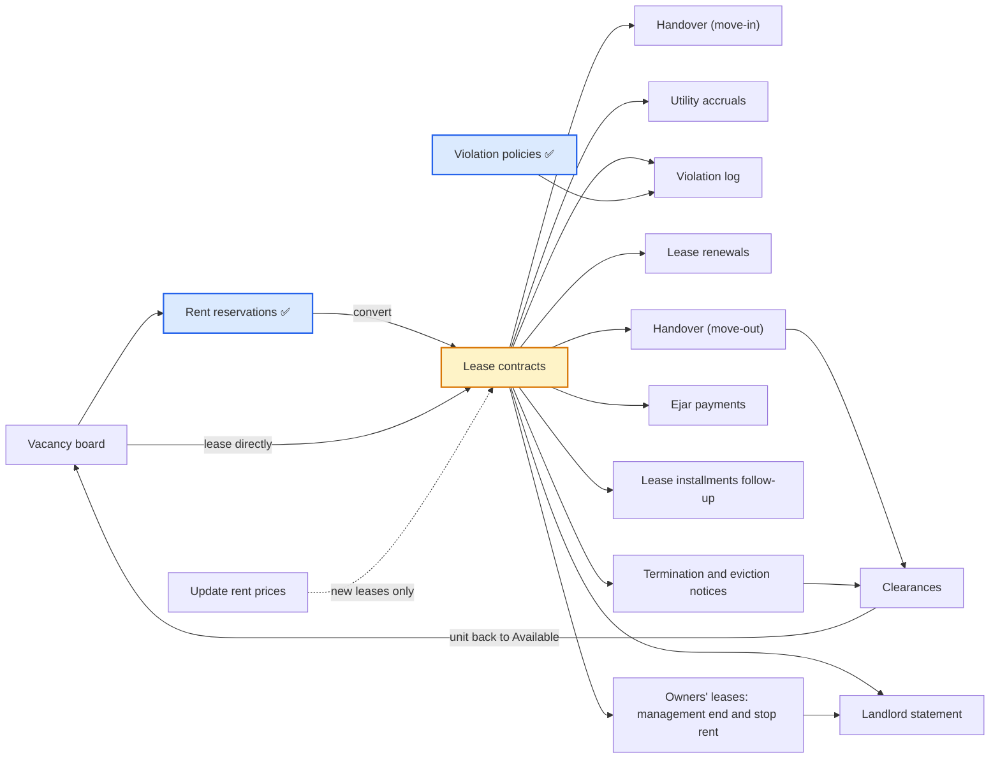

# Leasing (التأجير) — the 14 (+1) screens explained for a non-business reader

As of 2026-10-26 (refreshed from the mockup version published the same day) · complements [[Screens explained in detail]] (the 16 settings screens) · Arabic version: [[شرح شاشات التأجير]].

Source: the interactive mockup of the Property Manager module (its "Leasing" app holds 14 working screens plus 5 reports, and on 26 October gained "Lease installments follow-up", making 15) and the CR 125808 and CR 125716 notes in this folder. Two are built in the cloud (rent reservations and violation policies); the rest are specified in the mockup and not built yet.

**What changed in the mockup on 26 October:** "Installments management" and "Payment follow-up" were merged into one screen per app ("Sale installments follow-up" in sales, "Lease installments follow-up" in leasing); the lease's fines tab now lets you reduce a fine with a reason or exempt it; and the forfeited-deposit account is now called "forfeited reservation deposits revenue".

## The big idea

Leasing is the life of a rented unit from start to finish: it begins vacant on the board, gets reserved with a deposit, a lease is signed and its installment schedule generated, the tenant takes the unit with an inspection report, meters are read monthly, violations are recorded, the lease is renewed or terminated, the tenant hands the unit back with an exit inspection, and a "clearance" settles the security deposit and puts the unit back on the market. If the unit belongs to another owner, the owner gets a statement of what was collected for them.

✅ = built in the cloud. The lease contract (yellow) is the heart of the section: almost every screen reads from or writes to it, and it is not built yet.

## The 14 screens at a glance

| # | Menu group | Screen | What it does in one line | Status |
| --- | --- | --- | --- | --- |
| 1 | Reservation | Rent reservations | Hold a unit for a tenant with a deposit before the lease | ✅ built (CR 125808, module 959) |
| 2 | Contracts | Lease contracts | The lease itself, its installment schedule and all its attachments | not built |
| 3 | Renting | Unit handover and checkout | Inspection report at move-in and move-out | not built |
| 4 | Renting | Lease renewals | A new lease starting after the old one, at a raised rent | not built |
| 5 | Renting | Termination and eviction notices | End a lease by date, or warn a late tenant | not built |
| 6 | Renting | Clearances | Settle the deposit at the end and vacate the unit | not built |
| 7 | Renting | Utility accruals | Monthly meter readings charged to the tenant | not built |
| 8 | Renting | Update rent prices | Raise unit rents in bulk | not built |
| 9 | Renting | Vacancy board | A colour board of every unit's status | not built |
| 10 | Violations | Violation policies | The fine schedule for tenant violations | ✅ built (CR 125716, module 938) |
| 11 | Violations | Violation log | Record a violation and apply its fine to the lease | not built |
| 12 | Owners | Landlord statement | What was collected for a unit's owner and what they are due after fees | not built |
| 13 | Owners | Owners' leases: management end and stop rent | Change or stop the date the company manages an owner's unit | not built |
| 14 | Installments and collections | Ejar payments | Pull payments from the Ejar platform and match them to installments | not built |
| 15 | Installments and collections | Lease installments follow-up (added 26/10) | Confirm, invoice, collect and adjust lease installments from one screen | not built (Feature 101058 · CR 101110 Confirmed) |

---

## 1. Rent reservations

**What it is.** A "reservation" slip recording that a tenant agreed on a unit at an annual rent and an expected start date, and paid (or will pay) a deposit. Like booking a hotel room: the unit is closed to others until the lease is signed or the reservation is cancelled.

**Why.** Without it the same apartment can be promised to two people and the agreement lives outside the system (decision of 11 October).

**What you enter.** Number generated as `RR-<year>-<seq>`, date, "valid until" (today + the reservation validity from general settings, 14 days), tenant (from the customers screen, with a "+ new customer" button), project (filter only), unit (available units whose type is rent), expected start (today + 15), duration in years, annual rent (filled from the unit price), reservation deposit (= rent × the deposit percentage from general settings, 5%), payment method.

**Life cycle.** Draft → Confirmed (the unit becomes Reserved) → Converted to lease or Cancelled. A confirmed reservation past "valid until" shows as "expired" in the warning colour, but the unit stays reserved until the user decides; no automatic release, because the customer paid a deposit (decision of 26 October).

**Cancellation (decision of 26 October).** A dialog asks who cancelled (tenant or company) and what happens to the deposit: forfeit (default when the tenant cancels; posted to "forfeited reservation deposits revenue" 4195), full refund (default when the company cancels; a payment request "real-estate customer refund"), or partial refund.

**Accounting in plain words.** On confirm, a down-payment invoice for the deposit (debit customer 1210, credit customer advances 2330); a receipt on collection; at lease approval the deposit becomes part of the security deposit (from 2330 to tenant deposits 2320). The deposit is taken off the security deposit, not the first installment; any excess stays as an advance settled with the first rent invoice.

**Example.** Rent 120,000 with a 5% deposit → deposit 6,000; a lease with a 10,000 security deposit → a deposit line of only 4,000.

**What CR 125808 actually built.** The list and form, the draft / confirmed / cancelled cycle, reserving and releasing the unit. Deferred: the invoice, the receipt, conversion to a lease (no lease exists in the cloud yet) and the new cancellation dialog.

## 2. Lease contracts

**What it is.** The lease itself: a tenant, one or more units from the same project and the same owner, a term, an annual rent, a payment frequency, VAT, a security deposit, a yearly escalation, a broker, and a link to the Saudi Ejar platform. It is the heart of the section: approving it generates the installment schedule, turns the units to Rented and opens a move-in inspection.

**What you enter.**
- **Contract:** date, tenant, project (filter), units (multi-select; each unit's annual rent in the lease), owner (read from the unit: "company" or an owner's name), start (tomorrow by default), duration in years, end (computed), management end (for owners' units), auto-renew (informational).
- **Rent and VAT:** annual rent (sum of the units), payment frequency (monthly / quarterly / half-yearly / yearly, default from general settings), payment term (a rent-type payment term that sets the late fine), VAT-exempt or not (the rate comes from GL settings per country, 15% in Saudi Arabia), security deposit (= rent ÷ 12 by default), the collected reservation deposit if it came from a reservation, post-dated cheques or not.
- **Rent escalation:** none / percent / amount, and the method (fixed on the base or compound).
- **Brokerage:** broker, commission % and who pays it (the owner by default).
- **Ejar platform** (Saudi only): payment through the platform (mandatory for residential), documentation fee (125 a year residential; 200 + 400 per extra year commercial), documentation status and the platform contract number.

**Tabs.** Rent schedule (the installments), amenities (from the amenities catalog), furnishing (from the furnishing catalog, reference and inspection only, never in the schedule, decision of 18 October), service items (annual value spread over the installments, always company revenue), utilities and meters (per meter: who pays, metered or fixed amount, consumption limit), fines (the late fine computed from the payment term; "apply" opens a window that lets you reduce the amount with a mandatory reason, never raise it, and "exempt" waives it with a recorded reason, date and user, 26 October update), terms and conditions (from the clauses catalog by usage type), cheques, contract movements, invoices.

**How the schedule is built.** A "deposit" line first (deposit − reservation deposit), then one installment per period: that year's rent × period months ÷ 12 at the lease VAT, plus a services line, an amenities line and a fixed-utilities line when they exist. Each year's rent rises per the escalation type.

**Statuses.** Draft → Active (button "approve the lease and generate installments") → Expiring (last 60 days) / Expired / Terminated by notice / Renewed / Cleared. "Rescind" and "stop" buttons were removed (decision of 11 October). After approval the lease is read-only and every change goes through "contract movements" (renewal, termination notice, rescheduling, eviction warning, clearance).

**Key rules.** All units from the same project and owner; approval is refused if a unit is not Available (or Reserved by the same reservation); the deposit is outside VAT and is collected by receipt without an invoice; the late fine comes from the payment term and the country rules in general settings (Egypt: interest capped at 7%; Saudi Arabia: no monetary fine, stages at 7/30/60/90 days; Ejar-paid leases: no fine, grace 15 or 30 days).

**Accounting in plain words.** Revenue is not booked at approval but with each installment's invoice (the default manual policy): rent and furnishing revenue to 4120, services, amenities and utilities to 4140, fines to 4190. The automatic policy (company units only) books the whole lease revenue up front (1225 accrued revenue / 2315 deferred revenue) and then confirms each installment on its date. Confirming, invoicing and collecting happen from the "Lease installments follow-up" screen (decision of 20 October, the two screens merged on 26 October); no sales order (decision of 15 October).

## 3. Unit handover and checkout

**What it is.** An inspection report for the unit on three occasions: "tenant move-in" (opened automatically as a draft when the lease is approved), "tenant move-out" at exit, and "sold-unit handover". Number `INS-<year>-<seq>`.

**What it holds.** Type, date, lease (for move-in and move-out), unit, inspector, electricity and water meter readings, and two tabs: **checklist** (8 fixed items: kitchen, bathrooms, floors, paint, air conditioning, doors and windows, electricity, plumbing; each good / acceptable / damaged / missing, with a note and photos) and **furnishing items** (from the furnishing catalog on the unit; each present / missing / damaged, and at move-out a "suggested deduction").

**Statuses.** Draft → Posted by "approve the inspection". A move-out with a missing or damaged item raises an alert at the top of the list until a clearance exists, and the suggested deduction flows into it automatically.

**Note.** The inspection posts no journal and changes no unit status; deductions are settled in the clearance. The checklist belongs to the module because AccFlex "quality checks" need a stock item (D42).

## 4. Lease renewals

**What it is.** Renewing an active lease with a new lease that starts the day after the old one ends, at rent = last year's rent + the increase % (default the lease's own percent or 5%), with the deposit carried over and no new deposit line.

**How.** From the "renew" button on an active lease or from this screen: pick the lease, the new start, duration, increase %, frequency, then "execute and post". Result: a new lease approved at once with a new `LS` number, the old one becomes "Renewed", and a "renewal" document in the contract movements.

**Example.** Rent 100,000 with 5% → the new lease is 105,000.

**Open questions.** Renewing before the end does not cancel the old lease's installments after the new start; "auto-renew" is not run by a job yet; whether the broker commission accrues again on renewal.

## 5. Termination and eviction notices

**What it is.** A screen for two documents on an active lease, both created directly posted as `NT-<year>-<seq>` and printable:
- **Termination notice:** end the lease by date (end of month by default) with an optional termination penalty. It cancels the uninvoiced installments after the termination date (except the deposit), adds a "termination penalty" line if any, and sets the lease end to that date. A date before the notice date is refused. Termination is always by date, with no types (decision of 11 October).
- **Eviction warning:** for a late tenant: it computes the overdue installments after the grace days (from general settings, 5 days), gives a payment deadline (15 days by default), and the "move to legal collection" option flags the lease and the customer as "legal" and adds a "legal fees" line (2,500 by default) with commercial VAT.

**Afterwards.** The unit stays Rented until the clearance. No journals here; the added lines are invoiced later. Sending the notice to the tenant (message or through Ejar) is an open question.

## 6. Clearances

**What it is.** The final settlement at the end of a tenancy: take the held deposit, deduct what the tenant owes, refund the rest, and the unit goes back to Available. Number `CL-<year>-<seq>`, created directly posted.

**The three deductions (editable).** Unpaid installments and utilities due to date; missing or damaged furnishing per the exit inspection `INS-…` (pulled automatically); cleaning (600 by default). Deposit held = what was paid on deposit lines + the deposit carried from a previous lease.

**What "execute and post" does.** Creates an exit inspection automatically for any unit without a posted one, cancels uninvoiced installments after the clearance date, pays the arrears from the deposit in due order (invoicing them if needed), posts the "clearance and deposit settlement" journal, and if money remains for the tenant creates a payment request "real-estate customer refund" paid from Cash Management. The lease becomes "Cleared" and every unit Available; an Ejar-documented lease is closed there.

**Accounting in plain words.** From tenant deposits 2320 (the part of the deposit used) to the customer account 1210 (arrears settled) and to services and utilities revenue 4140 (damage and cleaning).

**Example.** Deposit 10,000, arrears 3,000, cleaning 600 → arrears paid from the deposit and 6,400 refunded by payment request.

**Open question.** If deductions exceed the deposit (negative net), the mockup creates no claim.

## 7. Utility accruals

**What it is.** Monthly meter readings for rented units (electricity, water, gas) that turn consumption into amounts on the tenant's account. Only meters the lease marks as paid by the tenant "by meter" appear; fixed-amount meters are already in the schedule.

**How.** "New month readings" opens a grid: per lease and meter the previous reading (last posted) and the current reading you enter; consumption and amount are computed (consumption × unit rate; above the lease limit priced × 1.5). "Post accruals" adds a "utility consumption" line to each lease's schedule due at month end with commercial VAT, invoiced later from lease installments follow-up.

**Example.** Consumption 1,650 with a limit of 1,500 → 1,500 at the normal rate + 150 at one and a half.

**Open questions.** Unit rates and the 1.5 factor are hard-coded in the mockup (where to define them?); no check that current ≥ previous; no block on posting the same month twice.

## 8. Update rent prices

**What it is.** A tool to raise (or adjust) the annual rent of a set of units at once: filter by project, unit type and usage, choose a percent or a fixed amount (5% by default), an effective date and a reason, review the preview (current, new, total difference), then "apply the update".

**What changes.** The unit's own rent price, immediately, with a line in the unit's price history. Active leases do not change; only new leases are affected.

**Example.** 100,000 at 5% → 105,000.

**Open question.** The effective date does not actually defer the change, and the built properties screen has no rent-price grid yet.

## 9. Vacancy board

**What it is.** A read-only board showing each project's units by building and floor, coloured by status: available (green), reserved (yellow), sold (blue), rented (violet), under maintenance (grey), with a counter per status. An available unit shows its annual rent (rent project) or sale price.

**What you do from it.** Clicking a unit opens its card, with a "lease" button (opens a new lease pre-filled with the unit), "reserve" (for sale units) or "open the unit". It changes no status itself; statuses change from reservations, leases and clearances.

## 10. Violation policies

**What it is.** The catalog, the "fine schedule", for a tenant who breaks the rules: noise, littering, damage, breaking lease terms, other. Each policy has an amount for the first, second and third-or-later time, a window in months within which earlier violations count as repeats (12 by default; 0 = since the lease started), an apply mode ("automatic" or "after confirmation"; Saudi default after confirmation because enforcement usually goes through Ejar or a court), and a "notice days before applying" (decision of 25 October; not in the built version yet).

**What it is not.** Not the late-payment penalty on an installment; that lives inside the installment plan and the payment term.

**Where it is used.** In the "violation policy" field on a clause in the contract-clauses screen, and in the violation log.

**Rules.** The first-time fine is required and above zero; a used policy cannot be deleted; inactive policies disappear from pickers; editing a policy never changes recorded violations; amounts carry no VAT.

**Example.** "Noise" 500 / 1,000 / 2,000 with a 12-month window: the third violation within a year on the same lease is fined 2,000.

**Status.** Shipped through CR 125716 (2026-10-22). Module id 938 because 954 was taken.

## 11. Violation log

**What it is.** Recording an actual violation on a rented unit: date, project (filter), unit (only units with an active lease), which fills the lease and tenant, then the violation (an active policy); the system computes the occurrence and the fine. Number `VL-<year>-<seq>`.

**Statuses.** Pending confirmation → Applied to the lease (automatically on save for an automatic policy with no notice days, or after the notice days pass, or by the "confirm and apply the fine" button for after-confirmation policies) or Cancelled (not counted as a repeat).

**What "applied" means.** A "fine" line is added to the lease schedule, due on the violation date, without VAT, invoiced later from lease installments follow-up (revenue to 4190). With notice days, a notice to the tenant is recorded and "apply from" = today + the days.

**Example.** An after-confirmation policy with 7 days → the violation waits, and the confirm button opens after 7 days.

**Open question.** Should a violation carry attachments (photos or a report)?

## 12. Landlord statement

**What it is.** For another owner whose units the company manages: a period statement showing rent collected, fines and utilities (pass-through), deducting the management fee (percent or amount from the "property management terms" on the owner's card, 5% by default) and the maintenance expenses charged to the owner, giving the "net due to the owner".

**How it is computed.** Receipts in the period on installment invoices of this owner's leases, at their value before VAT, by the owner's share of the unit when there are several owners. Service items are excluded because their revenue is the company's.

**Tabs.** Collections, expenses, units and leases.

**Buttons.** "Print preview"; "create an invoice verification (IV)" creates an invoice matching for the owner as a supplier in Purchasing (once per owner and period) and posts two journals: from owner dues under settlement 2215 to the owner's account, then the management-fee journal (from the owner to property-management fees 4130 and property maintenance 5410, and fines from 4190 to the owner); "payment request for the owner" creates a payment request for the net, paid from "payment requests" in Cash Management.

**Example.** Rent collected 30,000, fee 7%, maintenance 1,000 → fee 2,100 and net 26,900.

**Open questions.** Overlapping periods are not blocked; the management terms have no dates, so a change affects later statements.

## 13. Owners' leases: management end and stop rent

**What it is.** For leases on units of other owners: the company invoices and collects on the owner's behalf until the "management end" (a date on the lease, default = lease end). This screen changes that date or stops the rent; the lease itself continues between owner and tenant. It mirrors "change management end date" and "stop management" in the old system.

**Two documents.**
- **Change management end:** moving the date earlier cancels the uninvoiced installments after it (rent, furnishing, services, utilities) and marks them "left management"; moving it later (up to the lease end) brings them back. A past date or a date after the lease end is refused.
- **Stop rent:** with a mandatory reason and a stop date; cancels the installments after it, flags the lease "rent stopped", and both buttons disappear. What was invoiced before the date is collected normally and enters the landlord statement; the deposit is handed to the owner through the clearance.

**Example.** A quarterly lease ending 13/01/2028 with the management end moved to 13/07/2027 → installments after July 2027 are cancelled; moving it back restores them.

**Open question.** Does stopping the rent need an approval from the approvals system?

## 14. Ejar payments

**What it is.** For residential (and some commercial) leases in Saudi Arabia, the tenant pays on the "Ejar" platform (SADAD / mada) and the platform transfers the money to the company's bank within 5 working days. This screen pulls those payments, matches them to the lease installments with a receipt into a clearing account "rent payments in transit" (1135), then confirms the money reached the bank. Installments of these leases are never collected manually.

**Statuses.** Paid in Ejar, awaiting matching → ("match") receipt, in transit → ("confirm transfer") reached the bank. The expected transfer date shows in red when late.

**Buttons.** "Sync from Ejar" (or "import an Ejar statement from Excel", per the "connection method" in general settings); "match" invoices the installment if needed and creates a receipt "transfer from the Ejar platform" (from 1135 to the customer); "confirm transfer" posts a journal from 1135 to the bank.

**KPIs.** Awaiting matching, in transit, reached the bank, in-transit balance.

**Open questions.** No published documentation of the platform's API (the fields are assumptions until the company registers as a partner); whether platform fees are deducted before transfer; how partial amounts are matched.

## 15. Lease installments follow-up (added on 26 October)

**What it is.** One screen for everything about a lease's installments after approval, born from merging "installments management" and "payment follow-up" (decision of 26 October). It has a twin with the same design for sale contracts in real-estate sales ("Sale installments follow-up"); each screen shows only its own kind of installments, with no contract-type filter. It mirrors "payments monitoring" in the old system.

**What it shows.** A filter "due within N days or months" (30 days by default) with "include overdue", or "all installments"; project and status filters; six KPIs (due in the period, overdue unpaid, awaiting confirmation, confirmed with a balance to invoice, invoiced…); then the installments grid: contract and unit, customer, due date and series (rent, deposit, services, utilities, fine…), installment amount, invoiced, remaining to invoice, paid, days late, status, and an "invoice amount" box.

**The three steps.**
1. **Confirm selected:** marks the installment "confirmed" on the confirmation date. Under the manual policy it is only a flag, no journal; for an automatic lease it posts the confirmation entry (customer to accrued revenue). "Unconfirm" is allowed as long as no invoice exists.
2. **Issue invoices for selected:** a sales invoice per confirmed installment for the amount the user types in the "invoice amount" box; less than the remainder = a partial invoice, and the rest stays confirmed. An unconfirmed installment is skipped with "confirm it first". The e-invoice is created "pending" and payment links can be sent through the app.
3. **Collect:** a receipt on the installment's invoice with amount, method and date; the deposit line is collected by receipt without an invoice. Installments of Ejar-paid leases show a "via Ejar" badge and no collect button.

**Editing the schedule from the row buttons** (for an uninvoiced line with nothing paid): change the amount or the due date (the date needs the extra permission "change installment due date"; a change above the "installment-edit limit %" in general settings goes to the approvals system, and the difference is netted on the last later installment of the same series so the contract total stays fixed), split the installment into parts spaced by months, or cancel it. No "merge installments" (decision of 26 October).

**Example.** A confirmed installment of 61,800 (60,000 + VAT) with an invoice amount of 24,000 → an invoice of 24,000 plus its VAT, status "partially invoiced".

**Open questions.** May an installment be confirmed before it is due? Does the approval rule need both limits exceeded or either? Cancelling lowers the contract total with no document or reason.

**Status.** Not built; in DevOps: Feature 101058, User Story 101129 (New), CR 101110 (Confirmed).

---

## Suggested build order (from the mockup; written by Claude at Soheir's direction and not yet reviewed by the PO)

1. **Before the section:** projects, properties (with their five statuses), payment terms, clauses, general settings, customers, the sales invoice with source "Real Estate Contract" (the riskiest external dependency, not in the code), receipts.
2. **First priority:** lease contracts and their schedule, together with violation policies and completing payment terms.
3. **Independent now:** violation policies, the vacancy board, update rent prices.
4. **Second layer (needs the lease):** lease installments follow-up (the merged screen that produces the revenue: confirm, then invoice, then collect), cheques, rent reservations, utility accruals, renewals, notices, the violation log, handover.
5. **Third layer:** clearances, landlord statement, owners' leases, Ejar payments.
6. **Last:** reports.

## Words you will meet

| Word | Plain meaning |
| --- | --- |
| Reservation deposit | A small amount paid to hold the unit; it becomes part of the security deposit at the lease |
| Security deposit (tenant deposits 2320) | An amount held for the whole lease and refunded at clearance after deductions |
| Customer advances (2330) | What a customer paid before anything was due |
| Rent schedule / installments | The due lines generated from the lease: deposit, rent per period, services, amenities, utilities, fines |
| Invoicing and collection | The invoice books the revenue; the receipt books the cash. Both happen from "lease installments follow-up", not from the lease |
| Management end | The date the company stops managing another owner's unit |
| Occurrence (violations) | The rank of a violation for the same policy on the same lease within the repeat window |
| In-transit account (1135) | A clearing account holding Ejar payments until they reach the bank |

## Sources

- The interactive mockup (the shared artifact "موديول التسويق العقاري"), Leasing app: screen definitions and their specs (purpose, fields, rules, actions, acceptance, open questions) and the "build order and dependencies" screen.
- `Reservations\Reservations.md` and the `Reservations\CR-125808` folder; `Violations\Violation Policies\Violation Policies.md` and the `CR-125716` folder.
