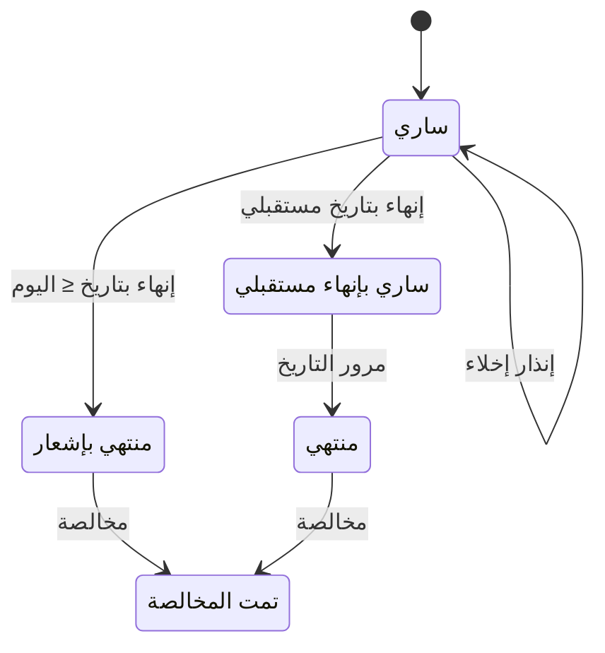

# إشعارات الإنهاء وإنذارات الإخلاء — شرح مفصّل

بتاريخ 2026-10-28 · من موك أب تطبيق «التأجير» (نسخة 26 أكتوبر)، شاشة `rem.notices` · المتطلبات M29 (الإخلاء)، M30 (الإنهاء) · القائمة: التأجير › الإيجار › إشعارات الإنهاء وإنذارات الإخلاء.

## ما هي الشاشة؟

شاشة لمستندين يصدران على عقد إيجار «ساري»، وكلاهما يُطبع ويُسلَّم للمستأجر:

- **إشعار إنهاء**: إبلاغ المستأجر بأن العقد ينتهي في تاريخ محدد قبل نهايته الأصلية. الإنهاء دائماً بتاريخ، بلا «نوع إنهاء» (قرار 11/10): تاريخ إشعار ثم تاريخ إنهاء (آخر الشهر أو تاريخ مبكر)، مع **غرامة إنهاء** اختيارية.
- **إنذار إخلاء**: تحذير للمستأجر المتأخر في السداد: ادفع خلال مهلة وإلا يُطلب منك الإخلاء. معه خيار «تحويل المستأجر للتحصيل القانوني».

**عقد الإيجار لا يُفسخ بغرامة**؛ الفسخ للبيع فقط، والإيجار يُنهى بإشعار من هنا. وتعرض الشاشة قائمة كل الإشعارات للطباعة.

## من أين تُفتح؟

من القائمة: التأجير › الإيجار › إشعارات الإنهاء وإنذارات الإخلاء، أو من زرّي «إشعار إنهاء» و«إنذار إخلاء» في [[شرح - عقود الإيجار|عقد الإيجار]] «ساري». بعد الإنهاء: [[شرح - المخالصات]].

## من يُسمح له؟

الحركتان لعقود «ساري» فقط. في المنتج يلزم صلاحية «تحويل للتحصيل القانوني»؛ غير مفروضة في الموك أب.

## نافذة «إشعار إنهاء»

| الحقل | النوع | الإلزام | الافتراضي | ملاحظات |
| --- | --- | --- | --- | --- |
| العقد | قائمة | إلزامي | — | عقود «ساري»؛ يظهر فقط عند الفتح من هذه الشاشة |
| تاريخ الإشعار | تاريخ | إلزامي | اليوم | |
| الإنهاء في آخر الشهر | مربع اختيار | اختياري | محدد | (i) محدد = آخر يوم في شهر الإشعار؛ غير محدد = تاريخ مبكر تختاره |
| تاريخ الإنهاء | تاريخ | شرطي | اليوم + شهر | إلزامي لو «آخر الشهر» غير محدد؛ معه يظهر للقراءة |
| غرامة الإنهاء (اختياري) | مبلغ | اختياري | 0 | (i) صفر = بدون غرامة |

الملخص: نهاية العقد الحالية، تاريخ الإنهاء (تحذير لو قبل النهاية)، السطور التي ستُلغى، والغرامة.

## نافذة «إنذار إخلاء»

| الحقل | النوع | الإلزام | الافتراضي | ملاحظات |
| --- | --- | --- | --- | --- |
| العقد | قائمة | إلزامي | — | عقود «ساري» |
| تاريخ الإنذار | تاريخ | إلزامي | اليوم | |
| مهلة السداد (يوم) | رقم صحيح | إلزامي | 15 | |
| تحويل المستأجر للتحصيل القانوني | مربع اختيار | اختياري | محدد | |
| أتعاب قانونية | مبلغ | شرطي | 2,500 | يظهر لو التحويل للقانوني محدد |

الملخص: عدد الأقساط المتأخرة، المبلغ المتأخر، وأقدم تأخير بالأيام. «تنفيذ وترحيل» معطّل في النافذتين حتى يُختار العقد.

## الحساب

- **تاريخ الإنهاء** = آخر يوم في شهر الإشعار، أو التاريخ المختار. يجب أن يكون ≥ تاريخ الإشعار، وإلا: «تاريخ الإنهاء لازم يكون بعد تاريخ الإشعار».
- **مبلغ الإنذار** = مجموع المتبقي على الأقساط المتأخرة بعد **أيام السماح** (أيام بعد الاستحقاق لا يُعد فيها القسط متأخراً؛ من الإعدادات، 5 أيام).
- **آخر موعد للسداد** = تاريخ الإنذار + المهلة. لا يُشترط وجود متأخرات لإصدار الإنذار.

## أعمدة القائمة

القائمة الأحدث أولاً: الرقم `NT-YYYY-####`، النوع (إشعار إنهاء / إنذار إخلاء، فلتر)، الإنهاء (آخر الشهر / بتاريخ محدد، للإنهاء فقط)، التاريخ، الفعالية / المهلة (تاريخ الإنهاء الفعلي أو آخر موعد للسداد)، العقد، المستأجر، العقار، المبلغ (غرامة الإنهاء أو المبلغ المتأخر). زرا «إشعار إنهاء» و«إنذار إخلاء» أعلاها يفتحان النافذتين، والضغط على صف يفتح معاينة الطباعة.

## الأزرار والإجراءات

### تنفيذ وترحيل (إنهاء)

| الشيء | بعد |
| --- | --- |
| سطور الجدول | تُلغى السطور النشطة غير المفوترة التي تستحق بعد تاريخ الإنهاء، عدا التأمين |
| الغرامة > 0 | سطر «غرامة» بملاحظة «غرامة إنهاء»، يستحق في تاريخ الإنهاء، بلا ضريبة |
| نهاية العقد | تُحفظ النهاية الأصلية؛ نهاية العقد ونهاية الإدارة = تاريخ الإنهاء |
| حالة العقد | تاريخ الإنهاء ≤ اليوم ← «منتهي بإشعار»؛ وإلا تبقى «ساري» حتى يمر التاريخ فتظهر «منتهي» |
| العقار | يبقى «مؤجر» حتى المخالصة |
| الإشعار والمستند | `NT-…` «مُرحّل» + مستند حركة «إشعار إنهاء» على العقد |

### تنفيذ وترحيل (إنذار)

| الشيء | بعد |
| --- | --- |
| الإنذار والمستند | `NT-…` «مُرحّل» + مستند حركة «إنذار إخلاء» على العقد |
| مع التحويل للقانوني | العقد والمستأجر يُعلَّمان «قانوني» (شارة على العقد، وحالة على العميل) |
| الأتعاب > 0 | سطر «رسوم» بضريبة النشاط التجاري، يستحق في تاريخ الإنذار|

شاشة «التحصيل القانوني» أُزيلت والمتابعة القانونية خارج الموديول؛ تبقى العلامة فقط.

### فتح صف (معاينة الطباعة)

الإنذار بنص «نظراً لتأخركم في سداد … نُنذركم بالسداد حتى …»، والإشعار بنص «نُشعركم بإنهاء عقد الإيجار … اعتباراً من …»، مع توقيع الشركة واستلام المستأجر.

## الحالات

المستند نفسه «مُرحّل» دائماً. أثره على العقد:

## القيود والمحاسبة

لا قيود عند التنفيذ. الشاشة تغيّر جدول الأقساط فقط (إلغاء سطور، إضافة غرامة أو رسوم)، وهذا ما يسميه الموك أب «تعديل العقد». السطور المضافة تُؤكد وتُفوتر لاحقاً من [[شرح - متابعة أقساط الإيجار]]: الغرامة بلا ضريبة وإيرادها إلى 4190 (إيرادات الغرامات)، والأتعاب القانونية بضريبة النشاط التجاري.

## أمثلة

- إشعار بتاريخ 12/10 مع «آخر الشهر» وغرامة 1,000 ← تاريخ الإنهاء 31/10، سطر غرامة 1,000 يستحق فيه، تُلغى سطور الإيجار غير المفوترة بعده، ونهاية العقد = 31/10.
- إلغاء «آخر الشهر» واختيار تاريخ قبل تاريخ الإشعار ← التنفيذ ممنوع برسالة.
- إنهاء بتاريخ اليوم ← العقد «منتهي بإشعار» ويظهر زر «مخالصة» في العقد.
- إنذار إخلاء مع التحويل للقانوني ← شارة «قانوني» على العقد وسطر أتعاب قانونية بضريبة.
- كل إشعار يظهر في القائمة وتفتح طباعته بالنص المناسب لنوعه.

## يعتمد على / يعتمد عليه

- يعتمد على: [[شرح - عقود الإيجار]] وجدول أقساطه (الطبقة الثانية؛ الإنهاء M30 أولوية H، الإخلاء M29 أولوية M).
- يعتمد عليه: [[شرح - المخالصات]] (بعد الإنهاء)، و[[شرح - متابعة أقساط الإيجار]] لفوترة الغرامة والأتعاب.

## الحالة

غير مبنية في الكلاود.

## أسئلة مفتوحة

- هل يُحسب إيجار جزئي لآخر فترة قبل تاريخ الإنهاء؟ حالياً السطر المستحق قبل التاريخ يبقى كاملاً.
- «آخر الشهر» = آخر يوم في شهر الإشعار أم آخر الشهر التالي (مهلة إشعار)؟
- تحويل الحالة إلى «منتهي بإشعار» عند حلول تاريخ مستقبلي (مهمة يومية؟).
- إرسال الإشعار للمستأجر (رسالة / منصة إيجار).
- بعد إزالة شاشة التحصيل القانوني: هل يبقى خيار «تحويل للتحصيل القانوني» في الإنذار كحالة على العقد فقط، أم يُزال هو أيضاً؟
