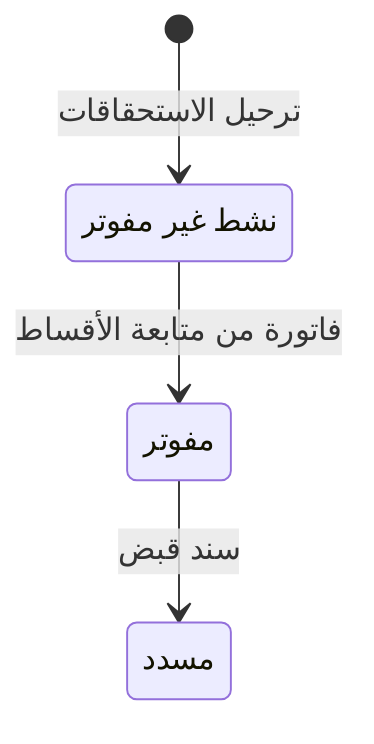

# استحقاقات المرافق — شرح مفصّل

بتاريخ 2026-10-28 · من موك أب تطبيق «التأجير» (نسخة 26 أكتوبر)، شاشة `rem.utilities` · المتطلبات M25، M24، CR 69446 (الأولوية H، تقدير 5 SP) · القائمة: التأجير › الإيجار › استحقاقات المرافق.

## ما هي الشاشة؟

**المرافق** هي الكهرباء والمياه والغاز. في بعض العقود يدفع المستأجر استهلاكه الفعلي حسب العداد. هذه الشاشة تسجل **قراءات العدادات** كل شهر، وتحسب الاستهلاك (الحالية − السابقة)، وتحوّله إلى مبلغ **مستحق** (أي مطلوب من المستأجر في تاريخ معين) يُضاف إلى جدول أقساط العقد.

لو تجاوز الاستهلاك **حد الاستهلاك** المحدد للعقار في العقد، يُسعّر ما فوق الحد بشريحة أعلى (× 1.5) (CR 69446).

## من أين تُفتح؟

- من القائمة: التأجير › الإيجار › استحقاقات المرافق.
- العدادات وحدودها تُعرَّف في تبويب «المرافق والعدادات» في [[شرح - عقود الإيجار]]: لكل عداد من يدفع، والطريقة (حسب العداد / مبلغ ثابت / ضمن الإيجار)، والحد.
- الاستحقاقات المرحّلة تُؤكَّد وتُفوتر من [[شرح - متابعة أقساط الإيجار]] (اجتماع 20/10).

## شكل الشاشة

قائمة القراءات المرحّلة مع إجمالي المبالغ، وزر «قراءات شهر جديد» يفتح نافذة جدول بسطر لكل عداد يُقرأ.

## أعمدة القائمة

| العمود | المعنى |
| --- | --- |
| الرقم | `UT-السنة-تسلسل` |
| الفترة | شهر/سنة |
| العقد / العقار | |
| العداد | كهرباء / مياه / غاز |
| السابقة / الحالية | القراءتان |
| الاستهلاك | الحالية − السابقة |
| الحد | حد الاستهلاك |
| تجاوز | «+ الزيادة عن الحد» عند التجاوز |
| المبلغ | مع إجمالي أسفل العمود |

## نافذة «قراءات العدادات – الشهر»

| الحقل | النوع | الإلزام | الافتراضي | ملاحظات |
| --- | --- | --- | --- | --- |
| الفترة | تلقائي | — | الشهر الحالي | في عنوان النافذة، لا تتغير |
| العقد | تلقائي | — | — | كل عقد ساري له سطر عداد «يدفع = المستأجر» و«الطريقة = حسب العداد»؛ سطر لكل عقد × عداد |
| العداد | تلقائي | — | — | كهرباء / مياه / غاز |
| السابقة | رقم | تلقائي | — | القراءة الحالية لآخر قراءة مرحّلة لنفس العقد والعداد؛ بدون قراءة سابقة يفترض البروتوتايب قيمة أولى |
| الحالية | رقم | إلزامي | — | يدخلها المستخدم (البروتوتايب يملؤها بقيمة تقديرية) |
| الاستهلاك | تلقائي | — | — | الحالية − السابقة؛ أحمر عند تجاوز الحد |
| الحد | تلقائي | — | — | من سطر العداد في العقد؛ «—» = بدون حد |
| المبلغ | تلقائي | — | — | حسب معادلة التسعير؛ يتحدث مع تغيير الحالية |

## أي العدادات تظهر؟

| العداد في العقد | يظهر هنا؟ | أين يُحمّل؟ |
| --- | --- | --- |
| يدفع المستأجر، حسب العداد | نعم | هنا شهرياً |
| يدفع المستأجر، مبلغ ثابت | لا | في جدول الإيجار عند اعتماد العقد |
| يدفع المالك | لا | لا يُحمّل على المستأجر |
| ضمن الإيجار | لا | لا يُحمّل |

## الحساب

- سعر الوحدة (ثابت في البروتوتايب): كهرباء 0.18، مياه 6.5، غاز 2.4.
- بدون تجاوز: المبلغ = الاستهلاك × السعر.
- إذا الحد > 0 والاستهلاك > الحد: المبلغ = الحد × السعر + (الاستهلاك − الحد) × السعر × 1.5.
- يُقرّب لخانتين عشريتين.
- الضريبة: الضريبة التجارية من الإعدادات (15%) تُضاف على سطر الاستحقاق.

## الأزرار والإجراءات

### قراءات شهر جديد
يفتح نافذة «قراءات العدادات – الشهر» بسطر لكل عداد يُقرأ. لو لا توجد عدادات: «لا توجد عدادات بالقراءة».

### ترحيل الاستحقاقات
لكل سطر في النافذة:

| الشيء | بعد |
| --- | --- |
| سجل القراءة | `UT-…` بالفترة والعقد والعداد والسابقة والحالية والاستهلاك والحد والمبلغ |
| جدول العقد | سطر استحقاق بسلسلة «مرافق استهلاك»، استحقاقه آخر يوم في شهر الفترة، بضريبة 15%، البيان «العداد + الشهر»، غير مفوتر |
| القيود | لا شيء |
| الرسالة | «تم ترحيل N استحقاق مرافق على حسابات المستأجرين» وتُغلق النافذة |

### إلغاء
يغلق النافذة بدون حفظ.

## الحالات

السجل يُنشأ مرحّلاً مباشرة. سطر الاستحقاق على العقد يمشي في دورة الأقساط العادية:

## القيود والمحاسبة

- الترحيل هنا **لا يرحّل قيداً**.
- الإيراد يُثبت عند فاتورة القسط: دائن **إيرادات خدمات ومرافق 4140**.
- في [[شرح - كشف حساب المالك]] تظهر المرافق المحصلة **كتمرير** (مبلغ يمر للمالك كما هو) ولا تدخل صافي المالك.
- المرافق غير المسددة تدخل خصم «أقساط ومرافق غير مسددة» في [[شرح - المخالصات]].

## أمثلة (من معايير القبول)

- كهرباء استهلاكها 1,650 وحدها 1,500 ← المبلغ = 1,500 × 0.18 + 150 × 0.18 × 1.5 = 270 + 40.50 = **310.50**، وعمود «تجاوز» يعرض «+150».
- عداد مياه بطريقة «مبلغ ثابت» أو يدفعه المالك ← لا يظهر في نافذة القراءات.
- بعد الترحيل ← يظهر في جدول العقد سطر «مرافق استهلاك» مستحق آخر الشهر بضريبة 15% وغير مفوتر.
- في الشهر التالي ← القراءة السابقة = القراءة الحالية المرحّلة لهذا الشهر.

## يعتمد على / يعتمد عليه

- **يعتمد على:** [[شرح - عقود الإيجار]] (شروط المرافق M24)، والفاتورة ([[شرح - متابعة أقساط الإيجار]]). ترتيب البناء: المرحلة 3.
- **يعتمد عليه:** [[شرح - المخالصات]]، [[شرح - كشف حساب المالك]].

## الحالة

غير مبنية في الكلاود بعد. موجودة في الموك أب فقط.

## أسئلة مفتوحة

- لا تحقق أن الحالية ≥ السابقة؛ الاستهلاك السالب ينتج مبلغاً سالباً.
- لا منع لترحيل الشهر نفسه للعداد نفسه مرتين.
- أسعار الوحدات ومعامل الشريحة 1.5 ثابتة في الكود؛ أين تُعرَّف (الإعدادات / لكل مشروع)؟
- القراءة الأولى: من قراءات فحص الاستلام ([[شرح - تسليم واستلام العقارات]]) أم إدخال يدوي؟
- الضريبة التجارية تُطبق على مرافق العقارات السكنية أيضاً؛ يلزم تأكيد.
- الفترة دائماً الشهر الحالي؛ لا يمكن إدخال شهر سابق متأخر.
