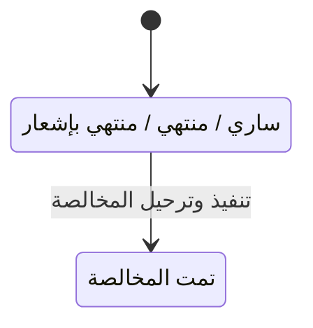

# المخالصات — شرح مفصّل

بتاريخ 2026-10-28 · من موك أب تطبيق «التأجير» (نسخة 26 أكتوبر)، شاشة `rem.clearance` · المتطلبات M31، M51 (الأولوية H، تقدير 8 SP) · القائمة: التأجير › الإيجار › المخالصات (وزر «مخالصة» في عقد الإيجار).

## ما هي الشاشة؟

**المخالصة** هي التسوية النهائية مع المستأجر عند نهاية الإيجار. عند بداية العقد يدفع المستأجر **تأميناً** (مبلغ تحتجزه الشركة ضماناً، ليس إيراداً). عند الخروج:

1. نفحص العقار (فحص خروج).
2. نخصم من التأمين ما على المستأجر: المتأخرات، الأضرار أو التأثيث الناقص، والتنظيف.
3. نرد له الباقي بطلب صرف.
4. نلغي الأقساط المستقبلية، ويعود العقار «متاح».

رقم المخالصة `CL-السنة-تسلسل`، وتُنشأ «مُرحّلة» مباشرة (لا مسودة).

## من أين تُفتح؟

- من القائمة: التأجير › الإيجار › المخالصات، زر «مخالصة نهائية».
- زر «مخالصة» في [[شرح - عقود الإيجار]] لعقد «ساري» أو «منتهي» أو «منتهي بإشعار». في هذه الحالة العقد معروف ولا يظهر حقل اختياره.

## شكل الشاشة

قائمة المخالصات (الأحدث أولاً). زر «مخالصة نهائية» يفتح النافذة: اختيار العقد ← ملخص (التأمين، الخصومات، يُرد / مستحق) ← الحقول وجدول الخصومات ← «تنفيذ وترحيل». الضغط على صف يفتح طباعة المخالصة.

## أعمدة القائمة

| العمود | المعنى |
| --- | --- |
| الرقم | `CL-YYYY-####` |
| التاريخ | تاريخ المخالصة |
| العقد / المستأجر / العقار | من العقد |
| التأمين | التأمين المحتجز |
| الخصومات | مجموع البنود |
| المرتجع / المستحق | التأمين − الخصومات |
| الحالة | مُرحّل |

## نافذة «مخالصة نهائية»

| الحقل | النوع | الإلزام | الافتراضي | ملاحظات |
| --- | --- | --- | --- | --- |
| العقد | قائمة | إلزامي | — | يظهر فقط عند الفتح من هذه الشاشة. عقود حالتها المحسوبة «ساري» أو «منتهي» أو «منتهي بإشعار»، وليست «تمت المخالصة» أو «مجدد» |
| تاريخ المخالصة | تاريخ | إلزامي | اليوم | |
| قراءة الكهرباء النهائية | رقم | اختياري | من محضر الخروج | |
| قراءة المياه النهائية | رقم | اختياري | من محضر الخروج | |
| الخصومات | جدول | إلزامي | — | ثلاثة بنود ثابتة بمبالغ قابلة للتعديل (أدناه) |

### بنود الخصومات

| البند | الافتراضي |
| --- | --- |
| أقساط ومرافق غير مسددة | متبقي السطور النشطة المستحقة حتى اليوم، عدا التأمين |
| تأثيث ناقص / تالف حسب فحص الخروج INS-… | مجموع «الخصم المقترح» في آخر تسليم معتمد للعقد؛ لو لا يوجد: «أضرار حسب فحص الخروج» = 0 |
| تنظيف | 600 |

الملخص أعلى النافذة يتحدث فوراً مع أي تعديل في المبالغ.

## الحساب

- **التأمين المحتجز** = المسدد على سطور التأمين + التأمين المرحّل من عقد سابق (عند التجديد، [[شرح - تجديد عقود الإيجار]]).
- **الصافي** = التأمين − مجموع الخصومات. موجب ← «يُرد للمستأجر»؛ سالب ← «مستحق على المستأجر».
- **المستخدم من التأمين** = الأقل من (التأمين، الخصومات).
- **جزء المتأخرات** = الأقل من (المستخدم، بند الأقساط غير المسددة).
- جزء المتأخرات يسدد السطور النشطة المستحقة حتى تاريخ المخالصة **بترتيب الاستحقاق**: السطر غير المفوتر يُفوتر أولاً، ثم يُعلَّم مسدداً من التأمين على الفاتورة والقسط (تسوية فواتير العملاء بوجهة «حساب» – D10).

## الأزرار والإجراءات

### مخالصة نهائية
يفتح النافذة مع العقود المؤهلة.

### تنفيذ وترحيل
معطل حتى اختيار العقد. ينفذ كل ما في القسم التالي.

### فتح صف (طباعة)
طباعة «مخالصة نهائية»: المستأجر، العقد والعقار، التأمين، كل خصم، الصافي، نص الإقرار، والتوقيعات.

## ما يحدث عند «تنفيذ وترحيل»

| الشيء | بعد |
| --- | --- |
| فحص الخروج | يُربط بآخر «تسليم مستأجر» معتمد بدون مخالصة (القراءات منه وملاحظة بعدد بنود التأثيث الناقصة / التالفة)؛ لو لا يوجد يُنشأ فحص خروج `INS-YYYY-####` بكل البنود «جيدة» مع ملاحظة تحذير (D42) |
| تنبيه المحضر | يختفي من [[شرح - تسليم واستلام العقارات]] |
| المتأخرات | تُسدد من التأمين بالترتيب (تُفوتر أولاً إن لزم) |
| الأقساط المستقبلية | تُلغى السطور النشطة غير المفوترة التي استحقاقها بعد تاريخ المخالصة |
| سجل المخالصة | `CL-YYYY-####` بالتأمين والخصومات والصافي، «مُرحّل» |
| القيد | `REM_Clearance` |
| الصافي > 0 | طلب صرف نوع 5 «مرتجع عميل عقاري» من حساب تأمينات المستأجرين (D24)، يُصرف بسند صرف من إدارة النقدية (D27) |
| الصافي < 0 | لا مطالبة في البروتوتايب |
| العقد | «تمت المخالصة» + مستند حركة «مخالصة» على العقد بمبلغ الصافي |
| العقار | «متاح» (كل العقارات لو العقد على أكثر من عقار) |
| منصة إيجار | لو العقد موثق في **منصة إيجار** (المنصة الحكومية السعودية لتوثيق عقود الإيجار) يُقفل فيها: «منتهي في إيجار» (D49) |

**عقد على أكثر من عقار:** تُربط كل محاضر التسليم المعتمدة للعقد وتُجمع خصوماتها في سطر التأثيث، ويُنشأ محضر خروج تلقائي للعقار الذي ليس له محضر، وتعود كل العقارات «متاح».

## الحالات

| الحالة | المعنى |
| --- | --- |
| مُرحّل | المخالصة الوحيدة الممكنة؛ تُنشأ مرحّلة مباشرة |

## القيود والمحاسبة

قيد `REM_Clearance` (مخالصة وتسوية التأمين):

| الطرف | الحساب | المبلغ |
| --- | --- | --- |
| مدين | تأمينات المستأجرين 2320 (المستأجر طرف في السطر) | المستخدم من التأمين |
| دائن | حساب العميل 1210 | المتأخرات المسوّاة فعلاً |
| دائن | إيرادات خدمات ومرافق 4140 | الباقي: الأضرار والتنظيف وأي جزء لم يُوزع |

القيد متوازن. المرتجع للمستأجر لا يدخل هذا القيد؛ يبقى في 2320 حتى يُصرف بطلب الصرف وسند الصرف. لا مفهوم «تأمين» في إدارة النقدية، لذلك حساب فرعي واحد لتأمينات المستأجرين يُختار في الضبط العام، والمستأجر طرف في سطر القيد.

## أمثلة (من معايير القبول)

- تأمين 10,000، متأخرات 3,000، تنظيف 600 ← تُسدد المتأخرات من التأمين، ويُرد 6,400 بطلب صرف، والعقد «تمت المخالصة» والعقار «متاح». القيد: مدين 2320 بـ 3,600 / دائن 1210 بـ 3,000 / دائن 4140 بـ 600.
- تعديل مبلغ «أضرار حسب فحص الخروج» ← تتحدث الخصومات والصافي فوراً في الملخص.
- العقود المجددة أو التي تمت مخالصتها لا تظهر في قائمة اختيار العقد.
- قيد `REM_Clearance` متوازن، ويظهر فحص خروج للعقار في شاشة تسليم واستلام العقارات.
- تسليم معتمد فيه بند تأثيث ناقص بخصم 2,500 ← المخالصة تعرض سطر التأثيث 2,500 وتُربط بالمحضر ولا تنشئ محضراً جديداً، ويختفي تنبيه المحضر.

## يعتمد على / يعتمد عليه

- **يعتمد على:** العقد والتأمين ([[شرح - عقود الإيجار]])، المرافق ([[شرح - استحقاقات المرافق]])، المخالفات ([[شرح - سجل المخالفات]])، التسليم ([[شرح - تسليم واستلام العقارات]])، الإنهاء ([[شرح - إشعارات الإنهاء وإنذارات الإخلاء]])، وفوترة الأقساط ([[شرح - متابعة أقساط الإيجار]]). ترتيب البناء: المرحلة 4.
- **يعتمد عليه:** [[شرح - لوحة العقارات الشاغرة]] (العقار يعود «متاح»)، [[شرح - عقود الملاك نهاية الإدارة وإيقاف الإيجار]] (التأمين يُسلّم للمالك عبر المخالصة)، [[شرح - مدفوعات منصة إيجار]].

## الحالة

غير مبنية في الكلاود بعد. موجودة في الموك أب فقط.

## أسئلة مفتوحة

- العقود «قاربت على الانتهاء» لا تظهر في قائمة المخالصة (الأهلية تقرأ الحالة المحسوبة) بينما زر المخالصة يظهر في العقد الساري.
- الصافي السالب: كيف يُطالَب المستأجر (فاتورة بيع بالرسوم – D09)؟
- قراءات العدادات النهائية لا تُحتسب كاستهلاك مرافق.
- الأضرار والتنظيف تُقيد إيراداً مباشرة بدون فاتورة بيع ولا ضريبة.
- هل تُمنع المخالصة حتى يُعمل «تسليم مستأجر» معتمد؟
