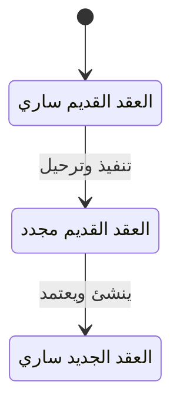

# تجديد عقود الإيجار — شرح مفصّل

بتاريخ 2026-10-28 · من موك أب تطبيق «التأجير» (نسخة 26 أكتوبر)، شاشة `rem.renewals` · المتطلبات M28 · القائمة: التأجير › الإيجار › تجديد عقود الإيجار.

## ما هي الشاشة؟

**التجديد** يعني أن المستأجر يبقى في نفس العقار بعد انتهاء عقده بعقد جديد. هنا لا نعدّل العقد القديم؛ ننشئ عقداً جديداً يبدأ من اليوم التالي لنهاية القديم، بإيجار = إيجار السنة الأخيرة مع **نسبة الزيادة**، وننقل إليه **التأمين** (مبلغ الضمان المحتجز لدى الشركة) دون أن يدفعه المستأجر مرة أخرى.

العقد القديم يصبح «مجدد»، والعقد الجديد يُعتمد فوراً. كل تجديد يترك **مستند** «تجديد» يظهر في هذه الشاشة وفي «حركات العقد» للعقد القديم.

## من أين تُفتح؟

- القائمة: التأجير › الإيجار › تجديد عقود الإيجار.
- زر «تجديد» في [[شرح - عقود الإيجار|عقد الإيجار]] «ساري».
- النتيجة: العقد الجديد يظهر في عقود الإيجار، والمستند في «حركات العقد» للعقد القديم.

## شكل الشاشة

قائمة مستندات التجديد مع بحث وتصدير. زر «تجديد عقد الإيجار» يفتح النافذة: اختيار العقد ← ملخص (الإيجار الحالي، الإيجار الجديد، التأمين المرحّل) والحقول ← «تنفيذ وترحيل».

## نافذة «تجديد عقد الإيجار»

| الحقل | النوع | الإلزام | الافتراضي | ملاحظات |
| --- | --- | --- | --- | --- |
| العقد | قائمة | إلزامي | — | عقود الإيجار «ساري» (بما فيها القاربة على الانتهاء والمنتهية تاريخياً)؛ يظهر فقط عند الفتح من هذه الشاشة |
| بداية العقد الجديد | تاريخ | إلزامي | نهاية العقد الحالي + يوم | |
| المدة (سنة) | رقم | إلزامي | 1 | |
| الزيادة % | نسبة % | اختياري | نسبة زيادة العقد إن كانت من نوع «نسبة»، وإلا 5 | |
| الدورية | قائمة | إلزامي | دورية العقد الحالي | شهري / ربع سنوي / نصف سنوي / سنوي |

عند الفتح من زر «تجديد» في العقد يكون العقد معروفاً فلا يظهر الحقل. «تنفيذ وترحيل» معطّل حتى يُختار العقد.

## الحساب

- **الإيجار الحالي** = إيجار آخر سنة في العقد، بعد الزيادات السنوية والتعديلات اليدوية.
- **الإيجار الجديد** = الحالي × (1 + الزيادة ÷ 100)، مقرباً لخانتين.
- **النهاية الجديدة** = البداية + المدة − يوم.
- **التأمين المرحّل** = تأمين العقد القديم، ينتقل كما هو.

## أعمدة القائمة

| العمود | ماذا يعرض |
| --- | --- |
| المستند | `DOC-YYYY-####` |
| النوع | تجديد |
| التاريخ | يوم التنفيذ |
| العقد | العقد القديم |
| العقار | |
| البيان | «تجديد إلى العقد LS-… بإيجار …» |
| المبلغ | الإيجار الجديد |
| الحالة | مُرحّل |

فتح صف يعرض نافذة تفاصيل المستند.

## ما يحدث عند «تنفيذ وترحيل»

| الشيء | بعد |
| --- | --- |
| عقد جديد | نسخة من القديم: رقم `LS` جديد بسنة البداية، تاريخ العقد = اليوم، البداية والمدة والإيجار والدورية الجديدة، مرتبط بالعقد السابق، بلا تعديلات إيجار يدوية |
| تأمين العقد الجديد | 0، مع ترحيل تأمين القديم؛ لا سطر تأمين في الجدول |
| اعتماد العقد الجديد | فوري: جدول الإيجار يُولَّد، العقار «مؤجر»، وعمولة الوسيط إن وُجد |
| العقد القديم | «مجدد»؛ أقساطه المتبقية لا تُلغى |
| المستند | «تجديد» مُرحّل مباشرة على العقد القديم، بمبلغ الإيجار الجديد ومرجع العقد الجديد |

التأمين المرحّل يدخل في «التأمين المحتجز» عند [[شرح - المخالصات|مخالصة]] العقد الجديد. العقد «مجدد» لا يظهر بعدها في قائمة التجديد ولا في المخالصة.

## الحالات

المستند نفسه حالة واحدة: «مُرحّل».

## القيود والمحاسبة

الشاشة لا تنشئ قيداً خاصاً بها. القيد الوحيد المرتبط هو قيد اعتماد العقد الجديد في السياسة التلقائية (إثبات إيراد العقد مقدماً لوحدات الشركة)، وهو نفس قيد الاعتماد في [[شرح - عقود الإيجار]]. في السياسة اليدوية (الافتراضية) يُثبت الإيراد مع فاتورة كل قسط من [[شرح - متابعة أقساط الإيجار]]. التأمين ينتقل على الورق بين العقدين؛ يبقى في نفس حساب تأمينات المستأجر.

## أمثلة

- عقد إيجاره السنوي 100,000 وزيادة 5% ← عقد جديد بإيجار 105,000 يبدأ من اليوم التالي لنهاية القديم، والقديم «مجدد».
- العقد الجديد بلا سطر تأمين، ومخالصته تعرض التأمين المرحّل.
- العقد المجدد لا يظهر في قائمة التجديد ولا المخالصة.

## يعتمد على / يعتمد عليه

- يعتمد على: [[شرح - عقود الإيجار]] (الطبقة الثانية، أولوية H، 5 نقاط M28).
- يعتمد عليه: [[شرح - المخالصات]] (التأمين المرحّل).
- قريب منه: [[شرح - إشعارات الإنهاء وإنذارات الإخلاء]] (الطريق الآخر لنهاية العقد)، و[[شرح - تحديث أسعار الإيجار]].

## الحالة

غير مبنية في الكلاود.

## أسئلة مفتوحة

- حقل «تجديد تلقائي» في العقد غير منفذ كمهمة.
- يمكن تجديد عقد عليه إشعار إنهاء بتاريخ مستقبلي — هل يُمنع؟
- التجديد قبل نهاية العقد لا يلغي أقساط القديم بعد بداية الجديد (تداخل).
- الزيادة من نوع «قيمة» تُستبدل بـ 5% افتراضياً.
- عمولة الوسيط تُستحق مرة أخرى عند التجديد — مقصود؟
