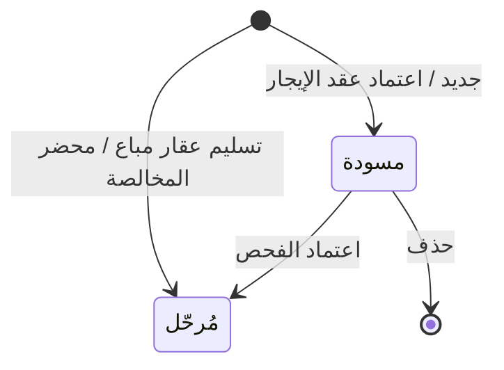

# تسليم واستلام العقارات — شرح مفصّل

بتاريخ 2026-10-28 · من موك أب تطبيق «التأجير» (نسخة 26 أكتوبر)، شاشة `rent.handover` · المتطلبات: شاشة جديدة (قرار اجتماع 11/10)، الأولوية M، الموديول المرجعي S19 · القائمة: التأجير › الإيجار › تسليم واستلام العقارات.

## ما هي الشاشة؟

شاشة «محاضر الفحص». المحضر ورقة تثبت حالة العقار في لحظة معينة، ويوقّعها الطرفان حتى لا يختلفا لاحقاً. لها ثلاث مناسبات:

- **استلام مستأجر (Move-in):** عند دخول المستأجر العقار في بداية عقد الإيجار.
- **تسليم مستأجر (Move-out):** عند خروج المستأجر وإعادة العقار للشركة.
- **تسليم عقار مباع:** عند تسليم وحدة مباعة لمشتريها.

في كل محضر: قائمة فحص من 8 بنود ثابتة، وبنود **التأثيث** (الأثاث والأجهزة المسجلة على العقار) بحالة موجود / ناقص / تالف، وقراءتا عدادي الكهرباء والمياه. في محضر الخروج، أي بند تأثيث ناقص أو تالف يُطلق **تنبيهاً** يبقى ظاهراً حتى تُعمل **المخالصة** (التسوية النهائية مع المستأجر)، و«الخصم المقترح» على البند ينتقل إليها تلقائياً.

رقم المحضر `INS-السنة-تسلسل`. المحضر **لا يرحّل قيوداً** ولا يغيّر حالة العقار؛ المال يُحاسب في [[شرح - المخالصات]].

## من أين تُفتح؟

- من القائمة: التأجير › الإيجار › تسليم واستلام العقارات.
- **تلقائياً عند اعتماد عقد الإيجار:** يُنشأ محضر «استلام مستأجر» بحالة مسودة، مربوط بالعقد ومعه بنود تأثيث العقار ([[شرح - عقود الإيجار]]). رسالة الاعتماد تقول: «تم اعتماد العقد، توليد جدول الإيجار، وإنشاء فحص استلام».
- **تلقائياً من تسليم العقار المباع:** «إجراءات العقود › تسليم العقارات المباعة» في تطبيق المبيعات تنشئ محضر «تسليم عقار مباع» معتمداً.
- **من المخالصة:** المخالصة تستخدم آخر «تسليم مستأجر» معتمد للعقد، أو تنشئ واحداً بدون ملاحظات لو لم يوجد.

## شكل الشاشة

1. **تنبيهات أعلى القائمة:** صف لكل محضر خروج معتمد فيه تأثيث ناقص أو تالف ولم تُعمل له مخالصة بعد، مثل: «تنبيه: فحص الخروج INS-… للعقار … فيه N بند تأثيث ناقص / تالف (خصم مقترح …) – لسه مفيش مخالصة».
2. **قائمة المحاضر.**
3. **نموذج الفحص:** في أعلاه ملاحظة القرار Q8، ثم الحقول، ثم تبويبا «قائمة الفحص» و«بنود التأثيث».

## أعمدة القائمة

| العمود | المعنى |
| --- | --- |
| الرقم | `INS-السنة-تسلسل` |
| النوع | استلام مستأجر / تسليم مستأجر / تسليم عقار مباع |
| التاريخ | تاريخ الفحص |
| العقار | العقار المفحوص |
| العقد / المستند | عقد الإيجار، أو رقم عقد البيع |
| ملاحظات الفحص | عدد بنود قائمة الفحص بحالة غير «جيدة» |
| تأثيث ناقص / تالف | عدد بنود التأثيث غير «موجود» |
| الحالة | مسودة / مُرحّل |

## حقول المحضر

| الحقل | النوع | الإلزام | الافتراضي | ملاحظات |
| --- | --- | --- | --- | --- |
| الرقم | تلقائي | — | — | `INS-السنة-تسلسل`، يُولّد عند أول حفظ |
| النوع | قائمة | إلزامي | استلام مستأجر | تغييره إلى «تسليم عقار مباع» يمسح العقد |
| التاريخ | تاريخ | إلزامي | اليوم | |
| عقد الإيجار | قائمة | إلزامي للاستلام والتسليم | — | الاستلام: العقود السارية. التسليم: السارية أو المنتهية بدون مخالصة ولا تجديد. القائمة تعرض «رقم العقد · المستأجر · العقار». اختياره يملأ العقار والرقم وبنود التأثيث |
| العقار | قائمة / قراءة فقط | إلزامي | من العقد | للقراءة فقط إذا كان العقد على عقار واحد. لو العقد على أكثر من عقار تختار منها (محضر لكل عقار) ويُحمّل تأثيث العقار المختار. قابل للاختيار في تسليم العقار المباع |
| المرجع | نص | — | — | يظهر لتسليم العقار المباع فقط (رقم عقد البيع) |
| الفاحص | قائمة | — | المستخدم الحالي | |
| قراءة الكهرباء | رقم | اختياري | — | قراءة العداد يوم الفحص؛ تُنقل للمخالصة |
| قراءة المياه | رقم | اختياري | — | قراءة العداد يوم الفحص؛ تُنقل للمخالصة |

## التبويبات

### قائمة الفحص

| الحقل | النوع | الإلزام | الافتراضي | ملاحظات |
| --- | --- | --- | --- | --- |
| البند | تلقائي | — | — | 8 بنود ثابتة: المطبخ، دورات المياه، الأرضيات، الدهانات، التكييف، الأبواب والنوافذ، الكهرباء، السباكة |
| الحالة | قائمة | إلزامي | جيدة | جيدة / مقبولة / تالفة / مفقودة |
| ملاحظة | نص | اختياري | — | |
| صور | مرفق | اختياري | — | زر الكاميرا يضيف صورة ويعرض العدد (محاكاة في الموك أب) |

### بنود التأثيث

كل بنود التأثيث المرتبطة بالعقار (من شاشة التأثيث). هي للمعلومة؛ قيمة الأصل الثابت للعقار تشمل تأثيثه.

| الحقل | النوع | الإلزام | الافتراضي | ملاحظات |
| --- | --- | --- | --- | --- |
| البند / الكمية | تلقائي | — | — | من تأثيث العقار |
| الحالة | قائمة | إلزامي | موجود | موجود / ناقص / تالف |
| ملاحظة | نص | اختياري | — | |
| خصم مقترح | مبلغ | اختياري | 0 | في التسليم (Move-out) فقط، ومتاح للبند الناقص أو التالف؛ يتصفّر للبند «موجود» عند الاعتماد. العمود لا يظهر في الاستلام |

## الأزرار والإجراءات

### جديد
يفتح نموذجاً: النوع «استلام مستأجر»، التاريخ اليوم، الحالة مسودة، والبنود الثمانية «جيدة».

### اختيار عقد الإيجار
يملأ العقار ورقم العقد، ويحمّل بنود تأثيث العقار بحالة «موجود».

### حفظ
يتحقق من الحقول الإلزامية، يولّد الرقم أول مرة، ويحفظ. عند الحفظ مع عقد إيجار يُؤخذ العقار ورقم العقد من العقد.

### حذف
للمحضر المسودة فقط، بعد رسالة تأكيد.

### اعتماد الفحص
يظهر فقط لمحضر محفوظ بحالة مسودة. يحفظ مع التحقق، يجعل الحالة «مُرحّل»، يكتب حدث «فحص» في تاريخ العقار، ويطلق التنبيه لو كان تسليماً فيه تأثيث ناقص أو تالف. المحضر المعتمد مقفول لا يُعدّل.

### صورة (لكل بند)
يزيد عدد صور البند بواحد (محاكاة).

## الحالات

| الحالة | المعنى | ما المسموح |
| --- | --- | --- |
| مسودة | محضر محفوظ لم يُعتمد | تعديل، حذف، اعتماد |
| مُرحّل | محضر معتمد | قراءة فقط |

## ما يحدث عند «اعتماد الفحص»

| الشيء | بعد |
| --- | --- |
| المحضر | «مُرحّل» ومقفول |
| تاريخ العقار | حدث «فحص» |
| الخصم المقترح | يتصفّر للبنود «موجود» |
| تسليم فيه تأثيث ناقص / تالف | رسالة «تم اعتماد الفحص – تنبيه: N بند تأثيث ناقص / تالف، والخصم المقترح هيظهر في المخالصة» + حدث «تنبيه» في تاريخ العقار + تنبيه أعلى قائمة المحاضر |
| حالة العقار | لا تتغير (تتغير في المخالصة) |
| القيود | لا شيء |

## العلاقة مع المخالصة

- المخالصة تربط **آخر تسليم معتمد بدون مخالصة** للعقد.
- يظهر فيها سطر «تأثيث ناقص / تالف حسب فحص الخروج INS-…» = مجموع الخصم المقترح (قابل للتعديل)، وتُنقل قراءات العدادات من المحضر.
- لا تنشئ المخالصة محضر خروج جديداً لو وُجد واحد معتمد.
- بعد تنفيذ المخالصة يختفي التنبيه.
- العقد على أكثر من عقار: المخالصة تربط كل محاضر التسليم المعتمدة وتنشئ محضر خروج تلقائياً للعقار الذي ليس له محضر.

## القيود والمحاسبة

المحضر لا يُنشئ قيوداً. الخصومات تُرحّل في قيد المخالصة `REM_Clearance` (انظر [[شرح - المخالصات]]).

## لماذا قائمة الفحص داخل الموديول؟ (القرار Q8 / D42)

«فحص الجودة» في AccFlex (Quality 1_2، جدول `Lgx_QualityCheck`) يتطلب صنفاً مخزنياً (MaterialId) ولا يدعم قائمة من بنود متعددة. لذلك القائمة مملوكة لموديول الأملاك وليست مأخوذة من الجودة.

## أمثلة (من معايير القبول)

- اعتماد عقد إيجار ← يظهر محضر «استلام مستأجر» مسودة مربوط بالعقد وفيه بنود تأثيث العقار.
- تسليم مستأجر فيه بند «ناقص» بخصم 2,500 ← بعد الاعتماد يظهر تنبيه أعلى القائمة، ومخالصة العقد تعرض سطر تأثيث 2,500 مربوطاً بالمحضر.
- بعد تنفيذ المخالصة يختفي التنبيه ولا يُنشأ محضر خروج ثانٍ.
- محاولة حفظ استلام أو تسليم بدون عقد إيجار ← مرفوضة.
- محضر استلام ← عمود «الخصم المقترح» غير ظاهر.

## يعتمد على / يعتمد عليه

- **يعتمد على:** [[شرح - عقود الإيجار]] (العقد وتأثيث العقار)، وتسليم العقارات المباعة في المبيعات. ترتيب البناء: المرحلة 3 (بعد العقد ومتابعة الأقساط).
- **يعتمد عليه:** [[شرح - المخالصات]] (الخصم المقترح والقراءات والتنبيه)، و[[شرح - استحقاقات المرافق]] (سؤال مفتوح: هل القراءة الأولى من فحص الاستلام؟).

## الحالة

غير مبنية في الكلاود بعد (لا عقد إيجار في الكلاود). موجودة في الموك أب فقط.

## أسئلة مفتوحة

- هل يُحسب الخصم المقترح من قيمة استبدال معرّفة على بند التأثيث بدل إدخاله يدوياً؟
- هل يُرسل التنبيه كإشعار لمستخدم أو دور معين (مدير الأملاك)؟
- بنود القائمة الثمانية ثابتة؛ هل نحتاج قوائم فحص حسب نوع العقار؟
