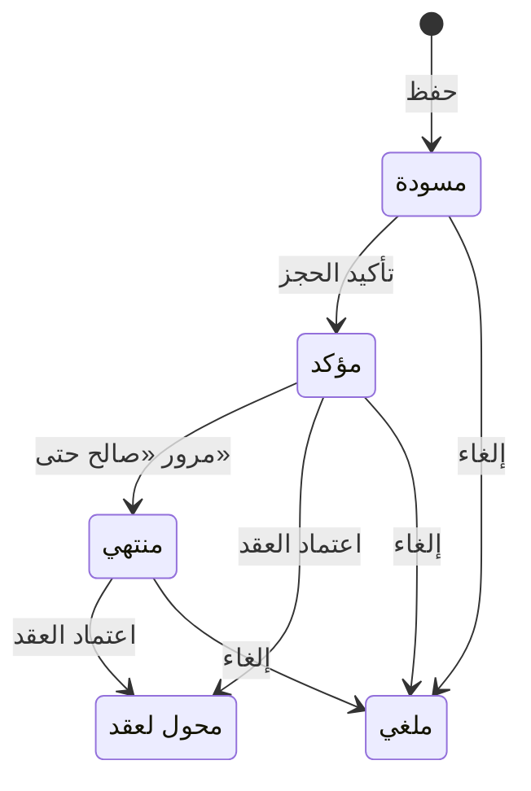

# حجوزات الإيجار — شرح مفصّل

بتاريخ 2026-10-28 · من موك أب تطبيق «التأجير» (نسخة 26 أكتوبر)، شاشة `rent.reservations` · المتطلبات M20 · القائمة: التأجير › الحجز › حجوزات الإيجار.

## ما هي الشاشة؟

**الحجز** ورقة تسجّل أن مستأجراً اتفق مع الشركة على عقار معيّن، بإيجار سنوي متفق عليه وتاريخ بداية متوقع، قبل توقيع العقد (قرار اجتماع 11/10). يدفع المستأجر **عربون حجز**: مبلغ صغير يثبت جديته، والعقار يُغلق في وجه غيره حتى يتحول الحجز لعقد أو يُلغى.

الدورة: نحفظ الحجز مسودة ← نؤكده فيصبح العقار «محجوز» وتصدر فاتورة بالعربون ← نحصّل العربون ← نحوّله لعقد إيجار مملوء مسبقاً ← عند اعتماد العقد يصبح العربون المحصّل جزءاً من **التأمين** (مبلغ يحتفظ به المؤجر ضماناً ويرده في آخر الإقامة).

بدون هذه الشاشة قد تُوعد نفس الشقة لشخصين ويضيع الاتفاق خارج النظام. توأمها في المبيعات العقارية: حجوزات البيع (`rem.reservations`)، ونافذة الإلغاء مشتركة بينهما (قرار 26/10).

## من أين تُفتح؟

من القائمة: التأجير › الحجز › حجوزات الإيجار. الخطوة التالية زر «تحويل لعقد إيجار» يفتح [[شرح - عقود الإيجار]]. فواتير الحجز تظهر في شاشة الفواتير الإلكترونية برابط للحجز وعلامة «عربون حجز».

## الحقول

مجموعة «الحجز»:

| الحقل | النوع | الإلزام | الافتراضي | ملاحظات |
| --- | --- | --- | --- | --- |
| الرقم | تلقائي | تلقائي | — | `RR-السنة-تسلسل` عند أول حفظ |
| التاريخ | تاريخ | إلزامي | اليوم | |
| صالح حتى | تاريخ | إلزامي | اليوم + «صلاحية الحجز» من الضبط العام (14) | بعده يظهر الحجز «منتهي» |
| الحالة | تلقائي | تلقائي | مسودة | مسودة / مؤكد / محول لعقد / ملغي؛ بجانبها للملغي: السبب والمصادَر والمردود |
| المستأجر | قائمة | إلزامي | — | من العملاء؛ زر «+ عميل جديد» (قرار 15/10) |
| المشروع | قائمة | إلزامي | — | مشاريع الإيجار بلا مشاريع فرعية، بصيغة «الرئيسي › الفرعي»؛ للتصفية فقط ولا يُحفظ؛ تغييره يمسح العقار |
| العقار | قائمة | إلزامي | — | عقارات المشروع «متاح» ونوعها إيجار؛ يملأ الإيجار السنوي والعربون |
| ملاحظات | نص | اختياري | — | |

زر «+ عميل جديد» يفتح نافذة قصيرة تنشئ عميلاً في شاشة العملاء (بدون «أنشطة العميل»، قرار 18/10) بمجموعة «عملاء عقاريون» وتصنيف «مستأجر» ويختاره. نفس قواعد شاشة العملاء: الاسم والجوال إلزاميان، الجوال غير مكرر، والعميل B2B يحتاج سجلاً تجارياً.

مجموعة «الإيجار المتفق عليه والعربون»:

| الحقل | النوع | الإلزام | الافتراضي | ملاحظات |
| --- | --- | --- | --- | --- |
| بداية الإيجار المتوقعة | تاريخ | إلزامي | اليوم + 15 | |
| المدة (سنة) | رقم | إلزامي | 1 | |
| الإيجار السنوي | مبلغ | إلزامي | سعر إيجار العقار | التلميح يعرض سعر العقار؛ تغييره يعيد حساب العربون |
| عربون الحجز | مبلغ | إلزامي | الإيجار × «عربون الحجز %» من الضبط العام (5%) | (i) يتحول للتأمين عند اعتماد العقد |
| طريقة السداد | قائمة | إلزامي | تحويل بنكي | من طرق السداد |

النموذج قابل للتعديل والحذف في «مسودة» فقط؛ بعد التأكيد يصبح للقراءة.

## أعمدة القائمة

الرقم، التاريخ، المستأجر، العقار، بداية الإيجار المتوقعة، الإيجار السنوي، عربون الحجز، المحصل، ينتهي («صالح حتى»)، عقد الإيجار (بعد التحويل)، الحالة (فلتر). المؤكد المنتهي بلون تحذير؛ فتح صف يفتح النموذج: بطاقة العقار، المجموعتان، وتبويب «الفاتورة والتحصيل» بعد الحفظ.

## الأزرار والإجراءات

### حفظ

يحفظ المسودة ويولّد الرقم.

### تأكيد الحجز (مسودة)

مرفوض لو العقار ليس «متاح»: «العقار غير متاح». عند النجاح:
- الحالة «مؤكد».
- تُفتح للمستأجر حساباته الفرعية (D31).
- العقار «محجوز» مع سجل في تاريخه.
- **فاتورة دفعة مقدمة** بالعربون: فاتورة تطالب بمبلغ قبل تقديم الخدمة. ضريبتها 0% بفئة O (خارج النطاق) لأن العربون سيصبح تأميناً مسترداً، وفاتورتها الإلكترونية من النوع 386 (D05).
- قيد الفاتورة (انظر القيود).

الرسالة: «تم تأكيد الحجز وحجز العقار، وإنشاء فاتورة العربون».

### تحصيل العربون (مؤكد والمحصل < العربون)

ينشئ **سند قبض** (مستند يثبت استلام المال) على فاتورة العربون بالمتبقي، بنوع كيان «عربون حجز» (D23)، ويحدّث «المحصل» في الحجز.

### تحويل لعقد إيجار (مؤكد)

يفتح عقد إيجار جديداً مملوءاً: المستأجر، العقار وبياناته، البداية، المدة، الإيجار المتفق عليه، التأمين = الإيجار ÷ 12، ورابط الحجز والعربون المحصّل. اعتماد العقد مسموح والعقار «محجوز» بنفس الحجز.

### إلغاء الحجز (مسودة / مؤكد)

نافذة الإلغاء (قرار 26/10، للبيع والإيجار):

| الحقل | النوع | الإلزام | الافتراضي | ملاحظات |
| --- | --- | --- | --- | --- |
| سبب الإلغاء | اختيار | إلزامي | — | من المستأجر / من الشركة |
| العربون | اختيار | إلزامي | من المستأجر ← مصادرة؛ من الشركة ← رد كامل | مصادرة / رد كامل / رد جزئي |
| مبلغ الرد | مبلغ | شرطي | — | للرد الجزئي؛ أقل من المحصّل |

- **المصادرة**: الشركة تحتفظ بالعربون إيراداً. سندها المادة 44 من نظام المعاملات المدنية السعودي والمادة 103 من القانون المدني المصري.
- **الرد**: يُنشأ طلب صرف نوع 5 «مرتجع عميل عقاري» (D24) يُدفع من إدارة النقدية.
- الجزء غير المحصّل من فاتورة العربون يُلغى بإشعار دائن (D09).
- العقار يعود «متاح».
- السبب والمصادَر والمردود يُسجَّلون على الحجز ويظهرون بجانب الحالة.
- مصر: لو الشركة هي من رجعت في الحجز، القانون يلزمها برد ضعف العربون إلا باتفاق مختلف؛ لذلك يجب أن يكون بند «الرد بنفس المبلغ» في شروط الحجز.

**تبويب «الفاتورة والتحصيل»:** جدولان: الفواتير (الرقم، الإجمالي، المسدد) وسندات القبض (الرقم، المبلغ)؛ كل صف يفتح مستنده. ملاحظة أعلى التبويب تشرح قيد التأكيد وقيد التحويل للتأمين.

## الحالات

| الحالة | متى |
| --- | --- |
| مسودة | بعد الحفظ؛ قابل للتعديل والحذف |
| مؤكد | بعد «تأكيد الحجز»؛ العقار «محجوز» |
| منتهي | محسوبة: مؤكد بعد «صالح حتى» |
| محول لعقد | عند اعتماد عقد الإيجار الناتج |
| ملغي | بعد نافذة الإلغاء |

«منتهي» (قرار 26/10) لا تحتاج مهمة خلفية: تظهر في القائمة والنموذج مع رسالة «انتهت صلاحية الحجز – حوّله لعقد أو ألغه لتحرير العقار». العقار يبقى «محجوز» حتى يقرر المستخدم؛ لا تحرير تلقائي، لأن العميل دفع عربوناً، وتحرير العقار وحده يُعد رجوعاً من الشركة.

## ما يحدث عند اعتماد عقد الإيجار الناتج

| الشيء | بعد |
| --- | --- |
| سطر التأمين في الجدول | التأمين − العربون المحصّل (لا سطر إن غطّاه العربون) |
| التأمين المرحّل على العقد | يزيد بالعربون (حتى قيمة التأمين) |
| زيادة العربون عن التأمين | تبقى دفعة مقدمة للمستأجر وتُسوّى مع أول فاتورة إيجار |
| دفعات الإيجار | كما في العقد وجدول منصة إيجار، دون خصم (قرار 26/10) |
| الحجز | «محول لعقد» برقم العقد |

العربون يُخصم من التأمين لا من أول دفعة إيجار (قرار 26/10).

## القيود والمحاسبة

- **التأكيد** — `InvoiceJournal`: مدين حساب العميل (1210) / دائن الدفعات المقدمة للعميل (2330) بالعربون.
- **التحصيل** — سند قبض على الفاتورة يخفض حساب العميل.
- **اعتماد العقد** — `CustomerInvoiceSettlement` (D10): مدين الدفعات المقدمة (2330) / دائن تأمينات المستأجرين (2320، المستأجر طرف) بالعربون المحوَّل. حساب تأمينات فرعي واحد للمستأجر (D29).
- **الإلغاء بالمصادرة** — مدين الدفعات المقدمة للعميل / دائن «إيرادات دفعات حجز مصادرة» (4195، من الإعدادات العامة › الحسابات).
- **الإلغاء بالرد** — مدين الدفعات المقدمة / دائن مرتجعات عملاء مستحقة + طلب صرف «مرتجع عميل عقاري».

## أمثلة

- عقار إيجاره 120,000 وعربون 5% ← تأكيد: العقار «محجوز» وفاتورة دفعة مقدمة 6,000.
- بعد التحصيل والتحويل واعتماد العقد بتأمين 10,000 ← سطر تأمين 4,000، قيد تحويل 6,000 للتأمين، والحجز «محول لعقد».
- إلغاء حجز مؤكد ← العقار يعود «متاح».
- عربون محصّل 6,000: إلغاء «من المستأجر» ← مصادرة 6,000 لإيرادات دفعات حجز مصادرة؛ «من الشركة» ← طلب صرف «مرتجع عميل عقاري» 6,000.
- عربون 12,000 وتأمين 10,000 ← لا سطر تأمين، التأمين المرحّل 10,000، و2,000 تبقى دفعة مقدمة للمستأجر.
- تأكيد حجز على عقار «مؤجر» ← مرفوض.

## يعتمد على / يعتمد عليه

- يعتمد على: العقار والعميل؛ العربون يحتاج فاتورة وسند قبض (الطبقة الثانية، أولوية H).
- يعتمد عليه: [[شرح - عقود الإيجار]] (التحويل وتسوية العربون للتأمين)، ثم [[شرح - المخالصات]] التي ترد التأمين.

## الحالة

بُنيت جزئياً في CR 125808 (موديول 959): القائمة والنموذج ودورة مسودة / مؤكد / ملغي، وحجز العقار وتحريره. مؤجَّل: الفاتورة وسند القبض والتحويل لعقد (لا عقد إيجار في الكلاود بعد)، ونافذة الإلغاء الجديدة. لا أسئلة مفتوحة في المواصفة.
