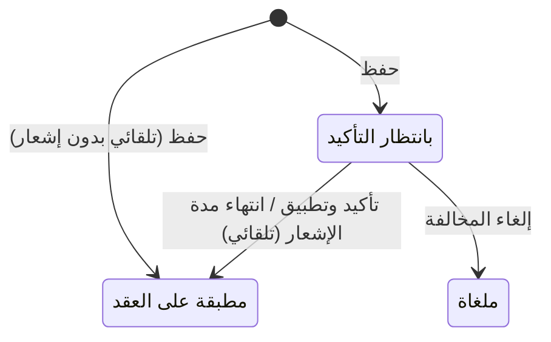

# سجل المخالفات — شرح مفصّل

بتاريخ 2026-10-28 · من موك أب تطبيق «التأجير» (نسخة 26 أكتوبر)، شاشة `rent.violations` · المتطلبات S21 · القائمة: التأجير › المخالفات › سجل المخالفات.

## ما هي الشاشة؟

هنا تُسجَّل **مخالفة فعلية** ارتكبها مستأجر (إزعاج، رمي مخلفات، تلفيات…) على عقار مؤجر. يختار الموظف العقار والمخالفة، والنظام:

1. يقرأ عقد الإيجار الساري والمستأجر من العقار.
2. يحسب **المرة** (كم مرة تكررت نفس المخالفة على نفس العقد).
3. يحسب **الغرامة** من [[شرح - سياسات المخالفات|سياسة المخالفة]].
4. يضيف الغرامة كسطر مستحق على عقد الإيجار، تلقائياً أو بعد التأكيد حسب السياسة.

الغرامة تصبح **قسطاً** على العقد، أي مبلغاً مستحقاً يُفوتر ويُحصّل مثل الإيجار من [[شرح - متابعة أقساط الإيجار]].

## أعمدة القائمة

| العمود | ماذا يعرض |
| --- | --- |
| الرقم | VL-السنة-تسلسل |
| التاريخ | تاريخ المخالفة |
| العقار / العقد / المستأجر | من العقد الساري |
| المخالفة | السياسة |
| المرة | 1، 2، 3… |
| الغرامة | المبلغ، مع إجمالي |
| الإشعار / التطبيق من | «تاريخ الإشعار ← التطبيق من» إذا كان فيه إشعار، وإلا «—» |
| الحالة | بانتظار التأكيد / مطبقة على العقد / ملغاة (قابلة للتصفية) |

## الحقول — المخالفة

| الحقل | النوع | الإلزام | الافتراضي | ملاحظات |
| --- | --- | --- | --- | --- |
| الرقم | تلقائي | تلقائي | «يُولد عند الحفظ» | VL-السنة-تسلسل عند أول حفظ |
| تاريخ المخالفة | تاريخ | إلزامي | اليوم | تغييره يعيد حساب المرة والغرامة |
| المشروع | قائمة | إلزامي | — | مشاريع الإيجار (بدون مشاريع لها فرعية)، بعرض «الرئيسي › الفرعي»؛ للتصفية ولا يُحفظ؛ تغييره يمسح العقار |
| العقار | قائمة | إلزامي | — | عقارات المشروع التي عليها عقد إيجار ساري فقط، بعرض «الكود · المستأجر»؛ يحدد العقد والمستأجر |
| عقد الإيجار | تلقائي | تلقائي | — | العقد الساري على العقار |
| المستأجر | تلقائي | تلقائي | — | من العقد |
| المخالفة | قائمة | إلزامي | — | سياسات المخالفات الفعالة؛ تغييرها يعيد الحساب |
| المرة | تلقائي | تلقائي | 1 | «تُحسب من سجل نفس المخالفة على نفس العقد» |
| الغرامة | تلقائي | تلقائي | 0 | من السياسة حسب المرة |
| الحالة | تلقائي | تلقائي | بانتظار التأكيد | |
| الوصف | نص طويل | اختياري | — | |

## الحساب

- **المرة** = عدد المخالفات غير الملغاة من نفس السياسة على نفس العقد، من (تاريخ المخالفة − مدة احتساب التكرار بالشهور) حتى تاريخ المخالفة، + 1. مدة 0 = من بداية العقد.
- **الغرامة**: المرة 1 = أول مرة؛ 2 = ثاني مرة (أو أول مرة لو 0)؛ 3+ = ثالث مرة (أو ثاني، أو أول لو أصفار).

## الأزرار والإجراءات

### حفظ

يتحقق: لازم يكون على العقار عقد إيجار ساري وإلا «العقار ليس عليها عقد إيجار ساري». يحفظ العقد والمستأجر والمرة والغرامة ويولّد الرقم. ثم في أول حفظ فقط:

- **مدة إشعار N > 0** (قرار 25/10): «تاريخ الإشعار» = اليوم، «التطبيق من» = اليوم + N، وسطر في تاريخ العقار «إشعار مخالفة … للمستأجر – الغرامة … من …». الرسالة: تلقائي ← «تم إشعار المستأجر – الغرامة هتتطبق لوحدها يوم … لو المخالفة متلغتش»؛ بعد التأكيد ← «تم إشعار المستأجر – «تأكيد وتطبيق» يتفتح يوم …».
- **N = 0 وسياسة تلقائية**: تُطبق الغرامة فوراً، رسالة «سياسة تلقائية – أُضيفت الغرامة على عقد الإيجار».
- **N = 0 وبعد التأكيد**: تبقى «بانتظار التأكيد».

### تأكيد وتطبيق الغرامة

لمخالفة «بانتظار التأكيد» سياستها «بعد التأكيد» (لا يظهر للتلقائي). معطّل حتى «التطبيق من» إن كان فيه مدة إشعار، برسالة «مدة الإشعار لسه مخلصتش – التطبيق من …». يضيف سطر الغرامة ويغيّر الحالة، رسالة «أُضيفت الغرامة كقسط مستحق على عقد الإيجار».

### إلغاء المخالفة / حذف

لمخالفة «بانتظار التأكيد»، متاح طول مدة الإشعار: الإلغاء يجعلها «ملغاة» بلا غرامة ولا تُحسب في التكرار؛ الحذف لها فقط. النموذج الجديد: التاريخ اليوم والحالة «بانتظار التأكيد».

### التطبيق التلقائي بعد مدة الإشعار

job يومي: كل مخالفة «بانتظار» سياستها تلقائية و«التطبيق من» ≤ اليوم تُطبق وحدها، لو لم تُلغَ.

## الحالات

| الحالة | متى |
| --- | --- |
| بانتظار التأكيد | بعد الحفظ (بعد التأكيد، أو أي سياسة بمدة إشعار لم تنته) |
| مطبقة على العقد | أُضيف سطر الغرامة |
| ملغاة | بعد «إلغاء المخالفة» |

المخالفة غير «بانتظار التأكيد» مقفولة: لا حفظ ولا حذف.

## ما يحدث عند التطبيق

| الشيء | بعد |
| --- | --- |
| جدول أقساط العقد | سطر جديد بسلسلة «غرامة» = الغرامة، استحقاق = تاريخ المخالفة، ضريبة 0% |
| ملاحظة السطر | «غرامة مخالفة – السياسة · رقم المخالفة» |
| حالة المخالفة | مطبقة على العقد |
| تاريخ العقار | حدث «مخالفة»: «مخالفة VL-… – السياسة (المرة n) المبلغ» |

## القيود والمحاسبة

- التسجيل والتطبيق: لا قيد؛ السطر مجرد قسط مستحق.
- الفوترة: السطر يُفوتر من [[شرح - متابعة أقساط الإيجار]] أو جدول العقد، ويُرحّل: مدين العميل (المستأجر) / دائن إيرادات غرامات (4190). بلا ضريبة.

## أمثلة

- سياسة «بعد التأكيد» بمدة 7 أيام: بعد الحفظ «الإشعار / التطبيق من» = اليوم ← اليوم + 7، و«تأكيد وتطبيق» معطّل ولا سطر غرامة.
- سياسة «تلقائي» بمدة 5 أيام: بعد الحفظ «بانتظار» ولا سطر غرامة؛ بعد 5 أيام تُضاف الغرامة وحدها كسطر «غرامة» على العقد.
- مخالفة إزعاج ثانية على نفس العقد خلال 12 شهر بسياسة 500 / 1,000 ← المرة 2 والغرامة 1,000.
- سياسة «بعد التأكيد»: بعد الحفظ لا سطر غرامة؛ بعد «تأكيد وتطبيق» يظهر سطر «غرامة» 1,000 في جدول الإيجار.
- سياسة «تلقائي» بلا إشعار: بعد الحفظ مباشرة الحالة «مطبقة على العقد».
- قائمة العقارات لا تعرض عقاراً بدون عقد ساري.

## يعتمد على / يعتمد عليه

- يعتمد على: [[شرح - سياسات المخالفات]] و[[شرح - عقود الإيجار]] (أولوية H، S21).
- يعتمد عليه: [[شرح - المخالصات]] (تقرأ المخالفات)، [[شرح - متابعة أقساط الإيجار]] (فوترة سطر الغرامة).

## الحالة

غير مبنية في الكلاود. تحتاج عقد الإيجار أولاً (الطبقة الثانية في خطة البناء). إرسال الإشعار الفعلي (رسالة / واتساب / إيجار) يُحدد في CR هذه الشاشة.

## أسئلة مفتوحة

- هل نحتاج مرفقات (صور / محضر) للمخالفة؟
