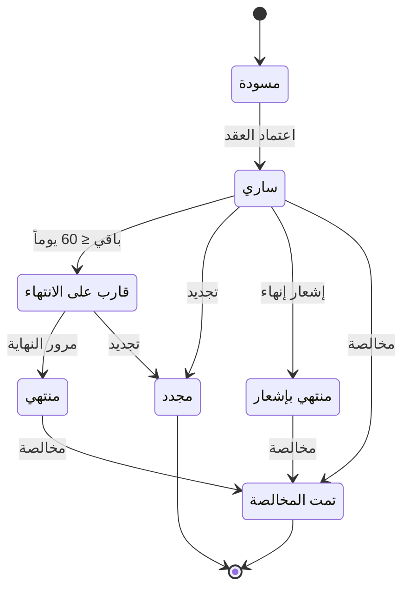
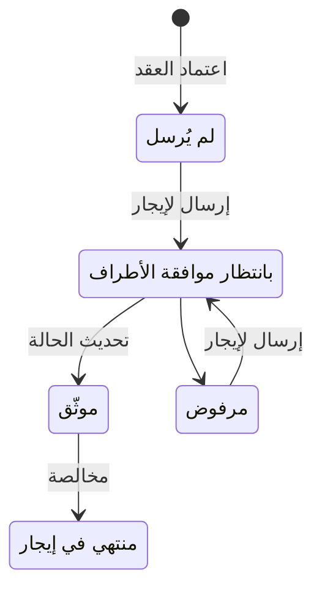

# عقود الإيجار — شرح مفصّل
بتاريخ 2026-10-28 · من موك أب تطبيق «التأجير» (نسخة 26 أكتوبر)، شاشة `rem.leases` · المتطلبات M20، M21، M22، M23، M24، M26، M37، M38، M43، M49، M50، M52، M53، M59 · القائمة: التسويق العقاري › الإيجار › عقود الإيجار.

## ما هي الشاشة؟
عقد الإيجار نفسه، وهو قلب تطبيق التأجير: كل الشاشات الأخرى تقريباً تعتمد عليه. العقد يربط **مستأجراً** (عميل مبيعات) بعقار أو أكثر، من نفس المشروع ولنفس المالك، لمدة محددة وبإيجار سنوي يُدفع على دفعات (دورية).

العقار قد يكون **للشركة**، أو **لمالك آخر** تديره الشركة نيابة عنه وتحصّل إيجاره ثم تحاسبه.

العقد يحدد: المدة، الإيجار السنوي والدورية، الضريبة، **التأمين** (مبلغ ضمان يدفعه المستأجر ويُرد له عند الخروج بعد خصم أي أضرار أو متأخرات)، الزيادة السنوية، الملحقات، التأثيث، العدادات، بنود الخدمات، الوسطاء والشروط.

**الاعتماد** يولّد جدول الإيجار (أقساط غير مُرحّلة) ويحوّل العقار إلى «مؤجر». الإيراد لا يثبت عند الاعتماد في السياسة اليدوية؛ يثبت بفاتورة مبيعات لكل قسط عند استحقاقه.

## من أين تُفتح؟
- القائمة: التسويق العقاري › الإيجار › عقود الإيجار.
- [[شرح - لوحة العقارات الشاغرة]]: زر «تأجير» على عقار إيجار متاح يفتح عقداً جديداً والعقار محدد.
- [[شرح - حجوزات الإيجار]]: «تحويل لعقد إيجار» يفتح عقداً جديداً بالمستأجر والعقار والبداية والمدة والإيجار المتفق عليه و**العربون** المحصّل (مبلغ دفعه المستأجر لحجز العقار).
- كسب فرصة بيع (CRM) لغرض الإيجار ينشئ عقد إيجار مسودة واحداً لكل عقارات الفرصة من نفس المشروع والمالك.
- شاشة «إنشاء عقود إيجار جماعية» أُزيلت (قرار 12/10): بدلها العقد الواحد يقبل أكثر من عقار، مثلاً شركة تستأجر دورين.
- بعد الاعتماد: الفوترة والتحصيل من تبويب «جدول الإيجار» أو [[شرح - متابعة أقساط الإيجار]]، الشيكات من [[شرح - الشيكات المؤجلة]]، والحركات (تجديد، إنهاء، مخالصة…) من أزرار النموذج. شاشات «الفوترة من كشف الحساب» و«منضدة التحصيل» و«التحصيل القانوني» أُزيلت (12/10).

## شكل الشاشة
**القائمة** وأعلاها أربعة مؤشرات: سارية، قاربت على الانتهاء (خلال مهلة الإشعار)، منتهية، إيجار سنوي ساري. أعمدتها: الرقم، المستأجر، العقار، البداية، النهاية، الإيجار السنوي، الدورية، الحالة (فلتر)، **إيجار** (حالة التوثيق، فلتر)، وشارة «قانوني» للعقد المحوّل للقانوني من إنذار الإخلاء. **النموذج**: بطاقة العقار (أو شريط بالعقارات والمشروع والمساحة والمالك لو أكثر من عقار)، تنبيهات قواعد الإيجار، شريط ملخص مالي بعد الاعتماد، مجموعات الحقول، ثم التبويبات.

## الحقول
### مجموعة «العقد»
| الحقل | النوع | الإلزام | الافتراضي | ملاحظات |
| --- | --- | --- | --- | --- |
| رقم العقد | تلقائي | — | — | `LS-السنة-تسلسل` من 4 خانات عند أول حفظ؛ السنة من تاريخ العقد |
| تاريخ العقد | تاريخ | إلزامي | اليوم | |
| المستأجر | قائمة (العملاء) | إلزامي | — | عميل مبيعات (D01). زر «+ عميل جديد» (قرار 15/10): نافذة قصيرة تنشئ عميلاً بمجموعة «عملاء عقاريون» وتصنيف «مستأجر»؛ الاسم والجوال إلزاميان، الجوال غير مكرر، B2B بسجل تجاري |
| المشروع | قائمة | إلزامي | — | يُختار أولاً. مشاريع الإيجار فقط (نوع الاستثمار يشمل «إيجار») بلا مشاريع فرعية. للتصفية فقط، لا يُحفظ ويُستنتج من العقار. تغييره يمسح العقارات وما ملأته |
| العقارات | اختيار متعدد | إلزامي | — | فارغة حتى اختيار المشروع («اختر المشروع أولاً»). تعرض عقارات المشروع المتاحة والمعروضة للإيجار بصيغة «الكود · النوع · سعر الإيجار» |
| المالك | للعرض | — | «—» | من «ملكية المشروع» في أول عقار: «للشركة» أو «لمالكين آخرين» مع اسم المالك |
| بداية العقد | تاريخ | إلزامي | غداً | تغييرها يعيد حساب النهاية ونهاية الإدارة |
| المدة (سنة) | رقم | إلزامي | 1 | تقبل الكسور (1.5) |
| نهاية العقد | محسوب | — | — | البداية + round(المدة × 12) شهراً − يوم. تظهر بالهجري أيضاً لو التقويم الهجري مفعّل (M59) |
| نهاية الإدارة | تاريخ | اختياري | = النهاية | لعقار مالك آخر: الشركة تفوتر وتحصّل حتى هذا التاريخ. يُضبط عند الحفظ لو فارغ |
| تجديد تلقائي | مربع اختيار | اختياري | محدد | معلوماتي؛ يُظهر تنبيه آخر موعد للإشعار لو «تجديد تلقائي» مفعّل في قواعد السعودية |

**ما يحدث عند اختيار العقارات:** يُعاد بناء جدول «عقارات العقد» (العقار الجديد بسعر إيجاره، والموجود يحتفظ بإيجاره)، ويُملأ من أول عقار الاستخدام والمالك، ويُعاد حساب الإيجار الإجمالي، والتأمين = الإجمالي ÷ 12، وبنود تأثيث كل العقارات، وسطرا عدادات لكل عقار (كهرباء حسب العداد، مياه مبلغ ثابت 150) بأرقام عداداته.

### جدول «عقارات العقد»
يظهر بعد اختيار عقار، ويُحفظ كجدول تفصيلي (العقد، العقار، الإيجار السنوي). أعمدته: العقار (رابط)، النوع، المساحة م²، الاستخدام، سعر إيجار العقار، و«الإيجار السنوي في العقد» القابل للتعديل في المسودة (تعديله يعيد الإجمالي والتأمين)، وسطر إجمالي بعدد العقارات والمساحة والإيجار.

### مجموعة «الإيجار والضريبة»
| الحقل | النوع | الإلزام | الافتراضي | ملاحظات |
| --- | --- | --- | --- | --- |
| الإيجار السنوي | محسوب | إلزامي | — | مجموع إيجار العقارات (مع ملاحظة «مجموع إيجار العقارات» لو أكثر من عقار). الجدول والزيادة تُحسب عليه |
| دورية السداد | قائمة | إلزامي | ربع سنوي | شهري / ربع سنوي / نصف سنوي / سنوي؛ الافتراضي من الإعدادات |
| شرط الدفع | قائمة | اختياري | أول شرط نوع «إيجار» | لا يؤثر على الجدول؛ منه تأتي غرامة التأخير |
| استخدام العقار | للعرض | — | من العقار | سكني / تجاري / إداري؛ لا يغيّر النسبة |
| معفى من ضريبة القيمة المضافة | مربع اختيار | اختياري | غير محدد | قرار 11/10: الإعفاء يتحدد في العقد. محدد ← سطور الإيجار والتأثيث 0% وتنبيه أعلى النموذج؛ الملحقات والمرافق والرسوم تبقى بنسبة الدولة |
| ضريبة القيمة المضافة % | محسوب | — | — | 0% لو معفى، وإلا نسبة الدولة من الحسابات العامة (15% في السعودية) لسكني وتجاري. تُعاد عند الحفظ؛ تنبيه لو عقد قديم بنسبة مختلفة (M49) |
| التأمين | مبلغ | اختياري | الإيجار ÷ 12 | خارج نطاق الضريبة. يُحصّل بسند قبض بنوع «تأمين» بلا فاتورة (D29) |
| عربون حجز محصل (يُخصم من التأمين) | للعرض | — | — | يظهر فقط للعقد المحوّل من حجز |
| جدول شيكات آجلة (PDC) | مربع اختيار | اختياري | غير محدد | يظهر فقط لو السداد ليس عبر إيجار. يجب تحديده قبل الاعتماد؛ يُظهر تبويب «الشيكات» |
| إثبات الإيراد | للعرض | — | — | سياسة الشركة من «الضبط العام › إثبات الإيراد» تُثبَّت على العقد عند الاعتماد: يدوي أو تلقائي (انظر القيود) |

**أوراق القبض / الشيكات الآجلة (PDC):** شيكات يسلّمها المستأجر مقدماً، شيك لكل قسط بتاريخ استحقاقه.

### مجموعة «زيادة الإيجار»
| الحقل | النوع | الإلزام | الافتراضي | ملاحظات |
| --- | --- | --- | --- | --- |
| نوع الزيادة | قائمة | اختياري | بدون زيادة | بدون زيادة / نسبة % / قيمة |
| القيمة السنوية | رقم | شرطي | 5 | تظهر عند وجود زيادة |
| طريقة الحساب | قائمة | شرطي | ثابتة | للنسبة فقط: ثابتة على الأساس أو تراكمية |

### مجموعة «منصة إيجار»
**منصة إيجار** منصة حكومية سعودية (الهيئة العامة للعقار) لتوثيق عقود الإيجار. العقد الموثّق فيها **سند تنفيذي**: يمكن طلب تنفيذه عبر «ناجز» دون دعوى. تظهر المجموعة فقط لو التكامل مفعّل (السعودية، الضبط العام › التكاملات الحكومية).

| الحقل | النوع | الإلزام | الافتراضي | ملاحظات |
| --- | --- | --- | --- | --- |
| السداد عبر منصة إيجار | مربع اختيار | — | سكني: محدد ومقفول؛ تجاري: من الضبط العام | السكني إلزامي (حصر الدفع الرقمي منذ 15/1/2024؛ أي دفع خارج إيجار لا يُعتد به). محدد ← لا «تحصيل» يدوي لسطور الإيجار والتأثيث، ولا شيكات (حقل PDC يختفي)؛ تُسجل من [[شرح - مدفوعات منصة إيجار]] |
| رسوم توثيق إيجار | محسوب | — | — | سكني 125 لكل سنة؛ تجاري 200 للسنة الأولى + 400 لكل سنة إضافية (المدة مقرّبة لأعلى). على المؤجر ما لم يُتفق. لا تُسجل كسطر في الجدول |
| حالة التوثيق | للعرض | — | لم يُرسل | لم يُرسل / بانتظار موافقة الأطراف / موثّق / مرفوض / منتهي في إيجار. تتغير من أزرار العقد والمخالصة فقط |
| رقم عقد إيجار | للعرض | — | — | بعد التوثيق. كل سطر إيجار / تأثيث يأخذ مرجع دفعة «رقم العقد-رقم الدفعة» |

## التبويبات
### جدول الإيجار
- **في المسودة:** معاينة فقط، مع ملاحظة أن السطور لا تُرحّل.
- **بعد الاعتماد:** السطور الحقيقية. لكل سطر عمود «الفاتورة الإلكترونية»: قبل الفوترة الفئة المتوقعة (S 15%، أو E – VATEX-SA-30 للسكني أو المعفى)، وبعدها حالة الإرسال والكود والنوع (قياسية B2B / مبسطة B2C).
- أزرار السطر: «متابعة الأقساط» لسطر نشط غير مفوتر يستحق خلال 30 يوماً (الفوترة صارت من متابعة الأقساط فقط، اجتماع 20/10)؛ «تحصيل» لسطر مفوتر غير مسدد؛ «تحصيل التأمين» لسطر تأمين غير محصّل. السطور الملغاة والمسددة بلا أزرار. في السداد عبر إيجار يظهر «يُسدد عبر إيجار» بدل «تحصيل».
- تحته جدول **«الإيجار حسب السنة»**: سطر لكل سنة (عدد السنوات = المدة مقرّبة لأعلى) بالسنة وتاريخ البداية والإيجار المحسوب، وخانة «تعديل يدوي لهذه السنة» تحل محل المحسوب (في المسودة فقط).

نافذة **تحصيل قسط**:

| الحقل | النوع | الإلزام | الافتراضي | ملاحظات |
| --- | --- | --- | --- | --- |
| المبلغ | مبلغ | إلزامي | المتبقي | يُقص إلى المتبقي من الفاتورة |
| طريقة السداد | قائمة | إلزامي | تحويل بنكي وارد | نقدي – سند قبض / تحويل بنكي وارد / شيك – ورقة قبض / دفع إلكتروني (Ottu) |
| التاريخ | تاريخ | إلزامي | اليوم | |

**سند القبض:** مستند في إدارة النقدية يثبت استلام مبلغ من العميل.

### المرافق (ملحقات مدفوعة)
خدمات إضافية مدفوعة مع العقد، منها الاشتراك المميز. من كتالوج الملحقات.

| العمود | الإلزام | الافتراضي | ملاحظات |
| --- | --- | --- | --- |
| المرفق | لكل سطر | — | ينسخ السعر وطريقة التحصيل |
| التحصيل | لكل سطر | مع كل دفعة إيجار | مرة واحدة / مع كل دفعة / سنوي |
| السعر | لكل سطر | من المرفق | مع كل دفعة: سعر سنوي يوزع على الفترات |

### التأثيث
للعلم وللفحص فقط: سعر العقار شامل التأثيث (قرار 18/10)، فلا يُضاف للإيجار ولا يظهر في الجدول. تُسحب بنود تأثيث كل عقار تلقائياً، وتُراجع في فحص الاستلام والتسليم.

| العمود | ملاحظات |
| --- | --- |
| العقار | من عقارات العقد؛ الافتراضي أول عقار |
| البند | بنود التأثيث المرتبطة بعقارات العقد؛ البند المشترك بين عقارين = سطران |
| السعر (مرجع) | للقراءة فقط |

### بنود الخدمات
خدمات يقدمها المكتب للمستأجر (نظافة، أمن، صيانة دورية…) من «بنود الخدمات» الفعالة.

| العمود | ملاحظات |
| --- | --- |
| البند | ينسخ قيمته السنوية |
| القيمة السنوية | قابلة للتعديل |
| لكل قسط | = القيمة × أشهر الدورية ÷ 12 |

إيرادها للشركة دائماً (إيرادات خدمات 4140) حتى لعقار مالك آخر؛ لا تدخل كشف حساب المالك.

### المرافق والعدادات
| العمود | الإلزام | الافتراضي | ملاحظات |
| --- | --- | --- | --- |
| العقار | شرطي | — | يظهر فقط لو العقد على أكثر من عقار |
| العداد | لكل سطر | سطران: كهرباء ومياه | كهرباء / مياه / غاز |
| رقم العداد | اختياري | من بيانات العقار | |
| يدفع | لكل سطر | المستأجر | المستأجر / المالك / ضمن الإيجار؛ الأخيران لا يولّدان مطالبة |
| الطريقة | لكل سطر | كهرباء حسب العداد، مياه مبلغ ثابت | حسب العداد / مبلغ ثابت |
| مبلغ ثابت / شهر | شرطي | 150 للمياه | لو مبلغ ثابت والدافع المستأجر |
| حد الاستهلاك | اختياري | 0 = بلا حد | يُطبق في [[شرح - استحقاقات المرافق]] (CR 69446) |

### الوساطة
جدول وسطاء بزر «إضافة سطر»: صفر أو أكثر (قرار 26/10)، والوسيط لا يتكرر.

| العمود | الإلزام | الافتراضي | ملاحظات |
| --- | --- | --- | --- |
| الوسيط | إلزامي | — | من الوسطاء العقاريين؛ يملأ النوع والقيمة من نسبته (قرار 11/10) |
| النوع | إلزامي | نسبة % | نسبة % / مبلغ |
| القيمة | إلزامي | نسبة الوسيط | > 0؛ النسبة ≤ 100% |
| تُحصّل من | إلزامي | من المالك | المشتري / المالك / المستأجر / على الشركة |
| العمولة المحسوبة | محسوب | — | نسبة: الإيجار السنوي × القيمة ÷ 100؛ مبلغ: القيمة. تحت الجدول «إجمالي عمولات الوسطاء» |

العمولة تُصرف للوسيط (كمورد) عبر أمر شراء عاجل ومطابقة من شاشة العمولات (D20 / D21).

### الغرامات
- غرامة التأخير من «بند الدفع» المختار (نوعها، قيمتها، فترة السماح بالأيام / الأسابيع / الشهور). لا سياسة غرامات على العقد (قرار 11/10). الحدود القانونية ومراحل التعثر من الضبط العام بنفس قواعد عقد البيع.
- لكل سطر تجاوز السماح (عدا التأمين والغرامات): الغرامة = المتبقي × النسبة% أو القيمة، ثم الحدود. تُطبق مرة واحدة لكل قسط، وبعدها يظهر «مطبقة».
- **السداد عبر إيجار:** لا غرامة مالية («منصة إيجار – بدون غرامة»)، والسماح 15 يوماً لدورية أقل من 6 أشهر و30 يوماً لنصف سنوي وسنوي. مراحل التعثر فقط، وكل مرحلة تبدأ بعد المهلة (قرار 13/10): مهلة 30 + إنذار يوم 7 = يوم 37، والبطاقة تعرض «مهلة إيجار 30 + 7».
- إجراء «فسخ العقد / الإخلاء» في مراحل التعثر يفتح نافذة «إنذار إخلاء».
- غرامات المخالفات (إزعاج، مخلفات…) ليست هنا، بل في [[شرح - سجل المخالفات]].

### الشروط والأحكام
اختيار متعدد من «شروط وأحكام العقود»: نوع «إيجار سكني» للاستخدام السكني، «إيجار تجاري» للتجاري والإداري؛ بلا عقار = كل شروط الإيجار. الإلزامية محددة ومقفلة. شارة «سياسة المخالفة» على الشرط المرتبط بسياسة في [[شرح - سياسات المخالفات]]. تُطبع بنصها الكامل. نصوص قانونية فقط، لا تغيّر أي مبلغ. شروط الإيجار القديمة اندمجت هنا (اجتماع 13/10).

### الشيكات
يظهر بعد الحفظ لو PDC محدد. زر «تسجيل شيكات لكل الأقساط» لعقد ساري بلا شيكات: شيك «في الخزينة» لكل سطر إيجار نشط غير مسدد (D26). التفاصيل في [[شرح - الشيكات المؤجلة]].

### حركات العقد والفواتير
**حركات العقد:** مستندات التجديد والإنهاء والمخالصة وإعادة الجدولة والإنذار ونهاية الإدارة. **الفواتير:** فواتير الأقساط وسندات القبض، ومنها فاتورة عربون الحجز إن جاء العقد من حجز.

## بناء جدول الأقساط
1. **سطر تأمين** بتاريخ البداية بقيمة التأمين وضريبة 0 (لو > 0). في العقد المحوّل من حجز: التأمين − العربون المحصّل.
2. **عدد الفترات** = ⌈أشهر العقد ÷ أشهر الدورية⌉ (شهري 1، ربع سنوي 3، نصف سنوي 6، سنوي 12).
3. **استحقاق الفترة k** = البداية + k × أشهر الدورية (الأولى في البداية).
4. **إيجار الفترة** = إيجار سنتها × أشهر الفترة ÷ 12، بنسبة ضريبة العقد وملاحظة «سنة n». الفترة الأخيرة تُقصّر لو لم تكتمل المدة (M37).
5. **إيجار السنة y** (أول سنة = 0) = التعديل اليدوي إن وُجد، وإلا (M50):
   - بدون زيادة ← الأساس.
   - نسبة ثابتة ← الأساس × (1 + ن% × y).
   - نسبة تراكمية ← الأساس × (1 + ن%)^y.
   - قيمة ← الأساس + القيمة × y.
6. **مع كل فترة:** سطر «مرافق» لكل ملحق «مع كل دفعة» = السعر × أشهر الفترة ÷ 12؛ سطر «مرافق استهلاك» لكل عداد ثابت يدفعه المستأجر = المبلغ الشهري × أشهر الفترة؛ سطر «بنود خدمات» لكل بند بنسبة مدة القسط. كلها بنسبة الدولة (الخدمات 0% لو البند غير خاضع).
7. **الملحق السنوي** = سطر في بداية كل سنة (⌈الأشهر ÷ 12⌉ سطراً)؛ **مرة واحدة** = سطر في البداية.
8. عدادات القراءة لا تدخل الجدول؛ تأتي من استحقاقات المرافق. التأثيث لا يدخل الجدول.

**الإعفاء:** «معفى من الضريبة» يجعل سطور الإيجار والتأثيث 0% والفواتير كود E؛ غير المعفى = نسبة الدولة لسكني وتجاري (قرار 11/10).
**نهاية الإدارة:** لو أقل من نهاية العقد عند الاعتماد، تُلغى أقساط الإيجار والتأثيث والخدمات والمرافق بعدها («خرجت من الإدارة»).

## قواعد الحفظ
- إلزامي: المستأجر، المشروع، العقارات، تاريخ العقد، البداية، المدة، الإيجار السنوي، الدورية، وفي كل سطر وسيط: الوسيط والنوع والقيمة وجهة التحصيل.
- عقار واحد على الأقل («اختر عقار واحد على الأقل»)، كلها من نفس المشروع («كل عقارات العقد لازم تكون من نفس المشروع») ولنفس المالك («… اعمل عقد لكل مالك»)، وإيجار كل عقار > 0 («أدخل الإيجار السنوي لكل عقار»).
- عند كل حفظ: النهاية تُعاد، ونهاية الإدارة = النهاية لو فارغة، والضريبة تُعاد، والسكني يُجبر «السداد عبر إيجار»، والسداد عبر إيجار يلغي PDC.
- تنبيهات قواعد الإيجار لا تمنع الحفظ ولا الاعتماد.

## الأزرار والإجراءات
### حفظ، حذف، اعتماد، طباعة
- **حفظ:** يحفظ مسودة (الرقم عند أول حفظ). في المسودة فقط. **حذف:** يحذف المسودة بعد تأكيد؛ غير متاح بعد الاعتماد.
- **اعتماد العقد وتوليد الأقساط:** انظر «ما يحدث عند الاعتماد» أدناه.
- **معاينة الطباعة:** قالب عقد الإيجار (M43): المؤجر (الشركة، أو المالك وتمثله الشركة)، المستأجر، العقار ونوعه واستخدامه وعداد الكهرباء، المدة ميلادي/هجري، الإيجار، التأمين، الدورية، الضريبة، الزيادة، جدول الدفعات (المعاينة في المسودة أو السطور النشطة)، الشروط والأحكام، التوقيعات.

### إرسال لإيجار للتوثيق / تحديث الحالة من إيجار
- **إرسال:** للعقد الساري بحالة «لم يُرسل» أو «مرفوض». يُرفض لو المستأجر بلا رقم هوية / سجل («المستأجر من غير رقم هوية / سجل – إيجار بيرفض العقد»). عبر API يُرسل العقار والأطراف والعقد الموحد وجدول الدفعات؛ يدوياً يوثّق المكتب من بوابة إيجار. الحالة ← بانتظار موافقة الأطراف (المؤجر والمستأجر يوافقان من حساباتهما).
- **تحديث الحالة:** عند «بانتظار موافقة الأطراف». في البروتوتايب يرجع «موثّق» دائماً برقم عقد ومراجع الدفعات.
- العقد الساري غير الموثق يعرض تنبيهاً: غير معتد به كسند تنفيذي، ولو السداد عبر إيجار فالمستأجر لا يستطيع السداد حتى التوثيق.

### أزرار الحركات (للحالة المخزنة «ساري» فقط)
| الزر | ماذا يفعل | التفاصيل |
| --- | --- | --- |
| تجديد | عقد جديد يبدأ بعد النهاية بيوم بإيجار = آخر سنة × (1 + الزيادة%)، التأمين يُرحّل، يُعتمد فوراً؛ القديم ← مجدد | [[شرح - تجديد عقود الإيجار]] |
| إشعار إنهاء | تاريخ إشعار وتاريخ إنهاء وغرامة اختيارية؛ يلغي السطور غير المفوترة بعد التاريخ (عدا التأمين)؛ النهاية ونهاية الإدارة ← تاريخ الإنهاء؛ الحالة ← منتهي بإشعار لو التاريخ ≤ اليوم | [[شرح - إشعارات الإنهاء وإنذارات الإخلاء]] |
| مخالصة | تسوية التأمين مقابل الخصومات مع فحص خروج، طلب صرف للمستأجر لو الصافي موجب، الحالة ← تمت المخالصة والعقار ← متاح. تظهر أيضاً للمنتهي والمنتهي بإشعار | [[شرح - المخالصات]] |
| إعادة جدولة | يلغي السطور غير المفوترة وغير المسددة (عدا التأمين والغرامات والرسوم) ويولّد عدداً جديداً بنفس الإجمالي | «إعادة جدولة الأقساط» |
| إنذار إخلاء | إنذار بمهلة سداد بمبلغ المتأخرات؛ مع خيار التحويل للقانوني: العقد والمستأجر ← قانوني وسطر «رسوم» أتعاب قانونية بالضريبة | [[شرح - إشعارات الإنهاء وإنذارات الإخلاء]] |
| تعديل نهاية الإدارة | عقار مالك آخر والإدارة غير موقوفة: يلغي أو يرجّع الأقساط غير المفوترة وينشئ مستنداً | [[شرح - عقود الملاك نهاية الإدارة وإيقاف الإيجار]] |
| إيقاف الإيجار | نفس الشرط: تاريخ وسبب إلزامي؛ يلغي الأقساط غير المفوترة بعد التاريخ ويعلّم العقد «الإيجار موقوف» | نفس الشاشة |
| فسخ / إيقاف العقد | أُزيلا (قرار 11/10) | — |

### أزرار التبويبات
- **فوترة / متابعة الأقساط:** فاتورة مبيعات للقسط بنفس منطق متابعة الأقساط («تم إنشاء فاتورة المبيعات INV-…»).
- **تحصيل ← إنشاء سند قبض:** ينشئ الفاتورة إن لم توجد، ثم سند قبض في إدارة النقدية (ApplicationId = 8، D23)، ويرفع المسدد للقسط والفاتورة.
- **تحصيل التأمين:** سند قبض بنوع «تأمين» لحساب تأمينات المستأجرين بلا فاتورة (D29).
- **تطبيق:** المبلغ المحسوب قابل للتقليل بسبب إلزامي (لا للزيادة)؛ التأكيد يضيف سطر «غرامة» بالمبلغ النهائي، استحقاق اليوم، ضريبة 0، ملاحظة «غرامة تأخير» (+ «معدلة من …: السبب»)، مربوطاً بالقسط.
- **إعفاء:** سبب إلزامي؛ القسط يتعلّم «معفاة» بالسبب والتاريخ والمستخدم.
- «إضافة سطر / حذف سطر» في المرافق والتأثيث والعدادات والخدمات والوساطة: في المسودة فقط.

## الحالات
| الحالة | متى | مخزنة؟ |
| --- | --- | --- |
| مسودة | قبل الاعتماد؛ النموذج قابل للتعديل | نعم |
| ساري | بعد الاعتماد | نعم |
| قارب على الانتهاء | ساري والمتبقي ≤ 60 يوماً (ثابتة) | محسوبة |
| منتهي | ساري والنهاية قبل اليوم | محسوبة |
| منتهي بإشعار | بعد إشعار إنهاء نافذ | نعم |
| مجدد | بعد التجديد | نعم |
| تمت المخالصة | بعد المخالصة | نعم |
| مفسوخ | حالة موروثة؛ لا زر فسخ في العقد الساري | نعم |

بعد الاعتماد يُقفل النموذج والتبويبات للقراءة، ويختفي «حفظ» و«حذف»؛ أي تغيير يتم بمستندات الحركات.

**حالة التوثيق في إيجار** مستقلة:

التجديد يعمل عقداً جديداً «لم يُرسل» بنفس اختيار السداد.

## ما يحدث عند «اعتماد العقد وتوليد الأقساط»
يحفظ العقد أولاً، ثم يتحقق أن كل عقار «متاح» (أو «محجوز» بحجز الإيجار المؤكد المرتبط). وإلا: «العقار غير متاح للإيجار» ويبقى مسودة.

| الشيء | بعد |
| --- | --- |
| المستأجر | تُنشأ حساباته الفرعية إن لم توجد: حساب العميل 1210-NNNN والدفعات المقدمة 2330-NNNN (D31)؛ لا حساب تأمين خاص به. نوع العميل «مشتري» ← «الاثنين» |
| الجدول | سطور نشطة غير مفوترة |
| العقد | ساري، والنموذج للقراءة فقط؛ تُثبَّت سياسة إثبات الإيراد عليه |
| العقارات | كلها «مؤجر» مع سطر في تاريخ كل عقار |
| فحص الاستلام | محضر «استلام مستأجر» (Move-in) مسودة لكل عقار بتاريخ البداية بقائمة الفحص الافتراضية (D42) – [[شرح - تسليم واستلام العقارات]] |
| الوسطاء | عمولة «وسيط – إيجار» لكل وسيط بحالة «محسوبة» |
| الحجز (لو محوّل) | ← «محول لعقد»؛ قيد تحويل العربون للتأمين؛ التأمين المرحّل += العربون |
| أمر بيع | لا يُنشأ (قرار 15/10) |
| إيجار | حالة التوثيق «لم يُرسل» |
| الرسالة | «تم اعتماد العقد، توليد جدول الإيجار، وإنشاء فحص استلام» |

**شريط الملخص بعد الاعتماد:** إجمالي العقد (المبلغ + الضريبة للسطور النشطة عدا التأمين)، المحصل، المتأخرات، التأمين (+ المرحّل من عقد سابق)، الأيام المتبقية.
**العقد على أكثر من عقار:** القيود بمركز تكلفة المشروع بدل العقار؛ المخالصة ترجّع كل العقارات «متاح»؛ ربحية العقارات تقسم الإيراد بنسبة إيجار كل عقار؛ المخالفات والصيانة تجد العقد من أي عقار فيه.

## القيود والمحاسبة
كل قيود العقد وتحصيلاته بمركز تكلفة «كود المشروع/كود العقار» (M38، D32). سطور الجدول نفسها لا ترحّل شيئاً (قرار 01-10-2026).

**إيراد الإيجار – السياسة اليدوية (الافتراضية):** الإيراد مع فاتورة كل قسط.
- مدين حساب العميل 1210-NNNN بالإجمالي / دائن إيرادات إيجارات 4120 (الإيجار) أو إيرادات خدمات 4140 (الخدمات والملحقات والمرافق) أو 4190 (الغرامات) / دائن ضريبة القيمة المضافة.

**إيراد الإيجار – السياسة التلقائية (عقارات الشركة فقط، D33):**
1. الاعتماد (`REM_LeaseAccrual`): مدين إيراد مستحق 1225 / دائن إيراد مقدم 2315 بإجمالي سطور الإيراد (إيجار، خدمات، مرافق).
2. تأكيد القسط (تلقائياً في تاريخ استحقاقه عند أي حفظ، أو قبله من متابعة الأقساط): مدين العميل / دائن إيراد مستحق.
3. الفاتورة: مدين إيراد مقدم / دائن الإيراد؛ والضريبة مدين العميل / دائن الضريبة. الفاتورة تؤكد القسط لو لم يُؤكد.
- أي تغيير في الجدول (إنهاء، إيقاف، نهاية الإدارة، إعادة جدولة) يُسوّى: القسط المؤكد الملغى قبل فوترته يُفك تأكيده (مدين إيراد مستحق / دائن العميل)، والفرق بقيد `REM_LeaseAccrual` بين المستحق والمقدم.

**التأمين (D29):** سند قبض بنوع «تأمين»: مدين الصندوق / البنك / دائن تأمينات المستأجرين 2320 (حساب فرعي واحد، المستأجر طرف في السطر). خارج نطاق الضريبة، بلا فاتورة.
**عربون الحجز عند الاعتماد:** قيد `CustomerInvoiceSettlement`: مدين الدفعات المقدمة 2330 / دائن تأمينات المستأجرين 2320 بالعربون.
**التحصيل:** مدين الصندوق / البنك / أوراق قبض تحت التحصيل (حسب الطريقة) / دائن حساب العميل.
**مستحقات الملاك (عقار مالك آخر):** إيجار عقار المالك مستحق له، فيبقى مع الفاتورة حتى في السياسة التلقائية، ولا يُعتبر إيراداً للشركة. تُحاسب الشركة المالك من [[شرح - كشف حساب المالك]]: مراجعة فاتورة (IV) مدين مستحقات ملاك تحت التسوية 2215 / دائن حساب المالك كمورد، ثم قيد أتعاب الإدارة (`REM_MgmtFee`). الخدمات تبقى إيراداً للشركة 4140.
**رسوم توثيق إيجار:** تُعرض فقط؛ لا قيد ولا سطر في الجدول في البروتوتايب (سؤال مفتوح).
**عمولة الوسيط:** تُحسب عند الاعتماد وتُصرف من شاشة العمولات بأمر شراء عاجل ومطابقة (D20 / D21).

## أمثلة
- عقار تجاري إيجاره 120,000 ← الضريبة 15%، التأمين 10,000، المالك من العقار.
- عقد ربع سنوي لسنة بإيجار 120,000 ← سطر تأمين + 4 سطور إيجار بـ 30,000، كل 3 أشهر من البداية.
- مكتبان بإيجار 120,000 و50,000 ← الإيجار 170,000 والتأمين 14,166.67؛ بعد الاعتماد كلاهما «مؤجر» بمحضري استلام، وبعد المخالصة كلاهما «متاح».
- عقار للشركة وعقار لمالك آخر في نفس العقد ← يمنع الحفظ برسالة نفس المالك.
- عقد من حجز عربونه 5,000 وتأمينه 10,000 ← سطر تأمين 5,000، قيد تحويل 5,000، والمخالصة تعتبر التأمين 10,000.
- وسيطان على إيجار 120,000 (2.5% من المالك، ومبلغ 3,000 من المستأجر) ← 3,000 و3,000 (الإجمالي 6,000)، وبعد الاعتماد سطرا «وسيط – إيجار» في العمولات.
- عقد «تلقائي» 120,000 ربع سنوي ← اعتماد: مدين إيراد مستحق 120,000 / دائن إيراد مقدم 120,000؛ فاتورة القسط الأول: مدين إيراد مقدم 30,000 / دائن إيرادات إيجارات 30,000؛ إنهاء بعد قسطين ← تسوية 60,000 من إيراد مقدم إلى إيراد مستحق.
- اعتماد عقد لعقار محجوز أو مؤجر ← «العقار غير متاح للإيجار» ويبقى مسودة.
- عقد سكني ← «السداد عبر منصة إيجار» محدد ومقفول وحقل الشيكات مختفٍ؛ لا زر «تحصيل» بل «يُسدد عبر إيجار»؛ الفاتورة الإلكترونية E – VATEX-SA-30.
- سكني معفى ← سطور الإيجار والتأثيث 0% والفواتير كود E.
- عقد ساري «لم يُرسل» ← إرسال ← «بانتظار موافقة الأطراف» ← تحديث ← «موثّق» برقم عقد.
- سكني عبر إيجار نصف سنوي ← الغرامات «منصة إيجار – بدون غرامة» والسماح 30 يوماً؛ ربع سنوي ← 15 يوماً.
- عبر إيجار نصف سنوي وقسط متأخر 35 يوماً ← لا مرحلة حالية؛ «إنذار رسمي بالسداد» قادمة من يوم 37.
- مصر وبند دفع 1%: قسط 46,000 متأخر 122 يوماً ← غرامة 460 (أقل من الحد القانوني 1,076.27) بلا شارة حد.
- قسط متأخر 40 يوماً وبند دفع 2% وسماح 5 أيام ← الغرامة = المتبقي × 2%، و«تطبيق» بلا تعديل يضيف سطر غرامة بها.
- العقد الساري لا يعرض «فسخ بغرامة» ولا «إيقاف».

## يعتمد على / يعتمد عليه
- **يعتمد على:** العقارات، العملاء، شروط الدفع (نوع إيجار)، بنود العقود (الشروط)، [[شرح - سياسات المخالفات]]، الملحقات والتأثيث وبنود الخدمات، الوسطاء، الضبط العام.
- **يعتمد عليه:** تقريباً كل شاشات التأجير: [[شرح - متابعة أقساط الإيجار]]، [[شرح - الشيكات المؤجلة]]، [[شرح - تسليم واستلام العقارات]]، [[شرح - تجديد عقود الإيجار]]، [[شرح - إشعارات الإنهاء وإنذارات الإخلاء]]، [[شرح - المخالصات]]، [[شرح - استحقاقات المرافق]]، [[شرح - سجل المخالفات]]، [[شرح - كشف حساب المالك]]، [[شرح - عقود الملاك نهاية الإدارة وإيقاف الإيجار]]، [[شرح - مدفوعات منصة إيجار]]، وتحويل [[شرح - حجوزات الإيجار]]. للبيع توأمها [[شرح - متابعة أقساط البيع]].
- **ترتيب البناء:** الأولوية الأولى: عقد الإيجار وجدول أقساطه، ومعه سياسات المخالفات وتكملة شروط الدفع.

## الحالة
غير مبني. لا يوجد كيان عقد إيجار في الكود بعد (لذلك أُجّل التحويل من الحجز في CR 125808). في DevOps: Feature 101060، User Story 101135 (New)، CR 101123 (Confirmed)؛ الـ Feature والـ US بلا وصف، والمواصفات من البروتوتايب.

## أسئلة مفتوحة
- التأمين: إيجار عندها خدمة «حفظ مبلغ الضمان» من محفظة المستأجر؛ هل يُحصّل التأمين عبر إيجار أيضاً؟
- المرافق والغرامات والملحقات: تُسدد عبر إيجار أم خارجها؟
- لو الحساب البنكي المسجل في عقد إيجار هو حساب المالك، يذهب الإيجار للمالك مباشرة: كيف يُسجل التحصيل وأتعاب الإدارة؟
- رسوم توثيق إيجار: مصروف على الشركة أم المالك، أم سطر يُحصّل من المستأجر؟
- ربط API إيجار يتطلب تسجيل الشركة كشريك تكامل لدى الهيئة العامة للعقار.
- نهاية الإدارة في البروتوتايب لا توقف المطالبات (تُخزن فقط)؛ المطلوب عدم توليد / فوترة ما بعدها؟ (M37).
- «تجديد تلقائي» معلوماتي؛ هل نحتاج مهمة خلفية تجدد العقد؟
- الإعفاء من الضريبة: هل نحتاج سبباً / مرجعاً؟ وهل يتحدد من نوع المستأجر تلقائياً؟
- شرط الدفع لا يؤثر على الجدول؛ ما دوره غير الغرامة؟
- قائمة العقارات لا تُصفّى على نوع الاستثمار = إيجار (يمكن تأجير عقار بيع متاح).
- هل تمنع تنبيهات «عقار تجاري بضريبة 0%» و«الغرامة فوق السقف» الاعتماد؟ حالياً لا.
- سطر «يدفع = المستأجر» برقم عداد فارغ مقبول بلا تحقق.
