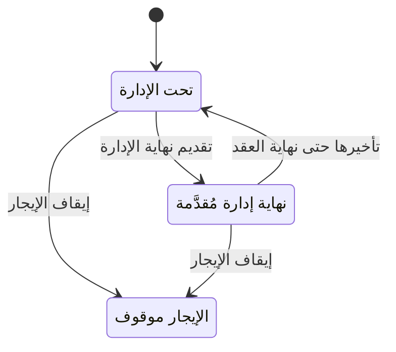

# عقود الملاك: نهاية الإدارة وإيقاف الإيجار — شرح مفصّل

بتاريخ 2026-10-28 · من موك أب تطبيق «التأجير» (نسخة 26 أكتوبر)، شاشة `rem.mgmt` · المتطلب M33 · القائمة: التأجير › الملاك › عقود الملاك – نهاية الإدارة وإيقاف الإيجار.

## ما هي الشاشة؟

عندما تؤجر الشركة عقاراً يملكه **مالك آخر**، فهي تفوتر المستأجر وتحصّل منه لحساب المالك حتى تاريخ اسمه **نهاية الإدارة** (حقل في عقد الإيجار، افتراضياً = نهاية العقد). بعده تتوقف الشركة عن الإدارة، لكن **العقد نفسه يستمر** بين المالك والمستأجر.

الشاشة قائمة لمستندين: **تعديل نهاية الإدارة** (تقديم التاريخ أو تأخيره) و**إيقاف الإيجار** (إيقاف إدارة الشركة للعقد نهائياً من تاريخ). تقابل «Change management end date» و«Stop management» في النظام القديم.

## من أين تُفتح؟

من القائمة أعلاه (فيها زر لكل إجراء يفتح نافذته)، ومن زري «تعديل نهاية الإدارة» و«إيقاف الإيجار» في [[شرح - عقود الإيجار|عقد الإيجار]] الساري لعقار مالك آخر.

## نافذة «تعديل تاريخ نهاية الإدارة»

| الحقل | النوع | الإلزام | الافتراضي | ملاحظات |
| --- | --- | --- | --- | --- |
| العقد | قائمة | إلزامي | — | عقود الإيجار السارية لعقارات ملاك والإدارة غير موقوفة |
| تاريخ المستند | تاريخ | إلزامي | اليوم | |
| نهاية الإدارة الجديدة | تاريخ | إلزامي | نهاية الإدارة الحالية | من اليوم حتى نهاية العقد |
| السبب | نص | اختياري | — | |

تعرض النافذة أيضاً: نهاية العقد، نهاية الإدارة الحالية، وعدد الأقساط التي ستخرج أو ترجع.

## نافذة «إيقاف الإيجار»

| الحقل | النوع | الإلزام | الافتراضي | ملاحظات |
| --- | --- | --- | --- | --- |
| العقد | قائمة | إلزامي | — | نفس العقود |
| تاريخ المستند | تاريخ | إلزامي | اليوم | |
| تاريخ الإيقاف | تاريخ | إلزامي | اليوم | لا يتجاوز نهاية العقد |
| السبب | نص | إلزامي | — | |

تعرض النافذة: المالك، عدد ومبلغ الأقساط التي ستُلغى، والتأمين المحتجز.

## أعمدة القائمة

| العمود | ماذا يعرض |
| --- | --- |
| المستند | رقمه |
| النوع | تعديل نهاية الإدارة / إيقاف الإيجار |
| العقد / العقار | رقم العقد وكود العقار |
| البيان | من / إلى، عدد الأقساط، السبب |
| المبلغ | للإيقاف: إجمالي الأقساط التي أُلغيت |
| الحالة | |

## القواعد

- **الأقساط المتأثرة:** الإيجار، التأثيث، بنود الخدمات، والمرافق، غير المفوترة وغير المسددة فقط. التأمين والغرامات والرسوم لا تتأثر.
- **تقديم نهاية الإدارة:** الأقساط المتأثرة التي استحقاقها بعد التاريخ الجديد تُلغى وتُعلَّم «خرجت من الإدارة». لا يُقبل تاريخ فات، ولا نفس التاريخ الحالي، ولا تاريخ بعد نهاية العقد.
- **تأخير نهاية الإدارة** (حتى نهاية العقد كحد أقصى): الأقساط التي أُلغيت بهذه الطريقة واستحقاقها قبل التاريخ الجديد أو فيه ترجع نشطة.
- **الإيقاف:** السبب إلزامي؛ الأقساط المتأثرة بعد تاريخ الإيقاف تُلغى؛ نهاية الإدارة = تاريخ الإيقاف؛ العقد يُعلَّم «الإيجار موقوف» ويُسجل في تاريخ العقار. بعد الإيقاف لا تعديل آخر.
- ما فُوتر قبل التاريخ يُحصَّل عادياً ويدخل [[شرح - كشف حساب المالك]]. **التأمين** (مبلغ الضمان المدفوع من المستأجر) يُسلَّم للمالك عبر [[شرح - المخالصات|المخالصة]].
- عقد إيجار جديد لعقار مالك بنهاية إدارة قبل نهاية العقد: عند اعتماده تُلغى الأقساط المتأثرة بعد نهاية الإدارة بنفس الطريقة.
- عقد موثق في **منصة إيجار** (المنصة الحكومية السعودية لتوثيق عقود الإيجار): نقل الإدارة يتم من بوابة إيجار، وليس آلياً هنا (D49).

## الأزرار والإجراءات

«تنفيذ وترحيل» في كل نافذة: في التعديل يعدّل الأقساط ونهاية الإدارة وينشئ مستند «تعديل نهاية الإدارة»؛ في الإيقاف يلغي الأقساط وينشئ مستند «إيقاف الإيجار».

## الحالات

## ما يحدث عند «تنفيذ وترحيل» في الإيقاف

| الشيء | بعد |
| --- | --- |
| الأقساط المتأثرة بعد التاريخ | ملغاة |
| نهاية الإدارة | = تاريخ الإيقاف |
| العقد | «الإيجار موقوف»، والزران يختفيان |
| القيود | لا قيد في المواصفات |

## أمثلة

- عقد ربع سنوي ينتهي 13/01/2028، تقديم نهاية الإدارة إلى 13/07/2027 ← تُلغى أقساط ما بعد يوليو 2027 ومستند بعددها. ثم تأخيرها مرة أخرى إلى 13/01/2028 ← نفس الأقساط ترجع نشطة.
- إيقاف الإيجار بلا سبب يُرفض؛ بالسبب ← العقد «الإيجار موقوف» والزران يختفيان.

## يعتمد على / يعتمد عليه

- يعتمد على: [[شرح - عقود الإيجار]]، [[شرح - كشف حساب المالك]] (خطة البناء: الطبقة الثالثة، أولوية عالية). يؤثر في: [[شرح - متابعة أقساط الإيجار]] (أقساط ملغاة)، [[شرح - المخالصات]] (التأمين للمالك).

## الحالة

غير مبنية؛ الـ overview لا يذكر CR لها.

## أسئلة مفتوحة

- هل يحتاج إيقاف الإيجار موافقة من نظام الموافقات؟ والتأمين: هل يتحول آلياً لحساب المالك أم بمخالصة يدوية؟
