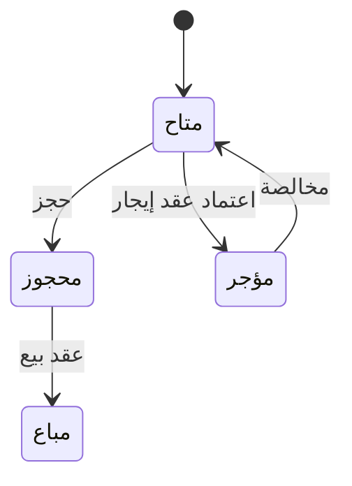

# لوحة العقارات الشاغرة — شرح مفصّل

بتاريخ 2026-10-28 · من موك أب تطبيق «التأجير» (نسخة 26 أكتوبر)، شاشة `rem.vacancy` · المتطلبات M55، M75 · القائمة: التسويق العقاري › الأسعار والإتاحة › لوحة العقارات الشاغرة.

## ما هي الشاشة؟

لوحة **إتاحة لحظية**: تعرض كل عقارات المشروع كمربعات، مرتبة بالمبنى والدور، وكل مربع ملوّن بحالة العقار. **الشاغر** = العقار المتاح، لا مستأجر عليه ولا حجز ولا بيع. منها يبدأ الموظف: يرى ما هو متاح، يضغط على العقار، ثم يحجزه (عقار بيع) أو يؤجره (عقار إيجار).

اللوحة **للقراءة فقط**. لا تغيّر حالة أي عقار؛ الحالة تتغير من الحجز والعقد والبيع والمخالصة، وتظهر عند إعادة العرض.

## من أين تُفتح؟

- القائمة: التسويق العقاري › الأسعار والإتاحة › لوحة العقارات الشاغرة.
- زر «لوحة الإتاحة» في قائمة العقارات.
- زر «لوحة الإتاحة التفصيلية» أسفل تقرير «حالة العقارات».

| الحقل | النوع | الإلزام | الافتراضي | ملاحظات |
| --- | --- | --- | --- | --- |
| المشروع | قائمة | اختياري | كل المشاريع | من المشاريع؛ يعيد رسم اللوحة والأعداد |

## وسيلة الإيضاح والكتل

| الحالة | اللون |
| --- | --- |
| متاحة | أخضر |
| محجوزة | أصفر |
| مباعة | أزرق |
| مؤجرة | بنفسجي |
| تحت الصيانة | رمادي |

- بجانب كل حالة عدد العقارات بها ضمن فلتر المشروع.
- رأس كل مشروع: الاسم، المدينة، و«المتاح/الإجمالي».
- الأدوار مجمعة بالمبنى ثم الدور: المبنى تصاعدياً والدور تنازلياً (الأعلى أولاً). اسم المبنى يظهر فقط إذا كان للمشروع أكثر من مبنى.
- اسم الدور: أقل من 0 = «قبو»، 0 = «أرضي»، غير ذلك «دور n».

## مربع العقار

- آخر جزء من رقم العقار ونوعه.
- للعقار المتاح: السعر. **الإيجار السنوي** إذا كان نشاط المشروع إيجار، وإلا **سعر البيع** بعد أعلى قائمة أسعار سارية أولوية (مشروع / مبنى / دور / نوع / عقار).
- لغير المتاح: اسم الحالة بدل السعر.

## الأزرار والإجراءات

### الضغط على عقار

يفتح نافذة العقار: بطاقة العقار، سعر البيع، الإيجار السنوي، المساحة والغرف. أزرارها:

| الزر | يظهر متى | ماذا يفعل |
| --- | --- | --- |
| حجز | عقار متاح نوع استثماره بيع | يغلق النافذة ويفتح حجزاً جديداً والعقار محدد |
| تأجير | عقار متاح نوع استثماره إيجار | يغلق النافذة ويفتح [[شرح - عقود الإيجار|عقد إيجار]] جديداً والعقار محدد، ويملأ الإيجار والضريبة و**التأمين** (مبلغ يدفعه المستأجر ضماناً ويُرد في المخالصة) من العقار |
| فتح العقار | دائماً | يفتح العقار في شاشة العقارات |

## الحالات (من أين يتغير اللون)

## أمثلة

- اختيار مشروع يجعل أعداد وسيلة الإيضاح لعقارات هذا المشروع فقط.
- عقار إيجار متاح يعرض «تأجير» ولا يعرض «حجز».
- بعد اعتماد عقد إيجار لعقار يتحول مربعه إلى لون «مؤجر» ويظهر نص الحالة بدل السعر.
- «تأجير» يفتح عقد إيجار جديداً بنفس العقار وإيجاره السنوي.

## يعتمد على / يعتمد عليه

- يعتمد على: حالة العقار بقيمها الخمسة (S2 ما زال ينقصه حالات البيع). الشاشة مستقلة (أولوية M)، لكن الحالة تتغير من [[شرح - عقود الإيجار]] (مؤجر) و[[شرح - حجوزات الإيجار]] (محجوز) وعقد البيع (مباع)؛ حتى تُبنى تُختبر ببيانات تجريبية. السعر من [[شرح - تحديث أسعار الإيجار]].
- يعتمد عليه: لا شيء؛ هي نقطة بداية لدورة الإيجار (اختيار عقار شاغر).

## الحالة

غير مبنية في الكلاود. ممكن بناؤها في أي وقت.

## أسئلة مفتوحة

- السعر المعروض يعتمد على نشاط المشروع وليس نوع استثمار العقار؛ في مشروع مختلط يظهر سعر غير مناسب.
