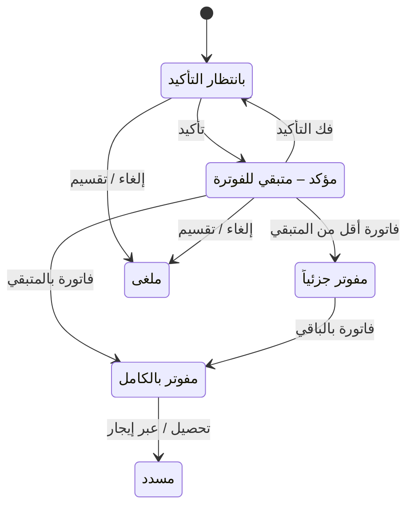

# متابعة أقساط الإيجار — شرح مفصّل

بتاريخ 2026-10-28 · من موك أب تطبيق «التأجير» (نسخة 26 أكتوبر)، شاشة `rent.installments` · المتطلبات M48، M52، M60، M62 · القائمة: التسويق العقاري › التأجير › الأقساط والتحصيل › متابعة أقساط الإيجار (وفي خريطة القوائم: العمليات › الإيجار › الأقساط).

## ما هي الشاشة؟

بعد اعتماد [[شرح - عقود الإيجار|عقد الإيجار]] يصبح للمستأجر جدول أقساط. **القسط** مبلغ يدفعه المستأجر في تاريخ محدد (تاريخ الاستحقاق). كل قسط ينتمي إلى **سلسلة** تحدد نوعه: إيجار، تأمين، خدمات، مرافق، غرامة (ومعها التأثيث). هذه الشاشة هي المكان الوحيد لمتابعة أقساط عقود الإيجار: نرى ما يستحق قريباً وما تأخر، نؤكد القسط، نصدر فاتورته، نحصّله، ونعدّل الجدول عند الحاجة.

قرار 26/10: دُمجت شاشتا «إدارة الأقساط» و«متابعة الاستحقاقات» في شاشة واحدة لكل تطبيق. هذه شاشة الإيجار، وتوأمها بنفس التصميم والقواعد في المبيعات العقارية: [[شرح - متابعة أقساط البيع]] (`rem.installments`). لا يوجد فلتر «نوع العقد»: هذه الشاشة لا تعرض أي سطر بيع، والعكس. شاشة «إصدار الفواتير» المنفصلة وإعداد «الفوترة» في الضبط العام أُزيلا (اجتماع 20/10). وهي معادل شاشة «متابعة الدفعات» (frmPaymentsMonitoring) في النظام القديم.

طرق الوصول الأخرى: في جدول أقساط عقد الإيجار، القسط غير المفوتر الذي يستحق خلال 30 يوماً عليه زر «متابعة الأقساط»؛ ورقم العقد في كل سطر رابط يفتح عقد الإيجار. الخطوات ثلاث: **تأكيد** ← **فاتورة** ← **تحصيل**. سطر **التأمين** استثناء: يُحصَّل مباشرة بلا تأكيد ولا فاتورة.

## من يُسمح له؟

الصلاحيات من «المستخدمين و الصلاحيات»، لهذه الشاشة وحدها (مستقلة عن شاشة البيع). تغيير تاريخ الاستحقاق يحتاج الصلاحية الإضافية «تغيير تاريخ استحقاق قسط» على «متابعة أقساط الإيجار» (الأدمن لديه كل الصلاحيات). **حد تعديل الأقساط %** يأتي من الضبط العام › القيم الافتراضية (نسبة فقط). الصلاحية والحد يُعرضان في ملاحظة أعلى الشاشة.

## الفلاتر والمؤشرات

مجموعة «المعايير»:

| الحقل | النوع | الإلزام | الافتراضي | ملاحظات |
| --- | --- | --- | --- | --- |
| الاستحقاق | اختيار | إلزامي | مستحق خلال | أو «كل الأقساط» (كل السطور غير الملغية) |
| العدد | رقم صحيح | شرطي | 30 | يظهر مع «مستحق خلال» |
| المدة | قائمة | شرطي | يوم | يوم / شهر |
| يشمل المتأخر | مربع اختيار | اختياري | محدد | يضيف ما استحق قبل اليوم وما زال فيه متبقٍ للفوترة أو غير مسدد |
| المشروع | قائمة | اختياري | — | مشاريع الإيجار |
| الحالة | قائمة | اختياري | الكل | بانتظار التأكيد / مؤكد – متبقي للفوترة / مفوتر جزئياً / مفوتر بالكامل / متأخر / مسدد |
| تاريخ التأكيد / الفاتورة | تاريخ | إلزامي | اليوم | تاريخ قيد التأكيد وتاريخ الفاتورة وقيدها؛ قابل للتعديل كالقديم (ConfirmDate) |
| إرسال روابط دفع عبر التطبيق مع الفواتير | مربع اختيار | اختياري | محدد | رابط يدفع منه المستأجر من تطبيقه |

«مستحق خلال N يوم/شهر» = الأقساط من اليوم حتى اليوم + N. السطور مرتبة بالاستحقاق تصاعدياً، والمتأخر مميز بالأحمر. فلتر الحالة «متأخر» و«مسدد» يعمل على حالة السداد.

المؤشرات: **مستحق خلال الفترة** (مجموع الأقساط التي تستحق من اليوم)، **متأخر غير مسدد** (مجموع غير المسدد من المتأخر)، **بانتظار التأكيد**، **مؤكد – متبقي للفوترة** (مجموع المتبقي للمؤكد والمفوتر جزئياً)، **مفوتر** (مجموع المفوتر). وفي الأعلى ملاحظة بالخطوات وسياسة إثبات الإيراد، وزر «إرسال الفواتير الإلكترونية (N معلق)» يفتح شاشة إرسال الفواتير الإلكترونية على فواتير التسويق العقاري.

## أعمدة الجدول

الجدول باختيار متعدد، 15 سطراً في الصفحة. كل صف = قسط غير ملغى مع أجزاء فوترته الجزئية.

| العمود | ماذا يعرض |
| --- | --- |
| العقد | رقم عقد الإيجار (رابط) + كود العقار |
| العميل | المستأجر |
| الاستحقاق / السلسلة | التاريخ ونوع القسط (إيجار، تأمين، خدمات، مرافق، غرامة، تأثيث) |
| مبلغ القسط | الإجمالي بالضريبة مع أجزاء الفوترة الجزئية، بإجمالي |
| المفوتر | مجموع الفواتير الصادرة على القسط |
| المتبقي للفوترة | مبلغ القسط − المفوتر؛ صفر لسطر التأمين |
| المسدد | مجموع المحصّل على القسط وأجزائه |
| تأخير | أيام التأخير = اليوم − الاستحقاق، لسطر نشط متبقيه > 0؛ أحمر |
| الحالة | حالة الفوترة (+ تاريخ التأكيد) أو «تأمين – بيتحصل من غير فاتورة»، + حالة السداد، «تلقائي» للإيجار التلقائي، أرقام الفواتير، «موقوف» لعقد موقوف |
| ف. إلكترونية | للمفوتر: حالة الفاتورة الإلكترونية + الفئة/الكود + النوع (قياسية/مبسطة)؛ لغيره الفئة المتوقعة أو «بدون فاتورة إلكترونية» |
| مبلغ الفاتورة (قبل الضريبة) | خانة للسطر المؤكد الذي له متبقٍ، وتحتها «من {المتبقي}» |
| (أزرار السطر) | تعديل، تقسيم، إلغاء، تحصيل، تحصيل التأمين، أو شارة «عبر إيجار» — حسب حالة السطر |

الإجمالي = المبلغ + الضريبة؛ المتبقي = الإجمالي − المسدد.

**فئة الفاتورة الإلكترونية للإيجار** (D08): S بضريبة 15% للإيجار التجاري؛ E معفى (VATEX-SA-30) للإيجار السكني.

## الأزرار والإجراءات

نفس الاختيار يخدم التأكيد والفوترة وفك التأكيد؛ كل زر يعمل على السطور المناسبة له ويتخطى الباقي.

### تأكيد المحدد

**التأكيد** يعني: «نعم، هذا القسط سنطالب به الآن». للسطور «بانتظار التأكيد» فقط. يعتمد على سياسة **إثبات الإيراد** في الضبط العام (متى وكيف يُسجل الإيراد في الحسابات): **يدوي** (الافتراضي، ودائماً لعقار مالك آخر) = علامة «مؤكد» بتاريخ التأكيد، بلا قيد وبلا فاتورة؛ **إيجار تلقائي** = قيد REM_Confirm بتاريخ التأكيد. نفس القيد يُنشأ تلقائياً في تاريخ الاستحقاق، فالتأكيد هنا للتأكيد المبكر.

مسموح لأي شهر معروض، حتى لقسط لم يستحق بعد. الرسالة: «تم تأكيد N استحقاق بتاريخ … – M قيد إيراد مستحق (إيجار تلقائي) · K اتخطى».

### إصدار فواتير للمحدد

**الفاتورة** مستند يطالب المستأجر بالمبلغ رسمياً ويثبت الضريبة. للسطر المؤكد أو المفوتر جزئياً الذي له متبقٍ وعقده غير موقوف. السطر غير المؤكد يُتخطى برسالة «N قسط لسه ما اتأكدش – أكده الأول».

المبلغ = خانة «مبلغ الفاتورة». يساوي المتبقي ← فاتورة بالمتبقي. أقل من المتبقي ← **فاتورة جزئية** (قرار 11/10): السطر يقل بالمبلغ وتُعاد ضريبته، ويُضاف سطر «جزء مفوتر» بنفس العقد والسلسلة والاستحقاق ونسبة الضريبة وتاريخ التأكيد ويُفوتر، والباقي يبقى مؤكداً. صفر أو أكبر من المتبقي ← رفض: «مبلغ الفاتورة لازم يكون أكبر من صفر ومش أكبر من المتبقي: …» بأرقام العقود.

الفاتورة: فاتورة مبيعات لكل قسط بعلامة «تسويق عقاري» ورقم العقد والقسط، سطر نص حر بالمبلغ، بلا أمر بيع (D06، قرار 15/10)، بتاريخ التأكيد/الفاتورة. تُنشأ معها **فاتورة إلكترونية** (النسخة التي تُرسل لهيئة الزكاة والضريبة) بحالة «معلق» بفئتها وكود الإعفاء من القسط (D08). الرسالة: «تم إصدار N فاتورة مبيعات بإجمالي … – الفواتير الإلكترونية «معلق» … وروابط الدفع اتبعتت».

### فك التأكيد

لسطر مؤكد لا فاتورة عليه (ولا جزئية): يدوي ← تُزال العلامة؛ إيجار تلقائي ← قيد عكسي بتاريخ التأكيد، ولا يتأكد السطر تلقائياً مرة أخرى حتى يُؤكد يدوياً. سطر عليه فاتورة ← «N قسط عليه فاتورة – مينفعش يتفك تأكيده (إشعار دائن على الفاتورة الأول)».

### تعديل (أيقونة)

لسطر نشط غير مفوتر لم يُسدد منه شيء.

| الحقل | النوع | الإلزام | الافتراضي | ملاحظات |
| --- | --- | --- | --- | --- |
| تاريخ الاستحقاق | تاريخ | إلزامي | تاريخ القسط | للقراءة فقط بدون صلاحية «تغيير تاريخ استحقاق قسط» على شاشة الإيجار |
| المبلغ | مبلغ | إلزامي | مبلغ القسط قبل الضريبة | تحذير «يتجاوز حد المستخدم – سيُرسل للاعتماد» عند تجاوز الحد |

يُرسل للموافقة إذا كان |الجديد − القديم| > القديم × نسبة حد الدور ÷ 100 **و** > مبلغ حد الدور (الشرطان معاً) — طلب REM-PLAN (D39) برسالة «أُرسل الطلب لنظام الموافقات». وإلا يُطبق فوراً: يتحدث الاستحقاق والمبلغ وتُعاد الضريبة = المبلغ × نسبة السطر، والفرق يُطرح من آخر سطر نشط غير مفوتر لنفس العقد والسلسلة بعده، فيبقى إجمالي العقد ثابتاً؛ إن لم يوجد يتغير الإجمالي. الرسالة: «تم تعديل القسط وتسوية الفرق على آخر قسط». عند اعتماد الطلب (ApprovalState = 2) يُطبق بنفس المنطق فقط إن كان السطر ما زال غير مفوتر؛ الرفض لا يغيّر شيئاً.

### تقسيم (أيقونة)

| الحقل | النوع | الإلزام | الافتراضي | ملاحظات |
| --- | --- | --- | --- | --- |
| عدد الأجزاء | رقم صحيح | إلزامي | 2 | أقل قيمة فعلية 2 |
| الفاصل (شهر) | رقم صحيح | إلزامي | 1 | |

الجزء = المبلغ ÷ n مقرباً لخانتين، والأخير يأخذ فرق التقريب. استحقاق الجزء k = الأصلي + k × الفاصل أشهر، بنفس السلسلة والنسبة. الأصل ← ملغى بملاحظة «مقسم»، والأجزاء بملاحظة «جزء k/n». الرسالة «تم التقسيم».

### إلغاء (أيقونة)

بعد «إلغاء هذا القسط؟» ← ملغى، بلا تعويض على سطور أخرى. لا يوجد «دمج أقساط» (قرار 26/10).

### تحصيل (أيقونة)

لسطر مفوتر غير مسدد. نافذة المبلغ والطريقة والتاريخ ← «إنشاء سند قبض» على فاتورة السطر (أو أول جزء مفوتر غير مسدد) (D23). **سند القبض** مستند يثبت أن الشركة استلمت مالاً من المستأجر. بعده يُعاد حساب المسدد والمتبقي (D25). السطر المسدد أو غير النشط بلا أزرار. **الشيكات المؤجلة (PDC):** لو المستأجر يدفع بشيكات آجلة لكل دفعة (M53)، تُسجل الشيكات كـ **أوراق قبض** (شيكات تستحق لاحقاً) من شاشة [[شرح - الشيكات المؤجلة]]، وتحصيلها يحدّث المسدد على القسط (D25).

### تحصيل التأمين (أيقونة)

**التأمين** مبلغ ضمان يدفعه المستأجر ويُرد عند الخروج في [[شرح - المخالصات|المخالصة]]. لسطر تأمين غير محصل: سند قبض بنوع كيان «تأمين» لحساب تأمينات المستأجرين، **بلا فاتورة** (D29).

**شارة «عبر إيجار»:** أقساط الإيجار والتأثيث في عقود سدادها عبر **منصة إيجار** (المنصة الحكومية السعودية): لا زر «تحصيل»؛ تظهر شارة «عبر إيجار» عليها مرجع الدفعة، والتحصيل يُسجل من [[شرح - مدفوعات منصة إيجار]].

## الحالات

| حالة الفوترة | متى |
| --- | --- |
| بانتظار التأكيد | لم يُؤكد بعد |
| مؤكد – متبقي للفوترة | مؤكد ولا فاتورة عليه |
| مفوتر جزئياً | عليه فاتورة وما زال له متبقٍ |
| مفوتر بالكامل | المتبقي للفوترة صفر |
| تأمين – بيتحصل من غير فاتورة | سطر التأمين |

حالة السداد: «مسدد» لو المسدد = مبلغ القسط؛ «متأخر» لو أي جزء تجاوز الاستحقاق + أيام السماح وغير مسدد؛ «مسدد جزئياً» لو فيه سداد.

## ما يحدث عند «إصدار فواتير للمحدد»

| الشيء | بعد |
| --- | --- |
| القسط | مفوتر بالكامل أو جزئياً (+ سطر «جزء مفوتر») |
| فاتورة المبيعات | جديدة لكل قسط بعلامة «تسويق عقاري» |
| الفاتورة الإلكترونية | «معلق» في شاشة الإرسال |

## القيود والمحاسبة

- **التأكيد:** يدوي = لا قيد. إيجار تلقائي = REM_Confirm: مدين العميل / دائن إيراد مستحق. فك التأكيد يعكسه: مدين إيراد مستحق / دائن العميل.
- **الفاتورة** حسب «إثبات الإيراد» (D33): يدوي = مدين العميل / دائن الإيراد (أو مستحقات الملاك لعقار مالك آخر، أو حساب السلسلة، كالغرامات والمرافق)؛ إيجار تلقائي = مدين إيراد مقدم / دائن الإيراد. **التحصيل:** سند قبض على الفاتورة يخفض حساب العميل؛ **التأمين:** سند قبض لحساب تأمينات المستأجرين.

## أمثلة

- «مستحق خلال 30 يوم» مع «يشمل المتأخر» ← أقساط الثلاثين يوماً القادمة + المتأخر غير المفوتر أو غير المسدد؛ «3 شهر» ← حتى اليوم + 3 شهور؛ «كل الأقساط» ← كل السطور.
- قسط إيجار «تلقائي» لشهر قادم ← التأكيد يُنشئ قيداً من العميل إلى إيراد مستحق، و«فك التأكيد» يعكسه.
- قسط مؤكد 61,800 (60,000 + ضريبة) ومبلغ الفاتورة 24,000 ← فاتورة 24,000 + ضريبتها، «مفوتر جزئياً»، والمفوتر + المتبقي = مبلغ القسط. فك تأكيده بعدها مرفوض.
- دور حده 10% و 5,000: تعديل قسط 100,000 إلى 85,000 ← طلب موافقة والقسط لم يتغير؛ إلى 94,000 ← يُطبق فوراً ويزيد آخر قسط لاحق من نفس السلسلة 6,000.
- تقسيم 10,000 إلى 3 بفاصل شهر ← 3,333.33 و 3,333.33 و 3,333.34، والأصل ملغى. سطر مفوتر لا يعرض تعديل/تقسيم/إلغاء، ويعرض «تحصيل». قسط إيجار سكني بعقد سداده عبر إيجار ← لا زر تحصيل وتظهر «عبر إيجار».
- تحصيل سطر تأمين غير محصل ← سند قبض لحساب التأمينات بلا فاتورة.

## يعتمد على / يعتمد عليه

- يعتمد على: [[شرح - عقود الإيجار]] (جدول الأقساط)، فاتورة المبيعات «Real Estate Contract»، الضبط العام (إثبات الإيراد، حد التعديل)، نظام الموافقات. خطة البناء: أولوية عالية، مباشرة بعد العقد («نفس شاشة البيع لعقود الإيجار»). يعتمد عليه: [[شرح - مدفوعات منصة إيجار]]، [[شرح - الشيكات المؤجلة]]، [[شرح - كشف حساب المالك]] (التحصيلات)، [[شرح - المخالصات]]، [[شرح - سجل المخالفات]] و[[شرح - استحقاقات المرافق]] (سطور الغرامة والمرافق).

## الحالة

غير مبنية. في DevOps: Feature 101058، User Story 101129 (New)، CR 101110 (Confirmed) — مشتركة مع شاشة البيع.

## أسئلة مفتوحة

- التأكيد مسموح لأقساط لم تستحق بعد — هل يُمنع أو يُربط بصلاحية؟
- شرط الموافقة يطلب تجاوز الحدين معاً (النسبة والمبلغ) بينما النص يقول «أو» — أيهما المقصود؟ (M60)
- الإلغاء يخفض إجمالي العقد بلا مستند ولا سبب.
