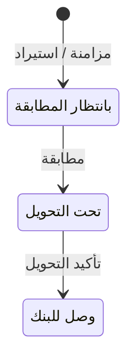

# مدفوعات منصة إيجار — شرح مفصّل

بتاريخ 2026-10-28 · من موك أب تطبيق «التأجير» (نسخة 26 أكتوبر)، شاشة `rent.ejarPayments` · بلا رقم متطلب (بحث 12/10، تكامل D49) · القائمة: التأجير › الأقساط والتحصيل › مدفوعات منصة إيجار.

## ما هي الشاشة؟

**منصة إيجار** منصة حكومية سعودية (الهيئة العامة للعقار) لتوثيق عقود الإيجار. منذ 15/1/2024 يجب أن يُدفع الإيجار السكني عبر قنواتها الرقمية (**سداد** أو **مدى**)، ثم تحوّل المنصة المبلغ للحساب البنكي المسجل في العقد خلال 5 أيام عمل (بدون الجمعة والسبت).

لذلك أقساط الإيجار والتأثيث في هذه العقود **لا تُحصَّل يدوياً** من [[شرح - متابعة أقساط الإيجار]]؛ تظهر هناك بشارة «عبر إيجار» بلا زر تحصيل. بدلاً من ذلك، هذه الشاشة:

1. **تسحب** المدفوعات التي سددها المستأجرون في المنصة.
2. **تطابقها** مع فواتير الأقساط بسند قبض على حساب وسيط «مدفوعات إيجار تحت التحويل» (1135)، لأن المال لم يصل البنك بعد.
3. **تؤكد** وصول التحويل للبنك.

العقود المشمولة: عقود الإيجار الموثقة في إيجار وسدادها عبر إيجار (كل السكني + التجاري المحدد في العقد).

## من أين تُفتح؟

القائمة: التأجير › الأقساط والتحصيل › مدفوعات منصة إيجار.

## شكل الشاشة

- ملاحظة تشرح الآلية (المزامنة أو الاستيراد حسب طريقة الربط، ومدة التحويل).
- تنبيه بالعقود التي سدادها عبر إيجار ولم تُوثق بعد: «N عقد سداده عبر إيجار ولسه مش موثق (…) – مدفوعاته مش هتظهر لحد التوثيق».
- 4 مؤشرات.
- جدول المدفوعات (15 سطراً في الصفحة، الأحدث أولاً) بأزرار الصف.

## الإعدادات (من الضبط العام)

| الإعداد | المكان | ملاحظات |
| --- | --- | --- |
| مدفوعات إيجار تحت التحويل | الضبط العام › الحسابات | الحساب 1135 |
| مدة التحويل (أيام عمل) | الضبط العام › التكاملات الحكومية | الافتراضي 5 |
| طريقة الربط | الضبط العام › التكاملات الحكومية | API (مزامنة) أو استيراد كشف Excel |

## المؤشرات

| المؤشر | المعنى |
| --- | --- |
| بانتظار المطابقة | عدد ومجموع الدفعات المسحوبة ولم تُطابق |
| تحت التحويل | عدد ومجموع الدفعات المطابقة ولم تصل البنك |
| وصلت البنك | عدد ومجموع الدفعات المؤكدة |
| رصيد تحت التحويل | مجموع «تحت التحويل» = رصيد الحساب 1135 |

## أعمدة الجدول

| العمود | ماذا يعرض |
| --- | --- |
| تاريخ السداد | |
| عقد إيجار | رقم العقد في إيجار + مرجع الدفعة |
| العقد | رابط عقد الإيجار |
| المستأجر | |
| الأقساط | تاريخ الاستحقاق + السلاسل التي تغطيها الدفعة (إيجار + تأثيث) |
| القناة | SADAD / mada |
| المبلغ | بإجمالي |
| التحويل المتوقع | تاريخ السداد + أيام التحويل (أيام عمل بدون الجمعة والسبت)؛ أحمر لو فات والدفعة ما زالت تحت التحويل؛ بعد التأكيد = تاريخ الوصول |
| سند القبض | أرقام السندات بعد المطابقة |
| الحالة | فلتر: مسدد في إيجار – بانتظار المطابقة / سند قبض – تحت التحويل / وصل للبنك |

## القواعد

- **دفعة إيجار واحدة لكل عقد وتاريخ استحقاق:** تغطي المتبقي من سطور الإيجار والتأثيث النشطة المستحقة في ذلك التاريخ.
- المزامنة (API) أو الاستيراد (يدوي) يضيف الدفعات الجديدة فقط؛ السطر الذي له دفعة سابقاً لا يتكرر.
- العقود التي سدادها عبر إيجار وغير موثقة لا تظهر لها مدفوعات، وتظهر في التنبيه.

## الأزرار والإجراءات

### مزامنة من إيجار / استيراد كشف إيجار (Excel)

زر واحد يتغير اسمه حسب «طريقة الربط». يسحب الدفعات المسددة حتى اليوم. الرسالة: «تم سحب N دفعة جديدة من إيجار» أو «مفيش مدفوعات جديدة».

### مطابقة (صف) / مطابقة الكل

للدفعات «بانتظار المطابقة». لكل سطر في الدفعة:
- لو القسط غير مفوتر ← تُنشأ فاتورته بتاريخ السداد، مع **فاتورة إلكترونية** (النسخة المرسلة لهيئة الزكاة والضريبة) حسب فئته (D08).
- ثم **سند قبض** (مستند يثبت استلام المال) «تحويل من منصة إيجار» بتاريخ السداد على الحساب 1135 (D23، ReceivableBankTransfer في إدارة النقدية).
- الرسالة: «سند قبض … (تحويل من إيجار – تحت التحويل) على فاتورة القسط»؛ الجماعي: «تمت مطابقة N دفعة». «مطابقة الكل» معطل لو لا شيء بانتظار المطابقة.

### تأكيد التحويل (صف) / تأكيد التحويلات المستحقة

للدفعات «تحت التحويل». الصف يؤكد بتاريخ اليوم؛ الجماعي يؤكد فقط ما وصل تاريخ تحويله المتوقع، بذلك التاريخ. الرسالة: «تم تأكيد وصول التحويل للبنك – قيد من «تحت التحويل» للبنك» / «تم تأكيد N تحويل».

## الحالات

| الحالة | متى |
| --- | --- |
| مسدد في إيجار – بانتظار المطابقة | سُحبت الدفعة ولم تُطابق |
| سند قبض – تحت التحويل | طوبقت؛ المال في الطريق للبنك |
| وصل للبنك | أُكد التحويل |

## ما يحدث عند «مطابقة»

| الشيء | بعد |
| --- | --- |
| القسط | مفوتر (إن لم يكن) ومسدد |
| الفاتورة الإلكترونية | تُنشأ حسب الفئة لو فُوتر الآن |
| سند القبض | جديد «تحويل من منصة إيجار» |
| الحالة | تحت التحويل |
| رصيد تحت التحويل | يزيد بالمبلغ |

## القيود والمحاسبة

- **المطابقة (سند القبض):** مدين مدفوعات إيجار تحت التحويل 1135 / دائن العميل بنوع كيان القسط. وقيد الفاتورة لو صدرت عند المطابقة.
- **تأكيد التحويل (REM_Ejar):** مدين البنك / دائن 1135.

## أمثلة

- عقد سكني موثق بقسط إيجار مستحق ← بعد المزامنة تظهر دفعة «بانتظار المطابقة» بمبلغ الإيجار + التأثيث في نفس التاريخ.
- «مطابقة» ← سند قبض لكل سطر، القسط مسدد، الحالة «تحت التحويل»، ورصيد تحت التحويل زاد بالمبلغ.
- «تأكيد التحويل» ← الحالة «وصل للبنك» وقيد مدين البنك / دائن 1135.
- مزامنة ثانية بلا أقساط مستحقة جديدة ← «مفيش مدفوعات جديدة».

## يعتمد على / يعتمد عليه

- يعتمد على: [[شرح - عقود الإيجار]] (التوثيق في إيجار وخيار السداد عبر إيجار)، [[شرح - متابعة أقساط الإيجار]] (الأقساط والفواتير)، سندات القبض في إدارة النقدية، والضبط العام. خطة البناء: الطبقة الثالثة، أولوية متوسطة؛ «مفيش API؛ الدفعات من استيراد كشف المدفوعات».
- يعتمد عليه: [[شرح - كشف حساب المالك]] (السندات تدخل التحصيلات)، [[شرح - المخالصات]].

## الحالة

غير مبنية؛ الـ overview لا يذكر CR لها.

## أسئلة مفتوحة

- وثائق API إيجار (أسماء الخدمات، صيغة المدفوعات، الأخطاء) غير منشورة؛ الحقول هنا افتراض حتى تسجيل الشركة شريك تكامل.
- هل تخصم المنصة رسوماً على الدفع قبل التحويل؟ وقتها يصل البنك مبلغ أقل من المطابق.
- كيف تُطابق دفعة جزئية أو بمبلغ مختلف عن القسط؟
