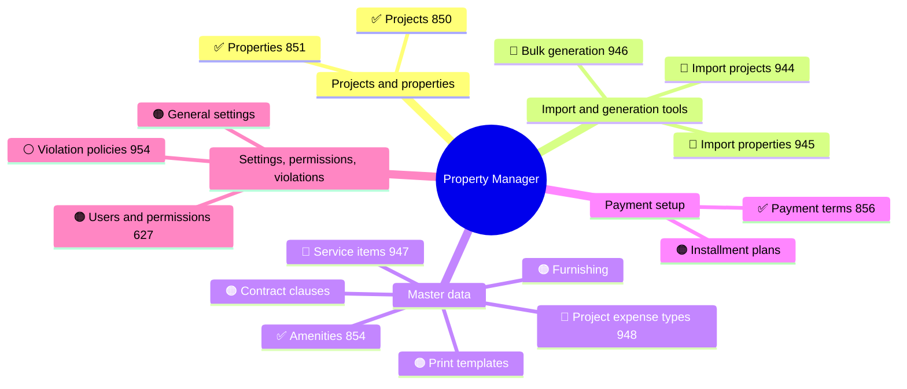
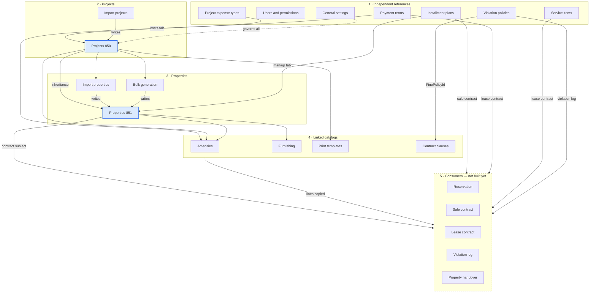
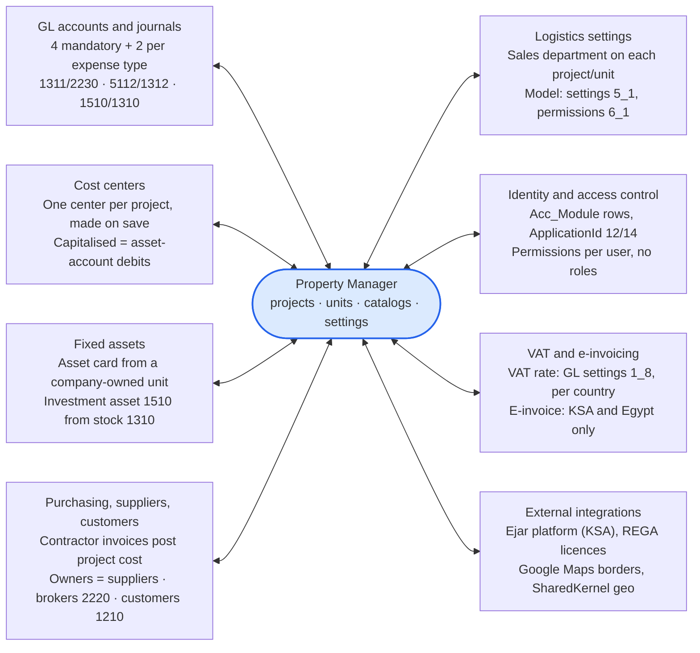
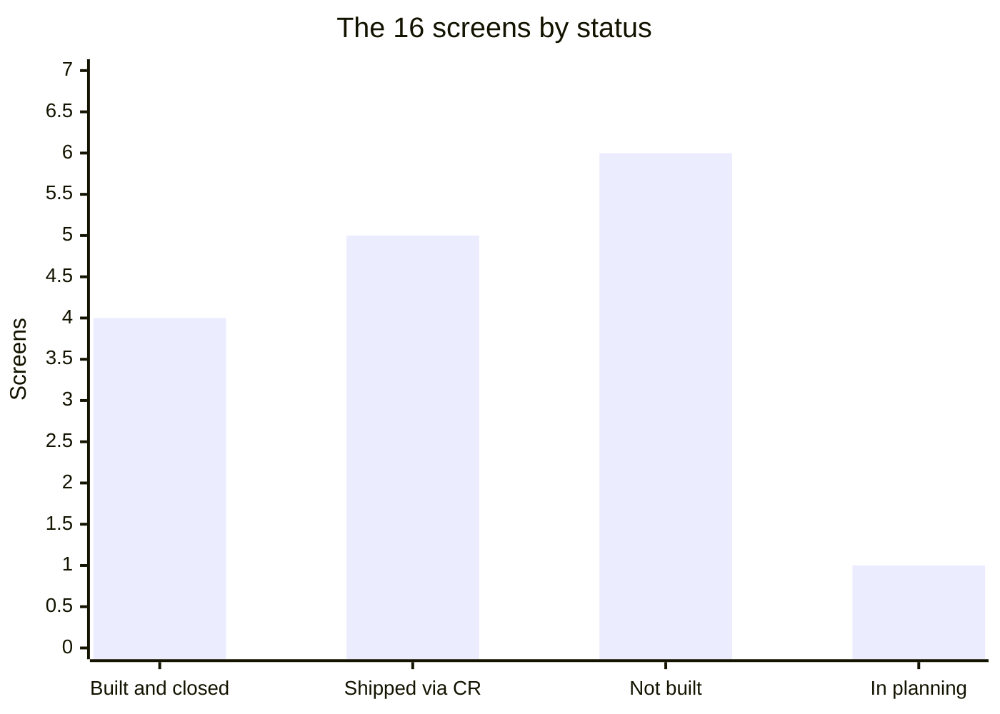

# Property Manager module (موديول التسويق العقاري) — explainer, mind map, dependencies

As of 2026-10-22 · built from `Settings\Settings.md` and the CR notes in this folder. Arabic version: [[شرح موديول التسويق العقاري]].

## Overview

The Property Manager module is the foundation layer of real-estate management in AccFlex Cloud: it registers projects and properties (units) and defines the reference data that sale and lease contracts will be built on. What exists in the cloud today is the "settings and master data" half only; the operational screens (reservation, sale contract, lease contract, installment management, violation log, property handover) appear in the specs as consumers of this data and have not been built.

The specs cover 16 screens in five groups:

- **Projects and properties** (the core): Projects (module 850) and Properties (module 851). Everything else writes into them or reads from them.
- **Import and generation tools**: import projects from Excel, import properties from Excel, and bulk-generate properties from a code pattern. All three write into the project and property tables with the same validation as the screens.
- **Master data (presets)**: Amenities (854), Furnishing, Service items (947), Project expense types (948), Contract clauses, Print templates. Catalogs whose lines are copied into contracts.
- **Payment setup**: Payment terms (856) and Installment plans. Payment terms serve lease contracts and amenities; installment plans serve quotations, reservations and sale contracts.
- **Settings, permissions and violations**: General settings (one company record), Users and permissions (an extension of the existing screen 627), and Violation policies (954) under the root "Leasing › Violations".

Status in short: four screens were built and closed in DevOps from the start, five shipped through CRs in October 2026, four have a confirmed CR and are not built, two have no DevOps item, and Violation policies are at the plan gate.

## Mind map

![[Property Manager mind map.png]]

✅ built and closed · 🔵 shipped via CR (Oct 2026) · 🟠 not built · ⚪ in planning

## Screens

| Screen | Path · Module | Status | DevOps / CR | Purpose |
| --- | --- | --- | --- | --- |
| Projects (المشاريع) | Projects and properties › 2_1 · 850 | ✅ built | Feature 99133 · CR 99136 Closed | Register main and sub-projects with geography, boundaries and a cost center |
| Properties (العقارات) | Projects and properties › 2_2 · 851 | ✅ built | Feature 101062 · CR 101107 Closed | Register units under projects with areas and sale price; geography and rent prices still missing |
| Import projects | Tools › 5_2_1 · 944 | 🔵 shipped | CR 125486 · Solved 2026-10-18, back to development after QA 2026-10-21 · client 1.0.124 | Excel import (24 columns), add-only, auto cost center and an import log |
| Import properties | Tools › 5_2_2 · 945 | 🔵 shipped | CR 125487 · Solved 2026-10-19 · client 1.0.126 | Excel import (19 columns), add-only, server-side inheritance from the project |
| Bulk generation | Tools › 5_2_3 · 946 | 🔵 shipped | CR 125488 · Solved 2026-10-20 · client 1.0.127 | Generate units from a code pattern (building / floor / unit) up to 500 rows, with a linked garage |
| Amenities (الملحقات) | Presets › 3_1 · 854 (classifications 855) | ✅ built | Feature 101061 · CR 101118 Closed | Amenities (parking, pool, storage) per project or unit with a price and a payment term |
| Furnishing (التأثيث) | Master data | 🟠 not built | No DevOps item | Furnishing items with an annual rent, copied into the lease and checked at handover; not fixed assets |
| Service items (بنود الخدمات) | Master data › 5_1_4 · 947 | 🔵 shipped | CR 125562 · Solved 2026-10-19 · client 1.0.136 | Service catalog with an annual value spread over the lease installments |
| Project expense types | Master data › 5_1_5 · 948 | 🔵 shipped | CR 125563 · Solved 2026-10-20 · client 1.0.143 | Project cost types (land, construction, finishing) with an asset account and a cost account |
| Contract clauses | Master data | 🟠 not built | Feature 101054 · CR 101119 Confirmed | Legal clauses printed in sale and lease contracts; a lease clause points to a violation policy |
| Print templates | Master data | 🟠 not built | No DevOps item | Contract text templates with variables, per project and contract type |
| Payment terms (بنود الدفع) | Payment setup › 4_1 · 856 | ✅ built | Feature 101052 · CR 101108 Closed | Payment terms (contract, deposit, rent, penalty…) with a value or percentage, recurrence and grace period |
| Installment plans | Master data | 🟠 not built | Feature 101053 · CR 101109 Confirmed | Library of installment systems for quotations, reservations and sale contracts; includes the late penalty |
| General settings (الضبط العام) | Settings and permissions | 🟠 not built | Feature 101056 · CR 101120 Confirmed | One company settings record: country, 4 mandatory accounts, penalties, revenue recognition, integrations |
| Users and permissions | Settings and permissions · 627 (extension) | 🟠 not built | Feature 101057 · CR 101121 Confirmed | The existing 6_1 screen plus two permission groups for the module |
| Violation policies | Leasing › Violations › 7_1_1 · 954 (proposed) | ⚪ planning | CR 125716 · plan gate pending | Tenant violation fines tiered by repeat; catalog only |

## Dependencies between screens

Projects, then properties, are the dependency spine: every tool writes into them, every linked catalog reads from them, and the future contracts read everything. Setup order: independent references → projects → properties → linked catalogs → contracts.

The links that fix the order:

- **A property inherits its project**: ownership, geography, sales department, cost center, currency, activity and status (GetProjectInfoById on the screen; server-side in import and bulk generation). So no property exists without a leaf sub-project.
- **A project creates a cost center** under «المشاريع» on save, and its costs tab reads the project expense types (the link table exists since CR 125563, with no UI yet).
- **Payment terms** feed amenities and the lease contract; **installment plans** feed the property's markup tab and the sale contract. The late penalty lives inside the plan (sales) and inside the payment term (leasing), not in a separate library.
- **Violation policies** are referenced by a lease clause (Pm_ContractClause.FinePolicyId) and by the violation log; they are separate from the late-payment penalty.
- **General settings** govern everything through one record: the country decides currency, VAT and e-invoicing, and the four mandatory accounts decide where contracts post. Decision of 11 and 15 October: revenue recognition is a company policy here, removed from project and property.
- **Delete is usage-guarded** in every catalog (a used payment term, an expense type with movement, a project with properties), and most of these checks are deferred until the contracts exist.

## Integration with the rest of AccFlex

The module defines neither its accounts, its taxes nor its sales departments; it reads them from GL, logistics settings and identity, and posts its own journals because the cloud has no revenue-recognition engine and no deposit concept in treasury. The four accounts general settings defines: tenant deposits 2320, owner dues under settlement 2215, uninvoiced sale-contract receivables 1215, property stock 1310 (the spec also names a contradicting fifth one: rent receipts pending transfer 1135).

Accounts the module uses but defines elsewhere:

| Account | Number | Defined in |
| --- | --- | --- |
| Customers and advances | 1210 · 2330 | Customer groups 1_2 |
| Brokers | 2220 | Supplier groups 1_5 |
| Deferred revenue | 2310 | Chart of accounts (needs an extension) |
| Property sales and rent revenue | 4110 · 4120 | Service class per sales department |
| Broker commissions | 2250 · 5210 | Logistics settings 5_1 |
| Customer VAT | 2410 | GL settings 1_8 |
| Asset-type accounts | — | Asset types 7_2 |
| Rep bonuses | 2260 | Payroll |

The three documented journals: cost recorded on a project (Dr 1311 / Cr 2230), handover of a sold company-owned unit (Dr 5112 / Cr 1312 for the unit's share of each cost type), and conversion of a unit into an investment asset (Dr 1510 / Cr 1310).

## Implementation status

| Group | Built | Shipped via CR | Not built | In planning | Total |
| --- | --- | --- | --- | --- | --- |
| Projects and properties | 2 | 0 | 0 | 0 | 2 |
| Tools | 0 | 3 | 0 | 0 | 3 |
| Master data | 1 | 2 | 3 | 0 | 6 |
| Payment setup | 1 | 0 | 1 | 0 | 2 |
| Settings, permissions, violations | 0 | 0 | 2 | 1 | 3 |

The core and the tools are complete; what remains are the catalogs that need a contract to be useful, and the general settings every contract depends on.

What is left on the shipped CRs:

| CR | Screen | Next step |
| --- | --- | --- |
| 125486 | Import projects | Merge the new Stage_Beta PRs (ERP 67925, Front 67926), deploy Stage Beta, then ADO back to Solved and reply to QA |
| 125487 | Import properties | The engineer resolves the three Stage_Beta PR conflicts, then a Beta deploy and PO check, then remove the set |
| 125488 | Bulk generation | Stage_Beta conflicts resolved together with 125487; the 2026-10-20 fix reaches Beta only through a new merge of cr125488 |
| 125562 | Service items | API and DB conflicts on cr125562_Stage_Beta branches, when the engineer asks |
| 125563 | Project expense types | Conflicts on the three PRs (67763/64/65); the set was removed and is recreated from origin/cr125563 when needed |
| 125716 | Violation policies | The engineer answers Q1–Q8 and approves the plan (gate 3), then phase-loop runs |

## Gaps and open questions

The one biggest gap: there is no lease contract and no sale contract in the cloud on any branch, so every catalog shipped without a consumer and with deferred acceptance criteria.

**Not in the cloud yet** (scan of 2026-10-22): lease contract, sale contract, reservation, violation log, property handover, rent-price table, property history, the «متاح» availability status, a building field (a building is a parent property), the «عقارات مركبة» tab, the project costs tab, and any KG coverage of the module. Deferred because of this: AC-1/AC-2/BR-2 and the «عقود الإيجار» column in service items, BR-2/AC-1..3 in violation policies, the rent column in import and bulk generation, and the project count in expense types (shows 0).

**Gaps in the built screens** (from "implemented vs story"): Projects 12 (flat parent list, HasProperties hard-coded false, inverted cost-center filter, North/South boundaries swapped…), Properties 14 (geography sent as 65/1/1, rent prices are a title with no table, type from ProjectTypes, manual price…), Payment terms 4 (grace unit saved from the recurrence unit, giving a 500 with "no repeat"; the ≤100 check is on value instead of percentage…), Amenities 6 ("serves" sends text while the server expects 1/2, payment term not filtered by type…).

**Decisions waiting for an owner:**

- [ ] D46: Amenity / PaymentTerm / Project / Property tables are shared with the other app (api/MenuList).
- [ ] Permissions: add the property screens under ApplicationId 12, or widen the query to 8 / 14 and resolve the 14 conflict.
- [ ] General settings: the fifth account 1135 contradicts "4 accounts only"; where are 5110, 4140, 4130, 4150, 4190, 2340, 2350, 5410 defined.
- [ ] Pm_Project.ProofOfIncomeAndExpenses: drop it or make it a company setting (already dropped from the import).
- [ ] Source of the completion percentage: contractor progress statements or an engineer's report.
- [ ] D03: add PurchaseOrganizationId to the project.
- [ ] CR 125716: Q1–Q8 all open (catalog-only scope, FK on the clause, module 954 and root 7); 952–953 are taken by unmerged branches.
- [ ] Furnishing: is price × quantity; and revenue 4120 for a unit owned by another owner.
- [ ] Clauses: snapshot the text at contract approval; print templates: text with variables or Word.

**On the release path now:** Stage_Beta conflicts pending on 125487, 125488, 125562 and 125563 (resolved on `cr<id>_Stage_Beta` branches, never by merging Stage_Beta into the CR branch), and 125486 went back to development after the QA retest, with the fix pushed and new Stage_Beta PRs open.

## Sources

All in this folder, read on 2026-10-22:

- `Settings\Settings.md`: the 15 screen specs (fields, business rules, journals, integration, implemented vs story, open questions).
- `Violations\Violation Policies\Violation Policies.md` and the `CR-125716` folder (facts, spec, plan, open-questions, HANDOFF).
- The shipped CR folders: `Settings\importProjects\CR-125486`, `Settings\importUnits\CR-125487`, `Settings\bulkUnits\CR-125488`, `Settings\services\CR-125562`, `Settings\expTypes\CR-125563` (HANDOFF.md, decisions.md, open-questions.md, spec.md, plan.md).
- Feature notes: `importProjects v3.md`, `importUnits v2.md`, `bulk Units V2.md`, `services.md`, `expTypes.md`.

Neither the code nor the KG was read; statuses and numbers are as these files state them.
