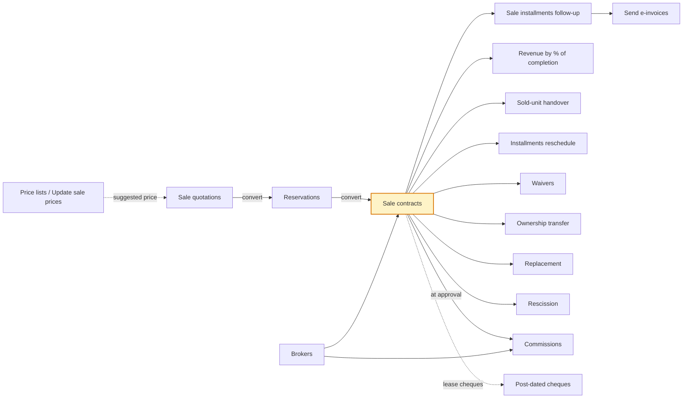
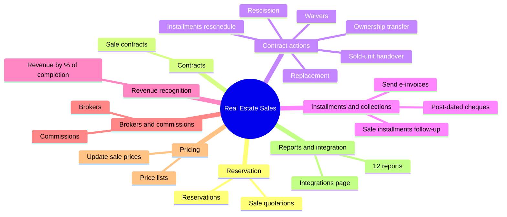

# Real-estate Sales (المبيعات العقارية) — the screens explained for a non-business reader

As of 2026-10-26 · complements [[Screens explained in detail]] (settings) and [[Leasing screens explained]] (leasing) · Arabic version: [[شرح شاشات المبيعات العقارية]].

Source: the interactive mockup of the Property Manager module, "Real Estate Sales" app (26 October version): 16 working screens, the e-invoice sending screen shared with Logistics, 12 reports and the integrations page. The cloud build status was not checked per screen here; the code shows that "Sale quotations" exists (SaleQuotations), that the sale contract carries CR 125774 and ownership transfer CR 126102.

## The big idea

A property sale is the unit's journey from Available to Sold to Delivered: a quotation for the customer, a reservation with a deposit (or an off-plan reservation with no unit yet), a sale contract that generates the installment schedule, installments follow-up (confirm → invoice → collect), revenue recognition by the company policy, then handover with an inspection report and the cost journal. Anything that happens after the contract has its own screen: rescheduling, waiver, ownership transfer, replacement, rescission. On the side: brokers and their commissions, and price lists.

The sale contract (yellow) is the centre: the reservation precedes it, and installments, revenue, handover and every action branch from it.

## Mind map

![[Sales mind map.png]]

## The screens at a glance

| # | Menu group | Screen | What it does in one line |
| --- | --- | --- | --- |
| 1 | Reservation | Sale quotations | A priced offer for a unit and a customer, with discount, plan and a proposed schedule |
| 2 | Reservation | Reservations | Reserve a unit with a deposit, or off-plan with a priority fee, and the advance-payment invoice |
| 3 | Contracts | Sale contracts | The contract: price, discount, taxes, buyers, installments, clauses |
| 4 | Contract actions | Sold-unit handover | Handover report and the delivery and cost journals |
| 5 | Contract actions | Installments reschedule | Spread the remaining installments over a new count and frequency |
| 6 | Contract actions | Waivers | The buyer returns the unit to the company for a fee |
| 7 | Contract actions | Ownership transfer | The contract moves to a new buyer under a new contract with a transfer fee |
| 8 | Contract actions | Replacement | The same buyer swaps the unit for another |
| 9 | Contract actions | Rescission | End the sale contract with a penalty and refund the rest |
| 10 | Installments and collections | Sale installments follow-up | Confirm, invoice, collect and edit installments (merged 26/10) |
| 11 | Installments and collections | Send e-invoices | Send installment invoices to the tax authority (an extended Logistics screen) |
| 12 | Installments and collections | Post-dated cheques | The cheque wallet for lease installments: deposit, collect, bounce |
| 13 | Revenue recognition | Revenue by % of completion | Post the month's revenue and cost for off-plan contracts |
| 14 | Brokers and commissions | Brokers | Register of external brokers with a REGA licence and a commission rate |
| 15 | Brokers and commissions | Commissions | Broker and marketer commissions from approval to payout |
| 16 | Pricing | Price lists | Adjust unit prices by percent or amount on a scope, with priority and validity |
| 17 | Pricing | Update sale prices | Raise sale prices in bulk |

The 12 reports (sold units, installment status, collection dashboard, cash flow, project revenue, project costs, deposits, salesmen, broker commissions, history, sale profitability, tax position) read from all of the above and are not described here.

---

## 1. Sale quotations

**What it is.** An offer to a customer on a specific unit: list price (from the price lists), discount %, installment plan; the final price = list price × (1 + plan markup) × (1 − discount), with a printable proposed schedule. It does not reserve the unit or change its status. Number `QT-<year>-<seq>`, valid 14 days.

**What you enter.** Customer (with "+ new customer", created in the "real-estate customers" group), an optional CRM lead, project (filter), unit (available for sale), marketer, list price, discount, installment plan.

**Statuses.** Draft → Sent (the "send to customer" button; in the product it sends a PDF by WhatsApp and email) → Converted to reservation, or Expired after validity. "Convert to reservation" opens a reservation pre-filled with the customer, unit, final price and plan.

**Example.** 1,050,000 with 2% discount → 1,029,000.

**Open questions.** When does it become "accepted"? Is it locked after sending?

## 2. Reservations

**What it is.** Reserving a unit for a customer with a deposit of a percentage of the price (5% from general settings) for a validity period (14 days), or an **off-plan reservation** with no unit and a priority fee, the unit chosen later from the project tree (decision of 11 October). Number `RSV-<year>-<seq>`.

**Life cycle.** Draft → Confirmed → Converted to contract (when the sale contract is approved) or Cancelled. "Expired" is computed after validity and the unit stays Reserved until the user decides (decision of 26 October).

**What confirm does.** The unit becomes Reserved, the customer's sub-accounts are created, and an **advance-payment invoice** for the deposit is issued in Sales with no sales order (decision of 15 October) and no VAT (out of scope), with e-invoice 386 in Saudi Arabia; the journal: debit customer, credit customer advances. "Collect deposit" creates a receipt by the payment method. "Convert to sale contract" opens a pre-filled contract.

**Cancellation (decision of 26 October).** The reason (customer / company) and the deposit's fate (forfeit to "forfeited reservation deposits revenue" 4195 / full refund with a "real-estate customer refund" payment request / partial refund).

**Details.** The broker and marketer are recorded here and their commissions computed at contract approval; "on behalf of others" shows when the unit belongs to another owner. DevOps: Feature 101055, CR 101122 Confirmed.

**Open questions.** Should conversion be blocked before the deposit is collected? Is the priority fee refundable if no unit is chosen?

## 3. Sale contracts

**What it is.** The contract (preliminary or final) selling a unit: price, discount, installment plan, amenities, clauses and buyers. Approval generates the schedule, sets the unit to Sold, stamps the revenue-recognition policy on the contract, settles the reservation deposit, and accrues broker and marketer commissions. Number `SC-<year>-<seq>`. Later actions are separate screens (decision of 11 October).

**What you enter.**
- **Contract:** type, date, schedule start, reservation (copies buyer, unit, price, deposit), the representative buyer (or a "buyers" table with ownership shares totalling 100% and one representative), unit.
- **Value:** list price → sale price = list price × (1 + plan markup), discount as an amount, contract net = sale price − discount (amenities outside it), the collected deposit deducted from the down payment (if larger, from the following installments, decision of 25 October).
- **Taxes (Saudi Arabia):** "subject to real-estate transaction tax" (default yes in Saudi Arabia): installments at 0% VAT category E, plus 5% RETT on the net paid by the buyer (a schedule line) or the seller (journal expense 5220 / accrued 2420). "First home for a Saudi citizen": the state bears the tax up to a 1,000,000 cap. Egypt: subject = installments at 14% VAT.
- **Brokerage:** marketer, external broker and their rate (2.5% default) and who bears it.

**Tabs.** Installments (a preview before approval, the real grid after, with a "follow up installments" button on lines due within 30 days), buyers, amenities (an "amenities" line in the schedule), fines, terms and conditions, contract movements, invoices.

**How the schedule is built.** The plan's down payment minus the deposit, then installments = basis ÷ count rounded per the plan, the first after "first installment after (months)", and a "maintenance deposit" line if any. No interest and no annual payment (decision of 13 October).

**Statuses.** Draft → Active (approval) → Fully paid (computed when the last installment is collected) → Delivered; other endings: Waived, Transferred, Replaced, Rescinded. "Convert to final" changes the type only.

**Fines.** Computed from the installment plan and the country rules in general settings (Saudi default: no monetary fine; "charity" fines go to account 2280, never revenue; Egypt capped at 7% a year), with default stages (reminder, warning, default notice, legal, accelerate remaining installments, rescind). "Apply" lets you reduce the fine with a reason, never raise it, and "exempt" waives it with a reason (CR 107039).

**Revenue recognition.** Manual (default): revenue with each installment's invoice. At handover: invoices go to customer advances and all revenue is booked at handover. Percentage of completion: from the revenue screen. A unit owned by someone else: company revenue = the marketing commission only, the rest due to the owners (2215).

**Open questions.** First home with more than one buyer (CR 125774 Q18). DevOps: CR 101123 Confirmed.

## 4. Sold-unit handover

**What it is.** The handover report of the unit to the buyer, with an inspection (6 items: kitchen, bathrooms, floors, paint, air conditioning, doors and windows) and two meter readings. Created posted; the contract becomes Delivered; the unit stays Sold.

**Journals at handover, by policy.** "At handover": full net revenue (debit contract receivables, credit property sales revenue) and closing of customer advances against contract receivables; "percentage of completion": completion of revenue and cost to 100%; "manual": the cost journal only. **The cost journal** (company unit only): per cost type, debit the type's cost account (e.g. 5111), credit work in progress (1311), for the unit's share (by area or a manual percentage from the project's costs tab).

**Example.** A 350 m² villa in a 3,750 m² project with a land balance of 3,150,000 → a land line of 294,000.

**Open questions.** Must a percentage be paid or the contract be final before delivery?

## 5. Installments reschedule

**What it is.** Spreading the remaining uninvoiced installments (sale or lease) over a new count, frequency and start, with the same total: installment = remaining ÷ count, the last one taking the rounding difference. Old lines become Cancelled. No journals. If the change exceeds the "installment-edit limit %" it needs an approval (D39).

**Example.** 8 × 75,000 into 6 quarterly → 6 × 100,000.

## 6. Waivers

**What it is.** The buyer returns the unit to the company: what they paid is refunded minus a waiver fee (1% of the net by default), the contract becomes Waived, the unit Available, and the remaining installments are cancelled. A credit note and a "real-estate customer refund" payment request are created for the difference. The journal reverses the recognised revenue (the unified reversal journal) and books the fee as services revenue. "Cancel the waiver" restores everything from a saved snapshot. "Waiver to a new customer" was removed on 26 October and moved into "ownership transfer".

**Example.** Net 1,000,000, paid 200,000, fee 10,000 → refund 190,000.

## 7. Ownership transfer (CR 126102, updated 26 October)

**What it is.** The contract moves to a new buyer (or several, with ownership shares totalling 100% and one representative) under a new `SC` contract starting on the transfer date: installments due from that date move to it with their dates, what was paid stays with the old buyer, and the old contract becomes Transferred. A transfer fee (5,000 by default from general settings, plus the country VAT) on the seller or the new buyer, as a line invoiced from installments follow-up. No journals and no new commissions; the broker does not carry over.

**Example.** Due dates 1/1, 1/4 and 1/7 with a transfer on 15/3 → only the 1/4 and 1/7 installments move.

## 8. Replacement

**What it is.** The same buyer swaps the unit for another available one: what was paid moves as the deposit of the new contract, the old contract becomes Replaced and its unit Available, and the new schedule is built on the difference (new price − paid) with the same plan. An optional replacement fee (amount or percent) with VAT. The journal reverses the old contract's revenue and moves the paid amount to customer advances settled on the new contract.

**Example.** Paid 200,000 and a new price of 1,200,000 → a new contract with a 200,000 deposit and a schedule on 1,000,000.

**Open question.** Commissions accrue a second time on the new contract.

## 9. Rescission

**What it is.** Ending a sale contract (leases are not rescinded; they end by notice) with a penalty based on a percent of the paid amount (10% default), a percent of the contract value, or a fixed amount (decision of 26 October). The company keeps the lesser of (penalty, paid) and refunds the rest by credit note and payment request; if the penalty exceeds the paid amount, the rest can be charged as a "rescission penalty" installment. Remaining installments are cancelled, the unit becomes Available, recognised revenue is reversed, and the cost journal is reversed if the unit was delivered. No VAT on the penalty (compensation, not a service).

**Example.** Paid 300,000 at 10% → penalty 30,000 and refund 270,000.

## 10. Sale installments follow-up (merged 26 October)

**What it is.** The one screen for sale-contract installments after approval (twin of "lease installments follow-up"): a "due within N days/months" filter with overdue, six KPIs and the installments grid. **Steps:** confirm selected (a flag with a date, no journal under the manual policy) → issue invoices for selected at the amount the user types (less than the remainder = partial invoice; e-invoice created "pending"; payment links through the app) → collect by receipt. "Unconfirm" as long as no invoice exists. Edit amount or due date (the date needs the "change installment due date" permission; above the edit limit it goes to approvals and the difference is netted on the last installment), split, cancel. No merge.

**Example.** An installment of 61,800 and an invoice amount of 24,000 → "partially invoiced".

## 11. Send e-invoices

**What it is.** The existing Logistics screen with a new "source" filter (real-estate sale / lease) and "project". Installment and deposit invoices are created "pending" and never sent automatically (decision of 14 October); the user marks them "ready to sync" and a background job sends them: syncing → synced, or rejected with a reason. Categories: S with VAT, E exempt (VATEX-SA-30: residential rent and property sales), O out of scope (the RETT line and security deposits, no e-invoice). B2B needs the customer's commercial registration.

## 12. Post-dated cheques (receivable notes)

**What it is.** The cheque wallet for leases with the cheques option: one cheque per rent installment, registered through "pooled receivable notes" in Cash Management. **Statuses:** in treasury → (deposit at bank) under collection → (collect) collected: it pays the installment with a receivable-note receipt and posts bank 1120 / notes under collection 1131; or (bounce) bounced with a 500 fine on the contract; or cancelled / withdrawn / re-presented.

## 13. Revenue by % of completion

**What it is.** For off-plan contracts under the "percentage of completion" policy: at each month end the user posts a run `POC-<year>-<seq>` with period revenue = contract net × completion % − already recognised, and period cost at the same percentage of the unit's share of each cost type. The percentage comes from the project's "completion %" tab (contractor progress bills or an engineer's report; the final source is open). Journal: debit contract receivables, credit property sales revenue; and debit the type's cost account, credit work in progress. Handover completes to 100%.

**Example.** Net 745,500 at 24% → 178,920; then 36% → 89,460.

## 14. Brokers

**What it is.** The register of external brokers: code, name, REGA licence number (required), licence expiry (red when expired), a default 2.5% commission, VAT-registered flag, withholding-tax flag. In AccFlex a broker is a supplier in the "real-estate brokers" group with account 2220-xxxx. A "commissions" tab shows the broker's commissions.

## 15. Commissions

**What it is.** Tracking broker (sale and lease) and marketer commissions from contract approval to payout. **Kinds:** broker – sale / broker – lease / marketer – sale. **Statuses:** calculated → approved → paid.
- **Broker:** "invoice verification" (or a combined bill for several contracts) creates a rush purchase order and an invoice verification in Purchasing (debit commission expense 5210, credit the broker's account, with input VAT and withholding), then "pay" through a type-5 payment request and a bank payment voucher.
- **Marketer:** "approve accrual" (5210 to accrued commissions 2250) then "payroll bonus" (2250 to accrued salaries and bonuses 2260). A "marketer tiers" tab re-rates the month at the final tier and "settle" adds the difference.

**Example.** Commissions 2,000 + 1,000, VAT-registered, 5% withholding → VAT 450, withholding 150, net 3,300.

**Open questions.** "Charged to" has no accounting effect; a renewal creates a new commission.

## 16. Price lists

**What it is.** Lists that adjust a unit's base price by percent or amount on a scope (project, building, floor, unit type, unit), with a priority and a validity period. Only the highest-priority applicable list applies, and the "effective price" is suggested on the quotation, reservation, contract and replacement, copied into the document and unchanged afterwards. An "affected units" tab previews the effect.

**Example.** A project list of +5% → 1,000,000 becomes 1,050,000.

## 17. Update sale prices

**What it is.** Raising sale prices in bulk with filters (project, building, floor, type, availability) and a percent, an amount, or price per metre × area, with rounding (to the nearest 1,000 by default) and a reason. It changes the unit price immediately and logs the old one in its history; existing quotations, reservations and contracts do not change.

**Example.** 7,000 per metre on a 135 m² unit rounded to 1,000 → 945,000.

---

## Words you will meet

| Word | Plain meaning |
| --- | --- |
| List price / effective price | The unit's price after price lists, before discount and plan markup |
| Installment-plan markup | A percentage added to the price when selling on installments, from the unit or the plan |
| Real-estate transaction tax (RETT) | A Saudi 5% tax on property sales, usually paid by the buyer; the sale installments themselves are VAT-exempt |
| First home | The state bears the RETT up to a one-million-riyal cap for a Saudi citizen |
| Contract receivables | An account holding what the buyer owes after revenue is recognised |
| Customer advances | What the customer paid before revenue recognition (the deposit and pre-handover invoices) |
| Revenue recognition | When a sale counts as revenue: with each invoice, at handover, or by completion percentage |
| Unified reversal journal | Reversing the recognised revenue on rescission, waiver or replacement |
| Invoice verification (IV) | Recording a supplier's (broker's or owner's) invoice in Purchasing before payment |

## Sources

- The interactive mockup (the shared artifact "موديول التسويق العقاري"), Real Estate Sales app, 26 October 2026 version: the screen specs and the integrations page (D01–D49).
