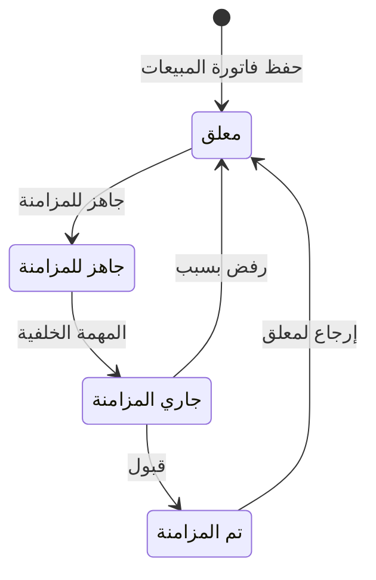

# إرسال الفواتير الإلكترونية — شرح مفصّل

بتاريخ 2026-10-28 · من موك أب تطبيق «المبيعات العقارية» (نسخة 26 أكتوبر)، شاشة `log.einvoice` (شاشة قائمة في اللوجستيات، Desktop: EInvoiceSending – Cloud: EInvoiceSearchQuery / UpdateEInvoice) · المتطلبات D08 · القائمة: الخدمات اللوجيستية › المبيعات › إرسال الفواتير الإلكترونية.

## ما هي الشاشة؟

**الفاتورة الإلكترونية** نسخة رقمية من فاتورة المبيعات تُرسل لهيئة الضرائب (في السعودية ZATCA، في مصر ETA). الإرسال يسمى **مزامنة**. هذه شاشة موجودة أصلاً في اللوجستيات؛ لا شاشة جديدة.

فواتير أقساط البيع والإيجار وفاتورة عربون الحجز هي فواتير مبيعات عادية بعلامة «تسويق عقاري». لذلك عند حفظها تُنشأ فاتورتها الإلكترونية بحالة «معلق» وتظهر هنا. ما أضافه التسويق العقاري: فلتر «المصدر» و«المشروع»، عمود «المصدر» (العقد والقسط)، الفئة وكود الإعفاء، و«نيابة عن المالك».

طرق الوصول:
- من القائمة أعلاه.
- من [[شرح - متابعة أقساط البيع]] زر «إرسال الفواتير الإلكترونية (N معلق)» يفتحها بالمصدر = التسويق العقاري والحالة = معلق.

**قرار 14/10:** لا إرسال تلقائي لفواتير التسويق العقاري. تبقى «معلق» حتى يحددها المستخدم ويضغط «جاهز للمزامنة»، مثل باقي فواتير اللوجستيات.

## الفلاتر والمؤشرات

مجموعة «البحث»:

| الحقل | النوع | الإلزام | الافتراضي | ملاحظات |
| --- | --- | --- | --- | --- |
| من تاريخ | تاريخ | إلزامي | اليوم − شهر | كالشاشة الحالية |
| إلى تاريخ | تاريخ | إلزامي | اليوم | لازم ≥ من تاريخ |
| العملاء | اختيار متعدد | اختياري | — | فارغ = الكل |
| الحالة | اختيار متعدد | اختياري | معلق | معلق (1) / جاهز للمزامنة (2) / تم المزامنة (3) / جاري المزامنة (4) |
| المصدر | قائمة | اختياري | التسويق العقاري (الكل) عند الفتح من الموديول | جديد: الكل / المبيعات / التسويق العقاري (الكل) / – بيع / – إيجار؛ يتحدد من العلامة ومرجع العقد أو الحجز ونوع العقد |
| المشروع | قائمة | شرطي | — | جديد؛ يظهر مع مصدر التسويق العقاري؛ من عقار العقد |

تحت البحث مؤشرات بعدد/مجموع كل حالة.

## أعمدة الجدول

تبويبان: «الفواتير» (اختيار متعدد) و«لم تُنشأ».

| العمود | ماذا يعرض |
| --- | --- |
| الكود / نوع الحركة | فاتورة 388 (قسط) أو فاتورة دفعة مقدمة 386 (عربون الحجز) + رقم الفاتورة الإلكترونية |
| التاريخ | تاريخ الفاتورة |
| العميل | + تنبيه «بيانات الضريبة ناقصة» |
| المصدر | جديد: رقم العقد بنوعه والسلسلة، أو عربون الحجز |
| الفئة / النوع | جديد: كود الإعفاء، مبسطة B2C أو قياسية B2B، «نيابة عن المالك» KSA-2 |
| قبل الضريبة / الضريبة / بعد الضريبة | المبالغ |
| حالة المزامنة / الرفض | الحالة + تاريخ المزامنة وسبب الرفض |

تبويب «لم تُنشأ»: نفس الأعمدة بلا الحالة، لسطور لا فاتورة إلكترونية لها: سطور O (ضريبة التصرفات على المشتري)، التأمينات، أو المعفاة والإعداد مقفول.

كلمات مهمة:
- **قياسية (B2B)**: لعميل شركة؛ تحتاج اعتماد الهيئة. **مبسطة (B2C)**: لعميل فرد؛ تُبلَّغ فقط.
- **الفئة**: S خاضعة بنسبة الدولة (مثل الإيجار التجاري 15%)؛ E معفاة بكود VATEX-SA-30 (الإيجار السكني وأي بيع عقار، خاضع لضريبة التصرفات أو لا)؛ O خارج النطاق.
- **نيابة عن المالك (KSA-2)**: إيجار عقار مالك آخر تصدر الشركة فاتورته باسمه — فجوة في AccFlex.

## الأزرار والإجراءات

### جاهز للمزامنة

يحوّل الفواتير المحددة من «معلق» إلى «جاهز للمزامنة» ويمسح سبب الرفض. متاح فقط عندما فلتر الحالة = «معلق» وحده وفي نتائج؛ والاختيار مسموح للسطور المعلقة فقط. بدون اختيار: «لم يتم تحديد أي حركات».

### تشغيل مهمة المزامنة

في المنتج مهمة خلفية (Hangfire) تعمل وحدها؛ في الموك أب زر يحاكيها: «جاهز» ← «جاري المزامنة»، و«جاري المزامنة» ← «تم المزامنة» بتاريخ المزامنة، أو ← «معلق» مع سبب الرفض (MakeEInvoiceRejected).

### إرجاع لمعلق

على سطر «تم المزامنة» فقط، بتأكيد: «سيتم تغيير حالة الفاتورة إلى معلقة». هي الطريقة الوحيدة للعودة إلى «معلق»؛ ولا يمكن وضع «تم المزامنة» يدوياً.

### تصدير XML (السعودية)

ينزّل ملف الفاتورة لكل سطر. في مصر: إلغاء فاتورة متزامنة بسبب (CancelEInvoice) — كالشاشة الحالية.

## الحالات

| الحالة | المعنى |
| --- | --- |
| معلق (1) | أُنشئت مع الفاتورة ولم تُرسل، أو رُفضت |
| جاهز للمزامنة (2) | المستخدم وافق على إرسالها |
| جاري المزامنة (4) | المهمة ترسلها الآن |
| تم المزامنة (3) | قبلتها الهيئة؛ لها تاريخ مزامنة |

الفاتورة في «جاهز» أو «جاري» أو «تم المزامنة» لا تُعدل ولا تُحذف (ValidToDelete / UpdateEInvoice). هذا يمنع تعديل أو إلغاء فاتورة قسط أُرسلت.

## القيود والمحاسبة

الشاشة لا ترحّل قيوداً؛ القيد يأتي من فاتورة المبيعات نفسها (انظر [[شرح - متابعة أقساط البيع]]). قواعد إضافية:
- بيانات العميل الضريبية: عميل B2B لازم نوع مستلم CRN (سجل تجاري) ورقمه. الناقص عليه «بيانات الضريبة ناقصة»، والمهمة ترفض فاتورته القياسية وترجعها «معلق» بسبب الرفض.
- الأقساط المسددة عبر منصة إيجار لها فاتورة إلكترونية كأي قسط (إيجار تعطي إيصالاً فقط).

## أمثلة

- بعد إصدار فاتورة قسط من «متابعة الأقساط» تظهر هنا «معلق»، مصدرها رقم العقد ونوعه والسلسلة، بعلامة «تسويق عقاري».
- المصدر = «التسويق العقاري – إيجار» ← فواتير عقود وحجوزات الإيجار فقط.
- «جاهز للمزامنة» معطل لو الحالة فيها غير «معلق»؛ مع «معلق» وحده وتحديد فاتورتين ← تتحولان «جاهز للمزامنة».
- تشغيل المهمة مرتين ← الفواتير الجاهزة تصبح «تم المزامنة» بتاريخ اليوم.
- فاتورة B2B لعميل بلا CRN ← ترجع «معلق» وفي «سبب الرفض» نص بيانات المشتري الناقصة.

## أسئلة مفتوحة

- الإصدار نيابة عن المالك (KSA-2) والفاتورة الصفرية المعفاة (قاعدة «لا ضريبة = لا فاتورة إلكترونية» وكود VATEX-SA-29 الافتراضي) فجوات في AccFlex، تحتاج تعديلاً في SharedKernel.EInvoice.
