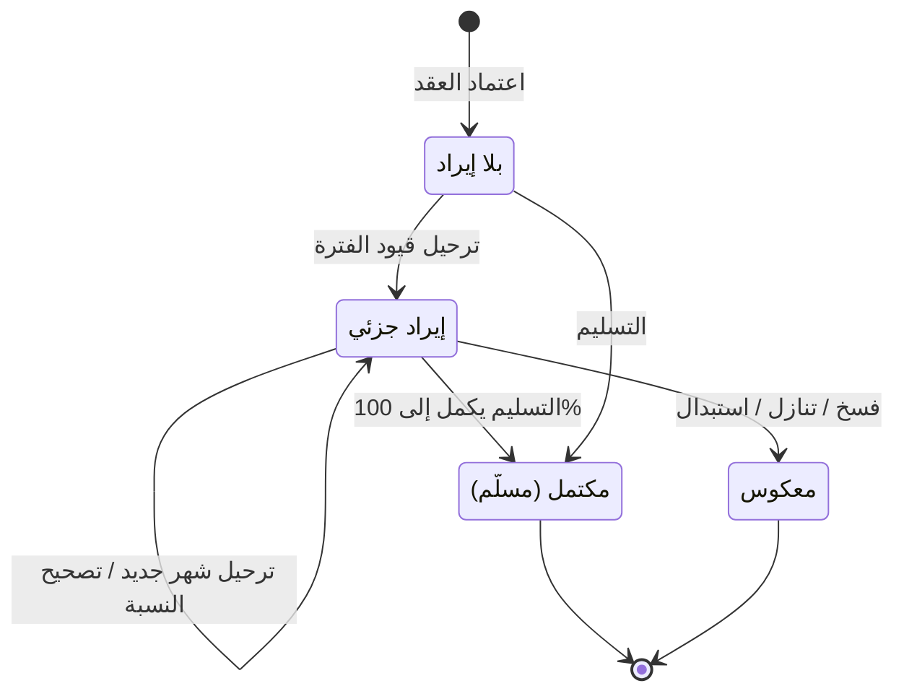

# احتساب الإيراد بنسبة الإنجاز — شرح مفصّل

بتاريخ 2026-10-28 · من موك أب تطبيق «المبيعات العقارية» (نسخة 26 أكتوبر)، شاشة `rem.poc` · المتطلبات: قرار 15/10، التكامل D33 · القائمة: التسويق العقاري › إثبات الإيراد › احتساب الإيراد بنسبة الإنجاز.

## ما هي الشاشة؟

الشركة تبيع وحدات «على الخارطة»، أي قبل أن يكتمل بناؤها. المشتري يوقّع العقد ويدفع على أقساط، والوحدة تُسلَّم بعد سنوات.

**إثبات الإيراد** يعني: متى تعتبر الشركة أن ثمن البيع صار «إيراداً» في دفاترها. لها طريقتان:

- **عند التسليم:** لا إيراد حتى تُسلَّم الوحدة، ثم يُثبت كله مرة واحدة.
- **نسبة الإنجاز (POC):** يُثبت الإيراد تدريجياً مع تقدّم البناء. لو المشروع منفّذ منه 24%، تُثبت الشركة 24% من ثمن العقد.

**نسبة الإنجاز** = كم في المئة من المشروع اكتمل فعلاً. تُدخل في تبويب «نسبة الإنجاز» في شاشة المشروع.

هذه الشاشة هي أداة آخر الشهر: لكل عقد بطريقة «نسبة الإنجاز» تحسب ما يجب أن يكون مُثبتاً حتى الآن، تطرح ما أُثبت قبل ذلك، وترحّل الفرق في قيد. وتفعل نفس الشيء للتكلفة.

القيود تظهر بعد الترحيل في «القيود اليومية» ومن زر «عرض القيود».

## من يُسمح له؟

لا قيد صلاحيات في الموك أب. من يرحّل الفترة يُسجَّل اسمه في عمود «بواسطة» في جدول الفترات المرحلة.

## شكل الشاشة

من الأعلى للأسفل:

1. **متصفح الشهر:** زر «السابق»، الشهر المعروض، زر «التالي» (لا يتجاوز الشهر الحالي)، وزر «ترحيل قيود الفترة».
2. **المؤشرات:** عقود بنسبة الإنجاز، إيراد الفترة، تكلفة الفترة، مجمل الربح (الإيراد − التكلفة).
3. ملاحظة تشرح الطريقة.
4. **جدول العقود** المؤهلة لهذا الشهر.
5. **جدول الفترات المرحلة** سابقاً.

## الحقول

| الحقل | النوع | الإلزام | الافتراضي | ملاحظات |
| --- | --- | --- | --- | --- |
| الشهر | تاريخ (شهر) | إلزامي | الشهر الحالي | تاريخ الاحتساب = آخر يوم في الشهر، أو اليوم لو الشهر الحالي |

## أعمدة الجدول

### جدول العقود

| العمود | المعنى |
| --- | --- |
| العقد | رقم عقد البيع |
| العميل | المشتري |
| العقار | الوحدة المباعة |
| المشروع | المشروع الذي تتبعه الوحدة (قابل للتصفية) |
| نسبة الإنجاز | النسبة المطبّقة حتى تاريخ الاحتساب |
| صافي العقد | ثمن البيع بعد الخصومات، بدون الضريبة |
| إيراد مثبت | ما أُثبت من إيراد في الفترات السابقة |
| إيراد الفترة | ما سيُرحّل الآن |
| تكلفة مثبتة | ما حُمّل من تكلفة في الفترات السابقة |
| تكلفة الفترة | ما سيُرحّل الآن |

### جدول الفترات المرحلة

| العمود | المعنى |
| --- | --- |
| الرقم | `POC-السنة-####` |
| حتى تاريخ | تاريخ الاحتساب |
| عدد العقود | العقود التي رُحّل لها قيد |
| الإيراد | مجموع إيراد الفترة |
| التكلفة | مجموع تكلفة الفترة |
| بواسطة | المستخدم الذي رحّل |

## أي العقود تظهر؟

- عقود بيع **معتمدة**، طريقة إثبات إيرادها «تلقائي – نسبة الإنجاز».
- حالتها «ساري» أو «مكتمل السداد».
- **لم تُسلَّم بعد.** العقد المسلَّم يختفي من الشاشة لأن التسليم يكمل الإيراد إلى 100%.

## الحساب

### نسبة الإنجاز

- آخر نسبة مسجلة في تبويب «نسبة الإنجاز» لمشروع العقار، حتى تاريخ الاحتساب.
- لو العقار في **مرحلة** من المشروع ليس لها نسبة، تُؤخذ نسبة المشروع الأب.
- لا نسبة مسجلة = 0%.

### الإيراد

- **إيراد الفترة = صافي العقد × النسبة − الإيراد المثبت.**
- لو الناتج سالب (النسبة صُحّحت للأقل)، يُعكس الفرق في القيد.

### التكلفة (لعقار الشركة فقط)

**أعمال تحت التنفيذ** = حساب تتجمّع فيه تكاليف البناء (أسمنت، حديد، مقاولون…) قبل أن تُحمَّل على المبيعات. عند البيع بنسبة الإنجاز تُنقل منه نسبة إلى حساب التكلفة.

- لكل **نوع تكلفة**: تكلفة الفترة = نصيب العقار من رصيد النوع حتى التاريخ × النسبة − المثبت لهذا النوع.
- الرصيد يُحسب حتى تاريخ الاحتساب. لو سُجّلت تكاليف جديدة على المشروع، التكلفة تتعدل تلقائياً في الشهر التالي.
- عقار مالك آخر (الشركة وسيط فقط) لا تكلفة له.

## الأزرار والإجراءات

### السابق / التالي

ينقل الشهر المعروض. «التالي» لا يذهب بعد الشهر الحالي.

### ترحيل قيود الفترة

- ينشئ فترة برقم `POC-السنة-####`.
- يرحّل قيد إيراد وقيد تكلفة **لكل عقد فيه فرق**.
- يتجاهل العقود التي ليس عندها فرق.
- يحدّث على العقد: الإيراد المثبت، التكلفة المثبتة، ونسبة آخر احتساب.
- الرسالة: «تم ترحيل POC-…: إيراد … وتكلفة …».
- لو لا يوجد عقد واحد فيه فرق: «مفيش فرق يترحّل – النسب ما اتغيرتش»، ولا تُنشأ فترة.

## الحالات

الشاشة نفسها لا تملك حالات؛ ما يتغير هو وضع العقد في رحلة إثبات الإيراد.

| الحالة | المعنى | يخرج منها بـ |
| --- | --- | --- |
| بلا إيراد | عقد معتمد، لم يُرحّل له شيء | أول ترحيل بنسبة > 0 |
| إيراد جزئي | أُثبت جزء بنسبة الإنجاز | ترحيل شهري جديد، أو تسليم، أو فسخ/تنازل/استبدال |
| مكتمل (مسلَّم) | التسليم أكمل الإيراد والتكلفة إلى 100% | — |
| معكوس | الفسخ أو التنازل للشركة أو الاستبدال عكس المثبت | — |

## القيود والمحاسبة

كل القيود بنوع `REM_POC`.

**قيد الإيراد (لكل عقد):**

| الطرف | الحساب | المبلغ |
| --- | --- | --- |
| مدين | ذمم العقد | إيراد الفترة |
| دائن | إيرادات بيع عقارات | إيراد الفترة |

**ذمم العقد** = ما استحقته الشركة من المشتري محاسبياً ولم تُصدر به فاتورة بعد.

لعقار **مالك آخر**: الدائن يُقسم إلى «عمولة وساطة» (حصة الشركة) و«مستحقات الملاك» (حصة المالك) بدل «إيرادات بيع عقارات».

لو الفرق سالب، القيد معكوس (مدين الإيراد / دائن ذمم العقد).

**قيد التكلفة (لكل نوع تكلفة، لعقار الشركة):**

| الطرف | الحساب | مركز التكلفة |
| --- | --- | --- |
| مدين | حساب تكلفة النوع | مركز تكلفة المشروع |
| دائن | حساب أعمال تحت التنفيذ للنوع | مركز تكلفة المشروع |

**ما بعد ذلك:**

- **التسليم** يرحّل الباقي حتى 100% من صافي العقد والتكلفة. انظر [[شرح - تسليم العقارات المباعة]].
- **الفسخ / التنازل للشركة / الاستبدال** تعكس الإيراد المثبت (القيد العكسي الموحّد) وتعكس قيود التكلفة. انظر [[شرح - عقود البيع]].

**التكامل (D33):** لا يوجد في الكلاود محرك لإثبات الإيراد ولا مفهوم نسبة إنجاز. الموديول يرحّل القيود بنفسه. المصدر المقترح للنسبة: الكميات المنفذة في مستخلصات المقاولات ÷ إجمالي الكميات. (**المستخلص** = الفاتورة الدورية للمقاول بما نفّذه.)

## أمثلة

- عقد صافيه **745,500**، نسبة المشروع **24%** في يونيو:
  ترحيل يونيو يسجّل إيراد 745,500 × 24% = **178,920**.
- تُحدَّث النسبة إلى **36%**، ترحيل يوليو:
  745,500 × 36% = 268,380 − 178,920 = **89,460**.
- إعادة الترحيل لنفس الشهر بدون تغيير النسبة تُرفض برسالة «مفيش فرق».
- تسليم العقد بعد ذلك يرحّل الباقي حتى صافي العقد كاملاً (745,500 − 268,380 = 477,120)، والعقد يختفي من الشاشة.
- فسخ عقد عليه إيراد بنسبة الإنجاز يعكس المثبت وقيود التكلفة.

## أسئلة مفتوحة

- المصدر النهائي للنسبة: تكامل مع مستخلصات المقاولات، أم إدخال يدوي معتمد؟
- هل يصبح الاحتساب مهمة تلقائية (job) آخر الشهر بدل الزر؟
