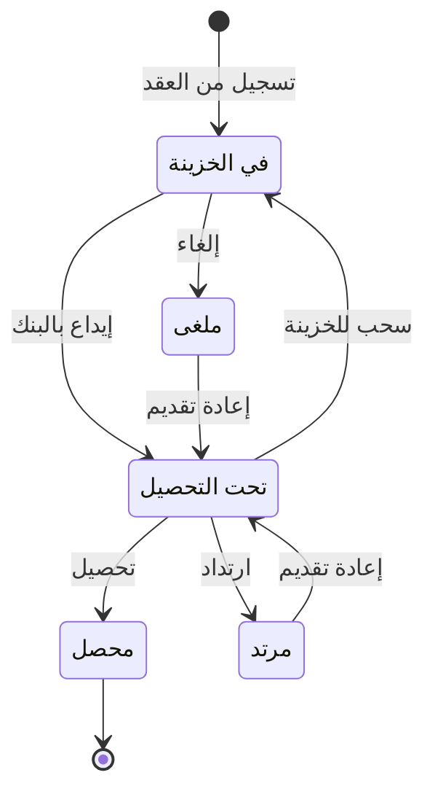

# الشيكات المؤجلة — شرح مفصّل

بتاريخ 2026-10-28 · من موك أب تطبيق «المبيعات العقارية» (نسخة 26 أكتوبر)، شاشة `rem.pdc` · المتطلبات M53، D25، D26 · القائمة: التسويق العقاري › الأقساط والتحصيل › الشيكات المؤجلة (أوراق القبض).

## ما هي الشاشة؟

**الشيك المؤجل (PDC)** شيك يكتبه المستأجر اليوم بتاريخ استحقاق لاحق، لا يُصرف قبله. الشركة تحتفظ به، وفي موعده تودعه البنك. في المحاسبة يسمى **ورقة قبض**: ورقة تثبت أن للشركة مالاً ستقبضه لاحقاً.

هذه الشاشة **حافظة** (محفظة) شيكات عقود الإيجار: شيك لكل قسط إيجار، يُسجَّل عبر «أوراق القبض مجمعة» في إدارة النقدية، ويُتابع حتى يُحصَّل أو يرتد. التحصيل يسدد القسط.

طرق الوصول:
- من القائمة أعلاه.
- التسجيل من تبويب «الشيكات» في عقد إيجار ساري عليه خيار PDC.
- إدارة النقدية › أوراق القبض، زر «الشيكات المؤجلة في الموديول».

أعلى الشاشة روابط شاشات إدارة النقدية (3_2_2، 3_2_3، 3_2_4، Saf_ReceivableNote)، مؤشرات، وملاحظة بالانتقالات المسموحة.

## من يُسمح له؟

صلاحيات الشاشة العادية (عرض، إضافة، تعديل). التسجيل ممكن فقط لعقد إيجار حُدد عليه خيار PDC.

## الفلاتر والمؤشرات

- مؤشر لكل حالة = مجموع مبالغ الشيكات في تلك الحالة، عدا «6 تحصيل مباشر».
- عمود الحالة قابل للتصفية.

## أعمدة الجدول

10 شيكات في الصفحة، وأزرار الانتقال على كل سطر.

| العمود | ماذا يعرض |
| --- | --- |
| رقم الورقة | RN-… |
| رقم الشيك | |
| البنك المسحوب عليه | بنك المستأجر |
| تاريخ الاستحقاق | ترتيب تصاعدي |
| المبلغ | بإجمالي |
| العقد | عقد الإيجار |
| الساحب | المستأجر |
| الحالة | 1 في الخزينة، 2 تحت التحصيل، 3 محصل، 4 مرتد، 5 ملغى |

## الأزرار والإجراءات

### تسجيل شيكات لكل الأقساط (من العقد)

شيك لكل سطر «إيجار» نشط متبقيه > 0، عبر أوراق القبض المجمعة 3_2_3 مربوطة بأرقام الأقساط (D26):

| الحقل | النوع | الإلزام | الافتراضي | ملاحظات |
| --- | --- | --- | --- | --- |
| رقم الورقة | نص | تلقائي | RN-… | |
| رقم الشيك | نص | إلزامي | — | الموك أب يولّده؛ المنتج يُدخله المستخدم لكل شيك |
| البنك | قائمة | إلزامي | — | كذلك |
| تاريخ الإصدار | تاريخ | تلقائي | اليوم | |
| الاستحقاق | تاريخ | تلقائي | استحقاق القسط | |
| المبلغ | مبلغ | تلقائي | إجمالي القسط مع الضريبة | |
| العقد / القسط / الساحب | مرجع | تلقائي | العقد، القسط، المستأجر | |
| الحالة / الحافظة | — | تلقائي | «في الخزينة» / «حافظة أوراق القبض» | |

### إيداع بالبنك

في الخزينة ← **تحت التحصيل** (أُودع الشيك في البنك وننتظر صرفه). قيد DepositBankJournal في إدارة النقدية (الموك أب يسجل الحدث فقط).

### إلغاء

في الخزينة ← ملغى. تغيير حالة فقط.

### تحصيل

تحت التحصيل ← **محصل** (صرف البنك الشيك). يسدد كامل متبقي القسط بسند قبض نوع «ورقة قبض محصلة» (ReceivableNote) على فاتورة القسط، وتُنشأ الفاتورة إن لم توجد. الرسالة: «تم تحصيل الشيك وتخفيض متبقي القسط».

### ارتداد

تحت التحصيل ← **مرتد** (رفض البنك صرفه، مثلاً لعدم وجود رصيد). القسط يبقى غير مسدد، ويُضاف على العقد سطر «غرامة» 500 بضريبة 0، مستحق اليوم، بملاحظة «غرامة شيك مرتد». الرسالة: «تم تسجيل الارتداد وإضافة غرامة». الغرامة تُفوتر من «متابعة أقساط الإيجار» (توأم [[شرح - متابعة أقساط البيع]]).

### سحب للخزينة / إعادة تقديم

سحب للخزينة: تحت التحصيل ← في الخزينة. إعادة تقديم: مرتد أو ملغى ← تحت التحصيل. تغيير حالة فقط.

## الحالات

| من | إلى (المسموح، IsNewStateValid) |
| --- | --- |
| في الخزينة | تحت التحصيل، ملغى |
| تحت التحصيل | محصل، مرتد، في الخزينة |
| مرتد | تحت التحصيل |
| ملغى | تحت التحصيل |
| محصل | نهائي، بلا أزرار |

## القيود والمحاسبة

- **الإيداع:** DepositBankJournal (حدث في الموك أب).
- **التحصيل:** سند القبض: مدين أوراق قبض تحت التحصيل 1131 / دائن حساب العميل. ثم قيد تحصيل الورقة: مدين البنك 1120 / دائن أوراق قبض تحت التحصيل 1131 بمبلغ الشيك. ثم إعادة حساب متبقي القسط (IInvoiceReCalculateRemaining، D25).
- **الارتداد:** ApostateJournal في إدارة النقدية (حدث) + سطر الغرامة.
- الإلغاء والسحب وإعادة التقديم: لا قيد.

## أمثلة

- عقد ربع سنوي بخيار PDC: «تسجيل شيكات لكل الأقساط» ← 4 شيكات «في الخزينة» بتواريخ ومبالغ سطور الإيجار (مع الضريبة).
- شيك «في الخزينة» يعرض «إيداع بالبنك» و«إلغاء» فقط.
- «تحصيل» شيك تحت التحصيل ← القسط مسدد، له فاتورة وسند قبض ReceivableNote، والشيك «محصل» بلا أزرار.
- «ارتداد» ← الشيك مرتد، سطر غرامة 500 على العقد، والقسط غير مسدد.
- مؤشر «تحت التحصيل» = مجموع مبالغ الشيكات بهذه الحالة.

## أسئلة مفتوحة

- الملاحظة تذكر «تحت التحصيل ← إلغاء» والأزرار لا تتيحه؛ يلزم تحديد الانتقال الصحيح (مع خطأ && / || في IsNewStateValid – D26).
- غرامة الارتداد 500 ثابتة في الكود — هل تأتي من سياسة غرامات؟
- التسجيل يشمل سلسلة الإيجار فقط (لا تأثيث ولا ملحقات ولا مرافق) ولا يرحّل قيد استلام أوراق القبض.
- تحصيل شيك لقسط سُدد بطريقة أخرى يرحّل قيد البنك بلا سند قبض؛ يلزم منعه.
- الحالة «6 تحصيل مباشر» بلا مسار.
- لا يمكن تسجيل شيكات لعقد ساري لم يُحدد عليه PDC قبل الاعتماد.
