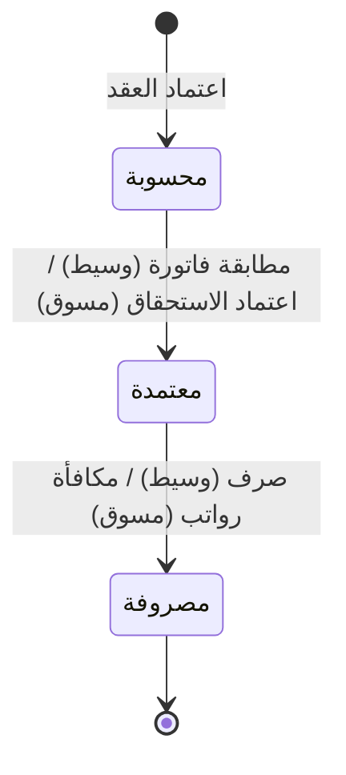

# العمولات — شرح مفصّل

بتاريخ 2026-10-28 · من موك أب تطبيق «المبيعات العقارية» (نسخة 26 أكتوبر)، شاشة `rem.commissions` · المتطلبات M64، M65، M66 · التكامل D11، D12، D21، D24، D27، D36 · القائمة: التسويق العقاري › الوسطاء والعمولات › العمولات (وأيضاً: الخدمات اللوجيستية › المبيعات – الحركات › العمولات).

## ما هي الشاشة؟

**العمولة** = مبلغ يُدفع لمن ساعد في إتمام صفقة، كنسبة من قيمتها. نوعان من المستفيدين:

- **الوسيط:** من خارج الشركة، مورّد في المشتريات. انظر [[شرح - الوسطاء العقاريون]].
- **المسوق:** موظف مبيعات في الشركة. عمولته تُصرف مع راتبه.

الشاشة تتابع كل عمولة من لحظة حسابها حتى صرفها. لا تُدخل يدوياً: **تُنشأ تلقائياً عند اعتماد** عقد إيجار أو [[شرح - عقود البيع|عقد بيع]] عليه وسيط أو مسوق.

## شكل الشاشة

- **المؤشرات:** مستحقة، مفوترة (IV)، مدفوعة = مجموع العمولات لكل حالة.
- ثلاثة تبويبات: «العمولات» (12 لكل صفحة)، «فواتير الوسطاء»، «شرائح المسوقين».

## أعمدة الجدول

### تبويب «العمولات» (مربع اختيار لعمولات الوسطاء «محسوبة» فقط)

| العمود | ملاحظات |
| --- | --- |
| التاريخ | |
| النوع | وسيط – بيع / وسيط – إيجار / مسوق – بيع (قابل للتصفية) |
| المستفيد | الوسيط أو المسوق |
| العقد | |
| الأساس | المبلغ الذي تُحسب عليه النسبة |
| النسبة | |
| العمولة | بإجمالي في الأسفل |
| تُحمّل على | من المشتري / من المالك / من المستأجر / على الشركة |
| المسار في AccFlex | الوسيط: مطابقة (أمر شراء عاجل) ← طلب صرف 5؛ المسوق: استحقاق 4_2 ← مكافأة رواتب 3_1_2 |
| الحالة | محسوبة / معتمدة / مصروفة (قابل للتصفية) |

### تبويب «فواتير الوسطاء»

الفاتورة (`BB-السنة-مسلسل`)، التاريخ، الوسيط، عدد العقود، العمولات، الضريبة، الخصم، الصافي، الحالة، وزر «صرف».

### تبويب «شرائح المسوقين»

لكل مسوق على سياسة شرائح في الشهر المختار: مبيعات الشهر، الشريحة المحققة، المتبقي للشريحة التالية، العمولة بالشريحة النهائية، المحسوب، الفرق.

## الحساب

**العمولة = الأساس × النسبة ÷ 100**، بحالة «محسوبة» عند الاعتماد.

| النوع | الأساس | النسبة | تُحمّل على (افتراضي) |
| --- | --- | --- | --- |
| وسيط – إيجار | الإيجار السنوي للعقد | عمولة العقد (افتراضي 2.5%) | حسب العقد (المالك) |
| وسيط – بيع | صافي سعر العقد | عمولة العقد | على الشركة |
| مسوق – بيع | صافي العقد | نسبة المسوق (افتراضي 1%) | على الشركة، سياسة «لكل صفقة» (D11) |

**فاتورة الوسيط المجمعة:**

- العمولات = Σ العمولات المختارة.
- الضريبة = العمولات × نسبة الدولة، لو الوسيط مسجل.
- الخصم من المنبع = العمولات × «نسبة الخصم من المنبع»، لو خاضع (مصر الافتراضي 5%، السعودية 0).
- **صافي المستحق = العمولات + الضريبة − الخصم.**

**شرائح المسوقين:** سياسة بنوع حساب «3 شرائح» = النسبة تتغير حسب إجمالي مبيعات المسوق في الشهر (من – إلى – %).

- مبيعات الشهر = Σ صافي عقود البيع المعتمدة في الشهر، عدا المسودة والمفسوخة والمستبدلة والمتنازل عنها.
- كل صفقة تُحسب وقت اعتمادها بنسبة الشريحة التي وصلها المسوق حتى تلك الصفقة.
- آخر الشهر: العمولة النهائية = المبيعات × نسبة الشريحة النهائية؛ الفرق = النهائية − المحسوب.

## الأزرار والإجراءات

### فاتورة وسيط مجمعة للمحدد

فاتورة واحدة لعمولات وسيط واحد. لو المحدد لأكثر من وسيط: رسالة رفض. تنشئ:

- **أمر شراء عاجل** (Rush = 2): طلب شراء يُنشأ ويُغلق فوراً بلا استلام بضاعة، بسطر نص حر.
- **مطابقة فاتورة (IV)**: تسجيل فاتورة المورد مقابل أمر الشراء، بالعمولات + الضريبة.
- رقم `BB-السنة-مسلسل` وقيد InvoiceVerification.

العمولات تصبح «معتمدة» ومربوطة بالفاتورة، ويُفتح تبويب الفواتير.

### مطابقة فاتورة (فاتورة وسيط لسطر واحد)

نفس الفاتورة المجمعة لعقد واحد. أمر شراء عاجل على مركز تكلفة عقار العقد والوسيط كمورد، ومطابقة مرحّلة تلقائياً بمصدر «Real Estate Contract» (D21، Q2). الرسالة: «أمر شراء عاجل ومطابقة IV-… في المشتريات». يظهر بعدها «صرف».

### صرف (عمولة وسيط / فاتورة وسيط)

**طلب صرف نوع 5** بمستفيد «عمولة وسيط» على المطابقة (D24) بالصافي، ثم **سند صرف** تحويل بنكي (D27). حالة دفع المطابقة CompletelyPaid. الفاتورة والعمولات «مصروفة»: «تم الصرف عبر طلب صرف نوع 5».

### اعتماد الاستحقاق (مسوق)

**استحقاق عمولة (4_2)** برقم AC-… مؤكد بمصدر عقد عقاري وسياسة المسوق (D12). **الاستحقاق** = تسجيل أن الشركة مدينة بالمبلغ قبل دفعه. الحالة ← معتمدة.

### مكافأة رواتب (مسوق)

**مكافأة موظف (3_1_2)** برقم BN-… لشهر التاريخ، بنوع «عمولة مبيعات عقارية»، بعلم «منشأ من العقار» وGUID ومرجع الاستحقاق (نمط DriverBonus، D36). الحالة ← مصروفة: «أُضيفت العمولة كمكافأة في مسير الرواتب».

### تسوية (شرائح)

تظهر لو الفرق ≠ 0. تنشئ عمولة «تسوية شرائح مسوق» محسوبة بالفرق (قد تكون سالبة) للمسوق والشهر، تكمل مسارها العادي (استحقاق ← رواتب).

## الحالات

| الحالة | الوسيط | المسوق | الأزرار |
| --- | --- | --- | --- |
| محسوبة | عند اعتماد العقد | عند اعتماد العقد | «فاتورة وسيط» / «اعتماد الاستحقاق» |
| معتمدة | بعد المطابقة | بعد الاستحقاق | «صرف» / «مكافأة رواتب» |
| مصروفة | بعد طلب الصرف | بعد المكافأة | لا أزرار |

## القيود والمحاسبة

**مطابقة فاتورة الوسيط (InvoiceVerification):**

| الطرف | الحساب | ملاحظات |
| --- | --- | --- |
| مدين | مصروف العمولات 5210 | سطر لكل عقد بمركز تكلفته |
| مدين | ضريبة مدخلات 1410 | لو مسجل |
| دائن | حساب الوسيط 2220-NNNN | بالصافي |
| دائن | الخصم من المنبع المستحق 2430 | لو خاضع |
**صرف الوسيط:** مدين حساب الوسيط / دائن البنك.

**استحقاق المسوق (AccrualCommissionJournal):** مدين مصروف العمولات 5210 (مركز التكلفة) / دائن عمولات مستحقة 2250.

**مكافأة الرواتب (SalaryJournal):** مدين عمولات مستحقة 2250 / دائن رواتب ومكافآت مستحقة 2260.

## أمثلة

- عقد إيجار بإيجار 100,000 ووسيط 2.5% ← عمولة «وسيط – إيجار» **2,500** محسوبة.
- «مطابقة فاتورة» ← أمر شراء عاجل ومطابقة في المشتريات، الحالة معتمدة، يظهر «صرف».
- «صرف» ← سند صرف في «طلبات الصرف» (ادارة النقدية)، الحالة مصروفة بلا أزرار، ومؤشر «مدفوعة» يزيد بالمبلغ.
- عمولة مسوق: «اعتماد الاستحقاق» ثم «مكافأة رواتب» ← مكافأة في مسير رواتب الشهر، مصروفة.
- عمولتان 2,000 + 1,000 لنفس الوسيط، مسجل، خصم 5% ← ضريبة **450**، خصم **150**، صافي **3,300**.
- مسوق على شرائح (0.75% حتى 1.5 مليون، 1% حتى 3 مليون)، عقدان 1,000,000 و900,000 في نفس الشهر:
  المحسوب 7,500 + 9,000 = 16,500؛ المبيعات 1,900,000 × 1% = **19,000**؛ التسوية **2,500**.

## أسئلة مفتوحة

- «تُحمّل على» (المشتري / المالك / المستأجر) بلا أثر محاسبي: العمولة دائماً مصروف على الشركة ولا تُفوتر على الطرف المحمّل (M64، M66).
- عمولة وسيط الإيجار على إيجار السنة الأولى فقط حتى لعقد متعدد السنوات؛ تأكيد الأساس.
- التجديد ينشئ عمولة وسيط جديدة لأن العقد الجديد يرث الوسيط؛ مقصود؟ ولا عكس للعمولة عند الفسخ.
- الصرف دائماً تحويل بنكي بكامل المبلغ.
- Q7: مسار عمولة المسوق (الموصى به مطبّق).
