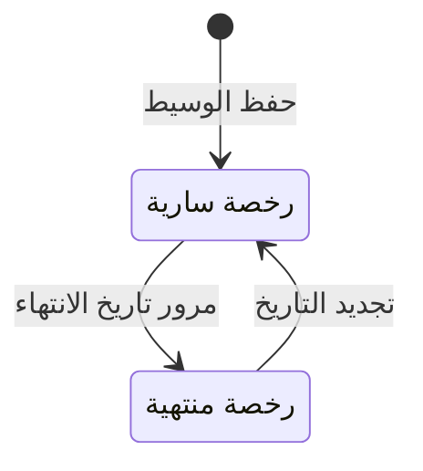

# الوسطاء العقاريون — شرح مفصّل

بتاريخ 2026-10-28 · من موك أب تطبيق «المبيعات العقارية» (نسخة 26 أكتوبر)، شاشة `rem.brokers` · المتطلبات M67، M58 · التكامل D20، D21 · القائمة: التسويق العقاري › الوسطاء والعمولات › الوسطاء العقاريون (وأيضاً: الخدمات اللوجيستية › المشتريات › الوسطاء العقاريون).

## ما هي الشاشة؟

**الوسيط العقاري** = شخص أو مكتب من خارج الشركة يجلب مشترياً أو مستأجراً، ويأخذ مقابل ذلك **عمولة** (نسبة من قيمة الصفقة).

هذه الشاشة سجل الوسطاء: من هم، رخصهم، ونسبة عمولتهم الافتراضية.

**رخصة فال** = ترخيص تصدره الهيئة العامة للعقار في السعودية (REGA) لمن يمارس الوساطة. بدونها لا يحق للوسيط العمل، لذلك رقمها إلزامي هنا.

**في AccFlex الوسيط مورّد.** المورّد = جهة تدفع لها الشركة مقابل خدمة. الوسيط يُسجَّل في شاشة الموردين في المشتريات، ضمن مجموعة «وسطاء عقاريون»، مع حقل جديد هو رخصة فال (D20). عمولاته تُصرف عبر المشتريات: أمر شراء عاجل ← مطابقة فاتورة ← طلب صرف نوع 5. التفاصيل في [[شرح - العمولات]].

يُختار الوسيط بعد ذلك في عقد الإيجار والحجز و[[شرح - عقود البيع|عقد البيع]].

## شكل الشاشة

- قائمة الوسطاء.
- نموذج من مجموعة واحدة «الوسيط».
- سطر روابط إلى شاشات المشتريات (الموردين 1_1، مجموعات الموردين 1_5، مطابقة الفواتير 2_6) وملاحظة التكامل.
- تبويب «العمولات» للوسيط المحفوظ فقط.

## الحقول

| الحقل | النوع | الإلزام | الافتراضي | ملاحظات |
| --- | --- | --- | --- | --- |
| الكود | نص | إلزامي | — | لا تحقق من التفرد |
| الاسم (عربي) | نص | إلزامي | — | والإنجليزي اختياري |
| رقم رخصة فال (REGA) | نص | إلزامي | — | حقل جديد على المورد (D20) |
| انتهاء الرخصة | تاريخ | اختياري | اليوم + 12 شهراً | المنتهية تظهر بالأحمر في القائمة |
| الجوال | نص | اختياري | — | |
| العمولة الافتراضية % | نسبة | اختياري | 2.5% | |
| مسجل في ضريبة القيمة المضافة | مربع اختيار | — | محدد | فاتورة الوسيط عليها الضريبة بنسبة الدولة؛ هي **ضريبة مدخلات** للشركة (حساب 1410) تستردها من الدولة |
| خاضع للخصم من المنبع | مربع اختيار | — | محدد | يُخصم «الخصم من المنبع %» (الضبط العام › الضرائب) من فاتورته ويُسجَّل على 2430 |
| مجموعة الموردين في المشتريات | محسوب | — | «وسطاء عقاريون» | ثابت |
| حساب المورد | محسوب | — | «يُنشأ عند الحفظ» | `2220-رقم الوسيط` بأربع خانات (D31) |

**الخصم من المنبع** = جزء من مستحق المورد تقتطعه الشركة عند الدفع وتورّده لمصلحة الضرائب نيابة عنه (في مصر: نموذج 41).

**لماذا مجموعة وليس «نوع المورد»؟** نوع المورد في AccFlex يحدد شكل الفاتورة الإلكترونية، فلا يصلح للتصنيف. المجموعة تحمل الحساب الرئيسي «وسطاء عقاريون».

## أعمدة الجدول

| العمود | ملاحظات |
| --- | --- |
| الكود | |
| الوسيط | الاسم بخط عريض |
| رخصة فال | |
| انتهاء الرخصة | بالأحمر لو قبل اليوم |
| الجوال | |
| العمولة الافتراضية | نسبة |
| عمولات مستحقة | مجموع عمولات الوسيط غير المصروفة (محسوبة + معتمدة) |

## تبويب «العمولات»

يظهر بعد حفظ الوسيط. يعرض عمولاته بنفس جدول وأزرار شاشة [[شرح - العمولات]]: التاريخ، النوع، المستفيد، العقد، الأساس، النسبة، العمولة، تُحمّل على، المسار، الحالة.

## الأزرار والإجراءات

### جديد / حفظ / حذف / رجوع

إدارة سجل الوسيط. الحفظ بدون الحقول الإلزامية يعرض رسالة بالحقول الناقصة. بعد حفظ وسيط جديد يُنشأ حسابه `2220-NNNN` تحت «وسطاء عقاريون (الحساب الرئيسي)».

### تصدير

ملف Excel بالصفوف المعروضة (محاكاة في الموك أب).

### مطابقة فاتورة / صرف (تبويب العمولات)

نفس أثرها في شاشة العمولات: الأولى تنشئ أمر شراء عاجل ومطابقة فاتورة، والثانية طلب صرف نوع 5 وسند صرف.

## الحالات

الوسيط نفسه بلا حالات. ما يتغير هو وضع رخصته:

| الوضع | الشرط | الأثر |
| --- | --- | --- |
| سارية | تاريخ الانتهاء ≥ اليوم | عرض عادي |
| منتهية | تاريخ الانتهاء < اليوم | التاريخ بالأحمر في القائمة؛ لا منع في العقود |

## القيود والمحاسبة

الشاشة لا ترحّل قيوداً. أثرها المحاسبي:

- **حساب المورد** `2220-NNNN` لكل وسيط تحت «وسطاء عقاريون».
- **ضريبة المدخلات** على فواتيره → 1410 (لو مسجل).
- **الخصم من المنبع المستحق** → 2430 (لو خاضع).

القيود نفسها تُرحَّل من [[شرح - العمولات]].

## أمثلة

- حفظ وسيط بدون رقم رخصة فال ← «حقول مطلوبة: رقم رخصة فال (REGA)».
- بعد الحفظ يظهر حساب المورد `2220-NNNN` ومجموعة «وسطاء عقاريون».
- وسيط رخصته منتهية ← تاريخ الانتهاء بالأحمر في القائمة.
- وسيط عليه عمولة 2,500 محسوبة ← «عمولات مستحقة» 2,500؛ بعد صرفها تقل إلى 0.

## أسئلة مفتوحة

- النسبة الافتراضية للوسيط لا تُستخدم كافتراضي للعمولة في عقود البيع (تبدأ دائماً بـ 2.5%).
- لا منع لاختيار وسيط رخصته منتهية في العقود، ولا تحقق من تفرد الكود أو الرخصة.
- حذف وسيط عليه عمولات غير ممنوع.
- شاشة مستقلة في الموديول، أم تصفية لشاشة الموردين بالمجموعة + حقل فال؟ (D20)
