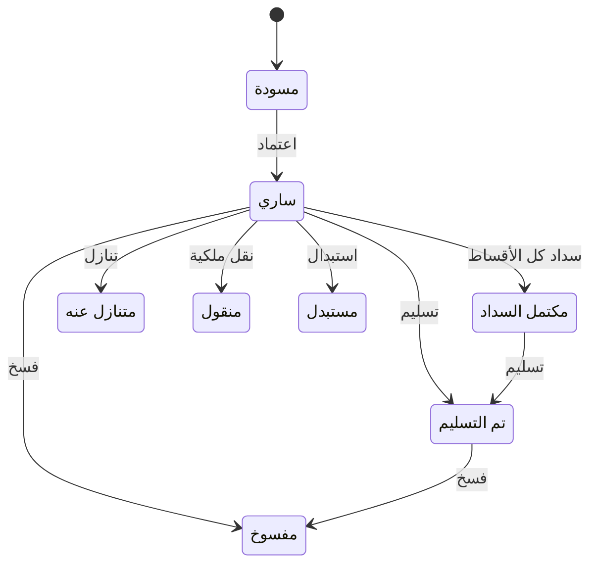

# عقود البيع — شرح مفصّل

بتاريخ 2026-10-28 · من موك أب تطبيق «المبيعات العقارية» (نسخة 26 أكتوبر)، شاشة `rem.saleContracts` · المتطلبات M6، M7، M8، M12، M14 · القائمة: التسويق العقاري › الحجز والتعاقد › عقود البيع (أو من الحجز المؤكد بزر «تحويل لعقد بيع»).

## ما هي الشاشة؟

**عقد البيع** هو الورقة التي تبيع بها الشركة عقاراً (شقة، فيلا، محل…) لعميل. فيه الثمن والخصم و**نظام التقسيط** (طريقة دفع الثمن على دفعات) والمرافق والغرامات والشروط.

العقد نوعان:
- **ابتدائي** (الافتراضي): اتفاق البيع قبل نقل الملكية رسمياً.
- **نهائي**: بعد استكمال الشروط، عادة بعد سداد الثمن كله و**الإفراغ** (نقل الصك باسم المشتري).

اعتماد العقد هو اللحظة المهمة. عندها:
- يُولَّد **جدول الأقساط** (قائمة الدفعات وتواريخ استحقاقها).
- يصبح العقار «مباع».
- تُثبَّت على العقد **سياسة إثبات الإيراد** (متى تعتبر الشركة ثمن البيع دخلاً لها في الحسابات).
- يُسوّى **عربون الحجز** (المبلغ الذي دفعه العميل عند الحجز) حسب هذه السياسة.
- تُستحق عمولة الوسيط والمسوق.

كل هذا **بدون أمر بيع** (قرار 15/10). من العقد بعد ذلك تُفوتر الأقساط وتُحصّل. الرقم `SC-السنة-تسلسل` بسنة تاريخ العقد، يُولَّد عند أول حفظ.

يأتي العقد غالباً من حجز مؤكد ([[شرح - الحجوزات]]). بعد الاعتماد تتابع الأقساط من [[شرح - متابعة أقساط البيع]]. **إجراءات ما بعد البيع ليست أزراراً في العقد** (قرار 11/10)، كل واحد شاشة مستقلة في «إجراءات العقود»:
[[شرح - تسليم العقارات المباعة]]، [[شرح - إعادة جدولة الأقساط]]، [[شرح - التنازلات]]، [[شرح - نقل الملكية]]، [[شرح - الاستبدال]]، [[شرح - فسخ العقود]].
في العقد نفسه ثلاثة أزرار فقط: اعتماد، معاينة الطباعة، تحويل لنهائي.

## من يُسمح له؟

مستخدم المبيعات العقارية بصلاحيات الشاشة (إضافة / تعديل / حذف). التعديل والحذف في «مسودة» فقط؛ بعد الاعتماد يُقفل العقد كله بما فيه المرافق والبنود. **الخصم** يجب أن يخضع لحد الخصم للمستخدم ونظام الموافقات (D39)، وهذا غير مفروض في الموك أب.

## شكل الشاشة

- **القائمة:** رقم العقد (مع شارة «افتتاحي» للعقود المرحّلة كأرصدة افتتاحية)، النوع، الحالة، المشتري، العقار، المسدد (= الأقساط + العربون)، المتبقي.
- **النموذج:** بطاقة العقار في الأعلى. بعد الاعتماد يظهر **شريط ملخص**: قيمة العقد، عربون الحجز، المسدد من الأقساط، المتبقي، المتأخرات (بالأحمر إن وُجدت).
- العقد الابتدائي «ساري» أو «مكتمل السداد» يعرض تنبيهاً: «حوّله لعقد نهائي عند استكمال الشروط (السداد / الإفراغ)».
- أربع مجموعات حقول ثم التبويبات.

## مجموعة «العقد»

| الحقل | النوع | الإلزام | الافتراضي | ملاحظات |
| --- | --- | --- | --- | --- |
| نوع العقد | اختيار | إلزامي | ابتدائي | يحدد عنوان قالب الطباعة؛ بعد الاعتماد يتغير بزر «تحويل لنهائي» فقط |
| تاريخ العقد | تاريخ | إلزامي | اليوم | سنته تدخل في الرقم |
| بداية الأقساط | تاريخ | إلزامي | اليوم | استحقاق الدفعة المقدمة وسطور المرافق وضريبة التصرفات |
| الحجز | قائمة | اختياري | — | الحجوزات المؤكدة فقط. ينسخ: المشتري، العقار، السعر، العربون المحصل، نظام التقسيط، المسوق، الوسيط |
| المشتري (الممثل) | قائمة | إلزامي لو جدول «المشترين» فاضي | — | مع الجدول يُملأ بالممثل ويُقفل. زر «+ عميل جديد» (انظر تحت) |
| المشروع | قائمة | إلزامي | — | مشاريع البيع، الفرعية بعرض «الرئيسي › الفرعي». للتصفية فقط ولا يُحفظ (يُستنتج من العقار) |
| العقار | قائمة | إلزامي | — | عقارات المشروع «متاح» ونوعها بيع، أو «محجوز» بالحجز المختار. اختياره يعيد السعر من قوائم الأسعار، ولو تجاري يلغي «المسكن الأول» |
| إثبات الإيراد | عرض | — | سياسة الشركة | قبل الاعتماد سياسة الشركة الحالية؛ بعده الطريقة المثبتة + المثبت حتى الآن (وآخر نسبة إنجاز) |

**«+ عميل جديد»** (قرار 15/10): نافذة قصيرة (الاسم عربي وإنجليزي، نوع العميل، نوع المستلم، رقم الهوية / السجل، الجوال، الجنسية، البريد). تنشئ عميلاً في شاشة العملاء (بدون «أنشطة العميل»، قرار 18/10) في مجموعة «عملاء عقاريون» مع حساباته الفرعية (D31). الاسم والجوال إلزاميان؛ الجوال المكرر مرفوض؛ عميل الشركات (B2B) يحتاج CRN ورقم سجل.

**إثبات الإيراد** يأتي من «الضبط العام › إثبات الإيراد» (قرار 15/10) ويُثبَّت على العقد عند الاعتماد. تغيير السياسة يؤثر على العقود الجديدة فقط (D33).

## مجموعة «الضريبة»

| الحقل | النوع | الإلزام | الافتراضي | ملاحظات |
| --- | --- | --- | --- | --- |
| خاضع لضريبة التصرفات العقارية | مربع اختيار | — | محدد في السعودية، غير محدد في غيرها | ظاهر في كل الدول (قرار 12/10، معدّل 25/10) |
| المعاملة الضريبية | عرض | — | — | نص يشرح الضريبة الناتجة (انظر «الحساب») |
| المسكن الأول لمواطن سعودي | مربع اختيار | — | غير محدد | يظهر في السعودية لعقار سكني وعقد «خاضع» فقط؛ شيل «خاضع» يشيله |
| تتحملها الدولة (المسكن الأول) | عرض | — | — | يظهر للمسكن الأول فقط؛ «لا تُفوتر ولا تُرحّل» |
| ضريبة التصرفات على | اختيار | شرطي | المشتري | يظهر وإلزامي لما تنطبق ضريبة التصرفات؛ المشتري أو البائع (الشركة). لا يُحفظ لو لا تنطبق |
| ضريبة التصرفات العقارية | عرض | — | — | الصافي × 5% (أو من الزيادة فوق السقف للمسكن الأول) |

**ضريبة التصرفات العقارية** ضريبة سعودية 5% على أي بيع عقار، سكني أو تجاري. **القيمة المضافة** ضريبة أخرى على السلع والخدمات، وبيع العقار في السعودية معفى منها.

## مجموعة «القيمة والسداد»

| الحقل | النوع | الإلزام | الافتراضي | ملاحظات |
| --- | --- | --- | --- | --- |
| سعر القائمة | مبلغ | — | من قوائم الأسعار | للقراءة؛ سعر العقار بعد قوائم الأسعار، أو سعر الحجز |
| نظام التقسيط | قائمة | إلزامي | من الحجز | أنظمة البيع فقط |
| زيادة نظام التقسيط | عرض | — | — | النسبة ومصدرها (خاص بالعقار / افتراضي النظام) وقيمتها؛ للعقد المعتمد النسبة المخزنة |
| سعر البيع | مبلغ | إلزامي | محسوب | = سعر القائمة × (1 + الزيادة)؛ يُعاد حسابه عند تغيير العقار أو النظام أو الحجز، ويبقى قابلاً للتعديل |
| الخصم | مبلغ | اختياري | 0 | مبلغ وليس نسبة |
| المرافق | عرض | — | — | مجموع أسعار سطور تبويب المرافق |
| صافي قيمة العقد | عرض | — | — | = سعر البيع − الخصم (المرافق خارجه) |
| عربون محصل من الحجز | مبلغ | — | من الحجز | للقراءة؛ المحصّل فعلاً، يُخصم من الدفعة المقدمة |
| إيراد الشركة | عرض | — | — | عقار الشركة: الصافي كله؛ عقار ملاك آخرين: العمولة فقط (انظر «القيود») |

## مجموعة «الوسطاء والمسوقين»

| الحقل | النوع | الإلزام | الافتراضي | ملاحظات |
| --- | --- | --- | --- | --- |
| المسوق | قائمة | اختياري | من الحجز | موظف المبيعات؛ عمولته Per Deal أو بالشرائح (D11) |
| الوسيط الخارجي | قائمة | اختياري | من الحجز | شخص أو شركة من خارج الشركة جاءت بالعميل؛ يُعامل كمورد (D20) |
| عمولة الوسيط % | نسبة | إلزامي مع وسيط | نسبة الوسيط (2.5%) | تتعبأ من شاشة الوسطاء وقابلة للتعديل |
| العمولة المحسوبة | عرض | — | — | الصافي × النسبة |
| تُحمّل على | اختيار | إلزامي مع وسيط | على الشركة | من يدفع العمولة |

## تبويبات العقد

### الأقساط

- **في المسودة:** معاينة لنفس الجدول الذي سيتولد عند الاعتماد، شاملاً سطر ضريبة التصرفات. ملاحظة: «تُنشأ الأقساط عند اعتماد العقد. عربون الحجز يُخصم من المقدم».
- **بعد الاعتماد:** الأقساط الفعلية: الاستحقاق والسلسلة (مقدم، قسط، مرافق، وديعة صيانة، ضريبة تصرفات، غرامة)، الإجمالي، الضريبة وفئتها، المسدد، المتبقي، الحالة، الفاتورة، **الفاتورة الإلكترونية**.
- زر **«متابعة الأقساط»** على القسط النشط غير المسدد وغير المفوتر الذي يستحق خلال 30 يوماً أو أقدم. التأكيد والفوترة من هناك فقط (اجتماع 20/10).
- زر **«تحصيل»** يظهر بعد الفوترة ويفتح «نافذة تحصيل قسط»: المبلغ (الافتراضي المتبقي، ويُقص إلى المتبقي إن زاد)، طريقة السداد (نقدي / تحويل بنكي وارد (الافتراضي) / شيك / إلكتروني Ottu)، التاريخ (اليوم). «إنشاء سند قبض» يفوتر القسط إن لم يُفوتر، ينشئ سند القبض (D23)، يحدّث المسدد (D25)، ويحوّل العقد إلى «مكتمل السداد» إذا سُددت كل الأقساط النشطة.
- سطور **التأمين** (وديعة الصيانة) لا تُفوتر.

### المشترون

لعقد بأكثر من مشترٍ (مثل `Rst_SellContractCustomers` في النظام القديم). أعمدة: المشتري، نسبة الملكية %، الممثل.
- مشتريان أو أكثر، نسبة كل واحد أكبر من صفر، والمجموع 100%.
- لا يتكرر المشتري، و**ممثل واحد فقط**.
- الفواتير والتحصيل وكشف الحساب والفاتورة الإلكترونية والتذاكر على الممثل؛ الطباعة بأسماء كل المشترين ونسبهم.
- جدول فاضي = مشترٍ واحد. زر «إضافة مشترين مشتركين» يبدأ بسطرين 50% / 50%.

### المرافق

**المرافق** (الملحقات) إضافات تُباع مع العقار: موقف سيارة، مخزن… أعمدة: المرفق (من «الملحقات»)، السعر (من سعر الملحق، قابل للتعديل). إضافة وحذف السطور في المسودة فقط. السعر **خارج** صافي قيمة العقد؛ كل مرفق بسعر > 0 يضيف سطر «مرافق» في الجدول يستحق في «بداية الأقساط» بنسبة القيمة المضافة للدولة (Q7).

### الغرامات

**غرامة التأخير** مبلغ إضافي على المشتري إذا تأخر في قسط. مصدرها **خطة التقسيط** المختارة (لا حقل سياسة غرامات على العقد، قرار 11/10)، والمعالجة والحدود ومراحل التعثر من «الضبط العام › غرامات التأخير والتعثر».
- شريط في أعلى التبويب: المعالجة، المصدر، **فترة السماح** (أيام بعد الاستحقاق بلا غرامة)، بداية الاحتساب، الحد القانوني، أقصى تأخير.
- جدول لكل قسط متأخر: استحقاق القسط، المتأخر، أيام التأخير، أيام الاحتساب، الغرامة، **الحد المطبق** (أي حد خفّض الغرامة)، الإجراء.
- **تطبيق:** على كل قسط متأخر بعد السماح لم تُطبق عليه غرامة ولم يُعفَ منه؛ معطل لو الغرامة بعد الحدود = 0.
- **إعفاء:** يلغي الغرامة كلها بسبب (نمط إعفاءات هيئة المجتمعات العمرانية).
- عمود الإجراء يعرض «مطبقة» (ولو قُلّلت: «المطبق من المحسوب · إعفاء جزئي X – السبب») أو «معفاة» + السبب.

**نافذة تطبيق غرامة التأخير** (CR 107039 «تعديل الغرامات»):

| الحقل | النوع | الإلزام | الافتراضي | ملاحظات |
| --- | --- | --- | --- | --- |
| القسط المتأخر / الغرامة المحسوبة | عرض | — | — | الاستحقاق والقيمة والغرامة بعد الحدود |
| مبلغ الغرامة | مبلغ | إلزامي | المحسوبة | > 0 و ≤ المحسوب؛ للإلغاء الكامل استخدم «إعفاء» |
| الإعفاء الجزئي | محسوب | — | — | المحسوبة − المبلغ |
| سبب التعديل | نص | شرطي | — | إلزامي لو المبلغ أقل من المحسوب؛ يُسجَّل على القسط (المحسوب، المطبق، السبب، التاريخ، المستخدم) وفي ملاحظة سطر الغرامة |

**نافذة الإعفاء:** الغرامة المحسوبة (عرض) + سبب الإعفاء (إلزامي)، يُسجَّل مع التاريخ والمستخدم والغرامة وقت الإعفاء.

**مراحل التعثر:** بطاقة لكل مرحلة (من يوم، الإجراء، الحالة: فات موعدها / المرحلة الحالية / قادمة / مسجّل) وتحتها «سجل التعثر». تفاصيلها في «الغرامات والتعثر».

### الشروط والأحكام

اختيار متعدد من «شروط وأحكام العقود» (`set.clauses`) لنوع «عقود البيع»، بترتيب حقل «الترتيب». الإلزامية مختارة ومعطلة. المختارة تُطبع في العقد تحت «الشروط والأحكام». للقراءة بعد الاعتماد. **نصوص قانونية فقط**: لا تغيّر أي مبلغ أو قسط أو قيد.

### حركات العقد

سجل المستندات المنفذة على العقد من شاشات «إجراءات العقود» (تسليم، إعادة جدولة، تنازل، نقل ملكية، استبدال، فسخ) مع ملاحظة بمكانها، ومستند «تحويل لنهائي». يظهر بعد أول حفظ.

### الفواتير

فاتورة الدفعة المقدمة (عربون الحجز) + فواتير الأقساط، مع حالة الفاتورة الإلكترونية لكل واحدة، **بدون القيود**.

## الحساب

**من السعر إلى الصافي:**
1. سعر القائمة = سعر العقار بعد قوائم الأسعار (أو سعر الحجز).
2. الزيادة = نسبة العقار لهذا النظام في تبويب «زيادة نظام التقسيط» بالعقار، وإلا «زيادة السعر %» في النظام (مثل `RstPropertyPaymentPlan`). تُخزَّن على العقد عند الحفظ.
3. سعر البيع = سعر القائمة × (1 + الزيادة %).
4. صافي العقد = سعر البيع − الخصم.

**بناء جدول الأقساط** (نظام التقسيط على الصافي من «بداية الأقساط»):
- **الدفعة المقدمة** = نسبة أو قيمة النظام، تُطرح دائماً من الأساس، وتستحق في البداية بعد طرح العربون المحصل. لا تُنشأ إن صارت ≤ 0.
- **العدد** = عدد النظام، أو المدة ÷ شهور الدورية (حد أدنى 1).
- **القسط** = (الأساس ÷ العدد) مقرّباً لأسفل لمضاعف «التقريب»، والفرق على الأول أو الأخير حسب النظام.
- أول قسط بعد «أول قسط بعد (شهر)»، أو بعد الدورية إن كان صفراً، والباقي كل دورية.
- **وديعة صيانة** = السعر × نسبة الصيانة، في تاريخ أول أو آخر قسط (سلسلة «وديعة صيانة»، 0%).
- لا فائدة ولا دفعة سنوية (حُذفتا في اجتماع 13/10، Q6).

**العربون الأكبر من المقدم** (Q8، قرار 25/10): لا سطر مقدم، والزيادة تُخصم من الأقساط التالية بالترتيب (القسط الذي يصل صفراً يُحذف). إجمالي الجدول = الصافي − العربون.

**الضرائب في السعودية** (قرار 12/10، معدّل 25/10):
- بيع العقار معفى من القيمة المضافة دائماً: الأقساط 0% بفئة **E** (VATEX-SA-30، المادة 30 من اللائحة منذ أكتوبر 2020).
- «خاضع» محدد: + ضريبة تصرفات 5% من الصافي. المعاملة: «معفى من القيمة المضافة (E – VATEX-SA-30) – ضريبة تصرفات 5%».
- «خاضع» غير محدد (تصرف معفى، مثل البيع لجهة حكومية): لا ضريبة تصرفات ولا «مسكن أول». المعاملة: «… – من غير ضريبة تصرفات». (كان قبل 25/10 بنسبة 15% S.)
- 15% (S) على بيع عقار للعقود القديمة فقط (قبل 4/10/2020)، خارج نطاق الموديول.
- **على المشتري:** سطر «ضريبة تصرفات» في الجدول باستحقاق «بداية الأقساط» بضريبة 0% (فئة O)، يُفوتر لحساب ضريبة التصرفات المستحقة (2420). البائع مسؤول أمام الهيئة عن توريدها (لائحة 2025)، والشركة تحصّلها وتورّدها.
- **على البائع:** لا سطر، وعند الاعتماد قيد مصروف (انظر «القيود»).
- النسبة والحسابات وسقف المسكن الأول من «الإعدادات العامة › الضرائب» (Q4)، ليست ثابتة في الكود.

**الضرائب في مصر وأي دولة أخرى** (قرار 25/10): نفس العلامة، الافتراضي غير محدد. محدد ← الأقساط بنسبة الدولة 14% (S)، المعاملة «خاضع ← قيمة مضافة 14% (S)». غير محدد ← 0%، «غير خاضع ← قيمة مضافة 0%». لا ضريبة تصرفات ولا مسكن أول.

**المسكن الأول** (سعودي، عقار سكني، عقد خاضع): الدولة تتحمل ضريبة التصرفات عن أول «سقف تحمّل الدولة» (الافتراضي 1,000,000؛ في القديم `MaximumTaxExemption`).
- ضريبة التصرفات = 5% × (الصافي − السقف) لو موجبة، وإلا لا ضريبة ولا «ضريبة التصرفات على».
- «تتحملها الدولة» = 5% × أقل (الصافي، السقف)، للعرض فقط.
- مع أكثر من مشترٍ: التحقق والسقف على الممثل فقط حتى رد المستشار الضريبي (CR 125774 Q18).

## الحالات

| الحالة | متى | ماذا يُسمح |
| --- | --- | --- |
| مسودة | الحفظ الأول | تعديل، حذف، اعتماد، معاينة |
| ساري | «اعتماد العقد وتوليد الأقساط» | فوترة وتحصيل، غرامات، إجراءات العقود، تحويل لنهائي |
| مكتمل السداد | آلياً عند سداد كل الأقساط النشطة لعقد ساري | تسليم، تحويل لنهائي |
| تم التسليم | من [[شرح - تسليم العقارات المباعة]] | تحويل لنهائي |
| متنازل عنه | من [[شرح - التنازلات]] | للقراءة |
| منقول | من [[شرح - نقل الملكية]] | للقراءة |
| مستبدل | من [[شرح - الاستبدال]] | للقراءة |
| مفسوخ | من [[شرح - فسخ العقود]] | للقراءة |

النوع (ابتدائي ← نهائي) مستقل عن الحالة.

## ما يحدث عند «اعتماد»

يحفظ أولاً ثم يتحقق من العقار: مرفوض إن لم يكن «متاح» أو «محجوز» مع حجز مختار على العقد («العقار غير متاح للبيع»)، والعقد يبقى مسودة.

| الشيء | بعد |
| --- | --- |
| العقد | «ساري»، مقفل للتعديل |
| الأقساط | تُنشأ نشطة حسب الجدول |
| العقار | «مباع» مع سجل في تاريخه |
| الحجز المرتبط | «محول لعقد» |
| سياسة الإيراد | تُثبَّت على العقد: الطريقة، صافي العقد، المثبت = 0 |
| العربون المحصل | يدوي: قيد تسوية؛ نسبة الإنجاز: نفس القيد على ذمم العقد؛ عند التسليم: لا قيد (D10) |
| ضريبة التصرفات على البائع | قيد مصروفها |
| عمولة الوسيط | تُستحق = الصافي × نسبته (D20) |
| عمولة المسوق | الصافي × نسبته (Per Deal) أو نسبة الشريحة التي وصلها في الشهر (D11) |
| قيد إيراد أو تكلفة | **لا شيء** في أي طريقة (D33) |

## القيود والمحاسبة

القيود بـ ApplicationId = 8 وعلى الحسابات الفرعية للعميل (D30 / D31). **ذمم العقد** حساب وسيط لما يستحقه العقد ولم يُفوتر بعد. **الدفعات المقدمة** مبالغ استلمتها الشركة قبل أن تكسبها.

**فاتورة القسط** (D06): فاتورة مبيعات بعلامة «تسويق عقاري» ورقم العقد والقسط في سطر نص حر، بدون أمر بيع. فئة الضريبة S إن كانت النسبة > 0 وإلا E. فاتورة إلكترونية 388 فقط إن كان بها ضريبة (D08). قيد `InvoiceJournal`: مدين حساب العميل بالإجمالي / دائن حسب الطريقة + دائن القيمة المضافة. سطور خاصة: وديعة الصيانة لحساب «وديعة صيانة الملاك»، ضريبة التصرفات لحساب 2420، المرافق والرسوم لحساب «إيرادات خدمات المرافق» (4140).

| السياسة | العربون عند الاعتماد | دائن فاتورة القسط | متى يُثبت الإيراد |
| --- | --- | --- | --- |
| يدوي – مع فاتورة القسط (الافتراضي) | `CustomerInvoiceSettlement`: مدين الدفعات المقدمة / دائن إيراد البيع | إيرادات بيع عقارات | مع كل فاتورة |
| تلقائي – عند التسليم | لا قيد؛ يبقى في الدفعات المقدمة حتى التسليم | الدفعات المقدمة قبل التسليم، ذمم العقد بعده | كله عند التسليم |
| تلقائي – نسبة الإنجاز | نفس القيد على ذمم العقد | ذمم العقد | من شاشة «احتساب الإيراد بنسبة الإنجاز» |

**ضريبة التصرفات على البائع:** مدين مصروف ضريبة التصرفات (5220) / دائن ضريبة التصرفات المستحقة (2420)، على فرع منظمة المبيعات للمشروع (Q19 / Q20).

**عقار لمالكين آخرين** (المشروع «لمالكين آخرين»؛ الشركة **وسيط** تبيع نيابة عن المالك):
- إيراد الشركة = عمولة التسويق من بطاقة المالك الممثل (تبويب «عمولة التسويق لكل بند دفع»): لكل بند (المقدم / الأقساط) مجموعه في الجدول × النسبة، + ضريبة العمولة.
- لو المالك ليس له جدول: «عمولة البيع من المالك %» × الصافي (أو 2.5%).
- قيد الإيراد: مدين ذمم غير مفوترة بالصافي / دائن عمولات وساطة (4150) + القيمة المضافة بضريبة العمولة + مستحقات ملاك (2215) بالباقي، سطر لكل مالك بنسبة ملكيته.
- لا قيد تكلفة عقار. نفس التقسيم في التسليم والتنازل والاستبدال والفسخ.
- الطباعة: البائع «بالوكالة عن المالك».

## الغرامات والتعثر

**المعالجات** (من الضبط العام):
- **بدون غرامة مالية** (افتراضي السعودية): لا جدول غرامة، ملاحظة بالمادة 178 ومراحل التعثر فقط.
- **أوجه البر**: الغرامة تُسجّل على حساب 2280 (تُصرف لأعمال خيرية) ولا تدخل الإيراد.
- **مالية** مع دولة سعودية: تحذير بأنها غير قابلة للتنفيذ.
- مصر: حد قانوني 7% سنوياً.

**الحساب** لكل قسط نشط متأخر بعد السماح (عدا سطور الغرامة والتأمين):
- أيام الاحتساب = أيام التأخير − السماح (أو كاملة لو «من تاريخ الاستحقاق»).
- نسبة: يومي = المتبقي × % × الأيام؛ شهري = المتبقي × % × ⌈الأيام ÷ 30⌉؛ سنوي = المتبقي × % × الأيام ÷ 365؛ مرة واحدة = المتبقي × %. قيمة ثابتة: × الأيام / ⌈÷30⌉ / 1.
- ثم الحدود بالترتيب: حد الخطة ← الحد القانوني (المتبقي × الحد × الأيام ÷ 365) ← لا تتجاوز أصل القسط ← حد العقد (مجموع الغرامات ≤ أكبر قسط ناقص المطبق، يُوزع على الأقدم أولاً).
- لا تُطبق مرتين على نفس القسط.

**التطبيق:** يضيف سطر «غرامة» بالمبلغ النهائي يستحق اليوم بدون ضريبة، مربوطاً بالقسط المتأخر (ومعلّماً «أوجه البر» إن لزم). فوترته دائن إيرادات الغرامات 4190 أو 2280. **الإعفاء** يعلّم القسط معفى من الغرامة كلها.

**مراحل التعثر:** تذكير ← إنذار ← إشعار تعثر ← شؤون قانونية ← حلول باقي الأقساط ← فسخ. زر الإجراء على المرحلة الحالية والفائتة غير المسجلة.
- **تسجيل:** سطر في «سجل التعثر» (التاريخ، المرحلة، الإجراء، البيان = عدد المتأخر وأقصى تأخير والمبلغ، بواسطة). الإنذار نفسه يُطبع ويُرسل خارج النظام.
- **حلول باقي الأقساط:** نافذة تأكيد بعدد وإجمالي الأقساط القادمة غير المفوترة؛ التأكيد يجعل استحقاقها اليوم (يحفظ الأصلي) ويسجل في السجل.
- **فسخ العقد:** يسجل الإجراء ويفتح نافذة «فسخ عقد البيع» ([[شرح - فسخ العقود]]).

## الأزرار

| الزر | متى | ماذا يفعل |
| --- | --- | --- |
| حفظ | مسودة | يحفظ، يحسب الصافي، يولد الرقم |
| حذف | مسودة | يحذف العقد |
| اعتماد العقد وتوليد الأقساط | مسودة | انظر «ما يحدث عند اعتماد» |
| معاينة الطباعة | دائماً بعد الحفظ | قالب «عقد بيع ابتدائي/نهائي»: البائع، المشتري وهويته، العقار والمشروع والمدينة والحدود، الثمن والخصم والصافي، نظام السداد والعربون، الجدول، البنود، التوقيعات |
| تحويل لنهائي | ابتدائي ساري / مكتمل السداد / مُسلّم | النوع ← نهائي بتاريخ التحويل، الحالة لا تتغير، مستند في «حركات العقد». لا يتحقق من أي شرط (قرار 25/10) |
| فوترة / تحصيل | سطر قسط | فاتورة القسط وقيدها؛ سند القبض |
| تطبيق / إعفاء | تبويب الغرامات | نافذتا الغرامة |
| تسجيل / حلول / فسخ | مراحل التعثر | كما في «الغرامات والتعثر» |
| إضافة سطر / حذف | المرافق، مسودة | |

العقد الساري لا يعرض «حفظ» ولا «حذف» ولا أزرار تسليم / تنازل / فسخ.

## أمثلة

- سعر 1,000,000، نظام 10% مقدم و12 قسطاً ربع سنوياً بتقريب 100، عربون 50,000 ← دفعة مقدمة 50,000 و12 × 75,000؛ العقار «مباع» والحجز «محول لعقد».
- صافي 1,000,000، مقدم 100,000، عربون 150,000 ← لا سطر مقدم، أول قسط يقل 50,000، إجمالي الجدول 850,000.
- عقار سعره 805,000 مع «3 سنوات – ربع سنوي» (زيادة 5%) ← سعر البيع 845,250.
- اعتماد عقد على عقار «مباع» ← «العقار غير متاح للبيع» ويبقى مسودة.
- شقة سكنية في السعودية بصافي 1,000,000 والضريبة على المشتري ← أقساط 0% + سطر «ضريبة تصرفات» 50,000. مع «المسكن الأول» ← لا سطر. على البائع ← لا سطر وقيد مصروف 50,000.
- مسكن أول بصافي 1,500,000 ← ضريبة 25,000 وتتحملها الدولة 50,000؛ بصافي 800,000 ← لا ضريبة.
- شيل «خاضع» في السعودية ← «معفى من القيمة المضافة (E – VATEX-SA-30) – من غير ضريبة تصرفات» وتختفي حقول التصرفات والمسكن الأول.
- مصر: «خاضع» غير محدد ← 0%؛ علّمه ← 14% (S).
- عقار ملاك آخرين بصافي 900,000 ونسبة 2% ← إيراد الشركة 18,000، دائن عمولات 18,000 ومستحقات ملاك 882,000، بلا قيد تكلفة.
- عقار مستثمر نقدي 1,055,000 ومالكه 3% على المقدم + ضريبة 15% ← عمولة 31,650 + ضريبة 4,747.50 والباقي للملاك 70% / 30%.
- مشتريان 60% / 40% والممثل الأول ← الفواتير على الأول والطباعة بالاثنين؛ 60% / 30% يرفض الحفظ.
- قسط يستحق بعد 40 يوماً لا يظهر عليه «متابعة الأقساط»؛ بعد 20 يوماً يظهر.
- بعد تحصيل آخر قسط نشط ← «مكتمل السداد». ابتدائي مكتمل السداد ← «تحويل لنهائي» يبقيه «مكتمل السداد»، ثم التسليم يجعله «تم التسليم».
- «يدوي»: لا قيد عند الاعتماد، وكل فاتورة دائن إيرادات بيع عقارات. «نسبة الإنجاز»: الفواتير على ذمم العقد. «عند التسليم»: الفواتير قبل التسليم على الدفعات المقدمة.
- مصر، خطة 1% شهري، قسط 9,000 متأخر 61 يوماً ← غرامة 105.29 (= 9,000 × 7% × 61 ÷ 365)، الحد المطبق = الحد القانوني 7%.
- السعودية بالافتراضي، قسط متأخر 35 يوماً ← ملاحظة م.178 بلا جدول، المرحلة الحالية «إشعار تعثر» (من يوم 30)؛ التسجيل يجعلها «مسجّل».
- «تطبيق» على غرامة 200: 150 بدون سبب ← «اكتب سبب تقليل الغرامة»؛ مع السبب ← سطر 150 و«150 من 200 · إعفاء جزئي 50 – السبب». 250 ← «مبلغ الغرامة مينفعش يزيد عن المحسوب».
- «إعفاء» ← يطلب السبب، ثم «معفاة» بلا زر تطبيق. «حلول باقي الأقساط» ← كل القادمة غير المفوترة تستحق اليوم وسطر «حلول» في السجل.

## خارج النطاق

- صرف نصيب المالك (Q10) بطلب صرف نوع 5 (مستثمر) من إدارة النقدية: في CR الملاك.
- ترحيل العقود القديمة (Q11) من `Rst_SellContract*` إلى `Pm_SaleContract*` بسكريبت مرة واحدة: CR مستقل مع نقاط CR 98503 المؤجلة.

## أسئلة مفتوحة

- المسكن الأول مع أكثر من مشترٍ (CR 125774 Q18): الآن التحقق والسقف على الممثل فقط. هل لكل مشترٍ سعودي سقفه بنسبة حصته؟ بانتظار المستشار الضريبي.
- حد الخصم وموافقته (D39) غير مفروضين في الموك أب.

DevOps: CR 101123 Confirmed.
