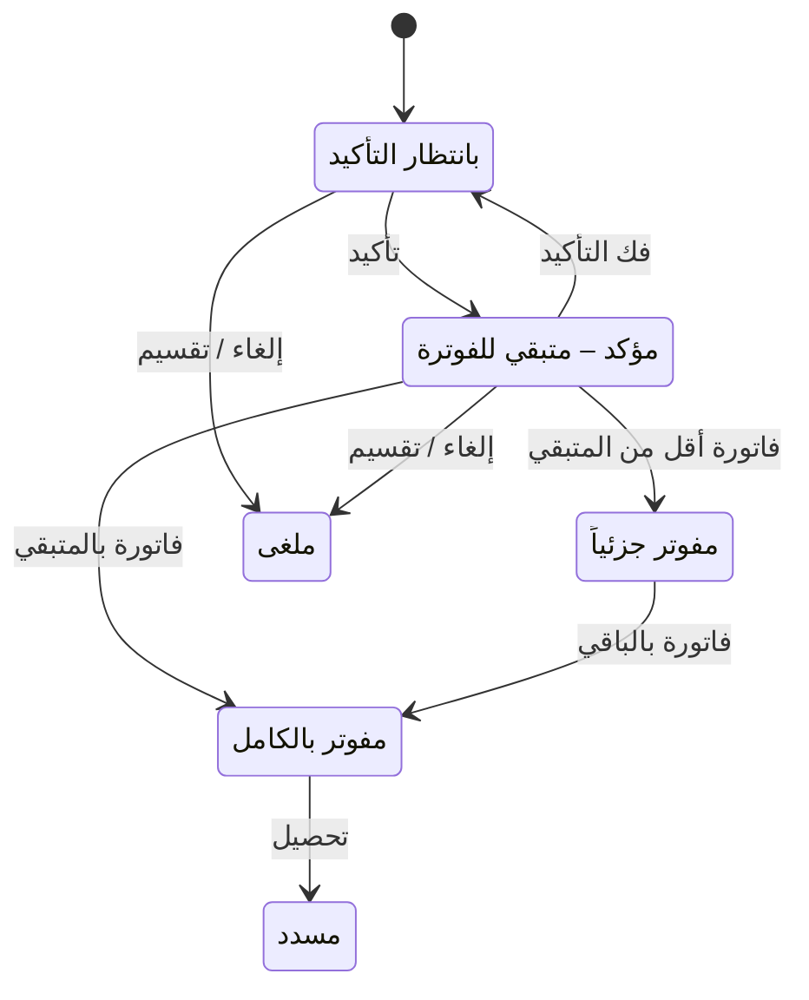

# متابعة أقساط البيع — شرح مفصّل

بتاريخ 2026-10-28 · من موك أب تطبيق «المبيعات العقارية» (نسخة 26 أكتوبر)، شاشة `rem.installments` · المتطلبات M2، M34، M48، M60، M62، M71 · القائمة: التسويق العقاري › المبيعات العقارية › الأقساط والتحصيل › متابعة أقساط البيع.

## ما هي الشاشة؟

بعد اعتماد [[شرح - عقود البيع|عقد البيع]] يصبح للمشتري جدول أقساط. **القسط** مبلغ يدفعه المشتري في تاريخ محدد (تاريخ الاستحقاق). هذه الشاشة هي المكان الوحيد لمتابعة أقساط عقود البيع: نرى ما يستحق قريباً وما تأخر، نؤكد القسط، نصدر فاتورته، نحصّله، ونعدّل الجدول عند الحاجة.

قرار 26/10: دُمجت شاشتا «إدارة الأقساط» و«متابعة الاستحقاقات» في شاشة واحدة لكل تطبيق. هذه شاشة البيع، ولها توأم بنفس التصميم والقواعد في التأجير: «متابعة أقساط الإيجار» (`rent.installments`). لا يوجد فلتر «نوع العقد»: شاشة البيع لا تعرض أي سطر إيجار، والعكس. شاشة «إصدار الفواتير» المنفصلة وإعداد «الفوترة» في الضبط العام أُزيلا (اجتماع 20/10). وهي معادل شاشة «متابعة الدفعات» في النظام القديم.

طرق الوصول الأخرى:
- من جدول أقساط عقد البيع: القسط الذي يستحق خلال 30 يوماً عليه زر «متابعة الأقساط».
- جرس التنبيهات أعلى الشاشة يفتحها بفلتر الحالة «متأخر» و«كل الأقساط».
- رقم العقد في كل سطر رابط يفتح العقد.

الخطوات ثلاث: **تأكيد** ← **فاتورة** ← **تحصيل**.

## من يُسمح له؟

الصلاحيات من «المستخدمين و الصلاحيات»، لكل شاشة (البيع والإيجار) على حدة. تغيير تاريخ الاستحقاق يحتاج الصلاحية الإضافية «تغيير تاريخ استحقاق قسط» على هذه الشاشة (الأدمن لديه كل الصلاحيات). **حد تعديل الأقساط %** يأتي من الضبط العام › القيم الافتراضية (نسبة فقط). الصلاحية والحد يُعرضان في ملاحظة أعلى الشاشة.

## الفلاتر والمؤشرات

مجموعة «المعايير»:

| الحقل | النوع | الإلزام | الافتراضي | ملاحظات |
| --- | --- | --- | --- | --- |
| الاستحقاق | اختيار | إلزامي | مستحق خلال | أو «كل الأقساط» (كل السطور غير الملغية) |
| العدد | رقم صحيح | شرطي | 30 | يظهر مع «مستحق خلال» |
| المدة | قائمة | شرطي | يوم | يوم / شهر |
| يشمل المتأخر | مربع اختيار | اختياري | محدد | يضيف ما استحق قبل اليوم وما زال فيه متبقٍ للفوترة أو غير مسدد |
| المشروع | قائمة | اختياري | — | مشاريع البيع |
| الحالة | قائمة | اختياري | الكل | بانتظار التأكيد / مؤكد – متبقي للفوترة / مفوتر جزئياً / مفوتر بالكامل / متأخر / مسدد |
| تاريخ التأكيد / الفاتورة | تاريخ | إلزامي | اليوم | تاريخ التأكيد وتاريخ الفاتورة وقيدها؛ قابل للتعديل كالقديم |
| إرسال روابط دفع عبر التطبيق مع الفواتير | مربع اختيار | اختياري | محدد | رابط يدفع منه العميل من تطبيقه |

«مستحق خلال N يوم/شهر» = الأقساط من اليوم حتى اليوم + N. السطور مرتبة بالاستحقاق تصاعدياً، والمتأخر مميز بالأحمر. فلتر الحالة «متأخر» و«مسدد» يعمل على حالة السداد.

المؤشرات الستة:
- **مستحق خلال الفترة** = مجموع مبالغ الأقساط التي تستحق من اليوم.
- **متأخر غير مسدد** = مجموع غير المسدد من المتأخر.
- **بانتظار التأكيد**.
- **مؤكد – متبقي للفوترة** = مجموع المتبقي للمؤكد والمفوتر جزئياً.
- **مفوتر** = مجموع المفوتر.

وفي الأعلى زر «إرسال الفواتير الإلكترونية (N معلق)» يفتح [[شرح - إرسال الفواتير الإلكترونية]].

## أعمدة الجدول

الجدول باختيار متعدد، 15 سطراً في الصفحة. كل صف = قسط غير ملغى مع أجزاء فوترته الجزئية.

| العمود | ماذا يعرض |
| --- | --- |
| العقد | رقم العقد (رابط) + كود العقار |
| العميل | المشتري |
| الاستحقاق / السلسلة | التاريخ ونوع القسط (مثل دفعة أولى، أقساط) |
| مبلغ القسط | الإجمالي بالضريبة مع أجزاء الفوترة الجزئية، بإجمالي |
| المفوتر | مجموع الفواتير الصادرة على القسط |
| المتبقي للفوترة | مبلغ القسط − المفوتر |
| المسدد | مجموع المحصّل على القسط وأجزائه |
| تأخير | أيام التأخير = اليوم − الاستحقاق، لسطر نشط متبقيه > 0؛ أحمر |
| الحالة | حالة الفوترة (+ تاريخ التأكيد) + حالة السداد، أرقام الفواتير، «موقوف» لعقد موقوف |
| ف. إلكترونية | للمفوتر: حالة الفاتورة الإلكترونية + الفئة/الكود + النوع (قياسية/مبسطة)؛ لغيره الفئة المتوقعة أو «بدون فاتورة إلكترونية» (سطر ضريبة التصرفات O، أو معفى والإعداد مقفول) |
| مبلغ الفاتورة (قبل الضريبة) | خانة للسطر المؤكد الذي له متبقٍ، وتحتها «من {المتبقي}» |
| (أزرار السطر) | تعديل، تقسيم، إلغاء، تحصيل — حسب حالة السطر |

الإجمالي = المبلغ + الضريبة؛ المتبقي = الإجمالي − المسدد.

## الأزرار والإجراءات

نفس الاختيار يخدم التأكيد والفوترة وفك التأكيد؛ كل زر يعمل على السطور المناسبة له ويتخطى الباقي.

### تأكيد المحدد

**التأكيد** يعني: «نعم، هذا القسط سنطالب به الآن». للسطور «بانتظار التأكيد» فقط. في السياسة اليدوية (الافتراضية) هو علامة «مؤكد» بتاريخ التأكيد، بلا قيد وبلا فاتورة. مسموح لأي شهر معروض، حتى لقسط لم يستحق بعد. الرسالة: «تم تأكيد N استحقاق بتاريخ … · K اتخطى».

### إصدار فواتير للمحدد

**الفاتورة** مستند يطالب العميل بالمبلغ رسمياً ويثبت الضريبة. للسطر المؤكد أو المفوتر جزئياً الذي له متبقٍ وعقده غير موقوف. السطر غير المؤكد يُتخطى برسالة «N قسط لسه ما اتأكدش – أكده الأول».

المبلغ = خانة «مبلغ الفاتورة»:
- يساوي المتبقي ← فاتورة بالمتبقي.
- أقل من المتبقي ← **فاتورة جزئية** (قرار 11/10): نفوتر جزءاً فقط. السطر يقل بالمبلغ وتُعاد ضريبته، ويُضاف سطر «جزء مفوتر» بنفس العقد والسلسلة والاستحقاق ونسبة الضريبة وتاريخ التأكيد ويُفوتر، والباقي يبقى مؤكداً.
- صفر أو أكبر من المتبقي ← رفض بأرقام العقود.

الفاتورة: فاتورة مبيعات لكل قسط بعلامة «تسويق عقاري» ورقم العقد والقسط، سطر نص حر بالمبلغ، بلا أمر بيع (D06، قرار 15/10)، بتاريخ التأكيد/الفاتورة. تُنشأ معها **فاتورة إلكترونية** (النسخة التي تُرسل لهيئة الضرائب) بحالة «معلق» بفئتها وكود الإعفاء من القسط (D08). الرسالة: «تم إصدار N فاتورة مبيعات بإجمالي … – الفواتير الإلكترونية «معلق» … وروابط الدفع اتبعتت».

### فك التأكيد

لسطر مؤكد لا فاتورة عليه (ولا جزئية): تُزال العلامة. سطر عليه فاتورة ← «N قسط عليه فاتورة – مينفعش يتفك تأكيده (إشعار دائن على الفاتورة الأول)».

### تعديل (أيقونة)

لسطر نشط غير مفوتر لم يُسدد منه شيء.

| الحقل | النوع | الإلزام | الافتراضي | ملاحظات |
| --- | --- | --- | --- | --- |
| تاريخ الاستحقاق | تاريخ | إلزامي | تاريخ القسط | للقراءة فقط بدون صلاحية «تغيير تاريخ استحقاق قسط» |
| المبلغ | مبلغ | إلزامي | مبلغ القسط قبل الضريبة | تحذير «يتجاوز حد المستخدم – سيُرسل للاعتماد» عند تجاوز الحد |

يُرسل للموافقة إذا كان |الجديد − القديم| > القديم × نسبة حد الدور ÷ 100 **و** > مبلغ حد الدور (الشرطان معاً) — طلب REM-PLAN (D39) برسالة «أُرسل الطلب لنظام الموافقات». وإلا يُطبق فوراً: يتحدث الاستحقاق والمبلغ وتُعاد الضريبة = المبلغ × نسبة السطر، والفرق يُطرح من آخر سطر نشط غير مفوتر لنفس العقد والسلسلة بعده، فيبقى إجمالي العقد ثابتاً؛ إن لم يوجد يتغير الإجمالي. الرسالة: «تم تعديل القسط وتسوية الفرق على آخر قسط». عند اعتماد الطلب (ApprovalState = 2) يُطبق بنفس المنطق فقط إن كان السطر ما زال غير مفوتر؛ الرفض لا يغيّر شيئاً.

### تقسيم (أيقونة)

| الحقل | النوع | الإلزام | الافتراضي | ملاحظات |
| --- | --- | --- | --- | --- |
| عدد الأجزاء | رقم صحيح | إلزامي | 2 | أقل قيمة فعلية 2 |
| الفاصل (شهر) | رقم صحيح | إلزامي | 1 | |

الجزء = المبلغ ÷ n مقرباً لخانتين، والأخير يأخذ فرق التقريب. استحقاق الجزء k = الأصلي + k × الفاصل أشهر، بنفس السلسلة والنسبة. الأصل ← ملغى بملاحظة «مقسم»، والأجزاء بملاحظة «جزء k/n». الرسالة «تم التقسيم».

### إلغاء (أيقونة)

بعد «إلغاء هذا القسط؟» ← ملغى، بلا تعويض على سطور أخرى. لا يوجد «دمج أقساط» (قرار 26/10).

### تحصيل (أيقونة)

لسطر مفوتر غير مسدد. نافذة المبلغ والطريقة والتاريخ ← «إنشاء سند قبض» على فاتورة السطر (أو أول جزء مفوتر غير مسدد) (D23). **سند القبض** مستند يثبت أن الشركة استلمت مالاً من العميل. بعده يُعاد حساب المسدد والمتبقي (D25). السطر المسدد أو غير النشط بلا أزرار. لو العميل يدفع بشيكات مؤجلة انظر [[شرح - الشيكات المؤجلة]].

## الحالات

| حالة الفوترة | متى |
| --- | --- |
| بانتظار التأكيد | لم يُؤكد بعد |
| مؤكد – متبقي للفوترة | مؤكد ولا فاتورة عليه |
| مفوتر جزئياً | عليه فاتورة وما زال له متبقٍ |
| مفوتر بالكامل | المتبقي للفوترة صفر |

حالة السداد: «مسدد» لو المسدد = مبلغ القسط؛ «متأخر» لو أي جزء تجاوز الاستحقاق + أيام السماح وغير مسدد؛ «مسدد جزئياً» لو فيه سداد.

## القيود والمحاسبة

- التأكيد اليدوي: لا قيد.
- قيد الفاتورة حسب «إثبات الإيراد» في الضبط العام: يدوي = مدين العميل / دائن الإيراد (أو مستحقات الملاك لوحدة مالك آخر، أو حساب السلسلة)؛ بيع تلقائي = دائن الدفعات المقدمة (قبل التسليم) أو ذمم العقد (نسبة الإنجاز).
- التحصيل: سند قبض على الفاتورة يخفض حساب العميل.

## أمثلة

- «مستحق خلال 30 يوم» مع «يشمل المتأخر» ← أقساط الثلاثين يوماً القادمة + المتأخر غير المفوتر أو غير المسدد؛ «3 شهر» ← حتى اليوم + 3 شهور.
- قسط بانتظار التأكيد ← «إصدار فواتير» يتخطاه برسالة «أكده الأول»؛ «تأكيد المحدد» بتاريخ 10/10 ← «مؤكد – متبقي للفوترة» بلا فاتورة ولا قيد.
- قسط مؤكد 61,800 (60,000 + ضريبة) ومبلغ الفاتورة 24,000 ← فاتورة 24,000 + ضريبتها، «مفوتر جزئياً»، والمفوتر + المتبقي = مبلغ القسط. فك تأكيده بعدها مرفوض.
- دور حده 10% و 5,000: تعديل قسط 100,000 إلى 85,000 ← طلب موافقة والقسط لم يتغير؛ إلى 94,000 ← يُطبق فوراً ويزيد آخر قسط لاحق من نفس السلسلة 6,000.
- تقسيم 10,000 إلى 3 بفاصل شهر ← 3,333.33 و 3,333.33 و 3,333.34، والأصل ملغى.
- سطر مفوتر لا يعرض تعديل/تقسيم/إلغاء، ويعرض «تحصيل».

## أسئلة مفتوحة

- التأكيد مسموح لأقساط لم تستحق بعد — هل يُمنع أو يُربط بصلاحية؟
- شرط الموافقة يطلب تجاوز الحدين معاً (النسبة والمبلغ) بينما النص يقول «أو» — أيهما المقصود؟ (M60)
- الإلغاء يخفض إجمالي العقد بلا مستند ولا سبب.
