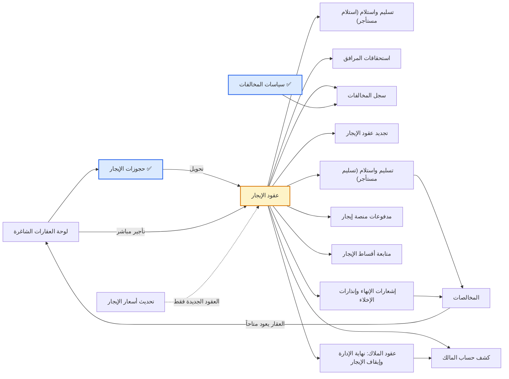

# التأجير (Leasing) — شرح الشاشات الـ 14 (+1) لغير المتخصص

بتاريخ 2026-10-26 (مُحدَّث من نسخة الموك أب الصادرة في اليوم نفسه) · يكمّل [[شرح الشاشات بالتفصيل]] (شاشات الإعدادات الـ 16) · النسخة الإنجليزية: [[Leasing screens explained]].

المصدر: الموك أب التفاعلي لموديول التسويق العقاري (تطبيق «التأجير» فيه، وبه 14 شاشة عمل و5 تقارير، وأُضيفت إليه في 26 أكتوبر شاشة «متابعة أقساط الإيجار» فصارت 15)، ومذكرات CR 125808 و CR 125716 في هذا المجلد. منها شاشتان مبنيتان في الكلاود (حجوزات الإيجار وسياسات المخالفات)؛ الباقي موصوف في الموك أب ولم يُبنَ بعد.

**ما تغيّر في الموك أب يوم 26 أكتوبر:** دُمجت «إدارة الأقساط» و«متابعة الاستحقاقات» في شاشة واحدة لكل تطبيق («متابعة أقساط البيع» في المبيعات و«متابعة أقساط الإيجار» في التأجير)؛ تبويب الغرامات في العقد صار يسمح بتخفيض الغرامة بسبب أو إعفائها؛ وحساب مصادرة العربون صار اسمه «إيرادات دفعات حجز مصادرة».

## الفكرة الكبيرة

قسم «التأجير» هو حياة الوحدة المؤجَّرة من أولها لآخرها: تبدأ شاغرة على اللوحة، تُحجز بعربون، يُوقَّع عقد ويُولَّد جدول أقساطه، يُسلَّم المستأجر الوحدة بمحضر فحص، تُقرأ عداداته شهرياً، تُسجَّل مخالفاته، يُجدَّد أو يُنهى عقده، يُسلِّم الوحدة بفحص خروج، ثم تُعمل له «مخالصة» تُسوّي التأمين وتُعيد الوحدة شاغرة. وإن كانت الوحدة لمالك آخر، يحصل المالك على «كشف حساب» بما حُصّل له.

✅ = مبنية في الكلاود. عقد الإيجار (الأصفر) هو قلب القسم: كل الشاشات تقريباً تقرأ منه أو تكتب فيه، ولم يُبنَ بعد.

## الخريطة الذهنية

![[Leasing mind map.png]]

الشرح المفصّل لكل شاشة في مجلد `Leasing` (ملف «شرح - <الشاشة>» لكل واحدة).

## الشاشات الـ 14 في لمحة

| # | المجموعة في القائمة | الشاشة | ماذا تفعل بسطر | الحالة |
| --- | --- | --- | --- | --- |
| 1 | الحجز | حجوزات الإيجار | تحجز وحدة لمستأجر بعربون قبل العقد | ✅ مبنية (CR 125808، Module 959) |
| 2 | العقود | عقود الإيجار | العقد نفسه وجدول أقساطه وكل ملحقاته | غير مبنية |
| 3 | الإيجار | تسليم واستلام العقارات | محضر فحص الوحدة عند الاستلام والتسليم | غير مبنية |
| 4 | الإيجار | تجديد عقود الإيجار | عقد جديد يبدأ بعد القديم بإيجار مرفوع | غير مبنية |
| 5 | الإيجار | إشعارات الإنهاء وإنذارات الإخلاء | إنهاء العقد بتاريخ، أو إنذار متأخر بالسداد | غير مبنية |
| 6 | الإيجار | المخالصات | تسوية التأمين في نهاية العقد وإخلاء الوحدة | غير مبنية |
| 7 | الإيجار | استحقاقات المرافق | قراءات العدادات الشهرية وتحميل الاستهلاك على المستأجر | غير مبنية |
| 8 | الإيجار | تحديث أسعار الإيجار | رفع أسعار إيجار الوحدات جماعياً | غير مبنية |
| 9 | الإيجار | لوحة العقارات الشاغرة | لوحة ملوّنة بحالة كل وحدة | غير مبنية |
| 10 | المخالفات | سياسات المخالفات | لائحة غرامات المخالفات | ✅ مبنية (CR 125716، Module 938) |
| 11 | المخالفات | سجل المخالفات | تسجيل مخالفة وتطبيق غرامتها على العقد | غير مبنية |
| 12 | الملاك | كشف حساب المالك | ما حُصّل لمالك الوحدة وما يستحقه بعد الأتعاب | غير مبنية |
| 13 | الملاك | عقود الملاك: نهاية الإدارة وإيقاف الإيجار | تغيير تاريخ انتهاء إدارة الشركة لوحدة مالك أو إيقافها | غير مبنية |
| 14 | الأقساط والتحصيل | مدفوعات منصة إيجار | سحب مدفوعات منصة «إيجار» ومطابقتها بالأقساط | غير مبنية |
| 15 | الأقساط والتحصيل | متابعة أقساط الإيجار (أُضيفت 26/10) | تأكيد أقساط عقود الإيجار وفوترتها وتحصيلها وتعديلها من شاشة واحدة | غير مبنية (Feature 101058 · CR 101110 Confirmed) |

---

## 1. حجوزات الإيجار

**ما هي؟** ورقة «حجز» تُسجّل أن مستأجراً اتفق على وحدة بإيجار سنوي وتاريخ بداية متوقع ودفع (أو سيدفع) عربوناً. كحجز غرفة فندق: الوحدة تُغلق في وجه غيره حتى يُوقَّع العقد أو يُلغى الحجز.

**لماذا؟** بدونها قد تُوعد نفس الشقة لشخصين ويضيع الاتفاق خارج النظام (قرار 11 أكتوبر).

**ماذا تُدخل؟** الرقم تلقائي `RR-السنة-تسلسل`، التاريخ، «صالح حتى» (اليوم + صلاحية الحجز من الضبط العام، 14 يوماً)، المستأجر (من شاشة العملاء، مع زر «+ عميل جديد»)، المشروع (للتصفية فقط)، العقار (الوحدات المتاحة ونوعها إيجار)، بداية الإيجار المتوقعة (اليوم + 15)، المدة بالسنوات، الإيجار السنوي (يُملأ من سعر الوحدة)، عربون الحجز (= الإيجار × نسبة العربون من الضبط العام، 5%)، طريقة السداد.

**دورة الحياة:** مسودة ← مؤكد (الوحدة تصبح «محجوز») ← محول لعقد أو ملغي. المؤكد بعد «صالح حتى» يظهر «منتهي» بلون تحذير لكن الوحدة تبقى محجوزة حتى يقرر المستخدم؛ لا تحرير تلقائي لأن العميل دفع عربوناً (قرار 26 أكتوبر).

**الإلغاء (قرار 26 أكتوبر):** نافذة تسأل عن سبب الإلغاء (من المستأجر أم من الشركة) ومصير العربون: مصادرة (الافتراضي إن كان من المستأجر؛ يذهب لحساب «إيرادات دفعات حجز مصادرة» 4195) أو رد كامل (الافتراضي إن كان من الشركة؛ طلب صرف «مرتجع عميل عقاري») أو رد جزئي.

**المحاسبة ببساطة:** عند التأكيد فاتورة دفعة مقدمة بالعربون (من حساب العميل 1210 إلى الدفعات المقدمة 2330)، وسند قبض عند التحصيل، وعند اعتماد العقد يتحول العربون إلى جزء من التأمين (من 2330 إلى تأمينات المستأجرين 2320). العربون يُخصم من التأمين لا من أول قسط؛ لو زاد عن التأمين تبقى الزيادة دفعة مقدمة تُسوّى مع أول فاتورة إيجار.

**مثال:** إيجار 120,000 وعربون 5% ← عربون 6,000؛ عقد بتأمين 10,000 ← سطر تأمين 4,000 فقط.

**ما بُني فعلاً في CR 125808:** القائمة والنموذج ودورة مسودة/مؤكد/ملغي وحجز الوحدة وتحريرها. مؤجَّل: الفاتورة والسند والتحويل لعقد (لا عقد إيجار في الكلاود بعد) ونافذة الإلغاء الجديدة.

## 2. عقود الإيجار

**ما هي؟** العقد نفسه: مستأجر، وحدة أو أكثر من نفس المشروع ونفس المالك، مدة، إيجار سنوي، دورية سداد، ضريبة، تأمين، زيادة سنوية، وسيط، وربط بمنصة «إيجار» السعودية. هو قلب القسم: اعتماده يولّد جدول الأقساط ويحوّل الوحدات إلى «مؤجر» ويفتح فحص استلام.

**ماذا تُدخل؟**
- **العقد:** التاريخ، المستأجر، المشروع (تصفية)، العقارات (اختيار متعدد؛ لكل وحدة إيجارها السنوي في العقد)، المالك (يُقرأ من الوحدة: «للشركة» أو اسم مالك)، البداية (غداً افتراضياً)، المدة بالسنوات، النهاية (تُحسب)، نهاية الإدارة (لوحدات الملاك)، تجديد تلقائي (معلومة فقط).
- **الإيجار والضريبة:** الإيجار السنوي (مجموع الوحدات)، دورية السداد (شهري/ربع/نصف/سنوي، الافتراضي من الضبط العام)، شرط الدفع (بند دفع من نوع إيجار يحدد غرامة التأخير)، معفى من الضريبة أم لا (الضريبة تُقرأ من إعدادات الحسابات حسب الدولة، 15% في السعودية)، التأمين (= الإيجار ÷ 12 افتراضياً)، عربون الحجز المحصّل إن جاء من حجز، شيكات آجلة أم لا.
- **زيادة الإيجار:** بدون / نسبة % / قيمة، وطريقة الحساب (ثابتة على الأساس أو تراكمية).
- **الوساطة:** الوسيط ونسبة عمولته ومن يدفعها (المالك افتراضياً).
- **منصة إيجار** (السعودية فقط): السداد عبر المنصة (إلزامي للسكني)، رسوم التوثيق (125 سنوياً سكني؛ 200 + 400 لكل سنة إضافية تجاري)، حالة التوثيق ورقم العقد في المنصة.

**التبويبات:** جدول الإيجار (الأقساط)، المرافق (الملحقات من كتالوج الملحقات)، التأثيث (من كتالوج التأثيث، للمعلومة والفحص فقط ولا يدخل الجدول، قرار 18 أكتوبر)، بنود الخدمات (قيمتها السنوية موزعة على الأقساط، إيرادها للشركة دائماً)، المرافق والعدادات (لكل عداد: من يدفع، حسب العداد أم مبلغ ثابت، حد الاستهلاك)، الغرامات (غرامة التأخير المحسوبة من بند الدفع؛ زر «تطبيق» يفتح نافذة تسمح بتخفيض المبلغ بسبب إلزامي لا بزيادته، وزر «إعفاء» يعفي القسط بسبب مسجَّل بالتاريخ والمستخدم، تحديث 26 أكتوبر)، الشروط والأحكام (من كتالوج الشروط حسب نوع الاستخدام)، الشيكات، حركات العقد، الفواتير.

**كيف يُبنى جدول الأقساط؟** سطر «تأمين» أولاً (التأمين − العربون)، ثم قسط لكل فترة: إيجار السنة × أشهر الفترة ÷ 12 بضريبة العقد، ومعه سطر خدمات وسطر ملحقات وسطر مرافق ثابتة إن وُجدت. إيجار كل سنة يرتفع حسب نوع الزيادة.

**الحالات:** مسودة ← ساري (بزر «اعتماد العقد وتوليد الأقساط») ← قارب على الانتهاء (آخر 60 يوماً) / منتهي / منتهي بإشعار / مجدد / تمت المخالصة. أزرار «فسخ» و«إيقاف» أُزيلت (قرار 11 أكتوبر). بعد الاعتماد يصبح العقد للقراءة فقط وكل تغيير يمر عبر «حركات العقد» (تجديد، إشعار إنهاء، إعادة جدولة، إنذار إخلاء، مخالصة).

**قواعد مهمة:** كل وحدات العقد من نفس المشروع ولنفس المالك؛ الاعتماد يُرفض إن لم تكن الوحدة «متاح» (أو «محجوز» بنفس الحجز)؛ التأمين خارج نطاق الضريبة ويُحصَّل بسند بلا فاتورة؛ غرامة التأخير تأتي من شرط الدفع وقواعد الدولة في الضبط العام (مصر: فائدة بسقف 7%؛ السعودية: لا غرامة مالية ومراحل 7/30/60/90 يوماً؛ عقود إيجار عبر المنصة: بلا غرامة وبسماح 15 أو 30 يوماً).

**المحاسبة ببساطة:** الإيراد لا يُثبت عند الاعتماد بل مع فاتورة كل قسط (السياسة اليدوية الافتراضية): إيراد الإيجار والتأثيث إلى 4120، والخدمات والملحقات والمرافق إلى 4140، والغرامات إلى 4190. السياسة التلقائية (وحدات الشركة فقط) تُثبت كامل إيراد العقد مقدماً (1225 إيراد مستحق / 2315 إيراد مقدم) ثم تؤكد كل قسط في موعده. التأكيد والفوترة والتحصيل من شاشة «متابعة أقساط الإيجار» (قرار 20 أكتوبر، ودمج الشاشتين في 26 أكتوبر)؛ لا أمر بيع (قرار 15 أكتوبر).

## 3. تسليم واستلام العقارات

**ما هي؟** محضر فحص للوحدة في ثلاث مناسبات: «استلام مستأجر» (يُفتح تلقائياً مسودةً عند اعتماد العقد)، «تسليم مستأجر» عند الخروج، و«تسليم عقار مباع». رقمه `INS-السنة-تسلسل`.

**ماذا يحوي؟** النوع، التاريخ، العقد (للاستلام والتسليم)، العقار، الفاحص، قراءة عدادي الكهرباء والمياه، وتبويبان: **قائمة الفحص** (8 بنود ثابتة: المطبخ، دورات المياه، الأرضيات، الدهانات، التكييف، الأبواب والنوافذ، الكهرباء، السباكة؛ لكل بند حالة جيدة/مقبولة/تالفة/مفقودة وملاحظة وصور)، و**بنود التأثيث** (من كتالوج التأثيث على الوحدة؛ لكل بند موجود/ناقص/تالف، وعند الخروج «خصم مقترح»).

**الحالات:** مسودة ← مُرحّل بزر «اعتماد الفحص». عند تسليم الخروج مع بند ناقص أو تالف يظهر تنبيه أعلى القائمة حتى تُعمل مخالصة، والخصم المقترح ينتقل إليها تلقائياً.

**ملاحظة:** الفحص لا يرحّل قيوداً ولا يغيّر حالة الوحدة؛ الخصومات تُحاسب في المخالصة. قائمة الفحص مملوكة للموديول لأن «فحوصات الجودة» في AccFlex تتطلب صنفاً مخزنياً (D42).

## 4. تجديد عقود الإيجار

**ما هي؟** تجديد عقد ساري بعقد جديد يبدأ في اليوم التالي لنهاية القديم، بإيجار = إيجار السنة الأخيرة + نسبة الزيادة (الافتراضي نسبة العقد أو 5%)، مع ترحيل التأمين دون سطر تأمين جديد.

**كيف؟** من زر «تجديد» على العقد الساري أو من هذه الشاشة: تختار العقد، بداية العقد الجديد، المدة، الزيادة %، الدورية، ثم «تنفيذ وترحيل». النتيجة: عقد جديد معتمد فوراً برقم `LS` جديد، القديم يصبح «مجدد»، ومستند «تجديد» في حركات العقد.

**مثال:** إيجار 100,000 بزيادة 5% ← العقد الجديد 105,000.

**أسئلة مفتوحة:** التجديد قبل النهاية لا يلغي أقساط القديم بعد بداية الجديد؛ «تجديد تلقائي» لا تنفذه مهمة بعد؛ هل تُحتسب عمولة الوسيط مرة أخرى عند التجديد.

## 5. إشعارات الإنهاء وإنذارات الإخلاء

**ما هي؟** شاشة لمستندين على العقد الساري، كلاهما يُنشأ «مُرحّلاً» برقم `NT-السنة-تسلسل` ويمكن طباعته:
- **إشعار إنهاء:** إنهاء العقد بتاريخ (آخر الشهر افتراضياً) مع غرامة إنهاء اختيارية. يلغي الأقساط غير المفوترة بعد تاريخ الإنهاء (عدا التأمين)، يضيف سطر «غرامة إنهاء» إن وُجدت، ويجعل نهاية العقد = تاريخ الإنهاء. يرفض تاريخاً قبل تاريخ الإشعار. الإنهاء دائماً بتاريخ، بلا أنواع (قرار 11 أكتوبر).
- **إنذار إخلاء:** للمستأجر المتأخر: يحسب الأقساط المتأخرة بعد أيام السماح (من الضبط العام، 5 أيام)، يعطي مهلة سداد (15 يوماً افتراضياً)، وخيار «تحويل للتحصيل القانوني» يضع على العقد والعميل علامة «قانوني» ويضيف سطر «أتعاب قانونية» (2,500 افتراضياً) بضريبة تجارية.

**ماذا بعد؟** الوحدة تبقى «مؤجر» حتى المخالصة. لا قيود هنا؛ السطور المضافة تُفوتر لاحقاً. إرسال الإشعار للمستأجر (رسالة أو عبر منصة إيجار) سؤال مفتوح.

## 6. المخالصات

**ما هي؟** التسوية النهائية في نهاية الإقامة: نأخذ التأمين المحتجز، نخصم منه ما على المستأجر، ونرد له الباقي، وتعود الوحدة «متاح». رقمها `CL-السنة-تسلسل` وتُنشأ «مُرحّلة» مباشرة.

**الخصومات الثلاثة (قابلة للتعديل):** أقساط ومرافق غير مسددة حتى اليوم؛ تأثيث ناقص أو تالف حسب فحص الخروج `INS-…` (يُجلب تلقائياً)؛ تنظيف (600 افتراضياً). التأمين المحتجز = ما دُفع في سطور التأمين + التأمين المرحّل من عقد سابق.

**ماذا يحدث عند «تنفيذ وترحيل»؟** يُنشئ فحص خروج تلقائياً لأي وحدة بلا فحص مرحّل، يلغي الأقساط غير المفوترة بعد تاريخ المخالصة، يسدد المتأخرات من التأمين بالترتيب (يفوترها إن لم تكن مفوترة)، يرحّل قيد «مخالصة وتسوية التأمين»، ولو بقي للمستأجر مبلغ يُنشئ طلب صرف «مرتجع عميل عقاري» يُدفع من إدارة النقدية. العقد يصبح «تمت المخالصة» وكل وحداته «متاح»، ولو موثقاً في منصة إيجار يُغلق فيها.

**المحاسبة ببساطة:** من تأمينات المستأجرين 2320 (بقدر المستخدم من التأمين) إلى حساب العميل 1210 (المتأخرات المسددة) وإلى إيرادات خدمات ومرافق 4140 (الأضرار والتنظيف).

**مثال:** تأمين 10,000، متأخرات 3,000، تنظيف 600 ← تُسدد المتأخرات من التأمين ويُرد 6,400 بطلب صرف.

**سؤال مفتوح:** لو الخصومات أكبر من التأمين (صافٍ سالب) لا يُنشأ مطالبة في الموك أب.

## 7. استحقاقات المرافق

**ما هي؟** قراءات شهرية لعدادات الوحدات المؤجَّرة (كهرباء، مياه، غاز) لتحويل الاستهلاك إلى مبالغ على حساب المستأجر. تُعرض فقط العدادات التي حُدد في العقد أن المستأجر يدفعها «حسب العداد»؛ العدادات بمبلغ ثابت تكون أصلاً في جدول الأقساط.

**كيف؟** زر «قراءات شهر جديد» يفتح جدولاً: لكل عقد وعداد القراءةُ السابقة (آخر قراءة مرحّلة) وتُدخل القراءة الحالية، فيُحسب الاستهلاك والمبلغ (الاستهلاك × سعر الوحدة؛ ما فوق الحد في العقد يُسعّر × 1.5). «ترحيل الاستحقاقات» يضيف سطر «مرافق استهلاك» على جدول كل عقد باستحقاق آخر الشهر وبالضريبة التجارية، ويُفوتر لاحقاً من «متابعة أقساط الإيجار».

**مثال:** استهلاك 1,650 وحد 1,500 ← 1,500 بالسعر العادي + 150 بسعر ونصف.

**أسئلة مفتوحة:** أسعار الوحدات ومعامل 1.5 ثابتة في الموك أب (أين تُعرَّف؟)؛ لا فحص أن الحالية ≥ السابقة؛ لا منع لترحيل الشهر نفسه مرتين.

## 8. تحديث أسعار الإيجار

**ما هي؟** أداة لرفع (أو تعديل) الإيجار السنوي لمجموعة وحدات دفعة واحدة: تصفّي بالمشروع ونوع الوحدة والاستخدام، تختار نسبة % أو قيمة ثابتة (5% افتراضياً)، تاريخ السريان والسبب، تراجع المعاينة (الحالي والجديد وفرق الإجمالي)، ثم «تطبيق التحديث».

**ماذا يتغير؟** سعر إيجار الوحدة نفسه فوراً، مع سطر في تاريخ أسعار الوحدة. العقود السارية لا تتغير؛ الأثر على العقود الجديدة فقط.

**مثال:** 100,000 بنسبة 5% ← 105,000.

**سؤال مفتوح:** تاريخ السريان لا يؤجل التغيير فعلياً؛ وشاشة العقارات المبنية لا تملك جدول أسعار إيجار بعد.

## 9. لوحة العقارات الشاغرة

**ما هي؟** لوحة قراءة فقط تعرض وحدات كل مشروع مرتبة بالمبنى والطابق وملوّنة بالحالة: متاحة (أخضر)، محجوزة (أصفر)، مباعة (أزرق)، مؤجرة (بنفسجي)، تحت الصيانة (رمادي)، مع عدّاد لكل حالة. الوحدة المتاحة تعرض إيجارها السنوي (مشروع إيجار) أو سعر بيعها.

**ماذا تفعل منها؟** النقر على وحدة يفتح بطاقتها، ومنها زر «تأجير» (يفتح عقد إيجار جديد مملوءاً بالوحدة) أو «حجز» (للوحدات المعروضة للبيع) أو «فتح العقار». لا تغيّر أي حالة بنفسها؛ الحالات تتغير من الحجز والعقد والمخالصة.

## 10. سياسات المخالفات

**ما هي؟** كتالوج «لائحة الغرامات» على المستأجر المخالف: إزعاج، رمي مخلفات، تلفيات، مخالفة شروط الإيجار، أخرى. لكل سياسة مبلغ للمرة الأولى والثانية والثالثة فأكثر، ومدة بالأشهر تُحسب فيها المخالفات السابقة تكراراً (12 افتراضياً؛ 0 = من بداية العقد)، وطريقة تطبيق: «تلقائي» أو «بعد التأكيد» (الافتراضي للسعودية بعد التأكيد لأن التنفيذ يمر عادة بمنصة إيجار أو المحكمة)، و«مدة الإشعار قبل التطبيق» بالأيام (قرار 25 أكتوبر؛ غير موجودة في النسخة المبنية بعد).

**ما ليست هي:** ليست غرامة التأخر في دفع القسط؛ تلك داخل خطة التقسيط وبند الدفع.

**أين تُستخدم؟** في «سياسة المخالفة» على بند شرط في شاشة شروط وأحكام العقود، وفي سجل المخالفات.

**قواعد:** غرامة أول مرة إلزامية وأكبر من صفر؛ لا تُحذف سياسة مستخدمة؛ غير الفعالة لا تظهر في القوائم؛ تعديل السياسة لا يغيّر مخالفات سُجّلت؛ المبالغ بلا ضريبة.

**مثال:** «إزعاج» 500 / 1,000 / 2,000 بمدة 12 شهراً: ثالث مخالفة خلال سنة على نفس العقد غرامتها 2,000.

**الحالة:** سُلّمت عبر CR 125716 (2026-10-22). رقم الموديول 938 لأن 954 كان مستخدماً.

## 11. سجل المخالفات

**ما هي؟** تسجيل مخالفة فعلية على وحدة مؤجَّرة: التاريخ، المشروع (تصفية)، العقار (الوحدات التي عليها عقد ساري فقط)، فيُقرأ العقد والمستأجر تلقائياً، ثم المخالفة (سياسة فعالة)، فيحسب النظام «المرة» والغرامة. الرقم `VL-السنة-تسلسل`.

**الحالات:** بانتظار التأكيد ← مطبقة على العقد (تلقائياً عند الحفظ إن كانت السياسة تلقائية بلا مدة إشعار، أو بعد انقضاء مدة الإشعار، أو بزر «تأكيد وتطبيق الغرامة» للسياسات بعد التأكيد) أو ملغاة (لا تُحسب تكراراً).

**ماذا يعني «التطبيق»؟** يُضاف سطر «غرامة» على جدول أقساط العقد باستحقاق تاريخ المخالفة وبلا ضريبة، ويُفوتر لاحقاً من «متابعة أقساط الإيجار» (إيراده إلى 4190). مع مدة إشعار: يُسجَّل إشعار للمستأجر ويُحدد «التطبيق من» = اليوم + المدة.

**مثال:** سياسة بعد التأكيد بمدة 7 أيام ← المخالفة تنتظر، وزر التأكيد يُفتح بعد 7 أيام.

**سؤال مفتوح:** هل تحتاج المخالفة مرفقات (صور أو محضر)؟

## 12. كشف حساب المالك

**ما هي؟** لمالك آخر تدير الشركة وحداته: كشف فترة يعرض الإيجارات المحصَّلة والغرامات والمرافق (تمرير)، ويخصم أتعاب الإدارة (نسبة أو قيمة من «شروط إدارة الأملاك» على بطاقة المالك، 5% افتراضياً) ومصروفات الصيانة المحمّلة على المالك، ليعطي «صافي مستحق للمالك».

**كيف تُحسب؟** تُؤخذ سندات القبض في الفترة على فواتير أقساط عقود هذا المالك، بقيمتها قبل الضريبة، وبنصيب المالك من الوحدة إن كانت لعدة ملاك. بنود الخدمات لا تدخل لأن إيرادها للشركة.

**التبويبات:** التحصيلات، المصروفات، العقارات والعقود.

**الأزرار:** «معاينة الطباعة»؛ «إنشاء مراجعة فاتورة (IV)» تنشئ مطابقة فاتورة للمالك كمورّد في المشتريات (مرة واحدة لكل مالك وفترة) وترحّل قيدين: من مستحقات ملاك تحت التسوية 2215 إلى حساب المالك، ثم قيد أتعاب الإدارة (من المالك إلى أتعاب إدارة أملاك 4130 وصيانة عقارات 5410، والغرامات من 4190 إلى المالك)؛ «طلب صرف للمالك» ينشئ طلب صرف بالصافي يُدفع من «طلبات الصرف» في إدارة النقدية.

**مثال:** إيجارات محصَّلة 30,000، أتعاب 7%، صيانة 1,000 ← أتعاب 2,100 وصافٍ 26,900.

**أسئلة مفتوحة:** الفترات المتداخلة لا تُمنع؛ شروط الإدارة بلا تاريخ فتغييرها يؤثر على الكشوف اللاحقة.

## 13. عقود الملاك: نهاية الإدارة وإيقاف الإيجار

**ما هي؟** للعقود على وحدات الملاك الآخرين: الشركة تفوتر وتحصّل نيابة عن المالك حتى «نهاية الإدارة» (تاريخ على العقد، افتراضياً = نهاية العقد). هذه الشاشة تعدّل ذلك التاريخ أو توقف الإيجار، والعقد نفسه يستمر بين المالك والمستأجر. تقابل «تغيير تاريخ نهاية الإدارة» و«إيقاف الإدارة» في النظام القديم.

**مستندان:**
- **تعديل نهاية الإدارة:** تقديم التاريخ يلغي الأقساط (إيجار، تأثيث، خدمات، مرافق غير المفوترة) بعده ويعلّمها «خرجت من الإدارة»؛ تأخيره (حتى نهاية العقد) يعيدها. لا يُقبل تاريخ ماضٍ ولا تاريخ بعد نهاية العقد.
- **إيقاف الإيجار:** بسبب إلزامي وتاريخ إيقاف؛ يلغي الأقساط بعده، يعلّم العقد «الإيجار موقوف»، ويختفي الزران. ما فُوتر قبل التاريخ يُحصَّل عادياً ويدخل كشف المالك، والتأمين يُسلَّم للمالك عبر المخالصة.

**مثال:** عقد ربع سنوي ينتهي 13/01/2028 ونهاية الإدارة نُقلت إلى 13/07/2027 ← تُلغى الأقساط بعد يوليو 2027، وإعادتها تعيد الأقساط.

**سؤال مفتوح:** هل يحتاج الإيقاف موافقة من نظام الموافقات.

## 14. مدفوعات منصة إيجار

**ما هي؟** للعقود السكنية (وبعض التجارية) في السعودية، المستأجر يدفع في منصة «إيجار» (سداد / مدى) والمنصة تحوّل المبلغ لحساب الشركة خلال 5 أيام عمل. هذه الشاشة تسحب تلك المدفوعات، تطابقها بأقساط العقد بسند قبض على حساب وسيط «مدفوعات إيجار تحت التحويل» (1135)، ثم تؤكد وصول المال للبنك. أقساط هذه العقود لا تُحصَّل يدوياً.

**الحالات:** مسدد في إيجار – بانتظار المطابقة ← (زر «مطابقة») سند قبض – تحت التحويل ← (زر «تأكيد التحويل») وصل للبنك. التحويل المتوقع يظهر بالأحمر إن تأخر.

**الأزرار:** «مزامنة من إيجار» (أو «استيراد كشف إيجار Excel» حسب «طريقة الربط» في الضبط العام)؛ «مطابقة» تفوتر القسط إن لم يُفوتر وتُنشئ سند قبض «تحويل من منصة إيجار» (من 1135 إلى حساب العميل)؛ «تأكيد التحويل» يرحّل قيداً من 1135 إلى البنك.

**مؤشرات:** بانتظار المطابقة، تحت التحويل، وصلت البنك، رصيد تحت التحويل.

**أسئلة مفتوحة:** لا توثيق منشوراً لواجهة المنصة (الحقول افتراضات حتى تسجيل الشركة شريكاً)؛ هل تُخصم رسوم المنصة قبل التحويل؛ كيف تُطابَق المبالغ الجزئية.

## 15. متابعة أقساط الإيجار (أُضيفت في 26 أكتوبر)

**ما هي؟** شاشة واحدة لكل ما يخص أقساط عقود الإيجار بعد الاعتماد، نتجت عن دمج «إدارة الأقساط» و«متابعة الاستحقاقات» (قرار 26 أكتوبر). لها توأم بنفس التصميم لعقود البيع في المبيعات العقارية («متابعة أقساط البيع»)، وكل شاشة لا تعرض إلا أقساط نوعها، بلا فلتر لنوع العقد. تقابل «متابعة الدفعات» في النظام القديم.

**ماذا تعرض؟** فلتر «مستحق خلال N يوم أو شهر» (30 يوماً افتراضياً) مع «يشمل المتأخر»، أو «كل الأقساط»؛ فلتر المشروع والحالة؛ ستة مؤشرات (مستحق خلال الفترة، متأخر غير مسدد، بانتظار التأكيد، مؤكد متبقٍ للفوترة، مفوتر…)؛ ثم جدول الأقساط: العقد والعقار، العميل، الاستحقاق والسلسلة (إيجار، تأمين، خدمات، مرافق، غرامة…)، مبلغ القسط، المفوتر، المتبقي للفوترة، المسدد، أيام التأخير، الحالة، وخانة «مبلغ الفاتورة».

**الخطوات الثلاث:**
1. **تأكيد المحدد:** يعلّم القسط «مؤكد» بتاريخ التأكيد. في السياسة اليدوية مجرد علامة بلا قيد؛ في الإيجار التلقائي قيد تأكيد (من العميل إلى إيراد مستحق). «فك التأكيد» ممكن ما لم تصدر فاتورة.
2. **إصدار فواتير للمحدد:** فاتورة مبيعات لكل قسط مؤكد بالمبلغ الذي يحدده المستخدم في خانة «مبلغ الفاتورة»؛ أقل من المتبقي = فاتورة جزئية ويبقى الباقي مؤكداً. القسط غير المؤكد يُتخطى برسالة «أكده الأول». الفاتورة الإلكترونية تُنشأ «معلقة» ويمكن إرسال روابط دفع عبر التطبيق.
3. **تحصيل:** سند قبض على فاتورة القسط بالمبلغ والطريقة والتاريخ؛ سطر التأمين يُحصَّل بسند بلا فاتورة. أقساط العقود المسددة عبر منصة إيجار تظهر بشارة «عبر إيجار» بلا زر تحصيل.

**تعديل الجدول من أزرار السطر** (لسطر غير مفوتر لم يُسدد منه شيء): تعديل المبلغ أو تاريخ الاستحقاق (التاريخ يحتاج الصلاحية الإضافية «تغيير تاريخ استحقاق قسط»؛ التعديل فوق «حد تعديل الأقساط %» من الضبط العام يذهب لنظام الموافقات، والفرق يُسوّى على آخر قسط لاحق من نفس السلسلة ليبقى إجمالي العقد ثابتاً)، تقسيم القسط إلى أجزاء بفاصل أشهر، أو إلغاؤه. لا «دمج أقساط» (قرار 26 أكتوبر).

**مثال:** قسط مؤكد 61,800 (60,000 + ضريبة) ومبلغ الفاتورة 24,000 ← فاتورة 24,000 بضريبتها، الحالة «مفوتر جزئياً».

**أسئلة مفتوحة:** هل يُسمح بتأكيد قسط لم يستحق بعد؟ شرط الموافقة على التعديل: تجاوز الحدين معاً أم أحدهما؟ الإلغاء يخفض إجمالي العقد بلا مستند أو سبب.

**الحالة:** غير مبنية؛ في DevOps: Feature 101058، User Story 101129 (New)، CR 101110 (Confirmed).

---

## ترتيب البناء المقترح (من الموك أب، كتبه Claude بتوجيه سهير ولم يراجعه الـ PO بعد)

1. **قبل القسم:** المشاريع، العقارات (بحالاتها الخمس)، بنود الدفع، الشروط، الضبط العام، العملاء، فاتورة المبيعات من مصدر «Real Estate Contract» (أخطر اعتماد خارجي، غير موجود في الكود)، سندات القبض.
2. **الأولوية الأولى:** عقود الإيجار وجدول أقساطه، ومعه سياسات المخالفات وإكمال بنود الدفع.
3. **مستقلة الآن:** سياسات المخالفات، لوحة الشواغر، تحديث أسعار الإيجار.
4. **الطبقة الثانية (تحتاج العقد):** متابعة أقساط الإيجار (الشاشة المدمجة التي تُخرج الإيراد: تأكيد ثم فوترة ثم تحصيل)، الشيكات، حجوزات الإيجار، استحقاقات المرافق، التجديد، الإشعارات، سجل المخالفات، التسليم والاستلام.
5. **الطبقة الثالثة:** المخالصات، كشف حساب المالك، عقود الملاك، مدفوعات منصة إيجار.
6. **الأخيرة:** التقارير.

## كلمات ستقابلك

| الكلمة | معناها ببساطة |
| --- | --- |
| عربون الحجز | مبلغ صغير يُدفع ليُحجز العقار؛ يصبح جزءاً من التأمين عند العقد |
| التأمين (تأمينات المستأجرين 2320) | مبلغ يُحتجز طوال العقد ويُرد في المخالصة بعد الخصومات |
| الدفعات المقدمة (2330) | ما دفعه العميل قبل أن يستحق عليه شيء |
| جدول الإيجار / الأقساط | سطور الاستحقاق المولَّدة من العقد: تأمين، إيجار كل فترة، خدمات، ملحقات، مرافق، غرامات |
| الفوترة والتحصيل | الفاتورة تُثبت الإيراد؛ السند يُثبت القبض. تتمان من «متابعة أقساط الإيجار» لا من العقد |
| نهاية الإدارة | التاريخ الذي تتوقف عنده الشركة عن إدارة وحدة مالك آخر |
| المرة (في المخالفات) | ترتيب المخالفة لنفس السياسة على نفس العقد خلال مدة التكرار |
| حساب تحت التحويل (1135) | حساب وسيط يحمل مدفوعات منصة إيجار حتى تصل للبنك |

## المصادر

- الموك أب التفاعلي (الـ artifact المشترك «موديول التسويق العقاري»)، تطبيق التأجير: تعريفات الشاشات ومواصفاتها (purpose, fields, rules, actions, accept, open) وشاشة «ترتيب التنفيذ والاعتماديات».
- `Reservations\Reservations.md` ومجلد `Reservations\CR-125808`؛ `Violations\Violation Policies\Violation Policies.md` ومجلد `CR-125716`.
