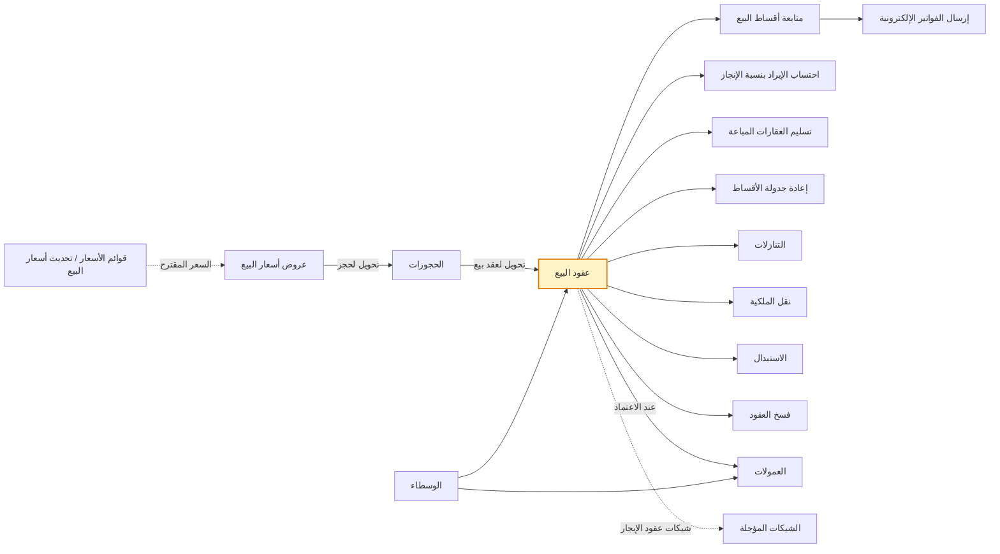
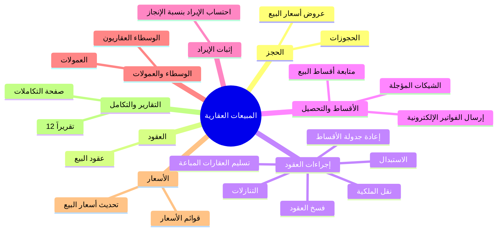

# المبيعات العقارية (Real Estate Sales) — شرح الشاشات لغير المتخصص

بتاريخ 2026-10-26 · يكمّل [[شرح الشاشات بالتفصيل]] (الإعدادات) و[[شرح شاشات التأجير]] (التأجير) · النسخة الإنجليزية: [[Sales screens explained]].

المصدر: الموك أب التفاعلي لموديول التسويق العقاري، تطبيق «المبيعات العقارية» (نسخة 26 أكتوبر): 16 شاشة عمل، وشاشة إرسال الفواتير الإلكترونية المشتركة مع اللوجستيات، و12 تقريراً، وصفحة التكاملات. حالة البناء في الكلاود لم تُفحص هنا لكل شاشة؛ الواضح من الكود أن «عروض أسعار البيع» موجودة (SaleQuotations)، وأن عقد البيع يحمل CR 125774 ونقل الملكية CR 126102.

## الفكرة الكبيرة

البيع العقاري هو رحلة الوحدة من «متاح» إلى «مباع» ثم «تم التسليم»: عرض سعر للعميل، حجز بعربون (أو حجز على المخطط بلا وحدة)، عقد بيع يولّد جدول أقساط، متابعة الأقساط (تأكيد ← فوترة ← تحصيل)، إثبات الإيراد حسب سياسة الشركة، ثم تسليم الوحدة بمحضر فحص وقيد التكلفة. وما يطرأ بعد العقد له شاشة منفصلة: إعادة جدولة، تنازل، نقل ملكية، استبدال، فسخ. وعلى الجانب: الوسطاء وعمولاتهم، وقوائم الأسعار.

عقد البيع (الأصفر) هو المركز: الحجز يسبقه، والأقساط والإيراد والتسليم وكل الإجراءات تتفرع منه.

## الخريطة الذهنية

![[Sales mind map.png]]

## الشاشات في لمحة

| # | المجموعة | الشاشة | ماذا تفعل بسطر |
| --- | --- | --- | --- |
| 1 | الحجز | عروض أسعار البيع | عرض سعر لوحدة وعميل بخصم ونظام تقسيط وجدول مقترح |
| 2 | الحجز | الحجوزات | حجز وحدة بعربون، أو حجز على المخطط برسوم أولوية، وفاتورة الدفعة المقدمة |
| 3 | العقود | عقود البيع | العقد: السعر والخصم والضرائب والمشترون والأقساط والشروط |
| 4 | إجراءات العقود | تسليم العقارات المباعة | محضر تسليم الوحدة وقيود التسليم والتكلفة |
| 5 | إجراءات العقود | إعادة جدولة الأقساط | توزيع الأقساط المتبقية على عدد ودورية جديدين |
| 6 | إجراءات العقود | التنازلات | المشتري يعيد الوحدة للشركة مقابل رسوم |
| 7 | إجراءات العقود | نقل الملكية | العقد ينتقل لمشترٍ جديد بعقد جديد ورسوم نقل |
| 8 | إجراءات العقود | الاستبدال | نفس المشتري يبدّل وحدته بأخرى |
| 9 | إجراءات العقود | فسخ العقود | إنهاء عقد البيع بغرامة ورد الباقي |
| 10 | الأقساط والتحصيل | متابعة أقساط البيع | تأكيد الأقساط وفوترتها وتحصيلها وتعديلها (مدمجة 26/10) |
| 11 | الأقساط والتحصيل | إرسال الفواتير الإلكترونية | إرسال فواتير الأقساط للهيئة (شاشة لوجستيات موسّعة) |
| 12 | الأقساط والتحصيل | الشيكات المؤجلة (أوراق القبض) | محفظة شيكات أقساط الإيجار: إيداع، تحصيل، ارتداد |
| 13 | إثبات الإيراد | احتساب الإيراد بنسبة الإنجاز | ترحيل إيراد وتكلفة الشهر للعقود على المخطط |
| 14 | الوسطاء والعمولات | الوسطاء العقاريون | سجل الوسطاء الخارجيين برخصة فال ونسبة عمولة |
| 15 | الوسطاء والعمولات | العمولات | عمولات الوسطاء والمسوقين من الاعتماد حتى الصرف |
| 16 | الأسعار | قوائم الأسعار | تعديل سعر الوحدات بنسبة أو مبلغ على نطاق وبأولوية وفترة |
| 17 | الأسعار | تحديث أسعار البيع | رفع أسعار البيع جماعياً |

التقارير الـ 12 (الوحدات المباعة، حالة الأقساط، لوحة التحصيل، التدفق النقدي، إيراد المشروع، تكاليف المشروع، العرابين، المندوبون، عمولات الوسطاء، التاريخ، ربحية البيع، الوضع الضريبي) تقرأ من كل ما سبق ولم تُشرح هنا.

---

## 1. عروض أسعار البيع

**ما هي؟** ورقة عرض لعميل على وحدة محددة: سعر القائمة (من قوائم الأسعار)، خصم %، نظام التقسيط، فيُحسب السعر النهائي = سعر القائمة × (1 + زيادة نظام التقسيط) × (1 − الخصم)، ويُعرض جدول أقساط مقترح قابل للطباعة. لا تحجز الوحدة ولا تغيّر حالتها. الرقم `QT-السنة-تسلسل`، صالح 14 يوماً.

**ماذا تُدخل؟** العميل (مع «+ عميل جديد» ينشئ عميلاً في مجموعة «عملاء عقاريون»)، العميل المحتمل من CRM اختيارياً، المشروع (تصفية)، العقار (المتاح للبيع)، المسوق، سعر القائمة، الخصم، نظام التقسيط.

**الحالات:** مسودة ← مرسل (زر «إرسال للعميل» يرسل PDF بالواتساب والبريد في المنتج) ← محول لحجز أو منتهي بعد الصلاحية. زر «تحويل لحجز» يفتح حجزاً مملوءاً بالعميل والوحدة والسعر النهائي والخطة.

**مثال:** 1,050,000 بخصم 2% ← 1,029,000.

**أسئلة مفتوحة:** متى يصبح «مقبول»؟ هل يُقفل العرض بعد الإرسال؟

## 2. الحجوزات

**ما هي؟** حجز وحدة لعميل بعربون نسبة من السعر (5% من الضبط العام) لمدة صلاحية (14 يوماً)، أو **حجز على المخطط** بلا وحدة برسوم أولوية تُختار الوحدة بعده من شجرة المشروع (قرار 11 أكتوبر). الرقم `RSV-السنة-تسلسل`.

**الدورة:** مسودة ← مؤكد ← محول لعقد (عند اعتماد عقد البيع) أو ملغي. «منتهي» حالة محسوبة بعد الصلاحية والوحدة تبقى «محجوز» حتى يقرر المستخدم (قرار 26 أكتوبر).

**ماذا يحدث عند التأكيد؟** الوحدة «محجوز»، تُنشأ حسابات العميل الفرعية، وتُصدر **فاتورة دفعة مقدمة** بالعربون في المبيعات بلا أمر بيع (قرار 15 أكتوبر) وبلا ضريبة (خارج النطاق)، وفاتورة إلكترونية 386 في السعودية؛ القيد: من حساب العميل إلى الدفعات المقدمة. «تحصيل العربون» ينشئ سند قبض حسب طريقة السداد. «تحويل لعقد بيع» يفتح عقداً مملوءاً.

**الإلغاء (قرار 26 أكتوبر):** السبب (من العميل / من الشركة) ومصير العربون (مصادرة إلى «إيرادات دفعات حجز مصادرة» 4195 / رد كامل بطلب صرف «مرتجع عميل عقاري» / رد جزئي).

**تفاصيل:** الوسيط والمسوق يُسجَّلان هنا وتُحسب عمولتهما عند اعتماد العقد؛ «لحساب الغير» يظهر إن كانت الوحدة لمالك آخر. DevOps: Feature 101055، CR 101122 Confirmed.

**أسئلة مفتوحة:** هل يُمنع التحويل لعقد قبل تحصيل العربون؟ رسوم الأولوية: هل تُرد إن لم يختر وحدة؟

## 3. عقود البيع

**ما هي؟** العقد (ابتدائي أو نهائي) لبيع وحدة: السعر والخصم ونظام التقسيط والملحقات والشروط والمشترون. اعتماده يولّد جدول الأقساط، يجعل الوحدة «مباع»، يثبّت سياسة إثبات الإيراد على العقد، يسوّي عربون الحجز، ويحسب عمولات الوسيط والمسوق. الرقم `SC-السنة-تسلسل`. الإجراءات اللاحقة شاشات منفصلة (قرار 11 أكتوبر).

**ماذا تُدخل؟**
- **العقد:** النوع، التاريخ، بداية الأقساط، الحجز (ينسخ المشتري والوحدة والسعر والعربون)، المشتري الممثل (أو جدول «المشترين» بنسب ملكية مجموعها 100% وممثل واحد)، العقار.
- **القيمة:** سعر القائمة ← سعر البيع = سعر القائمة × (1 + زيادة نظام التقسيط)، الخصم مبلغاً، صافي العقد = سعر البيع − الخصم (الملحقات خارجه)، العربون المحصّل يُخصم من المقدم (ولو زاد عنه يُخصم من الأقساط التالية، قرار 25 أكتوبر).
- **الضرائب (السعودية):** «خاضع لضريبة التصرفات العقارية» (افتراضياً نعم في السعودية): الأقساط بضريبة 0% فئة E، و5% ضريبة تصرفات على الصافي يدفعها المشتري (سطر في الجدول) أو البائع (قيد مصروف 5220 / مستحق 2420). «المسكن الأول لمواطن سعودي»: الدولة تتحمل الضريبة حتى سقف 1,000,000. في مصر: خاضع = الأقساط بضريبة 14%.
- **الوساطة:** المسوق، الوسيط الخارجي ونسبته (2.5% افتراضياً) ومن يتحملها.

**التبويبات:** الأقساط (معاينة قبل الاعتماد، الجدول الفعلي بعده، مع زر «متابعة الأقساط» للقسط المستحق خلال 30 يوماً)، المشترون، المرافق (الملحقات بسطر «مرافق» في الجدول)، الغرامات، الشروط والأحكام، حركات العقد، الفواتير.

**كيف يُبنى الجدول؟** المقدم من نظام التقسيط ناقص العربون، ثم أقساط = الأساس ÷ العدد مقرّبة حسب الخطة، وأول قسط بعد «أول قسط بعد (شهر)»، وسطر «وديعة صيانة» إن وُجدت. لا فائدة ولا دفعة سنوية (قرار 13 أكتوبر).

**الحالات:** مسودة ← ساري (اعتماد) ← مكتمل السداد (محسوبة عند تحصيل آخر قسط) ← تم التسليم؛ ونهايات أخرى: متنازل عنه، منقول، مستبدل، مفسوخ. «تحويل لنهائي» يغيّر النوع فقط.

**الغرامات:** تُحسب من نظام التقسيط وقواعد الدولة في الضبط العام (السعودية افتراضياً بلا غرامة مالية؛ «أوجه البر» تذهب لحساب 2280 لا للإيراد؛ مصر بسقف قانوني 7% سنوياً)، مع مراحل التعثر (تذكير، إنذار، إشعار تعثر، شؤون قانونية، حلول باقي الأقساط، فسخ). زر «تطبيق» يسمح بتخفيض الغرامة بسبب (لا زيادتها) و«إعفاء» بسبب (CR 107039).

**إثبات الإيراد:** يدوي (الافتراضي): الإيراد مع فاتورة كل قسط. عند التسليم: الفواتير على الدفعات المقدمة ثم يُثبت الإيراد كله عند التسليم. نسبة الإنجاز: من شاشة احتساب الإيراد. وحدة مالك آخر: إيراد الشركة = عمولة التسويق فقط، والباقي مستحق للملاك (2215).

**أسئلة مفتوحة:** المسكن الأول مع أكثر من مشترٍ (CR 125774 Q18). DevOps: CR 101123 Confirmed.

## 4. تسليم العقارات المباعة

**ما هي؟** محضر تسليم الوحدة للمشتري بفحص (6 بنود: المطبخ، دورات المياه، الأرضيات، الدهانات، التكييف، الأبواب والنوافذ) وقراءتي عدادين. يُنشأ «مُرحّلاً» ويجعل العقد «تم التسليم»؛ الوحدة تبقى «مباع».

**القيود عند التسليم حسب السياسة:** «عند التسليم»: إيراد كامل الصافي (من ذمم العقد إلى إيرادات بيع العقارات) وإقفال الدفعات المقدمة على ذمم العقد؛ «نسبة الإنجاز»: إكمال الإيراد والتكلفة إلى 100%؛ «يدوي»: قيد التكلفة فقط. **قيد التكلفة** (وحدة الشركة فقط): لكل نوع تكلفة من تكلفة النوع (مثلاً 5111) إلى أعمال تحت التنفيذ (1311) بنصيب الوحدة (بالمساحة أو نسبة يدوية من تبويب التكاليف في المشروع).

**مثال:** فيلا 350 م² في مشروع 3,750 م² ورصيد أرض 3,150,000 ← سطر أرض 294,000.

**أسئلة مفتوحة:** هل يُشترط سداد نسبة أو عقد نهائي قبل التسليم؟

## 5. إعادة جدولة الأقساط

**ما هي؟** توزيع الأقساط المتبقية غير المفوترة (بيع أو إيجار) على عدد ودورية وبداية جديدة بنفس الإجمالي: القسط = المتبقي ÷ العدد، والأخير يأخذ فرق التقريب. الأسطر القديمة تصبح «ملغي». لا قيود محاسبية. لو تجاوز التغيير «حد تعديل الأقساط %» يحتاج موافقة (D39).

**مثال:** 8 × 75,000 إلى 6 ربع سنوية ← 6 × 100,000.

## 6. التنازلات

**ما هي؟** المشتري يعيد الوحدة للشركة: تُرد له مدفوعاته ناقص رسوم تنازل (1% من الصافي افتراضياً)، العقد «متنازل عنه»، الوحدة «متاح»، والأقساط المتبقية تُلغى. يُنشأ إشعار دائن وطلب صرف «مرتجع عميل عقاري» بالفرق. القيد يعكس ما أُثبت من إيراد (قيد عكسي موحّد) ويقيّد الرسوم إيراد خدمات. «إلغاء التنازل» يعيد كل شيء من لقطة محفوظة. «تنازل لعميل جديد» أُزيل في 26 أكتوبر وصار في «نقل الملكية».

**مثال:** صافٍ 1,000,000، مسدد 200,000، رسوم 10,000 ← مرتجع 190,000.

## 7. نقل الملكية (CR 126102، محدَّثة 26 أكتوبر)

**ما هي؟** العقد ينتقل لمشترٍ جديد (أو عدة مشترين بنسب ملكية مجموعها 100% وممثل واحد) بعقد جديد `SC` يبدأ من تاريخ النقل: الأقساط المستحقة من تاريخ النقل فصاعداً تنتقل إليه بنفس تواريخها، وما سُدد يبقى مع المشتري القديم، والعقد القديم يصبح «منقول». رسوم نقل (5,000 افتراضياً من الضبط العام، بضريبة الدولة) على البائع أو المشتري الجديد كسطر يُفوتر من متابعة الأقساط. لا قيود ولا عمولات جديدة؛ الوسيط لا ينتقل.

**مثال:** استحقاقات 1/1 و1/4 و1/7 ونقل في 15/3 ← ينتقل قسطا 1/4 و1/7 فقط.

## 8. الاستبدال

**ما هي؟** نفس المشتري يبدّل وحدته بوحدة متاحة أخرى: ما سُدد ينتقل كعربون للعقد الجديد، العقد القديم «مستبدل» ووحدته «متاح»، والجدول الجديد يُبنى على الفرق (السعر الجديد − المسدد) بنفس نظام التقسيط. رسوم استبدال اختيارية (مبلغ أو نسبة) بضريبة. القيد يعكس إيراد القديم ويحوّل المسدد إلى دفعات مقدمة تُسوّى على الجديد.

**مثال:** مسدد 200,000 وسعر جديد 1,200,000 ← عقد جديد بعربون 200,000 وجدول على 1,000,000.

**سؤال مفتوح:** العمولات تُحتسب مرة ثانية على العقد الجديد.

## 9. فسخ العقود

**ما هي؟** إنهاء عقد البيع (الإيجار لا يُفسخ؛ يُنهى بإشعار) بغرامة أساسها نسبة من المسدد (10% افتراضياً) أو نسبة من قيمة العقد أو مبلغ ثابت (قرار 26 أكتوبر). الشركة تأخذ الأقل من (الغرامة، المسدد) وترد الباقي بإشعار دائن وطلب صرف؛ لو الغرامة أكبر من المسدد يمكن تحميل الباقي قسطاً «غرامة فسخ». الأقساط المتبقية تُلغى، الوحدة «متاح»، الإيراد المثبت يُعكس، وقيد التكلفة يُعكس إن كان العقد مسلَّماً. الغرامة بلا ضريبة (تعويض لا خدمة).

**مثال:** مسدد 300,000 بنسبة 10% ← غرامة 30,000 ومرتجع 270,000.

## 10. متابعة أقساط البيع (مدمجة 26 أكتوبر)

**ما هي؟** الشاشة الواحدة لأقساط عقود البيع بعد الاعتماد (توأم «متابعة أقساط الإيجار»): فلتر «مستحق خلال N يوم/شهر» مع المتأخر، ست مؤشرات، وجدول الأقساط. **الخطوات:** تأكيد المحدد (علامة بتاريخ، بلا قيد في السياسة اليدوية) ← إصدار فواتير للمحدد بالمبلغ الذي يحدده المستخدم (أقل من المتبقي = فاتورة جزئية؛ فاتورة إلكترونية «معلقة»؛ روابط دفع عبر التطبيق) ← تحصيل بسند قبض. «فك التأكيد» ما لم تصدر فاتورة. تعديل المبلغ أو التاريخ (التاريخ بصلاحية «تغيير تاريخ استحقاق قسط»؛ فوق حد التعديل يذهب للموافقات والفرق يُسوّى على آخر قسط)، تقسيم، إلغاء. لا دمج.

**مثال:** قسط 61,800 ومبلغ فاتورة 24,000 ← «مفوتر جزئياً».

## 11. إرسال الفواتير الإلكترونية

**ما هي؟** شاشة اللوجستيات الحالية مضافاً إليها فلتر «المصدر» (التسويق العقاري بيع/إيجار) و«المشروع». فواتير الأقساط والعرابين تُنشأ «معلق» ولا تُرسل تلقائياً (قرار 14 أكتوبر)؛ المستخدم يعلّمها «جاهز للمزامنة» ومهمة خلفية ترسلها: جاري المزامنة ← تم المزامنة أو مرفوضة بسبب. الفئات: S بالضريبة، E معفاة (VATEX-SA-30: الإيجار السكني وبيع العقار)، O خارج النطاق (سطر ضريبة التصرفات والتأمينات، بلا فاتورة إلكترونية). B2B يحتاج سجلاً تجارياً للعميل.

## 12. الشيكات المؤجلة (أوراق القبض)

**ما هي؟** محفظة شيكات عقود الإيجار ذات خيار الشيكات: شيك لكل قسط إيجار، يُسجَّل عبر «أوراق القبض المجمعة» في إدارة النقدية. **الحالات:** في الخزينة ← (إيداع بالبنك) تحت التحصيل ← (تحصيل) محصل: يسدد القسط بسند ورقة قبض وقيد من البنك 1120 إلى أوراق قبض تحت التحصيل 1131؛ أو (ارتداد) مرتد مع غرامة 500 على العقد؛ أو ملغى / سحب للخزينة / إعادة تقديم.

## 13. احتساب الإيراد بنسبة الإنجاز

**ما هي؟** للعقود على المخطط بسياسة «نسبة الإنجاز»: آخر كل شهر يرحّل المستخدم دفعة `POC-السنة-تسلسل` بإيراد الفترة = صافي العقد × نسبة الإنجاز − المثبت سابقاً، وتكلفة الفترة بنفس النسبة من نصيب الوحدة من كل نوع تكلفة. النسبة من تبويب «نسبة الإنجاز» في المشروع (مستخلصات المقاول أو تقرير مهندس؛ المصدر النهائي مفتوح). القيد: من ذمم العقد إلى إيرادات بيع العقارات، ومن تكلفة النوع إلى أعمال تحت التنفيذ. التسليم يكمل إلى 100%.

**مثال:** صافٍ 745,500 بنسبة 24% ← 178,920؛ ثم 36% ← 89,460.

## 14. الوسطاء العقاريون

**ما هي؟** سجل الوسطاء الخارجيين: كود، اسم، رقم رخصة فال (REGA، إلزامي)، انتهاء الرخصة (أحمر إن انتهت)، عمولة افتراضية 2.5%، مسجل في الضريبة، خاضع للخصم من المنبع. في AccFlex الوسيط مورّد في مجموعة «وسطاء عقاريون» بحساب 2220-xxxx. تبويب «العمولات» يعرض عمولاته.

## 15. العمولات

**ما هي؟** متابعة عمولات الوسطاء (بيع وإيجار) والمسوقين من اعتماد العقد حتى الصرف. **الأنواع:** وسيط – بيع / وسيط – إيجار / مسوق – بيع. **الحالات:** محسوبة ← معتمدة ← مصروفة.
- **الوسيط:** «مطابقة فاتورة» (أو فاتورة مجمعة لعدة عقود) تُنشئ أمر شراء عاجل ومطابقة فاتورة في المشتريات (من مصروف العمولات 5210 إلى حساب الوسيط، مع ضريبة مدخلات وخصم من المنبع)، ثم «صرف» بطلب صرف نوع 5 وسند صرف بنكي.
- **المسوق:** «اعتماد الاستحقاق» (من 5210 إلى عمولات مستحقة 2250) ثم «مكافأة رواتب» (من 2250 إلى رواتب ومكافآت مستحقة 2260). تبويب «شرائح المسوقين» يعيد تسعير الشهر بالشريحة النهائية و«تسوية» تضيف الفرق.

**مثال:** عمولتان 2,000 + 1,000، مسجل بالضريبة، خصم 5% ← ضريبة 450، خصم 150، صافٍ 3,300.

**أسئلة مفتوحة:** «تُحمّل على» بلا أثر محاسبي؛ التجديد يُنشئ عمولة جديدة.

## 16. قوائم الأسعار

**ما هي؟** قوائم تعدّل سعر الوحدة الأساسي بنسبة أو مبلغ على نطاق (مشروع، مبنى، دور، نوع عقار، عقار)، بأولوية وفترة سريان. تُطبَّق القائمة الأعلى أولوية فقط ويُقترح «السعر الفعلي» في عرض السعر والحجز والعقد والاستبدال، ويُنسخ في المستند ولا يتغير بعده. تبويب «العقارات المتأثرة» يعاين الأثر.

**مثال:** قائمة مشروع +5% ← 1,000,000 تصبح 1,050,000.

## 17. تحديث أسعار البيع

**ما هي؟** رفع أسعار البيع جماعياً بتصفية (مشروع، مبنى، دور، نوع، إتاحة) ونسبة أو مبلغ أو سعر متر × المساحة، مع تقريب (لأقرب 1,000 افتراضياً) وسبب. يغيّر سعر الوحدة فوراً ويسجل القديم في تاريخها؛ العروض والحجوزات والعقود القائمة لا تتغير.

**مثال:** سعر متر 7,000 لعقار 135 م² بتقريب 1,000 ← 945,000.

---

## كلمات ستقابلك

| الكلمة | معناها ببساطة |
| --- | --- |
| سعر القائمة / السعر الفعلي | سعر الوحدة بعد قوائم الأسعار، قبل الخصم وزيادة التقسيط |
| زيادة نظام التقسيط | نسبة تُضاف للسعر عند البيع بالتقسيط، من الوحدة أو الخطة |
| ضريبة التصرفات العقارية | ضريبة سعودية 5% على بيع العقار يدفعها المشتري عادة؛ أقساط البيع نفسها معفاة من القيمة المضافة |
| المسكن الأول | الدولة تتحمل ضريبة التصرفات حتى سقف مليون ريال للمواطن السعودي |
| ذمم العقد | حساب يحمل ما يستحق على المشتري بعد إثبات الإيراد |
| الدفعات المقدمة | ما دفعه العميل قبل إثبات الإيراد (العربون وفواتير ما قبل التسليم) |
| إثبات الإيراد | متى يُعدّ البيع إيراداً: مع كل فاتورة، أو عند التسليم، أو بنسبة الإنجاز |
| القيد العكسي الموحّد | عكس ما أُثبت من إيراد عند الفسخ أو التنازل أو الاستبدال |
| مطابقة فاتورة (IV) | إثبات فاتورة مورّد (الوسيط أو المالك) في المشتريات تمهيداً للصرف |

## المصادر

- الموك أب التفاعلي (الـ artifact المشترك «موديول التسويق العقاري»)، تطبيق المبيعات العقارية، نسخة 26 أكتوبر 2026: مواصفات الشاشات وصفحة التكاملات (D01–D49).
