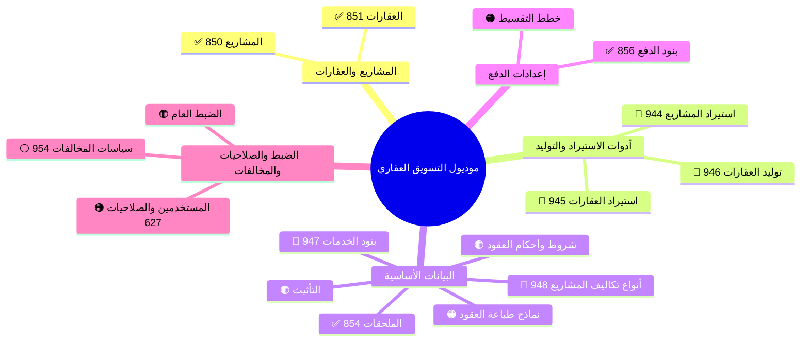
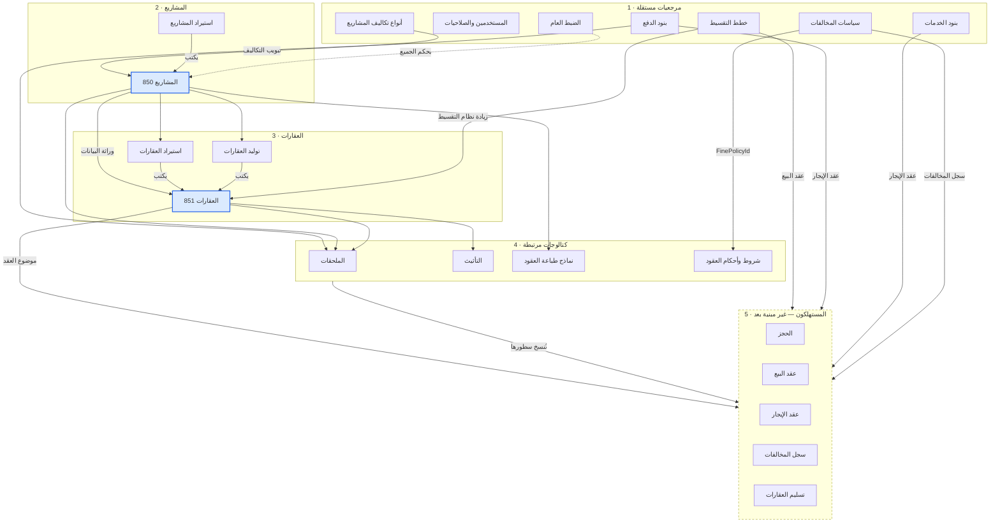
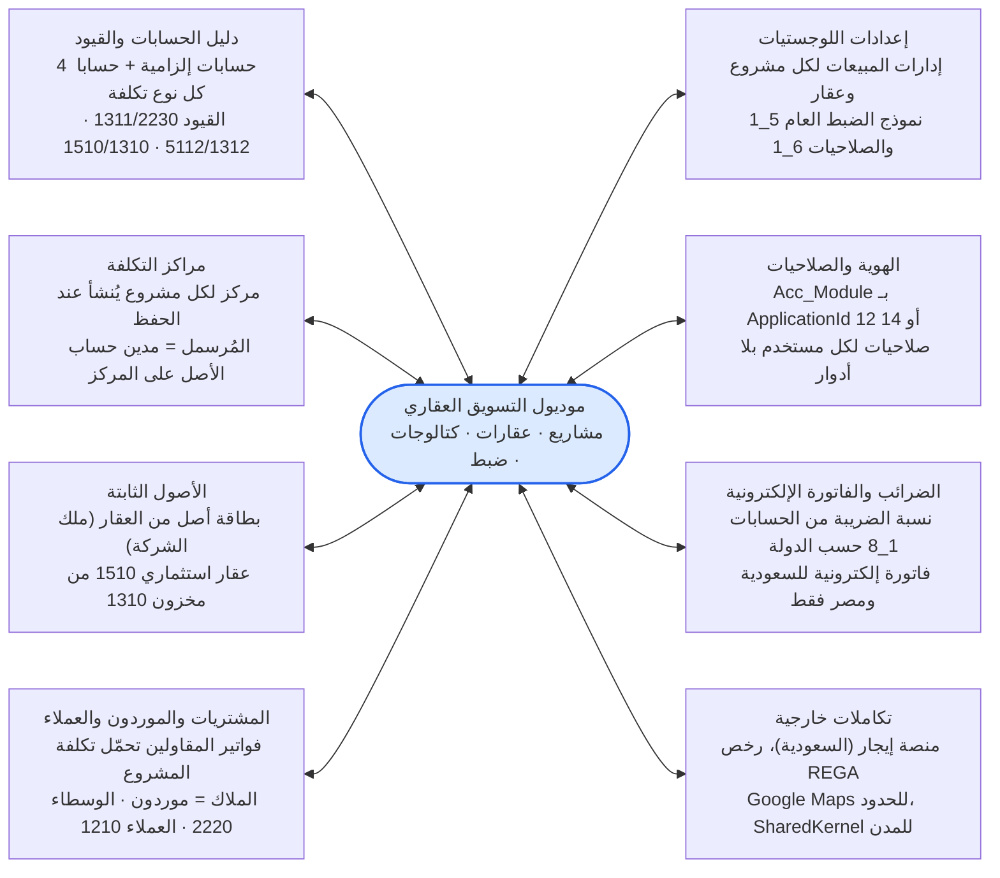
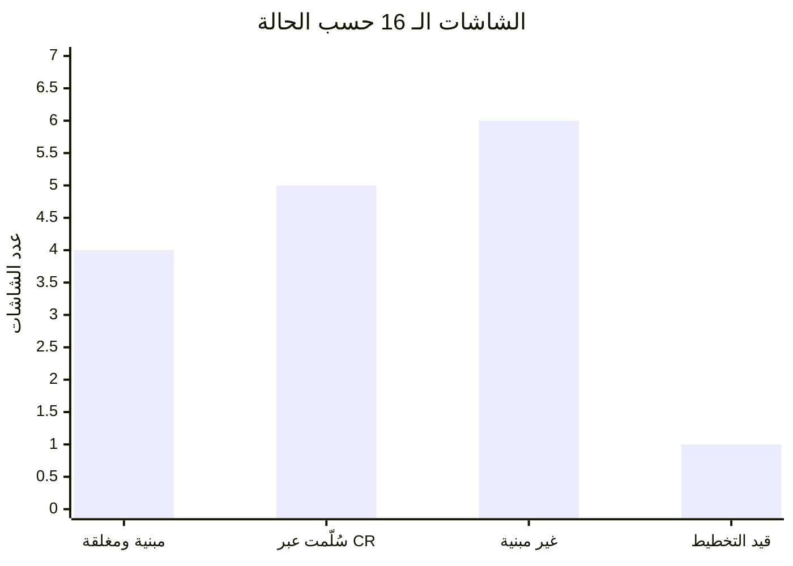

# موديول التسويق العقاري (Property Manager) — شرح وخرائط وتبعيات

بتاريخ 2026-10-22 · مبني على `Settings\Settings.md` ومذكرات الـ CRs في هذا المجلد. النسخة الإنجليزية: [[Property Manager module overview]].

## نظرة عامة

موديول التسويق العقاري هو الطبقة التأسيسية لإدارة العقارات في AccFlex Cloud: يسجّل المشاريع والعقارات (الوحدات) ويعرّف البيانات المرجعية التي تُبنى عليها عقود البيع والإيجار لاحقاً. الموجود اليوم في الكلاود هو «الإعدادات والبيانات الأساسية» فقط؛ الشاشات التشغيلية (الحجز، عقد البيع، عقد الإيجار، إدارة الأقساط، سجل المخالفات، تسليم العقارات) تظهر في المواصفات كمستهلِك للبيانات ولم تُبنَ بعد.

المواصفات تغطي 16 شاشة في خمس مجموعات:

- **المشاريع والعقارات** (نواة الموديول): المشاريع (Module 850) والعقارات (Module 851). كل شيء آخر يغذّيهما أو يقرأ منهما.
- **أدوات المشاريع والعقارات**: استيراد المشاريع من Excel، استيراد العقارات من Excel، توليد العقارات جماعياً من نمط كود. ثلاثتها تكتب في جدولي المشاريع والعقارات بنفس قواعد التحقق.
- **البيانات الأساسية (الإعدادات المسبقة)**: الملحقات (854)، التأثيث، بنود الخدمات (947)، أنواع تكاليف المشاريع (948)، شروط وأحكام العقود، نماذج طباعة العقود. كتالوجات تُنسخ منها السطور إلى العقود.
- **إعدادات الدفع**: بنود الدفع (856) وخطط التقسيط. بنود الدفع تخدم عقود الإيجار والملحقات؛ خطط التقسيط تخدم عرض السعر والحجز وعقد البيع.
- **الضبط والصلاحيات والمخالفات**: الضبط العام (سجل إعدادات واحد للشركة)، المستخدمين والصلاحيات (امتداد لشاشة 627)، وسياسات المخالفات (954) تحت جذر «التأجير › المخالفات».

حالة التنفيذ باختصار: أربع شاشات مبنية ومغلقة في DevOps منذ البداية، خمس سُلّمت عبر CRs في أكتوبر 2026، أربع لها CR مؤكَّد ولم تُبنَ، شاشتان بلا بند DevOps، وسياسات المخالفات عند بوابة الخطة.

## الخريطة الذهنية

![[Property Manager mind map.png]]

✅ مبنية ومغلقة · 🔵 سُلّمت عبر CR (أكتوبر 2026) · 🟠 غير مبنية · ⚪ قيد التخطيط

## الشاشات

| الشاشة | المسار · Module | الحالة | DevOps / CR | الهدف |
| --- | --- | --- | --- | --- |
| المشاريع | المشاريع والعقارات › 2_1 · 850 | ✅ مبنية | Feature 99133 · CR 99136 Closed | تسجيل المشاريع الرئيسية والفرعية بجغرافيتها وحدودها ومركز تكلفتها |
| العقارات | المشاريع والعقارات › 2_2 · 851 | ✅ مبنية | Feature 101062 · CR 101107 Closed | تسجيل العقارات تحت المشاريع بالمساحات وسعر البيع؛ ناقصة الجغرافيا وأسعار الإيجار |
| استيراد المشاريع | أدوات › 5_2_1 · 944 | 🔵 سُلّمت | CR 125486 · Solved 2026-10-18، عاد للتطوير بعد QA 2026-10-21 · client 1.0.124 | استيراد من Excel (24 عموداً)، إضافة فقط، مع إنشاء مركز تكلفة وسجل استيراد |
| استيراد العقارات | أدوات › 5_2_2 · 945 | 🔵 سُلّمت | CR 125487 · Solved 2026-10-19 · client 1.0.126 | استيراد من Excel (19 عموداً)، إضافة فقط، وراثة بيانات المشروع على السيرفر |
| توليد العقارات | أدوات › 5_2_3 · 946 | 🔵 سُلّمت | CR 125488 · Solved 2026-10-20 · client 1.0.127 | توليد عقارات من نمط كود (مبنى / طابق / وحدة) حتى 500 صف، مع جراج مرتبط |
| الملحقات | الإعدادات المسبقة › 3_1 · 854 (التصنيفات 855) | ✅ مبنية | Feature 101061 · CR 101118 Closed | ملحقات (موقف، مسبح، مخزن) لمشروع أو عقار بسعر وبند دفع |
| التأثيث | البيانات الأساسية | 🟠 غير مبنية | لا بند DevOps | بنود تأثيث بإيجار سنوي تُنسخ لعقد الإيجار وتُفحص عند التسليم؛ ليست أصولاً |
| بنود الخدمات | البيانات الأساسية › 5_1_4 · 947 | 🔵 سُلّمت | CR 125562 · Solved 2026-10-19 · client 1.0.136 | كتالوج خدمات بقيمة سنوية تُوزّع على أقساط الإيجار |
| أنواع تكاليف المشاريع | البيانات الأساسية › 5_1_5 · 948 | 🔵 سُلّمت | CR 125563 · Solved 2026-10-20 · client 1.0.143 | أنواع تكلفة المشروع (أرض، إنشاء، تشطيب) بحساب أصل وحساب تكلفة |
| شروط وأحكام العقود | البيانات الأساسية | 🟠 غير مبنية | Feature 101054 · CR 101119 Confirmed | بنود قانونية تُطبع في عقود البيع والإيجار؛ تشير لسياسة مخالفة |
| نماذج طباعة العقود | البيانات الأساسية | 🟠 غير مبنية | لا بند DevOps | قوالب نص العقد بمتغيرات، لكل مشروع ونوع عقد |
| بنود الدفع | إعدادات الدفع › 4_1 · 856 | ✅ مبنية | Feature 101052 · CR 101108 Closed | بنود دفع (تعاقد، وديعة، إيجار، غرامة…) بقيمة أو نسبة ودورية وفترة سماح |
| خطط التقسيط | البيانات الأساسية | 🟠 غير مبنية | Feature 101053 · CR 101109 Confirmed | مكتبة أنظمة تقسيط لعرض السعر والحجز وعقد البيع؛ تشمل غرامة التأخير |
| الضبط العام | الإعدادات والصلاحيات | 🟠 غير مبنية | Feature 101056 · CR 101120 Confirmed | سجل إعدادات واحد للشركة: الدولة، 4 حسابات إلزامية، الغرامات، إثبات الإيراد، التكاملات |
| المستخدمين والصلاحيات | الإعدادات والصلاحيات · 627 (امتداد) | 🟠 غير مبنية | Feature 101057 · CR 101121 Confirmed | شاشة 6_1 نفسها + مجموعتا صلاحيات «التسويق العقاري» و«إعدادات العقارات» |
| سياسات المخالفات | التأجير › المخالفات › 7_1_1 · 954 (مقترح) | ⚪ قيد التخطيط | CR 125716 · بوابة الخطة معلّقة | غرامات مخالفات المستأجر بمبالغ متدرجة حسب التكرار؛ كتالوج فقط |

## التبعيات بين الشاشات

المشاريع ثم العقارات هما عمود التبعية: كل أداة تكتب فيهما، وكل كتالوج مرتبط يقرأ منهما، والعقود المستقبلية تقرأ الجميع. ترتيب الإعداد الصحيح: مرجعيات مستقلة ← مشاريع ← عقارات ← كتالوجات مرتبطة ← العقود.

الروابط التي تحدد الترتيب:

- **العقار يرث المشروع**: الملكية، الجغرافيا، إدارة المبيعات، مركز التكلفة، العملة، النشاط والحالة (GetProjectInfoById في الشاشة، وعلى السيرفر في الاستيراد والتوليد). لذلك لا عقار بلا مشروع فرعي (ورقة شجرة).
- **المشروع ينشئ مركز تكلفة** تحت «المشاريع» عند الحفظ، وتبويب «التكاليف» يقرأ أنواع تكاليف المشاريع (جدول الربط موجود منذ CR 125563 بلا واجهة بعد).
- **بنود الدفع** تغذّي الملحقات وعقد الإيجار؛ **خطط التقسيط** تغذّي تبويب «زيادة نظام التقسيط» في العقار وعقد البيع. غرامة التأخير تعيش داخل الخطة (بيع) وداخل بند الدفع (إيجار)، لا في مكتبة منفصلة.
- **سياسات المخالفات** تُقرأ من بند شرط إيجار (Pm_ContractClause.FinePolicyId) ومن سجل المخالفات؛ هي منفصلة عن غرامة التأخير.
- **الضبط العام** يحكم الجميع بسجل واحد: الدولة تقرر العملة والضريبة والفاتورة الإلكترونية، والحسابات الأربعة الإلزامية تحدد أين تُرحّل العقود. قرار 11 و15 أكتوبر: «إثبات الإيراد» سياسة شركة هنا، وأُزيل من المشروع والعقار.
- **الحذف محكوم بالاستخدام** في كل كتالوج (بند دفع مستخدم، نوع تكلفة عليه حركة، مشروع له عقارات)، ومعظم هذه الفحوص مؤجلة حتى تُبنى العقود.

## التكامل مع باقي موديولات AccFlex

الموديول لا يعرّف حساباته ولا ضرائبه ولا إدارات مبيعاته بنفسه؛ يقرأها من الحسابات العامة وإعدادات اللوجستيات والهوية، ويرحّل قيوده بنفسه لأن الكلاود بلا محرك إثبات إيراد وبلا مفهوم وديعة في النقدية. الحسابات الأربعة التي يعرّفها الضبط العام: تأمينات المستأجرين 2320، مستحقات ملاك تحت التسوية 2215، ذمم عقود بيع غير مفوترة 1215، مخزون عقارات 1310 (والمواصفات تذكر خامساً متعارضاً: مدفوعات إيجار تحت التحويل 1135).

حسابات يستخدمها الموديول وتُعرّف خارجه:

| الحساب | الرقم | يُعرّف في |
| --- | --- | --- |
| العملاء والدفعات المقدمة | 1210 · 2330 | مجموعات العملاء 1_2 |
| الوسطاء | 2220 | مجموعات الموردين 1_5 |
| إيراد مؤجل | 2310 | دليل الحسابات (يحتاج امتداداً) |
| إيراد بيع العقارات والإيجارات | 4110 · 4120 | فئة الخدمة لكل إدارة مبيعات |
| عمولات الوسطاء | 2250 · 5210 | إعدادات اللوجستيات 5_1 |
| ضريبة العملاء | 2410 | الحسابات العامة 1_8 |
| حسابات نوع الأصل | — | أنواع الأصول 7_2 |
| مكافآت المندوبين | 2260 | الرواتب |

القيود الثلاثة الموثّقة: تسجيل تكلفة على مشروع (مدين 1311 / دائن 2230)، تسليم عقار مباع ملك الشركة (مدين 5112 / دائن 1312 بنصيب العقار من كل نوع تكلفة)، وتحويل عقار إلى أصل استثماري (مدين 1510 / دائن 1310).

## حالة التنفيذ

| المجموعة | مبنية | سُلّمت عبر CR | غير مبنية | قيد التخطيط | المجموع |
| --- | --- | --- | --- | --- | --- |
| المشاريع والعقارات | 2 | 0 | 0 | 0 | 2 |
| الأدوات | 0 | 3 | 0 | 0 | 3 |
| البيانات الأساسية | 1 | 2 | 3 | 0 | 6 |
| إعدادات الدفع | 1 | 0 | 1 | 0 | 2 |
| الضبط والصلاحيات والمخالفات | 0 | 0 | 2 | 1 | 3 |

النواة والأدوات مكتملة؛ ما بقي هو الكتالوجات التي تحتاج عقداً لتكون مفيدة، والضبط العام الذي تعتمد عليه كل العقود.

ما بقي على الـ CRs المسلّمة:

| CR | الشاشة | الخطوة التالية |
| --- | --- | --- |
| 125486 | استيراد المشاريع | دمج PRs Stage_Beta الجديدة (ERP 67925 و Front 67926)، نشر Stage Beta، ثم ADO إلى Solved والرد على QA |
| 125487 | استيراد العقارات | المهندس يحل تعارضات PRs Stage_Beta الثلاثة، ثم نشر Beta وفحص PO، ثم إزالة الست |
| 125488 | توليد العقارات | تعارضات Stage_Beta تُحل مع 125487؛ إصلاح 2026-10-20 يصل Beta بدمج جديد لـ cr125488 |
| 125562 | بنود الخدمات | تعارضات API وDB على فروع cr125562_Stage_Beta عندما يطلب المهندس |
| 125563 | أنواع تكاليف المشاريع | تعارضات الـ PRs الثلاثة (67763/64/65)؛ الست أُزيل ويُعاد من origin/cr125563 عند الحاجة |
| 125716 | سياسات المخالفات | المهندس يجيب عن Q1–Q8 ويعتمد الخطة (البوابة 3)، ثم phase-loop |

## الفجوات والأسئلة المفتوحة

أكبر فجوة واحدة: لا عقد إيجار ولا عقد بيع في الكلاود على أي فرع، فكل كتالوج سُلّم بلا مستهلِك ومع معايير قبول مؤجلة.

**غير موجود في الكلاود بعد** (مسح 2026-10-22): عقد الإيجار، عقد البيع، الحجز، سجل المخالفات، تسليم العقارات، جدول أسعار الإيجار، تاريخ العقار، حالة «متاح»، حقل المبنى (المبنى = عقار أب)، تبويب «عقارات مركبة»، تبويب «التكاليف» في المشروع، ولا تغطية للموديول في الـ KG. لذلك أُجّلت: AC-1/AC-2/BR-2 وعمود «عقود الإيجار» في بنود الخدمات، BR-2/AC-1..3 في سياسات المخالفات، عمود الإيجار في الاستيراد والتوليد، وعدّاد المشاريع في أنواع التكاليف (يظهر 0).

**فجوات في الشاشات المبنية** (من «المنفّذ حالياً مقابل الستوري»): المشاريع 12 فجوة (قائمة الأب مسطحة، HasProperties ثابت false، فلتر مركز التكلفة مقلوب، الحدود شمال/جنوب معكوسة…)، العقارات 14 (الجغرافيا تُرسل 65/1/1 ثابتة، أسعار الإيجار عنوان بلا جدول، النوع من ProjectTypes، السعر يدوي…)، بنود الدفع 4 (وحدة السماح تُحفظ من وحدة التكرار فتعطي 500 مع «لا تكرر»، فحص ≤100 على القيمة بدل النسبة…)، الملحقات 6 («يخدم» يرسل نصاً والسيرفر يتوقع 1/2، بند الدفع غير مفلتر بالنوع…).

**قرارات تنتظر صاحبها:**

- [ ] D46: جداول Amenity / PaymentTerm / Project / Property مشتركة مع التطبيق الآخر (api/MenuList).
- [ ] الصلاحيات: إضافة شاشات العقارات بـ ApplicationId 12 أم توسيع الاستعلام إلى 8 / 14 مع حل تضارب الرقم 14.
- [ ] الضبط العام: الحساب الخامس 1135 يتعارض مع «4 حسابات فقط»؛ وأين تُعرّف 5110، 4140، 4130، 4150، 4190، 2340، 2350، 5410.
- [ ] Pm_Project.ProofOfIncomeAndExpenses: حذفه أم تحويله إلى إعداد شركة (أُسقط من الاستيراد بالفعل).
- [ ] مصدر نسبة الإنجاز: مستخلصات المقاول أم تقرير مهندس.
- [ ] D03: إضافة PurchaseOrganizationId للمشروع.
- [ ] CR 125716: Q1–Q8 كلها مفتوحة (النطاق كتالوج فقط، FK على الشرط، موديول 954 وجذر 7)؛ الأرقام 952–953 مستخدمة في فروع غير مدمجة.
- [ ] التأثيث: هل السعر × الكمية؛ وإيراد 4120 لعقار مالك آخر.
- [ ] الشروط: هل يُثبّت نص البند عند اعتماد العقد؛ نماذج الطباعة: نص بمتغيرات أم Word.

**على المسار الآن:** تعارضات Stage_Beta معلّقة على 125487 و125488 و125562 و125563 (تُحل على فروع `cr<id>_Stage_Beta`، لا بدمج Stage_Beta في فرع الـ CR)، و125486 عاد للتطوير بعد اختبار QA والإصلاح مدفوع مع PRs جديدة على Stage_Beta.

## المصادر

كلها في هذا المجلد، قُرئت بتاريخ 2026-10-22:

- `Settings\Settings.md`: مواصفات الشاشات الـ 15 (الحقول، قواعد العمل، القيود، التكامل، المنفّذ مقابل الستوري، الأسئلة المفتوحة).
- `Violations\Violation Policies\Violation Policies.md` ومجلد `CR-125716` (facts, spec, plan, open-questions, HANDOFF).
- مجلدات الـ CRs المسلّمة: `Settings\importProjects\CR-125486`، `Settings\importUnits\CR-125487`، `Settings\bulkUnits\CR-125488`، `Settings\services\CR-125562`، `Settings\expTypes\CR-125563` (HANDOFF.md، decisions.md، open-questions.md، spec.md، plan.md).
- مذكرات الميزات: `importProjects v3.md`، `importUnits v2.md`، `bulk Units V2.md`، `services.md`، `expTypes.md`.

لم يُقرأ الكود نفسه ولا الـ KG؛ الحالات والأرقام كما تذكرها هذه الملفات.
