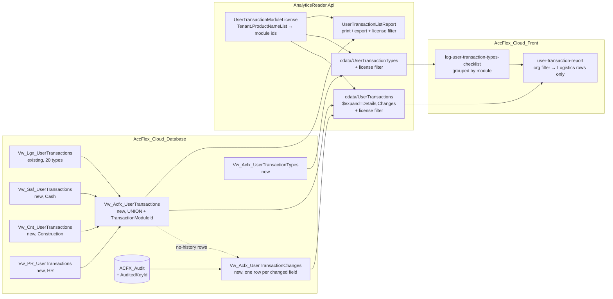

# CR-120883 — User Transactions Report: All Licensed Modules + Before/After Values

> [!danger] Out of date — do not implement from this draft
> Decisions in [[CR-120883 - Grilling Decisions]] replace key assumptions here: a **new** report instead of extending the old one, all ≈137 audited tables, a generated view, the Misc API for lookups, and **no** `ACFX_Audit` index. This plan will be rewritten once those decisions are confirmed.

> [!info] Source
> CR text: [[CR-120883 - Source]] · Current screen: `/logistics/user-transactions-report` · Permission module **720**

> **For agentic workers:** REQUIRED SUB-SKILL: Use `superpowers:subagent-driven-development` (recommended) or `superpowers:executing-plans` to implement this plan task by task. Steps use checkbox (`- [ ]`) syntax for tracking.

**Goal:** Keep the existing User Transactions report, but let its "Transaction Type" filter cover Cash, Construction and HR transactions as well as Logistics ones, limited to the modules the company is licensed for. For each row, add a "Change Details" tab that shows each edited field's value before and after.

**Architecture:** Three layers change, and no new report is built:
1. **Database.** Add three views, one each for Cash, Construction and HR, that return the same columns as the current Logistics view. A new combined view unions all four. A second new view turns the existing `ACFX_Audit` log (which already stores old and new values as JSON) into one row per changed field.
2. **AnalyticsReader API.** Point the existing OData entity at the combined view, add a `Changes` detail collection, add a license-filtered `UserTransactionTypes` endpoint, and apply the license filter to both the grid path and the print path.
3. **Angular.** Replace the Logistics-only type picker with one that groups types by module, add `Changes` as a second detail tab, and apply the organization filters only to Logistics rows.

Moving the menu entry to General Settings is a separate phase. It waits for the General Settings module to exist.

**Tech stack:** SQL Server 2016 (SSDT, `Sql130`, `OPENJSON`) · ASP.NET Core 8 + EF Core + OData (AnalyticsReader) · NUnit 3 + FluentAssertions · Angular 18 + DevExtreme + odata-query + ngx-translate

## Global Constraints

- The existing report stays in place, with no new screen. Main-grid columns stay exactly as they are today. Only the filter and the detail tabs change. (CR §4.1-1, §4.1-5)
- Transaction types and rows are shown **only for licensed modules**. The server enforces this. The UI must never be the only gate. (CR §4.1-3, §2.1)
- An empty type selection means **all licensed modules**. (CR §4.3 "Default: كل الموديولات المرخصة")
- Permission stays **ModuleId 720**, and `[PermissionModuleId((int)ModuleIds.UserTransactions)]` stays unchanged. (CR §4.1-8)
- Not a breaking change. Tenants licensed only for Logistics see exactly the same report as today. (CR §2.2)
- Old and new values only come from `ACFX_Audit`. If nothing was recorded, show an explicit "not available" note and never an empty cell. (CR §4.1-6, §4.5.2-3)
- SQL views that are `UNION ALL`-ed must use **typed NULLs**, such as `CAST(NULL AS INT)` or `CAST(NULL AS NVARCHAR(200))`. A bare `NULL` becomes an `INT` view column, and unioning it with the Logistics view's `NVARCHAR` columns throws a conversion error.
- DB conventions (from `AccFlex_Cloud_Database/CLAUDE.md`):
  - Put schema DDL only in `dbo/` model files, never in Pre/Post scripts.
  - Don't use `GO` in scripts.
  - Every new `.sql` file must be registered in the `.sqlproj`, or it is silently dropped.
  - Reference-data scripts are idempotent `MERGE`s and are edited in place (see `0108` history).
- Build the DB with VS 2022 MSBuild `/p:VisualStudioVersion=17.0`, not `dotnet build`.
- Build the backend with `-c Release`, because VS locks Debug.
- Front-end type-check: use the override tsconfig, because `projects/logistics/tsconfig.app.json` points at a wrong `main.ts`.
- i18n: every new key goes in **both** `src/assets/i18n/ar-EG/shared.json` and `en-US/shared.json`, under `ODATAREPORTS`. Grep first, because a duplicate JSON key silently overrides the earlier one.
- Report-grid conventions: columns ending in `Id` or `Hidden` are auto-hidden. `*FirstLanguage` shows in Arabic and `*SecondLanguage` in English. Captions come from `ODATAREPORTS.<dataField>`.

---

## 1. What the Code Says (Findings That Change the CR)

> [!success] F1: Old and new values are ALREADY recorded, which resolves the CR's biggest "Missing Data" item
> The CR says the audit base only stores `CreatedBy`/`LastModifiedBy`. That is true of `AuditedEntityBase`, but a detailed log also exists.
> `ChangeTrackerExtensions.SetShadowProperties` (`Shared/SharedKernel.Data/logging/ChangeTrackerExtensions.cs`) builds an `AuditEntry` holding `OldValues` and `NewValues` as JSON of the **modified properties only**. It includes child collections as nested arrays. The entry is written to **`ACFX_Audit`** by:
> - `Payroll.Data/PayrollContext.cs:368`
> - `CashControll.Data/CashControlContext.cs:249`
> - `Construction.Data/ConstructionContext.cs:273`
> - `Logistics.Inventory/Sales/Purchase/Production` contexts
>
> There is already a precedent for reading it: `dbo/Views/Vw_Pr_AnnualIncreaseDetail.sql`.
> **So no new change-history layer is needed.** The work is reading and presenting existing data.

> [!warning] F2: Limits of `ACFX_Audit` (these shape the design)
> | Limit | Effect | Handling |
> |---|---|---|
> | Only entities implementing `IAuditedEntityBase` are audited | A document type without it has no history | The catalog (D1) lists only verified tables; the "no history" note covers the rest |
> | The table has **no action column** | Add/Edit must be inferred | `OldValues IS NULL` → Add; `Void`/`IsDeleted` = true → Cancel; otherwise → Edit |
> | Soft deletes (`Remove()` on `ISoftDelete`) and hard deletes create **no** audit row | A deletion done through EF `Remove` has no history | Domain-level voids (setting `Void = true`) *are* captured. Documented as a known gap |
> | Stores `UserName`, **not** a user id; `DateTime` is **UTC** | The display needs a name and local time | Show `UserName`; convert UTC to server-local in the view |
> | `KeyValues` is a JSON string (`"123"`) | It can't be joined efficiently as-is | Add a persisted computed column `AuditedKeyId` plus an index |
> | Values are raw (foreign keys stay ids, property names stay C# names) | `StoreId: 5 → 7` is not user-friendly | Captions come from a reference table; resolving FK names is a follow-up (D5) |
> | Changes made by the **desktop** AccFlex_ERP go to `Saf_Audit`/`PR_Audit`/`Crt_Audit`, not `ACFX_Audit` | Edits made in the desktop app won't show | Out of scope. Tell the customer |

> [!warning] F3: The org filters would hide every non-Logistics row
> `HandleControlChanges` (front end) and `AppendUserTransactionFilters` (back end) filter on Sales, Purchase and Inventory org ids. The form also **defaults `SalesOrgsIds` to the user's default sales org** (`setDefaultValues`). Cash, Construction and HR rows have NULL org ids, so they would disappear by default. Fix: apply the org filters only to Logistics rows (D2).

> [!note] F4: Where the type list comes from today
> `log-transactions-type` → `LogisticsStaticResourcesService.transactionsTypeList` → Logistics API `GetAllTransactionsTypesQuery`. That query returns the static C# enum `Logistics.Common.Logic.Enums.TransactionsType` (ids 1–20) with no license check. The data view `Vw_Lgx_UserTransactions` is 20 `UNION ALL` branches, one row per document, keyed `(TransactionId, TransactionTypeId)`.

> [!note] F5: Menu, permission and licensing facts
> - Menu: `Logistics.Application/Shared/MenuList/WebMenuItem.cs:328` (`"2_3_3"`, route `user-transactions-report`), grouped in `WebMenuGroup.cs:72`.
> - Module: `SharedKernel.Logic/Modules/Module.cs:662`, `new Module(720, …, 12, 44)`. It is seeded in `Scripts/ReferenceDataScripts/0002_Acc_Module_Data.sql` with ApplicationId **12**.
> - License: `HttpContext.Features.Get<Tenant>().ProductNameList` holds product `ReferenceName`s, following the existing `ProductLicenseFilter` pattern. `TenantInfoMiddleware` sets it, and AnalyticsReader runs `UseRequestTenantInfo()`.
> - **Interim limitation:** until Phase 4, the report still lives inside the Logistics app, so a tenant *without* a Logistics license can't open it at all.

> [!bug] Noticed, out of scope
> - `projects/logistics/src/app/routes.ts`: the `customer-invoice-debit-aging-report` route also uses `ModuleId: 720` (probably a copy-paste error).
> - `Vw_Lgx_UserTransactions` fills `CreatedOnHidden`/`ModifiedDateHidden` from the **user** row (`Creator.CreatedOn`), not from the document.
> - `UserTransactionsDetailConfigurations` uses a non-unique EF key `(TransactionId, TransactionTypeId)`.
>
> Log these separately; don't fix them here.

---

## 2. Decisions Needed (Product Owner) — with Recommendations

| # | Decision | Recommendation (the plan assumes this) |
|---|---|---|
| **D1** | Initial list of document types for Cash, Construction and HR | Approve the **13 types** in Task 1. `TransactionDate` = the document's own date. Deferred because of missing columns: `Saf_MoneyTransfer` (no `CreatedById`), `Cnt_ConstractorProgressBill` (no `ModifiedBy`), `PR_EmployeeTransactions` (no document code) |
| **D2** | How the Sales/Purchase/Inventory org filters treat non-Logistics rows | They **apply to Logistics rows only**. Other modules' rows pass through |
| **D3** | What a "حركة تعديل" (edit transaction) is | Every row gets a **"تفاصيل التعديل"** tab listing its audit events: Add, Edit (with each field's value before and after) and Cancel. No new "action" filter in v1 |
| **D4** | Approve / un-approve (اعتماد / إلغاء اعتماد) | v1 shows them as **field edits** on the status field. A dedicated "approval" action type is a follow-up |
| **D5** | Foreign-key values (`ProjectId: 5 → 7`) | v1 shows raw values under a translated field caption. Resolving names for the top fields is a follow-up |
| **D6** | Field captions (Arabic and English) | A BA/PO fills `ACFX_UserTransactionFieldCaption` from the discovery query in Task 3. Missing captions fall back to the property name |

> [!tip] None of these block Phase 1. Tasks 1–3 build on the recommendations; changing D1 only edits reference data plus one view branch.

---

## 3. Data Flow



## 4. File Map

| Repo | File | Change | Responsibility |
|---|---|---|---|
| DB | `dbo/Tables/Lgx_TransactionCycleType.sql` | Modify | Add `TransactionModuleId` (1 Logistics, 2 Cash, 3 Construction, 4 HR) |
| DB | `dbo/Tables/Lgx_TransactionsType.sql` | Modify | Add `AuditTableName` (link to `ACFX_Audit.TableName`) |
| DB | `Scripts/ReferenceDataScripts/0107_Lgx_TransactionCycleType.sql` | Modify | Add cycles 5–7 and the module id |
| DB | `Scripts/ReferenceDataScripts/0108_Lgx_TransactionsType.sql` | Modify | Add types 21–33 and the audit table names |
| DB | `dbo/Views/Vw_Acfx_UserTransactionTypes.sql` | Create | Type list with module names (feeds the filter) |
| DB | `dbo/Views/Vw_Saf_UserTransactions.sql` | Create | Cash documents in the report's shape |
| DB | `dbo/Views/Vw_Cnt_UserTransactions.sql` | Create | Construction documents in the report's shape |
| DB | `dbo/Views/Vw_PR_UserTransactions.sql` | Create | HR documents in the report's shape |
| DB | `dbo/Views/Vw_Acfx_UserTransactions.sql` | Create | Union of all four views plus `TransactionModuleId` |
| DB | `dbo/Tables/ACFX_Audit.sql` | Modify | Persisted computed `AuditedKeyId` and an index |
| DB | `dbo/Tables/ACFX_UserTransactionFieldCaption.sql` | Create | Field-name → caption table |
| DB | `Scripts/ReferenceDataScripts/5002_ACFX_UserTransactionFieldCaption.sql` | Create | Caption seed |
| DB | `dbo/Views/Vw_Acfx_UserTransactionChanges.sql` | Create | One row per audited change, plus "no history" rows |
| DB | `AccFlex_Cloud_Database_State.sqlproj` | Modify | Register every new file |
| API | `AnalyticsReader.Api/Helpers/UserTransactions/UserTransactionModuleLicense.cs` | Create | Maps licensed products to module ids |
| API | `AnalyticsReader.Api/ODataViews/Logistics/UserTransactions/UserTransactions.cs` | Modify | Add `TransactionModuleId` and the `Changes` nav |
| API | `…/UserTransactions/UserTransactionChange.cs` | Create | OData entity for a change row |
| API | `…/UserTransactions/UserTransactionType.cs` | Create | OData entity for a type row |
| API | `ODataViewsConfigurations/Logistics/UserTransactions/UserTransactionsConfigurations.cs` | Modify | Point at the new views, add relations |
| API | `Models/DataContext.cs` | Modify | Two DbSets |
| API | `ODataControllers/Logistics/LogisticsOdataController.cs` | Modify | License filter plus the `UserTransactionTypes` action |
| API | `AngularReports/Logistics/UserTransactionsReport/UserTransactionListReport.cs` | Modify | License filter in print, org filter → Logistics only |
| API | `AnalyticsReader/AnalyticsReader.Api.Test/*` | Create | NUnit project (the first tests for AnalyticsReader) |
| FE | `projects/logistics/src/app/modules/user-transaction-report/services/user-transaction-types.service.ts` | Create | Fetches licensed types |
| FE | `…/user-transaction-report/components/user-transaction-types-checklist/*` | Create | Multi-select grouped by module |
| FE | `…/user-transaction-report/user-transaction-report.module.ts` | Modify | Declare the checklist |
| FE | `…/user-transaction-report/user-transaction-report/user-transaction-report.component.{ts,html}` | Modify | New picker, `Changes` tab, org filter |
| FE | `src/assets/i18n/{ar-EG,en-US}/shared.json` | Modify | New `ODATAREPORTS` keys |

All DB paths are relative to `AccFlex_Cloud_Database/AccFlex_Cloud_Database_State/AccFlex_Cloud_Database_State/`, API paths to `AccFlex_Cloud_ERP/AccFlex_Cloud_ERP/AnalyticsReader/`, and FE paths to `AccFlex_Cloud_Front/accflex-erp/`.

**Branch (all three repos):** `feature/CR-120883-user-transactions-all-modules`

## 5. Phases & Estimate (11 SP)

| Phase                 | Tasks   | SP  | Can ship alone?                                                                              |
| --------------------- | ------- | --- | -------------------------------------------------------------------------------------------- |
| 1 — Database          | 1, 2, 3 | 4   | Yes (additive views, not yet used)                                                           |
| 2 — API               | 4, 5, 6 | 3   | With Phase 1                                                                                 |
| 3 — Front end         | 7, 8    | 3   | With Phases 1 and 2. **This is the shippable "filter + before/after" increment** (CR §4.1-7) |
| 4 — Access point move | 9       | 1   | Only once the General Settings module exists                                                 |
| QA                    | 10      | —   | Run after Phase 3, and again after Phase 4                                                   |

---

## Phase 1 — Database (`AccFlex_Cloud_Database`)

### Task 1: Transaction-type catalog with module and audit-table mapping

**Files:**
- Modify: `dbo/Tables/Lgx_TransactionCycleType.sql`
- Modify: `dbo/Tables/Lgx_TransactionsType.sql`
- Modify: `Scripts/ReferenceDataScripts/0107_Lgx_TransactionCycleType.sql`
- Modify: `Scripts/ReferenceDataScripts/0108_Lgx_TransactionsType.sql`
- Create: `dbo/Views/Vw_Acfx_UserTransactionTypes.sql`
- Modify: `AccFlex_Cloud_Database_State.sqlproj`

**Interfaces:**
- Produces: `Lgx_TransactionCycleType.TransactionModuleId INT NOT NULL` (1 = Logistics, 2 = Cash, 3 = Construction, 4 = HR); `Lgx_TransactionsType.AuditTableName NVARCHAR(128) NULL`; type ids **21–33**; view `Vw_Acfx_UserTransactionTypes(TransactionsTypeId, NameFirstLanguage, NameSecondLanguage, TransactionModuleId, ModuleNameFirstLanguage, ModuleNameSecondLanguage)`
- The Logistics C# enum `TransactionsType` (1–20) is **not** changed, so no Logistics screen is affected.

- [ ] **Step 1: Confirm the audit table names against real data.** Run this on a copy of the customer DB:

```sql
SELECT TableName, COUNT(*) AS Rows, MIN([DateTime]) AS FirstUtc, MAX([DateTime]) AS LastUtc
FROM dbo.ACFX_Audit
WHERE TableName IN (N'Lgx_GoodReceipt',N'Lgx_GoodIssue',N'Lgx_InventoryMovement',N'Lgx_TransactionCancellation',
  N'Lgx_PhysicalInventory',N'Lgx_PhysicalInventoryCount',N'Lgx_PhysicalInventoryDifference',N'Lgx_SalesOrder',
  N'Lgx_SalesContract',N'Lgx_OutboundDelivery',N'Lgx_Invoice',N'Lgx_CustomerMemo',N'Lgx_SalesReturn',
  N'Lgx_PurchaseOrder',N'Lgx_PurchaseRequisition',N'Lgx_InvoiceVerification',N'Lgx_PurchaseReturn',
  N'Lgx_SupplierMemo',N'Lgx_ProductionOrder',N'Lgx_DeliveryPlan',
  N'Saf_StoreDailyReceive',N'Saf_StoreDailyPayment',N'Saf_ReceivableNote',N'Saf_PayableNote',
  N'Saf_RecievableBankTransfer',N'Saf_PayableBankTransfer',
  N'Cnt_OwnerProgressInvoice',N'Cnt_OwnerMemo',N'Cnt_ContractorMemo',N'Cnt_ContractorAdvance',
  N'PR_Vacations',N'PR_ResignationRequest',N'PR_SalaryMain')
GROUP BY TableName
ORDER BY TableName;
```

Expected: one row per table that has been edited since the cloud version was installed. For any **missing** table, run `SELECT DISTINCT TableName FROM dbo.ACFX_Audit WHERE TableName LIKE N'%<keyword>%'` to find the spelling EF actually used (`GetTableName()` returns the `ToTable()` string, so casing can differ, e.g. `pr_EmployeeIncome`). Use that spelling in Step 5. Record the row counts; Task 3 needs them.

- [ ] **Step 2: Add `TransactionModuleId` to the cycle-type table.** Replace the contents of `dbo/Tables/Lgx_TransactionCycleType.sql` with:

```sql
CREATE TABLE [dbo].[Lgx_TransactionCycleType]
(
    [TransactionCycleTypeId]			INT             IDENTITY (1, 1) NOT NULL,
    [Name]						        NVARCHAR(200)	NOT NULL,
    [NameSecondLanguage]		        NVARCHAR(200)	NOT NULL,
    [TransactionModuleId]               INT             CONSTRAINT [DF_Lgx_TransactionCycleType_TransactionModuleId] DEFAULT ((1)) NOT NULL,

    CONSTRAINT [PK_Lgx_TransactionCycleType] PRIMARY KEY CLUSTERED ([TransactionCycleTypeId] ASC)
)
```

- [ ] **Step 3: Add `AuditTableName` to the type table.** Replace the contents of `dbo/Tables/Lgx_TransactionsType.sql` with:

```sql
CREATE TABLE [dbo].[Lgx_TransactionsType]
(
    [TransactionsTypeId]			INT             IDENTITY (1, 1) NOT NULL,
    [Name]						    NVARCHAR(200)	NOT NULL,
    [NameSecondLanguage]		    NVARCHAR(200)	NOT NULL,
    [TransactionCycleTypeId]        INT             NOT NULL,
    [AuditTableName]                NVARCHAR(128)   NULL,

    CONSTRAINT [PK_Lgx_TransactionsType] PRIMARY KEY CLUSTERED ([TransactionsTypeId] ASC),
    CONSTRAINT [FK_Lgx_TransactionsType_Lgx_TransactionCycleType] FOREIGN KEY ([TransactionCycleTypeId])
        REFERENCES [dbo].[Lgx_TransactionCycleType] ([TransactionCycleTypeId])
)
```

- [ ] **Step 4: Seed the new cycle types.** Replace the contents of `Scripts/ReferenceDataScripts/0107_Lgx_TransactionCycleType.sql` with:

```sql
SET NOCOUNT ON

SET IDENTITY_INSERT [Lgx_TransactionCycleType] ON

MERGE INTO [Lgx_TransactionCycleType] AS [Target]
USING (VALUES
  (1,N'المخازن',N'Inventory',1)
 ,(2,N'المبيعات',N'Sales',1)
 ,(3,N'المشتريات',N'Purchase',1)
 ,(4,N'الانتاج',N'Production',1)
 ,(5,N'النقدية',N'Cash Management',2)
 ,(6,N'المقاولات',N'Construction',3)
 ,(7,N'الموارد البشرية',N'Human Resources',4)
) AS [Source] ([TransactionCycleTypeId],[Name],[NameSecondLanguage],[TransactionModuleId])
ON ([Target].[TransactionCycleTypeId] = [Source].[TransactionCycleTypeId])
WHEN MATCHED AND (
	NULLIF([Source].[Name], [Target].[Name]) IS NOT NULL OR NULLIF([Target].[Name], [Source].[Name]) IS NOT NULL OR
	NULLIF([Source].[NameSecondLanguage], [Target].[NameSecondLanguage]) IS NOT NULL OR NULLIF([Target].[NameSecondLanguage], [Source].[NameSecondLanguage]) IS NOT NULL OR
	NULLIF([Source].[TransactionModuleId], [Target].[TransactionModuleId]) IS NOT NULL OR NULLIF([Target].[TransactionModuleId], [Source].[TransactionModuleId]) IS NOT NULL) THEN
 UPDATE SET
  [Target].[Name] = [Source].[Name],
  [Target].[NameSecondLanguage] = [Source].[NameSecondLanguage],
  [Target].[TransactionModuleId] = [Source].[TransactionModuleId]
WHEN NOT MATCHED BY TARGET THEN
 INSERT([TransactionCycleTypeId],[Name],[NameSecondLanguage],[TransactionModuleId])
 VALUES([Source].[TransactionCycleTypeId],[Source].[Name],[Source].[NameSecondLanguage],[Source].[TransactionModuleId])
WHEN NOT MATCHED BY SOURCE THEN
 DELETE;

DECLARE @mergeError int
 , @mergeCount int
SELECT @mergeError = @@ERROR, @mergeCount = @@ROWCOUNT
IF @mergeError != 0
 BEGIN
 PRINT 'ERROR OCCURRED IN MERGE FOR [Lgx_TransactionCycleType]. Rows affected: ' + CAST(@mergeCount AS VARCHAR(100)); -- SQL should always return zero rows affected
 END
ELSE
 BEGIN
 PRINT '[Lgx_TransactionCycleType] rows affected by MERGE: ' + CAST(@mergeCount AS VARCHAR(100));
 END

SET IDENTITY_INSERT [Lgx_TransactionCycleType] OFF
SET NOCOUNT OFF
```

- [ ] **Step 5: Seed types 21–33 and the audit table names.** Replace the contents of `Scripts/ReferenceDataScripts/0108_Lgx_TransactionsType.sql` with the following. Use any spelling corrections from Step 1.

```sql
SET NOCOUNT ON

SET IDENTITY_INSERT [Lgx_TransactionsType] ON

MERGE INTO [Lgx_TransactionsType] AS [Target]
USING (VALUES
  (1,N'استلام بضاعة',N'Goods Receipt',1,N'Lgx_GoodReceipt')
 ,(2,N'صرف بضاعة',N'Goods Issue',1,N'Lgx_GoodIssue')
 ,(3,N'تحويلات مخزنية',N'Inventory Movement',1,N'Lgx_InventoryMovement')
 ,(4,N'الغاء الحركات المخزنية',N'Transaction Cancellation',1,N'Lgx_TransactionCancellation')
 ,(5,N'انشاء الجرد',N'Physical Inventory',1,N'Lgx_PhysicalInventory')
 ,(6,N'عد الجرد',N'Physical Inventory Count',1,N'Lgx_PhysicalInventoryCount')
 ,(7,N'تسوية الجرد',N'Physical Inventory Difference',1,N'Lgx_PhysicalInventoryDifference')
 ,(8,N'امر بيع',N'Sales Order',2,N'Lgx_SalesOrder')
 ,(9,N'التعاقدات',N'Contract',2,N'Lgx_SalesContract')
 ,(10,N'اذن صرف بضاعة',N'Outbound Delivery',2,N'Lgx_OutboundDelivery')
 ,(11,N'فاتوره البيع',N'Invoice',2,N'Lgx_Invoice')
 ,(12,N'اشعار عميل',N'Customer Memo',2,N'Lgx_CustomerMemo')
 ,(13,N'مرتجع مبيعات',N'Sales Return',2,N'Lgx_SalesReturn')
 ,(14,N'امر توريد',N'Purchase Order',3,N'Lgx_PurchaseOrder')
 ,(15,N'طلب شراء',N'Purchase Requisition',3,N'Lgx_PurchaseRequisition')
 ,(16,N'مطابقة الفاتورة',N'Invoice Verification',3,N'Lgx_InvoiceVerification')
 ,(17,N'مرتجعات مشتريات',N'Purchase Return',3,N'Lgx_PurchaseReturn')
 ,(18,N'اشعار مورد',N'Supplier Memo',3,N'Lgx_SupplierMemo')
 ,(19,N'امر الانتاج',N'Production Order',4,N'Lgx_ProductionOrder')
 ,(20,N'تسليم الخرسانة',N'ReadyMix Delivery',4,N'Lgx_DeliveryPlan')
 ,(21,N'سند قبض نقدي',N'Cash Receipt',5,N'Saf_StoreDailyReceive')
 ,(22,N'سند صرف نقدي',N'Cash Payment',5,N'Saf_StoreDailyPayment')
 ,(23,N'أوراق قبض',N'Receivable Note',5,N'Saf_ReceivableNote')
 ,(24,N'أوراق دفع',N'Payable Note',5,N'Saf_PayableNote')
 ,(25,N'تحويل بنكي وارد',N'Receivable Bank Transfer',5,N'Saf_RecievableBankTransfer')
 ,(26,N'تحويل بنكي صادر',N'Payable Bank Transfer',5,N'Saf_PayableBankTransfer')
 ,(27,N'مستخلص مالك',N'Owner Progress Invoice',6,N'Cnt_OwnerProgressInvoice')
 ,(28,N'إشعار مالك',N'Owner Memo',6,N'Cnt_OwnerMemo')
 ,(29,N'إشعار مقاول',N'Contractor Memo',6,N'Cnt_ContractorMemo')
 ,(30,N'دفعة مقدمة مقاول',N'Contractor Advance',6,N'Cnt_ContractorAdvance')
 ,(31,N'إجازة',N'Vacation',7,N'PR_Vacations')
 ,(32,N'طلب استقالة',N'Resignation Request',7,N'PR_ResignationRequest')
 ,(33,N'مسير رواتب',N'Salary Sheet',7,N'PR_SalaryMain')
) AS [Source] ([TransactionsTypeId],[Name],[NameSecondLanguage],[TransactionCycleTypeId],[AuditTableName])
ON ([Target].[TransactionsTypeId] = [Source].[TransactionsTypeId])
WHEN MATCHED AND (
	NULLIF([Source].[Name], [Target].[Name]) IS NOT NULL OR NULLIF([Target].[Name], [Source].[Name]) IS NOT NULL OR
	NULLIF([Source].[NameSecondLanguage], [Target].[NameSecondLanguage]) IS NOT NULL OR NULLIF([Target].[NameSecondLanguage], [Source].[NameSecondLanguage]) IS NOT NULL OR
	NULLIF([Source].[TransactionCycleTypeId], [Target].[TransactionCycleTypeId]) IS NOT NULL OR NULLIF([Target].[TransactionCycleTypeId], [Source].[TransactionCycleTypeId]) IS NOT NULL OR
	NULLIF([Source].[AuditTableName], [Target].[AuditTableName]) IS NOT NULL OR NULLIF([Target].[AuditTableName], [Source].[AuditTableName]) IS NOT NULL) THEN
 UPDATE SET
  [Target].[Name] = [Source].[Name],
  [Target].[NameSecondLanguage] = [Source].[NameSecondLanguage],
  [Target].[TransactionCycleTypeId] = [Source].[TransactionCycleTypeId],
  [Target].[AuditTableName] = [Source].[AuditTableName]
WHEN NOT MATCHED BY TARGET THEN
 INSERT([TransactionsTypeId],[Name],[NameSecondLanguage],[TransactionCycleTypeId],[AuditTableName])
 VALUES([Source].[TransactionsTypeId],[Source].[Name],[Source].[NameSecondLanguage],[Source].[TransactionCycleTypeId],[Source].[AuditTableName])
WHEN NOT MATCHED BY SOURCE THEN
 DELETE;

DECLARE @mergeError int
 , @mergeCount int
SELECT @mergeError = @@ERROR, @mergeCount = @@ROWCOUNT
IF @mergeError != 0
 BEGIN
 PRINT 'ERROR OCCURRED IN MERGE FOR [Lgx_TransactionsType]. Rows affected: ' + CAST(@mergeCount AS VARCHAR(100)); -- SQL should always return zero rows affected
 END
ELSE
 BEGIN
 PRINT '[Lgx_TransactionsType] rows affected by MERGE: ' + CAST(@mergeCount AS VARCHAR(100));
 END

SET IDENTITY_INSERT [Lgx_TransactionsType] OFF
SET NOCOUNT OFF
```

- [ ] **Step 6: Create `dbo/Views/Vw_Acfx_UserTransactionTypes.sql`.**

```sql
CREATE VIEW [dbo].[Vw_Acfx_UserTransactionTypes]
AS
    SELECT  tt.[TransactionsTypeId] ,
            tt.[Name]                   AS NameFirstLanguage ,
            tt.[NameSecondLanguage] ,
            ct.[TransactionModuleId] ,
            CASE ct.[TransactionModuleId]
                WHEN 1 THEN N'اللوجستيك'
                WHEN 2 THEN N'النقدية'
                WHEN 3 THEN N'المقاولات'
                WHEN 4 THEN N'الموارد البشرية'
            END                         AS ModuleNameFirstLanguage ,
            CASE ct.[TransactionModuleId]
                WHEN 1 THEN N'Logistics'
                WHEN 2 THEN N'Cash Management'
                WHEN 3 THEN N'Construction'
                WHEN 4 THEN N'Human Resources'
            END                         AS ModuleNameSecondLanguage
    FROM    dbo.Lgx_TransactionsType tt
            INNER JOIN dbo.Lgx_TransactionCycleType ct ON ct.[TransactionCycleTypeId] = tt.[TransactionCycleTypeId];
```

- [ ] **Step 7: Register the view in the sqlproj.** Add this next to the other `dbo\Views` `Build` entries:

```xml
    <Build Include="dbo\Views\Vw_Acfx_UserTransactionTypes.sql" />
```

`0107` and `0108` are already registered as `<None Include="Scripts\ReferenceDataScripts\…" />`.

- [ ] **Step 8: Build the dacpac.**

Run (from `AccFlex_Cloud_Database/`):

```bash
"/c/Program Files/Microsoft Visual Studio/2022/Community/MSBuild/Current/Bin/MSBuild.exe" AccFlex_Cloud_Database_State/AccFlex_Cloud_Database_State/AccFlex_Cloud_Database_State.sqlproj /p:VisualStudioVersion=17.0 /v:quiet /nologo /clp:ErrorsOnly
```

Expected: no output and exit code 0. The ~520 `SQL71558` warnings are pre-existing noise.

- [ ] **Step 9: Publish to the dev DB** (VS → Publish with `AccFlex_Cloud_Database_State.publish.xml`), then verify:

```sql
SELECT TransactionModuleId, COUNT(*) FROM dbo.Vw_Acfx_UserTransactionTypes GROUP BY TransactionModuleId;
-- Expected: 1 → 20, 2 → 6, 3 → 4, 4 → 3
SELECT COUNT(*) FROM dbo.Lgx_TransactionsType WHERE AuditTableName IS NULL;
-- Expected: 0
```

- [ ] **Step 10: Commit**

```bash
git add AccFlex_Cloud_Database_State/AccFlex_Cloud_Database_State/dbo/Tables/Lgx_TransactionCycleType.sql AccFlex_Cloud_Database_State/AccFlex_Cloud_Database_State/dbo/Tables/Lgx_TransactionsType.sql AccFlex_Cloud_Database_State/AccFlex_Cloud_Database_State/Scripts/ReferenceDataScripts/0107_Lgx_TransactionCycleType.sql AccFlex_Cloud_Database_State/AccFlex_Cloud_Database_State/Scripts/ReferenceDataScripts/0108_Lgx_TransactionsType.sql AccFlex_Cloud_Database_State/AccFlex_Cloud_Database_State/dbo/Views/Vw_Acfx_UserTransactionTypes.sql AccFlex_Cloud_Database_State/AccFlex_Cloud_Database_State/AccFlex_Cloud_Database_State.sqlproj
git commit -m "CR-120883: add Cash/Construction/HR transaction types with module and audit-table mapping"
```

---

### Task 2: Per-module transaction views + combined view

**Files:**
- Create: `dbo/Views/Vw_Saf_UserTransactions.sql`
- Create: `dbo/Views/Vw_Cnt_UserTransactions.sql`
- Create: `dbo/Views/Vw_PR_UserTransactions.sql`
- Create: `dbo/Views/Vw_Acfx_UserTransactions.sql`
- Modify: `AccFlex_Cloud_Database_State.sqlproj`
- Unchanged: `dbo/Views/Vw_Lgx_UserTransactions.sql`, `dbo/Views/Vw_Lgx_UserTransactionsDetail.sql`

**Interfaces:**
- Consumes: type ids 21–33 and `TransactionModuleId` (Task 1)
- Produces: `Vw_Acfx_UserTransactions`, with exactly the same 21 columns as `Vw_Lgx_UserTransactions` in the same order, **plus** `TransactionModuleId INT`. Key: `(TransactionId, TransactionTypeId)`.

- [ ] **Step 1: Create `dbo/Views/Vw_Saf_UserTransactions.sql`.**

```sql
CREATE VIEW [dbo].[Vw_Saf_UserTransactions]
AS
    -------------- CASH RECEIPT (21) --------------
    SELECT  r.StoreDailyReceiveId AS TransactionId ,
            CAST(r.DocumentNo AS NVARCHAR(50)) AS TransactionCode ,
            r.RecieveDate AS TransactionDate ,
            Creator.UserId AS CreatedById ,
            Creator.UserName AS CreatedByName ,
            r.CreatedDate AS CreatedOnHidden ,
            Modifier.UserId AS LastModifiedById ,
            Modifier.UserName AS LastModifiedByName ,
            r.ModifiedDate AS ModifiedDateHidden ,
            tt.TransactionsTypeId AS TransactionTypeId ,
            tt.Name AS TransactionsTypeFirstLanguage ,
            tt.NameSecondLanguage AS TransactionsTypeSecondLanguage ,
            CAST(NULL AS INT) AS InventoryManagementId ,
            CAST(NULL AS NVARCHAR(200)) AS InventoryManagementFirstLanguage ,
            CAST(NULL AS NVARCHAR(200)) AS InventoryManagementSecondLanguage ,
            CAST(NULL AS INT) AS SalesOrganizationId ,
            CAST(NULL AS NVARCHAR(200)) AS SalesOrganizationFirstLanguage ,
            CAST(NULL AS NVARCHAR(200)) AS SalesOrganizationSecondLanguage ,
            CAST(NULL AS INT) AS PurchaseOrganizationId ,
            CAST(NULL AS NVARCHAR(200)) AS PurchaseOrganizationFirstLanguage ,
            CAST(NULL AS NVARCHAR(200)) AS PurchaseOrganizationSecondLanguage
    FROM    dbo.Saf_StoreDailyReceive r
            LEFT JOIN dbo.Acc_User AS Creator ON r.CreatedBy = Creator.UserId
            LEFT JOIN dbo.Acc_User AS Modifier ON r.ModifiedBy = Modifier.UserId
            LEFT JOIN dbo.Lgx_TransactionsType tt ON tt.TransactionsTypeId = 21
    UNION ALL
    -------------- CASH PAYMENT (22) --------------
    SELECT  p.StoreDailyPaymentId , CAST(p.DocumentNo AS NVARCHAR(50)) , p.PaymentDate ,
            Creator.UserId , Creator.UserName , p.CreatedDate ,
            Modifier.UserId , Modifier.UserName , p.ModifiedDate ,
            tt.TransactionsTypeId , tt.Name , tt.NameSecondLanguage ,
            CAST(NULL AS INT) , CAST(NULL AS NVARCHAR(200)) , CAST(NULL AS NVARCHAR(200)) ,
            CAST(NULL AS INT) , CAST(NULL AS NVARCHAR(200)) , CAST(NULL AS NVARCHAR(200)) ,
            CAST(NULL AS INT) , CAST(NULL AS NVARCHAR(200)) , CAST(NULL AS NVARCHAR(200))
    FROM    dbo.Saf_StoreDailyPayment p
            LEFT JOIN dbo.Acc_User AS Creator ON p.CreatedBy = Creator.UserId
            LEFT JOIN dbo.Acc_User AS Modifier ON p.ModifiedBy = Modifier.UserId
            LEFT JOIN dbo.Lgx_TransactionsType tt ON tt.TransactionsTypeId = 22
    UNION ALL
    -------------- RECEIVABLE NOTE (23) --------------
    SELECT  n.ReceivableNoteId , CAST(n.ReceivableNoteNo AS NVARCHAR(50)) , n.IssuanceDate ,
            Creator.UserId , Creator.UserName , n.CreatedDate ,
            Modifier.UserId , Modifier.UserName , n.ModifiedDate ,
            tt.TransactionsTypeId , tt.Name , tt.NameSecondLanguage ,
            CAST(NULL AS INT) , CAST(NULL AS NVARCHAR(200)) , CAST(NULL AS NVARCHAR(200)) ,
            CAST(NULL AS INT) , CAST(NULL AS NVARCHAR(200)) , CAST(NULL AS NVARCHAR(200)) ,
            CAST(NULL AS INT) , CAST(NULL AS NVARCHAR(200)) , CAST(NULL AS NVARCHAR(200))
    FROM    dbo.Saf_ReceivableNote n
            LEFT JOIN dbo.Acc_User AS Creator ON n.CreatedBy = Creator.UserId
            LEFT JOIN dbo.Acc_User AS Modifier ON n.ModifiedBy = Modifier.UserId
            LEFT JOIN dbo.Lgx_TransactionsType tt ON tt.TransactionsTypeId = 23
    UNION ALL
    -------------- PAYABLE NOTE (24) --------------
    SELECT  n.PayableNoteId , CAST(n.PayableNoteNo AS NVARCHAR(50)) , n.IssuanceDate ,
            Creator.UserId , Creator.UserName , n.CreatedDate ,
            Modifier.UserId , Modifier.UserName , n.ModifiedDate ,
            tt.TransactionsTypeId , tt.Name , tt.NameSecondLanguage ,
            CAST(NULL AS INT) , CAST(NULL AS NVARCHAR(200)) , CAST(NULL AS NVARCHAR(200)) ,
            CAST(NULL AS INT) , CAST(NULL AS NVARCHAR(200)) , CAST(NULL AS NVARCHAR(200)) ,
            CAST(NULL AS INT) , CAST(NULL AS NVARCHAR(200)) , CAST(NULL AS NVARCHAR(200))
    FROM    dbo.Saf_PayableNote n
            LEFT JOIN dbo.Acc_User AS Creator ON n.CreatedBy = Creator.UserId
            LEFT JOIN dbo.Acc_User AS Modifier ON n.ModifiedBy = Modifier.UserId
            LEFT JOIN dbo.Lgx_TransactionsType tt ON tt.TransactionsTypeId = 24
    UNION ALL
    -------------- RECEIVABLE BANK TRANSFER (25) --------------
    SELECT  b.RecievableBankTransferId , CAST(b.DocumentNo AS NVARCHAR(50)) , b.TransferDate ,
            Creator.UserId , Creator.UserName , b.CreatedDate ,
            Modifier.UserId , Modifier.UserName , b.ModifiedDate ,
            tt.TransactionsTypeId , tt.Name , tt.NameSecondLanguage ,
            CAST(NULL AS INT) , CAST(NULL AS NVARCHAR(200)) , CAST(NULL AS NVARCHAR(200)) ,
            CAST(NULL AS INT) , CAST(NULL AS NVARCHAR(200)) , CAST(NULL AS NVARCHAR(200)) ,
            CAST(NULL AS INT) , CAST(NULL AS NVARCHAR(200)) , CAST(NULL AS NVARCHAR(200))
    FROM    dbo.Saf_RecievableBankTransfer b
            LEFT JOIN dbo.Acc_User AS Creator ON b.CreatedBy = Creator.UserId
            LEFT JOIN dbo.Acc_User AS Modifier ON b.ModifiedBy = Modifier.UserId
            LEFT JOIN dbo.Lgx_TransactionsType tt ON tt.TransactionsTypeId = 25
    UNION ALL
    -------------- PAYABLE BANK TRANSFER (26) --------------
    SELECT  b.PayableBankTransferId , CAST(b.DocumentNo AS NVARCHAR(50)) , b.TransferDate ,
            Creator.UserId , Creator.UserName , b.CreatedDate ,
            Modifier.UserId , Modifier.UserName , b.ModifiedDate ,
            tt.TransactionsTypeId , tt.Name , tt.NameSecondLanguage ,
            CAST(NULL AS INT) , CAST(NULL AS NVARCHAR(200)) , CAST(NULL AS NVARCHAR(200)) ,
            CAST(NULL AS INT) , CAST(NULL AS NVARCHAR(200)) , CAST(NULL AS NVARCHAR(200)) ,
            CAST(NULL AS INT) , CAST(NULL AS NVARCHAR(200)) , CAST(NULL AS NVARCHAR(200))
    FROM    dbo.Saf_PayableBankTransfer b
            LEFT JOIN dbo.Acc_User AS Creator ON b.CreatedBy = Creator.UserId
            LEFT JOIN dbo.Acc_User AS Modifier ON b.ModifiedBy = Modifier.UserId
            LEFT JOIN dbo.Lgx_TransactionsType tt ON tt.TransactionsTypeId = 26;
```

- [ ] **Step 2: Create `dbo/Views/Vw_Cnt_UserTransactions.sql`.** Tables other than `Cnt_OwnerProgressInvoice` have no confirmed created/modified timestamp columns, so their hidden dates are typed NULLs.

```sql
CREATE VIEW [dbo].[Vw_Cnt_UserTransactions]
AS
    -------------- OWNER PROGRESS INVOICE (27) --------------
    SELECT  i.OwnerProgressInvoiceId AS TransactionId ,
            CAST(i.InvoiceCode AS NVARCHAR(50)) AS TransactionCode ,
            i.ExtractionDate AS TransactionDate ,
            Creator.UserId AS CreatedById ,
            Creator.UserName AS CreatedByName ,
            i.CreatedDate AS CreatedOnHidden ,
            Modifier.UserId AS LastModifiedById ,
            Modifier.UserName AS LastModifiedByName ,
            i.ModifiedDate AS ModifiedDateHidden ,
            tt.TransactionsTypeId AS TransactionTypeId ,
            tt.Name AS TransactionsTypeFirstLanguage ,
            tt.NameSecondLanguage AS TransactionsTypeSecondLanguage ,
            CAST(NULL AS INT) AS InventoryManagementId ,
            CAST(NULL AS NVARCHAR(200)) AS InventoryManagementFirstLanguage ,
            CAST(NULL AS NVARCHAR(200)) AS InventoryManagementSecondLanguage ,
            CAST(NULL AS INT) AS SalesOrganizationId ,
            CAST(NULL AS NVARCHAR(200)) AS SalesOrganizationFirstLanguage ,
            CAST(NULL AS NVARCHAR(200)) AS SalesOrganizationSecondLanguage ,
            CAST(NULL AS INT) AS PurchaseOrganizationId ,
            CAST(NULL AS NVARCHAR(200)) AS PurchaseOrganizationFirstLanguage ,
            CAST(NULL AS NVARCHAR(200)) AS PurchaseOrganizationSecondLanguage
    FROM    dbo.Cnt_OwnerProgressInvoice i
            LEFT JOIN dbo.Acc_User AS Creator ON i.CreatedBy = Creator.UserId
            LEFT JOIN dbo.Acc_User AS Modifier ON i.ModifiedBy = Modifier.UserId
            LEFT JOIN dbo.Lgx_TransactionsType tt ON tt.TransactionsTypeId = 27
    UNION ALL
    -------------- OWNER MEMO (28) --------------
    SELECT  m.OwnerMemoId , CAST(m.DocumentNumber AS NVARCHAR(50)) , m.MemoDate ,
            Creator.UserId , Creator.UserName , CAST(NULL AS DATETIME) ,
            Modifier.UserId , Modifier.UserName , CAST(NULL AS DATETIME) ,
            tt.TransactionsTypeId , tt.Name , tt.NameSecondLanguage ,
            CAST(NULL AS INT) , CAST(NULL AS NVARCHAR(200)) , CAST(NULL AS NVARCHAR(200)) ,
            CAST(NULL AS INT) , CAST(NULL AS NVARCHAR(200)) , CAST(NULL AS NVARCHAR(200)) ,
            CAST(NULL AS INT) , CAST(NULL AS NVARCHAR(200)) , CAST(NULL AS NVARCHAR(200))
    FROM    dbo.Cnt_OwnerMemo m
            LEFT JOIN dbo.Acc_User AS Creator ON m.CreatedById = Creator.UserId
            LEFT JOIN dbo.Acc_User AS Modifier ON m.LastModifiedById = Modifier.UserId
            LEFT JOIN dbo.Lgx_TransactionsType tt ON tt.TransactionsTypeId = 28
    UNION ALL
    -------------- CONTRACTOR MEMO (29) --------------
    SELECT  m.ContractorMemoId , CAST(m.DocumentNumber AS NVARCHAR(50)) , m.MemoDate ,
            Creator.UserId , Creator.UserName , CAST(NULL AS DATETIME) ,
            Modifier.UserId , Modifier.UserName , CAST(NULL AS DATETIME) ,
            tt.TransactionsTypeId , tt.Name , tt.NameSecondLanguage ,
            CAST(NULL AS INT) , CAST(NULL AS NVARCHAR(200)) , CAST(NULL AS NVARCHAR(200)) ,
            CAST(NULL AS INT) , CAST(NULL AS NVARCHAR(200)) , CAST(NULL AS NVARCHAR(200)) ,
            CAST(NULL AS INT) , CAST(NULL AS NVARCHAR(200)) , CAST(NULL AS NVARCHAR(200))
    FROM    dbo.Cnt_ContractorMemo m
            LEFT JOIN dbo.Acc_User AS Creator ON m.CreatedById = Creator.UserId
            LEFT JOIN dbo.Acc_User AS Modifier ON m.LastModifiedById = Modifier.UserId
            LEFT JOIN dbo.Lgx_TransactionsType tt ON tt.TransactionsTypeId = 29
    UNION ALL
    -------------- CONTRACTOR ADVANCE (30) --------------
    SELECT  a.ContractorAdvanceId , CAST(a.Code AS NVARCHAR(50)) , a.AdvanceDate ,
            Creator.UserId , Creator.UserName , CAST(NULL AS DATETIME) ,
            Modifier.UserId , Modifier.UserName , CAST(NULL AS DATETIME) ,
            tt.TransactionsTypeId , tt.Name , tt.NameSecondLanguage ,
            CAST(NULL AS INT) , CAST(NULL AS NVARCHAR(200)) , CAST(NULL AS NVARCHAR(200)) ,
            CAST(NULL AS INT) , CAST(NULL AS NVARCHAR(200)) , CAST(NULL AS NVARCHAR(200)) ,
            CAST(NULL AS INT) , CAST(NULL AS NVARCHAR(200)) , CAST(NULL AS NVARCHAR(200))
    FROM    dbo.Cnt_ContractorAdvance a
            LEFT JOIN dbo.Acc_User AS Creator ON a.CreatedById = Creator.UserId
            LEFT JOIN dbo.Acc_User AS Modifier ON a.LastModifiedById = Modifier.UserId
            LEFT JOIN dbo.Lgx_TransactionsType tt ON tt.TransactionsTypeId = 30;
```

- [ ] **Step 3: Create `dbo/Views/Vw_PR_UserTransactions.sql`.**

```sql
CREATE VIEW [dbo].[Vw_PR_UserTransactions]
AS
    -------------- VACATION (31) --------------
    SELECT  v.VacationId AS TransactionId ,
            CAST(v.Code AS NVARCHAR(50)) AS TransactionCode ,
            v.DateFrom AS TransactionDate ,
            Creator.UserId AS CreatedById ,
            Creator.UserName AS CreatedByName ,
            v.CreatedDate AS CreatedOnHidden ,
            Modifier.UserId AS LastModifiedById ,
            Modifier.UserName AS LastModifiedByName ,
            v.ModifiedDate AS ModifiedDateHidden ,
            tt.TransactionsTypeId AS TransactionTypeId ,
            tt.Name AS TransactionsTypeFirstLanguage ,
            tt.NameSecondLanguage AS TransactionsTypeSecondLanguage ,
            CAST(NULL AS INT) AS InventoryManagementId ,
            CAST(NULL AS NVARCHAR(200)) AS InventoryManagementFirstLanguage ,
            CAST(NULL AS NVARCHAR(200)) AS InventoryManagementSecondLanguage ,
            CAST(NULL AS INT) AS SalesOrganizationId ,
            CAST(NULL AS NVARCHAR(200)) AS SalesOrganizationFirstLanguage ,
            CAST(NULL AS NVARCHAR(200)) AS SalesOrganizationSecondLanguage ,
            CAST(NULL AS INT) AS PurchaseOrganizationId ,
            CAST(NULL AS NVARCHAR(200)) AS PurchaseOrganizationFirstLanguage ,
            CAST(NULL AS NVARCHAR(200)) AS PurchaseOrganizationSecondLanguage
    FROM    dbo.PR_Vacations v
            LEFT JOIN dbo.Acc_User AS Creator ON v.CreatedById = Creator.UserId
            LEFT JOIN dbo.Acc_User AS Modifier ON v.LastModifiedById = Modifier.UserId
            LEFT JOIN dbo.Lgx_TransactionsType tt ON tt.TransactionsTypeId = 31
    UNION ALL
    -------------- RESIGNATION REQUEST (32) --------------
    SELECT  r.ResignationRequestId , CAST(r.SerialNumber AS NVARCHAR(50)) , r.ResignationDate ,
            Creator.UserId , Creator.UserName , CAST(NULL AS DATETIME) ,
            Modifier.UserId , Modifier.UserName , CAST(NULL AS DATETIME) ,
            tt.TransactionsTypeId , tt.Name , tt.NameSecondLanguage ,
            CAST(NULL AS INT) , CAST(NULL AS NVARCHAR(200)) , CAST(NULL AS NVARCHAR(200)) ,
            CAST(NULL AS INT) , CAST(NULL AS NVARCHAR(200)) , CAST(NULL AS NVARCHAR(200)) ,
            CAST(NULL AS INT) , CAST(NULL AS NVARCHAR(200)) , CAST(NULL AS NVARCHAR(200))
    FROM    dbo.PR_ResignationRequest r
            LEFT JOIN dbo.Acc_User AS Creator ON r.CreatedById = Creator.UserId
            LEFT JOIN dbo.Acc_User AS Modifier ON r.LastModifiedById = Modifier.UserId
            LEFT JOIN dbo.Lgx_TransactionsType tt ON tt.TransactionsTypeId = 32
    UNION ALL
    -------------- SALARY SHEET (33) --------------
    SELECT  s.SalaryMainId , CAST(s.SalaryMainId AS NVARCHAR(50)) , s.SalaryDate ,
            Creator.UserId , Creator.UserName , CAST(NULL AS DATETIME) ,
            Modifier.UserId , Modifier.UserName , CAST(NULL AS DATETIME) ,
            tt.TransactionsTypeId , tt.Name , tt.NameSecondLanguage ,
            CAST(NULL AS INT) , CAST(NULL AS NVARCHAR(200)) , CAST(NULL AS NVARCHAR(200)) ,
            CAST(NULL AS INT) , CAST(NULL AS NVARCHAR(200)) , CAST(NULL AS NVARCHAR(200)) ,
            CAST(NULL AS INT) , CAST(NULL AS NVARCHAR(200)) , CAST(NULL AS NVARCHAR(200))
    FROM    dbo.PR_SalaryMain s
            LEFT JOIN dbo.Acc_User AS Creator ON s.CreatedById = Creator.UserId
            LEFT JOIN dbo.Acc_User AS Modifier ON s.LastModifiedById = Modifier.UserId
            LEFT JOIN dbo.Lgx_TransactionsType tt ON tt.TransactionsTypeId = 33;
```

- [ ] **Step 4: Create `dbo/Views/Vw_Acfx_UserTransactions.sql`.**

```sql
CREATE VIEW [dbo].[Vw_Acfx_UserTransactions]
AS
WITH AllTransactions AS
(
    SELECT  TransactionId , TransactionCode , TransactionDate , CreatedById , CreatedByName , CreatedOnHidden ,
            LastModifiedById , LastModifiedByName , ModifiedDateHidden , TransactionTypeId ,
            TransactionsTypeFirstLanguage , TransactionsTypeSecondLanguage ,
            InventoryManagementId , InventoryManagementFirstLanguage , InventoryManagementSecondLanguage ,
            SalesOrganizationId , SalesOrganizationFirstLanguage , SalesOrganizationSecondLanguage ,
            PurchaseOrganizationId , PurchaseOrganizationFirstLanguage , PurchaseOrganizationSecondLanguage
    FROM    dbo.Vw_Lgx_UserTransactions
    UNION ALL
    SELECT  TransactionId , TransactionCode , TransactionDate , CreatedById , CreatedByName , CreatedOnHidden ,
            LastModifiedById , LastModifiedByName , ModifiedDateHidden , TransactionTypeId ,
            TransactionsTypeFirstLanguage , TransactionsTypeSecondLanguage ,
            InventoryManagementId , InventoryManagementFirstLanguage , InventoryManagementSecondLanguage ,
            SalesOrganizationId , SalesOrganizationFirstLanguage , SalesOrganizationSecondLanguage ,
            PurchaseOrganizationId , PurchaseOrganizationFirstLanguage , PurchaseOrganizationSecondLanguage
    FROM    dbo.Vw_Saf_UserTransactions
    UNION ALL
    SELECT  TransactionId , TransactionCode , TransactionDate , CreatedById , CreatedByName , CreatedOnHidden ,
            LastModifiedById , LastModifiedByName , ModifiedDateHidden , TransactionTypeId ,
            TransactionsTypeFirstLanguage , TransactionsTypeSecondLanguage ,
            InventoryManagementId , InventoryManagementFirstLanguage , InventoryManagementSecondLanguage ,
            SalesOrganizationId , SalesOrganizationFirstLanguage , SalesOrganizationSecondLanguage ,
            PurchaseOrganizationId , PurchaseOrganizationFirstLanguage , PurchaseOrganizationSecondLanguage
    FROM    dbo.Vw_Cnt_UserTransactions
    UNION ALL
    SELECT  TransactionId , TransactionCode , TransactionDate , CreatedById , CreatedByName , CreatedOnHidden ,
            LastModifiedById , LastModifiedByName , ModifiedDateHidden , TransactionTypeId ,
            TransactionsTypeFirstLanguage , TransactionsTypeSecondLanguage ,
            InventoryManagementId , InventoryManagementFirstLanguage , InventoryManagementSecondLanguage ,
            SalesOrganizationId , SalesOrganizationFirstLanguage , SalesOrganizationSecondLanguage ,
            PurchaseOrganizationId , PurchaseOrganizationFirstLanguage , PurchaseOrganizationSecondLanguage
    FROM    dbo.Vw_PR_UserTransactions
)
SELECT  t.TransactionId , t.TransactionCode , t.TransactionDate , t.CreatedById , t.CreatedByName , t.CreatedOnHidden ,
        t.LastModifiedById , t.LastModifiedByName , t.ModifiedDateHidden , t.TransactionTypeId ,
        t.TransactionsTypeFirstLanguage , t.TransactionsTypeSecondLanguage ,
        t.InventoryManagementId , t.InventoryManagementFirstLanguage , t.InventoryManagementSecondLanguage ,
        t.SalesOrganizationId , t.SalesOrganizationFirstLanguage , t.SalesOrganizationSecondLanguage ,
        t.PurchaseOrganizationId , t.PurchaseOrganizationFirstLanguage , t.PurchaseOrganizationSecondLanguage ,
        ct.TransactionModuleId
FROM    AllTransactions t
        INNER JOIN dbo.Lgx_TransactionsType tt ON tt.TransactionsTypeId = t.TransactionTypeId
        INNER JOIN dbo.Lgx_TransactionCycleType ct ON ct.TransactionCycleTypeId = tt.TransactionCycleTypeId;
```

- [ ] **Step 5: Register the four views in the sqlproj.**

```xml
    <Build Include="dbo\Views\Vw_Saf_UserTransactions.sql" />
    <Build Include="dbo\Views\Vw_Cnt_UserTransactions.sql" />
    <Build Include="dbo\Views\Vw_PR_UserTransactions.sql" />
    <Build Include="dbo\Views\Vw_Acfx_UserTransactions.sql" />
```

- [ ] **Step 6: Build.** Use the same MSBuild command as Task 1, Step 8. Expected: exit code 0. An `SQL71501` error means a column name is wrong. Check it against `dbo/Tables/<table>.sql` and fix the branch.

- [ ] **Step 7: Publish and verify.** The first two queries check that the Logistics result is unchanged and that the new modules have data:

```sql
-- 1) Logistics part must be identical to the old view
SELECT COUNT(*) FROM dbo.Vw_Lgx_UserTransactions;
SELECT COUNT(*) FROM dbo.Vw_Acfx_UserTransactions WHERE TransactionModuleId = 1;   -- Expected: same number

-- 2) Every new module returns rows (on a DB that has data for it)
SELECT TransactionModuleId, TransactionTypeId, COUNT(*) FROM dbo.Vw_Acfx_UserTransactions
WHERE TransactionModuleId <> 1 GROUP BY TransactionModuleId, TransactionTypeId ORDER BY 1, 2;

-- 3) Key is unique
SELECT TransactionId, TransactionTypeId, COUNT(*) FROM dbo.Vw_Acfx_UserTransactions
GROUP BY TransactionId, TransactionTypeId HAVING COUNT(*) > 1;                     -- Expected: 0 rows
```

- [ ] **Step 8: Commit**

```bash
git add AccFlex_Cloud_Database_State/AccFlex_Cloud_Database_State/dbo/Views/Vw_Saf_UserTransactions.sql AccFlex_Cloud_Database_State/AccFlex_Cloud_Database_State/dbo/Views/Vw_Cnt_UserTransactions.sql AccFlex_Cloud_Database_State/AccFlex_Cloud_Database_State/dbo/Views/Vw_PR_UserTransactions.sql AccFlex_Cloud_Database_State/AccFlex_Cloud_Database_State/dbo/Views/Vw_Acfx_UserTransactions.sql AccFlex_Cloud_Database_State/AccFlex_Cloud_Database_State/AccFlex_Cloud_Database_State.sqlproj
git commit -m "CR-120883: add Cash/Construction/HR user-transaction views and combined view"
```

---

### Task 3: Change-history view over `ACFX_Audit` (before/after)

**Files:**
- Modify: `dbo/Tables/ACFX_Audit.sql`
- Create: `dbo/Tables/ACFX_UserTransactionFieldCaption.sql`
- Create: `Scripts/ReferenceDataScripts/5002_ACFX_UserTransactionFieldCaption.sql`
- Create: `dbo/Views/Vw_Acfx_UserTransactionChanges.sql`
- Modify: `AccFlex_Cloud_Database_State.sqlproj`

**Interfaces:**
- Consumes: `Lgx_TransactionsType.AuditTableName` (Task 1); `Vw_Acfx_UserTransactions` (Task 2)
- Produces: view `Vw_Acfx_UserTransactionChanges` with these columns: `TransactionId INT, TransactionTypeId INT, AuditId INT, FieldNameHidden NVARCHAR(4000), ChangeDate DATETIME2, ChangedByName NVARCHAR(256), ChangeActionId INT, ChangeActionFirstLanguage, ChangeActionSecondLanguage, FieldCaptionFirstLanguage, FieldCaptionSecondLanguage, OldValue NVARCHAR(MAX), NewValue NVARCHAR(MAX), NoteFirstLanguage, NoteSecondLanguage`. Key: `(TransactionId, TransactionTypeId, AuditId, FieldNameHidden)`.
- Action ids: `0` = no history, `1` = Add, `2` = Edit, `3` = Cancel/Void.

> [!warning] Deploy cost
> Adding a **persisted** computed column rewrites every row of `ACFX_Audit`, and the index is then built on top. Use the row count from Task 1 Step 1 (`SELECT COUNT(*) FROM ACFX_Audit`) on the customer DB. If it is in the millions, schedule the deploy off-hours and tell the DBA.

- [ ] **Step 1: Add `AuditedKeyId` and an index to `dbo/Tables/ACFX_Audit.sql`.** Replace the contents with the following. `KeyValues` holds a JSON-serialized single key such as `"123"`, and the stripping mirrors `Vw_Pr_AnnualIncreaseDetail`.

```sql
CREATE TABLE [dbo].[ACFX_Audit]
(
	[Id]                    INT             IDENTITY (1, 1) NOT NULL,
    [TableName]             NVARCHAR (500)  NOT NULL,
    [DateTime]              DATETIME        NOT NULL,
    [KeyValues]             NVARCHAR (500)  NOT NULL,
    [OldValues]             NVARCHAR (MAX)  NULL,
    [NewValues]             NVARCHAR (MAX)  NULL,
    [UserName]              NVARCHAR (256)  NULL,
    [AuditedKeyId]          AS (TRY_CONVERT(INT, REPLACE(REPLACE(REPLACE([KeyValues], N'"', N''), N'[', N''), N']', N''))) PERSISTED,
    CONSTRAINT [PK_ACFX_Audit] PRIMARY KEY CLUSTERED ([Id] ASC)
);
GO

CREATE NONCLUSTERED INDEX [IX_ACFX_Audit_TableName_AuditedKeyId]
    ON [dbo].[ACFX_Audit] ([TableName] ASC, [AuditedKeyId] ASC)
    INCLUDE ([DateTime], [UserName]);
```

(`GO` is allowed in `dbo/` model files. The no-`GO` rule is for Pre/Post scripts only.) EF's `Audit` entity never writes `AuditedKeyId`, so every context's insert keeps working.

- [ ] **Step 2: Create `dbo/Tables/ACFX_UserTransactionFieldCaption.sql`.**

```sql
CREATE TABLE [dbo].[ACFX_UserTransactionFieldCaption]
(
    [TransactionsTypeId]        INT             NOT NULL,
    [FieldName]                 NVARCHAR (128)  NOT NULL,
    [Caption]                   NVARCHAR (200)  NOT NULL,
    [CaptionSecondLanguage]     NVARCHAR (200)  NOT NULL,
    CONSTRAINT [PK_ACFX_UserTransactionFieldCaption] PRIMARY KEY CLUSTERED ([TransactionsTypeId] ASC, [FieldName] ASC),
    CONSTRAINT [FK_ACFX_UserTransactionFieldCaption_Lgx_TransactionsType] FOREIGN KEY ([TransactionsTypeId])
        REFERENCES [dbo].[Lgx_TransactionsType] ([TransactionsTypeId])
);
```

- [ ] **Step 3: Discover the field names (D6).** Run this on the customer DB copy after Task 1 is published. It lists each audited property per type, with a sample value:

```sql
SELECT  tt.TransactionsTypeId, tt.NameSecondLanguage, j.[key] AS FieldName,
        COUNT(*) AS Edits, MAX(j.[value]) AS SampleValue
FROM    dbo.ACFX_Audit a
        INNER JOIN dbo.Lgx_TransactionsType tt ON tt.AuditTableName = a.TableName
        CROSS APPLY OPENJSON(CASE WHEN ISJSON(a.NewValues) = 1 THEN a.NewValues END) j
WHERE   a.OldValues IS NOT NULL
  AND   j.[type] NOT IN (4, 5)
  AND   j.[key] NOT IN (N'LastModifiedOn', N'LastModifiedById', N'CreatedOn', N'CreatedById', N'GuidNumber', N'LastSyncDate', N'RowVersion')
GROUP BY tt.TransactionsTypeId, tt.NameSecondLanguage, j.[key]
ORDER BY tt.TransactionsTypeId, Edits DESC;
```

Export the result to Excel and send it to the PO/BA. They return an Arabic caption and an English caption for each field worth showing. Fields without a caption still display under their raw property name.

- [ ] **Step 4: Create `Scripts/ReferenceDataScripts/5002_ACFX_UserTransactionFieldCaption.sql`** with the rows from Step 3. The format is below. The two rows shown are real `IAuditedEntityBase` properties on `PR_Vacations`; keep them and append the approved list.

```sql
SET NOCOUNT ON

MERGE INTO [ACFX_UserTransactionFieldCaption] AS [Target]
USING (VALUES
  (31,N'DateFrom',N'من تاريخ',N'From Date')
 ,(31,N'DateTo',N'إلى تاريخ',N'To Date')
) AS [Source] ([TransactionsTypeId],[FieldName],[Caption],[CaptionSecondLanguage])
ON ([Target].[TransactionsTypeId] = [Source].[TransactionsTypeId] AND [Target].[FieldName] = [Source].[FieldName])
WHEN MATCHED AND (
	NULLIF([Source].[Caption], [Target].[Caption]) IS NOT NULL OR NULLIF([Target].[Caption], [Source].[Caption]) IS NOT NULL OR
	NULLIF([Source].[CaptionSecondLanguage], [Target].[CaptionSecondLanguage]) IS NOT NULL OR NULLIF([Target].[CaptionSecondLanguage], [Source].[CaptionSecondLanguage]) IS NOT NULL) THEN
 UPDATE SET
  [Target].[Caption] = [Source].[Caption],
  [Target].[CaptionSecondLanguage] = [Source].[CaptionSecondLanguage]
WHEN NOT MATCHED BY TARGET THEN
 INSERT([TransactionsTypeId],[FieldName],[Caption],[CaptionSecondLanguage])
 VALUES([Source].[TransactionsTypeId],[Source].[FieldName],[Source].[Caption],[Source].[CaptionSecondLanguage])
WHEN NOT MATCHED BY SOURCE THEN
 DELETE;

DECLARE @mergeError int
 , @mergeCount int
SELECT @mergeError = @@ERROR, @mergeCount = @@ROWCOUNT
IF @mergeError != 0
 BEGIN
 PRINT 'ERROR OCCURRED IN MERGE FOR [ACFX_UserTransactionFieldCaption]. Rows affected: ' + CAST(@mergeCount AS VARCHAR(100)); -- SQL should always return zero rows affected
 END
ELSE
 BEGIN
 PRINT '[ACFX_UserTransactionFieldCaption] rows affected by MERGE: ' + CAST(@mergeCount AS VARCHAR(100));
 END

SET NOCOUNT OFF
```

Before committing, confirm the exact property names `DateFrom`/`DateTo` against the Step 3 output. The audit stores **C# property names**, not column names.

- [ ] **Step 5: Create `dbo/Views/Vw_Acfx_UserTransactionChanges.sql`.**

```sql
CREATE VIEW [dbo].[Vw_Acfx_UserTransactionChanges]
AS
WITH AuditEvents AS
(
    SELECT  a.[Id]                                              AS AuditId ,
            tt.[TransactionsTypeId]                             AS TransactionTypeId ,
            a.[AuditedKeyId]                                    AS TransactionId ,
            -- ACFX_Audit.DateTime is UTC (AuditEntry.ToAudit uses DateTime.UtcNow); show server-local like the document dates
            DATEADD(MINUTE, DATEDIFF(MINUTE, GETUTCDATE(), GETDATE()), CAST(a.[DateTime] AS DATETIME2)) AS ChangeDate ,
            a.[UserName]                                        AS ChangedByName ,
            CASE WHEN ISJSON(a.[OldValues]) = 1 THEN a.[OldValues] END AS OldValues ,
            CASE WHEN ISJSON(a.[NewValues]) = 1 THEN a.[NewValues] END AS NewValues ,
            CASE
                WHEN a.[OldValues] IS NULL THEN 1
                WHEN ISJSON(a.[NewValues]) = 1
                     AND (JSON_VALUE(a.[NewValues], '$.Void') = 'true' OR JSON_VALUE(a.[NewValues], '$.IsDeleted') = 'true') THEN 3
                ELSE 2
            END                                                 AS ChangeActionId
    FROM    dbo.ACFX_Audit a
            INNER JOIN dbo.Lgx_TransactionsType tt ON tt.[AuditTableName] = a.[TableName]
    WHERE   a.[AuditedKeyId] IS NOT NULL
),
FieldChanges AS
(
    SELECT  e.AuditId , e.TransactionTypeId , e.TransactionId , e.ChangeDate , e.ChangedByName , e.ChangeActionId ,
            n.[key]                                             AS FieldName ,
            CASE WHEN n.[type] IN (4, 5) OR o.[type] IN (4, 5) THEN 0 ELSE 1 END AS IsComparable ,
            o.[value]                                           AS OldValue ,
            n.[value]                                           AS NewValue
    FROM    AuditEvents e
            CROSS APPLY OPENJSON(e.NewValues) n
            OUTER APPLY ( SELECT TOP (1) oj.[value], oj.[type]
                          FROM OPENJSON(e.OldValues) oj
                          WHERE oj.[key] = n.[key] ) o
    WHERE   e.ChangeActionId IN (2, 3)
      AND   n.[key] NOT IN (N'LastModifiedOn', N'LastModifiedById', N'CreatedOn', N'CreatedById', N'GuidNumber', N'LastSyncDate', N'RowVersion')
      AND   ISNULL(o.[value], N'<null>') <> ISNULL(n.[value], N'<null>')
),
AllRows AS
(
    -- Event rows: Add / Cancel (one per audit event, no field)
    SELECT  e.TransactionId , e.TransactionTypeId , e.AuditId , N'' AS FieldName , e.ChangeDate , e.ChangedByName , e.ChangeActionId ,
            CAST(NULL AS NVARCHAR(MAX)) AS OldValue , CAST(NULL AS NVARCHAR(MAX)) AS NewValue ,
            CAST(NULL AS NVARCHAR(400)) AS NoteFirstLanguage , CAST(NULL AS NVARCHAR(400)) AS NoteSecondLanguage
    FROM    AuditEvents e
    WHERE   e.ChangeActionId IN (1, 3)
    UNION ALL
    -- Field rows: before / after
    SELECT  f.TransactionId , f.TransactionTypeId , f.AuditId , f.FieldName , f.ChangeDate , f.ChangedByName , f.ChangeActionId ,
            CASE WHEN f.IsComparable = 1 THEN f.OldValue END ,
            CASE WHEN f.IsComparable = 1 THEN f.NewValue END ,
            CASE WHEN f.IsComparable = 0 THEN N'تم تعديل بنود الحركة - تفاصيل المقارنة غير متاحة' END ,
            CASE WHEN f.IsComparable = 0 THEN N'Line items changed - comparison not available' END
    FROM    FieldChanges f
    UNION ALL
    -- No audit history at all (transaction recorded before audit logging, or type not audited)
    SELECT  t.TransactionId , t.TransactionTypeId , 0 , N'' , CAST(NULL AS DATETIME2) , CAST(NULL AS NVARCHAR(256)) , 0 ,
            CAST(NULL AS NVARCHAR(MAX)) , CAST(NULL AS NVARCHAR(MAX)) ,
            N'تفاصيل التعديل (القيمة قبل / بعد) غير متاحة لهذه الحركة' ,
            N'Change details (old / new value) are not available for this transaction'
    FROM    dbo.Vw_Acfx_UserTransactions t
            INNER JOIN dbo.Lgx_TransactionsType tt ON tt.TransactionsTypeId = t.TransactionTypeId
    WHERE   NOT EXISTS ( SELECT 1 FROM dbo.ACFX_Audit a
                         WHERE a.[TableName] = tt.[AuditTableName] AND a.[AuditedKeyId] = t.TransactionId )
)
SELECT  r.TransactionId ,
        r.TransactionTypeId ,
        r.AuditId ,
        r.FieldName                                             AS FieldNameHidden ,
        r.ChangeDate ,
        r.ChangedByName ,
        r.ChangeActionId ,
        CASE r.ChangeActionId WHEN 0 THEN N'غير متاح' WHEN 1 THEN N'إضافة' WHEN 2 THEN N'تعديل' WHEN 3 THEN N'إلغاء' END AS ChangeActionFirstLanguage ,
        CASE r.ChangeActionId WHEN 0 THEN N'Not available' WHEN 1 THEN N'Add' WHEN 2 THEN N'Edit' WHEN 3 THEN N'Cancel' END AS ChangeActionSecondLanguage ,
        NULLIF(COALESCE(c.[Caption], r.FieldName), N'')          AS FieldCaptionFirstLanguage ,
        NULLIF(COALESCE(c.[CaptionSecondLanguage], r.FieldName), N'') AS FieldCaptionSecondLanguage ,
        r.OldValue ,
        r.NewValue ,
        r.NoteFirstLanguage ,
        r.NoteSecondLanguage
FROM    AllRows r
        LEFT JOIN dbo.ACFX_UserTransactionFieldCaption c
               ON c.[TransactionsTypeId] = r.TransactionTypeId AND c.[FieldName] = r.FieldName;
```

- [ ] **Step 6: Register the new files in the sqlproj.**

```xml
    <Build Include="dbo\Tables\ACFX_UserTransactionFieldCaption.sql" />
    <Build Include="dbo\Views\Vw_Acfx_UserTransactionChanges.sql" />
    <None Include="Scripts\ReferenceDataScripts\5002_ACFX_UserTransactionFieldCaption.sql" />
```

After building, confirm that `5002_…` appears in `Scripts/RunReferenceDataScriptsGenerated.sql`. If it doesn't, the ref-data runner is maintained by hand; add a `:r .\ReferenceDataScripts\5002_ACFX_UserTransactionFieldCaption.sql` line after the `5001_…` line.

- [ ] **Step 7: Build.** Use the same MSBuild command as Task 1, Step 8. Expected: exit code 0.

- [ ] **Step 8: Publish and verify the behavior on the dev DB.** Replace the ids with one real document per case:

```sql
-- a) An edited Vacation shows one row per changed field with old/new
DECLARE @Id INT = (SELECT TOP (1) AuditedKeyId FROM dbo.ACFX_Audit WHERE TableName = N'PR_Vacations' AND OldValues IS NOT NULL ORDER BY Id DESC);
SELECT * FROM dbo.Vw_Acfx_UserTransactionChanges WHERE TransactionTypeId = 31 AND TransactionId = @Id ORDER BY AuditId, FieldNameHidden;
-- Expected: an 'إضافة' row (if the Add was audited) + 'تعديل' rows whose OldValue <> NewValue; no LastModifiedOn rows

-- b) A document with no audit rows shows exactly one "not available" row
SELECT TOP (1) t.TransactionId, t.TransactionTypeId FROM dbo.Vw_Acfx_UserTransactions t
JOIN dbo.Lgx_TransactionsType tt ON tt.TransactionsTypeId = t.TransactionTypeId
WHERE NOT EXISTS (SELECT 1 FROM dbo.ACFX_Audit a WHERE a.TableName = tt.AuditTableName AND a.AuditedKeyId = t.TransactionId);
-- then query the view for that pair → Expected: 1 row, ChangeActionId = 0, NoteFirstLanguage filled

-- c) Key is unique
SELECT TransactionId, TransactionTypeId, AuditId, FieldNameHidden, COUNT(*) FROM dbo.Vw_Acfx_UserTransactionChanges
GROUP BY TransactionId, TransactionTypeId, AuditId, FieldNameHidden HAVING COUNT(*) > 1;   -- Expected: 0 rows
```

- [ ] **Step 9: Performance gate.** Run this with `SET STATISTICS TIME, IO ON` on the customer DB copy. It is the shape of query that OData `$expand` produces:

```sql
SELECT c.* FROM dbo.Vw_Acfx_UserTransactions t
JOIN dbo.Vw_Acfx_UserTransactionChanges c ON c.TransactionId = t.TransactionId AND c.TransactionTypeId = t.TransactionTypeId
WHERE t.TransactionDate >= DATEADD(MONTH, -1, GETDATE());
```

Target: **under 5 s** for one month. The plan must show an **Index Seek** on `IX_ACFX_Audit_TableName_AuditedKeyId`. If the target is missed, remove the third `UNION ALL` branch ("no history") from `AllRows`, rebuild, and log the "not available" message as a front-end follow-up. That is the only accepted fallback.

- [ ] **Step 10: Commit**

```bash
git add AccFlex_Cloud_Database_State/AccFlex_Cloud_Database_State/dbo/Tables/ACFX_Audit.sql AccFlex_Cloud_Database_State/AccFlex_Cloud_Database_State/dbo/Tables/ACFX_UserTransactionFieldCaption.sql AccFlex_Cloud_Database_State/AccFlex_Cloud_Database_State/Scripts/ReferenceDataScripts/5002_ACFX_UserTransactionFieldCaption.sql AccFlex_Cloud_Database_State/AccFlex_Cloud_Database_State/dbo/Views/Vw_Acfx_UserTransactionChanges.sql AccFlex_Cloud_Database_State/AccFlex_Cloud_Database_State/AccFlex_Cloud_Database_State.sqlproj
git commit -m "CR-120883: expose ACFX_Audit old/new values per user transaction"
```

---

## Phase 2 — API (`AccFlex_Cloud_ERP` → AnalyticsReader)

Run all commands from `AccFlex_Cloud_ERP/AccFlex_Cloud_ERP/`.

### Task 4: License → module mapping (with the first AnalyticsReader test project)

**Files:**
- Create: `AnalyticsReader/AnalyticsReader.Api/Helpers/UserTransactions/UserTransactionModuleLicense.cs`
- Create: `AnalyticsReader/AnalyticsReader.Api.Test/AnalyticsReader.Api.Test.csproj`
- Create: `AnalyticsReader/AnalyticsReader.Api.Test/UserTransactions/UserTransactionModuleLicenseTests.cs`
- Modify: `AnalyticsReader/AnalyticsReader.sln`, `All.sln` (add the test project)

**Interfaces:**
- Produces: `enum UserTransactionModule { Logistics = 1, CashControl = 2, Construction = 3, HumanResources = 4 }`, whose values equal `Lgx_TransactionCycleType.TransactionModuleId`; `static List<int> UserTransactionModuleLicense.LicensedModuleIds(IEnumerable<string>? productNames)`

- [ ] **Step 1: Create the test project `AnalyticsReader/AnalyticsReader.Api.Test/AnalyticsReader.Api.Test.csproj`.** Package versions match `Logistics.Application.Test`.

```xml
<Project Sdk="Microsoft.NET.Sdk">

  <PropertyGroup>
    <TargetFramework>net8.0</TargetFramework>
    <Nullable>enable</Nullable>
    <IsPackable>false</IsPackable>
  </PropertyGroup>

  <ItemGroup>
    <PackageReference Include="Microsoft.NET.Test.Sdk" Version="16.9.4" />
    <PackageReference Include="NUnit" Version="3.13.3" />
    <PackageReference Include="NUnit3TestAdapter" Version="4.2.1" />
    <PackageReference Include="FluentAssertions" Version="5.10.3" />
  </ItemGroup>

  <ItemGroup>
    <ProjectReference Include="..\AnalyticsReader.Api\AnalyticsReader.Api.csproj" />
  </ItemGroup>

</Project>
```

```bash
dotnet sln AnalyticsReader/AnalyticsReader.sln add AnalyticsReader/AnalyticsReader.Api.Test/AnalyticsReader.Api.Test.csproj
```

```bash
dotnet sln All.sln add AnalyticsReader/AnalyticsReader.Api.Test/AnalyticsReader.Api.Test.csproj
```

- [ ] **Step 2: Write the failing test `UserTransactions/UserTransactionModuleLicenseTests.cs`.**

```csharp
using AnalyticsReader.Api.Helpers.UserTransactions;
using FluentAssertions;
using HadafProductLicense;
using NUnit.Framework;

namespace AnalyticsReader.Api.Test.UserTransactions
{
    public class UserTransactionModuleLicenseTests
    {
        [Test]
        public void Logistics_only_license_returns_only_logistics()
        {
            var ids = UserTransactionModuleLicense.LicensedModuleIds(new[] { Product.LogisticsWeb.ReferenceName });

            ids.Should().BeEquivalentTo(new[] { (int)UserTransactionModule.Logistics });
        }

        [Test]
        public void Logistics_and_payroll_license_returns_logistics_and_hr()
        {
            var ids = UserTransactionModuleLicense.LicensedModuleIds(
                new[] { Product.LogisticsWeb.ReferenceName, Product.PayRollWeb.ReferenceName });

            ids.Should().BeEquivalentTo(new[] { (int)UserTransactionModule.Logistics, (int)UserTransactionModule.HumanResources });
        }

        [Test]
        public void Desktop_product_names_count_as_licensed_too()
        {
            var ids = UserTransactionModuleLicense.LicensedModuleIds(
                new[] { Product.Store.ReferenceName, Product.Construction.ReferenceName });

            ids.Should().BeEquivalentTo(new[] { (int)UserTransactionModule.CashControl, (int)UserTransactionModule.Construction });
        }

        [Test]
        public void Missing_or_unrelated_products_return_no_modules()
        {
            UserTransactionModuleLicense.LicensedModuleIds(null).Should().BeEmpty();
            UserTransactionModuleLicense.LicensedModuleIds(new[] { Product.Dashboard.ReferenceName }).Should().BeEmpty();
        }
    }
}
```

- [ ] **Step 3: Run it and confirm it fails.**

```bash
dotnet test AnalyticsReader/AnalyticsReader.Api.Test/AnalyticsReader.Api.Test.csproj -c Release
```

Expected: a build error, `CS0246: The type or namespace name 'UserTransactionModuleLicense' could not be found`.

- [ ] **Step 4: Implement `AnalyticsReader/AnalyticsReader.Api/Helpers/UserTransactions/UserTransactionModuleLicense.cs`.** The web and desktop product pairs mirror `SharedKernel.Logic/Applications/Application.cs`.

```csharp
using HadafProductLicense;

namespace AnalyticsReader.Api.Helpers.UserTransactions
{
    public enum UserTransactionModule
    {
        Logistics = 1,
        CashControl = 2,
        Construction = 3,
        HumanResources = 4
    }

    public static class UserTransactionModuleLicense
    {
        private static readonly IReadOnlyDictionary<UserTransactionModule, string[]> ModuleProducts =
            new Dictionary<UserTransactionModule, string[]>
            {
                [UserTransactionModule.Logistics] = new[] { Product.LogisticsWeb.ReferenceName, Product.Logistics.ReferenceName },
                [UserTransactionModule.CashControl] = new[] { Product.StoreWeb.ReferenceName, Product.Store.ReferenceName },
                [UserTransactionModule.Construction] = new[] { Product.ConstructionWeb.ReferenceName, Product.Construction.ReferenceName },
                [UserTransactionModule.HumanResources] = new[] { Product.PayRollWeb.ReferenceName, Product.Salaries.ReferenceName },
            };

        public static List<int> LicensedModuleIds(IEnumerable<string>? productNames)
        {
            var licensed = new HashSet<string>(productNames ?? Array.Empty<string>(), StringComparer.OrdinalIgnoreCase);

            return ModuleProducts
                .Where(module => module.Value.Any(licensed.Contains))
                .Select(module => (int)module.Key)
                .ToList();
        }
    }
}
```

- [ ] **Step 5: Run the tests and confirm they pass.** Use the same `dotnet test` command. Expected: `Passed! - Failed: 0, Passed: 4`.

- [ ] **Step 6: Commit**

```bash
git add AnalyticsReader/AnalyticsReader.Api/Helpers/UserTransactions/UserTransactionModuleLicense.cs AnalyticsReader/AnalyticsReader.Api.Test AnalyticsReader/AnalyticsReader.sln All.sln
git commit -m "CR-120883: map tenant license to user-transaction modules"
```

---

### Task 5: OData entities — combined view, `Changes` detail, type list

**Files:**
- Modify: `AnalyticsReader/AnalyticsReader.Api/ODataViews/Logistics/UserTransactions/UserTransactions.cs`
- Create: `AnalyticsReader/AnalyticsReader.Api/ODataViews/Logistics/UserTransactions/UserTransactionChange.cs`
- Create: `AnalyticsReader/AnalyticsReader.Api/ODataViews/Logistics/UserTransactions/UserTransactionType.cs`
- Modify: `AnalyticsReader/AnalyticsReader.Api/ODataViewsConfigurations/Logistics/UserTransactions/UserTransactionsConfigurations.cs`
- Modify: `AnalyticsReader/AnalyticsReader.Api/Models/DataContext.cs:248`

**Interfaces:**
- Consumes: the views from Tasks 1–3
- Produces:
  - `UserTransactions.TransactionModuleId (int)`
  - `UserTransactions.Changes (List<UserTransactionChange>)`
  - OData entity sets `UserTransactionChanges` and `UserTransactionTypes`
  - DbSets `DataContext.UserTransactionChanges` and `DataContext.UserTransactionTypes`

- [ ] **Step 1: Extend `UserTransactions.cs`.** Add the two properties after `ModifiedDateHidden`, and register the navigation in `Configure`:

```csharp
        public DateTime? ModifiedDateHidden { get; set; }

        public int TransactionModuleId { get; set; }

        public List<UserTransactionsDetail> Details { get; set; } = new List<UserTransactionsDetail>();

        public List<UserTransactionChange> Changes { get; set; } = new List<UserTransactionChange>();


        public void Configure(ODataConventionModelBuilder builder)
        {
            var userTransactionsReportConfig = builder
                .EntitySet<UserTransactions>("UserTransactions")
                .EntityType;

            userTransactionsReportConfig.HasKey(x => new { x.TransactionId, x.TransactionTypeId });

            userTransactionsReportConfig.HasMany(x => x.Details);

            userTransactionsReportConfig.HasMany(x => x.Changes);
        }
```

(`TransactionModuleId` ends in `Id`, so report-grid hides it automatically.)

- [ ] **Step 2: Create `UserTransactionChange.cs`.**

```csharp
using AnalyticsReader.Api.Helpers.ODataHelpers;
using Microsoft.OData.ModelBuilder;

namespace AnalyticsReader.Api.ODataViews.UserTransactions
{
    public class UserTransactionChange : IODataEntity
    {
        public int TransactionId { get; set; }

        public int TransactionTypeId { get; set; }

        public int AuditId { get; set; }

        public string FieldNameHidden { get; set; } = string.Empty;

        public DateTime? ChangeDate { get; set; }

        public string? ChangedByName { get; set; }

        public int ChangeActionId { get; set; }

        public string? ChangeActionFirstLanguage { get; set; }

        public string? ChangeActionSecondLanguage { get; set; }

        public string? FieldCaptionFirstLanguage { get; set; }

        public string? FieldCaptionSecondLanguage { get; set; }

        public string? OldValue { get; set; }

        public string? NewValue { get; set; }

        public string? NoteFirstLanguage { get; set; }

        public string? NoteSecondLanguage { get; set; }


        public void Configure(ODataConventionModelBuilder builder)
        {
            builder
                .EntitySet<UserTransactionChange>("UserTransactionChanges")
                .EntityType
                .HasKey(x => new { x.TransactionId, x.TransactionTypeId, x.AuditId, x.FieldNameHidden });
        }
    }
}
```

- [ ] **Step 3: Create `UserTransactionType.cs`.**

```csharp
using AnalyticsReader.Api.Helpers.ODataHelpers;
using Microsoft.OData.ModelBuilder;

namespace AnalyticsReader.Api.ODataViews.UserTransactions
{
    public class UserTransactionType : IODataEntity
    {
        public int TransactionsTypeId { get; set; }

        public string? NameFirstLanguage { get; set; }

        public string? NameSecondLanguage { get; set; }

        public int TransactionModuleId { get; set; }

        public string? ModuleNameFirstLanguage { get; set; }

        public string? ModuleNameSecondLanguage { get; set; }


        public void Configure(ODataConventionModelBuilder builder)
        {
            builder
                .EntitySet<UserTransactionType>("UserTransactionTypes")
                .EntityType
                .HasKey(x => x.TransactionsTypeId);
        }
    }
}
```

- [ ] **Step 4: Update `UserTransactionsConfigurations.cs`.** Change the view name, add the `Changes` relation, and append two configuration classes:

```csharp
    public class UserTransactionsConfigurations : IEntityTypeConfiguration<UserTransactions>
    {
        public void Configure(EntityTypeBuilder<UserTransactions> builder)
        {
            builder.HasKey(x => new {x.TransactionId, x.TransactionTypeId});

            builder.HasMany(x => x.Details)
                .WithOne()
                .HasForeignKey(a => new { a.TransactionId, a.TransactionTypeId });

            builder.HasMany(x => x.Changes)
                .WithOne()
                .HasForeignKey(a => new { a.TransactionId, a.TransactionTypeId });

            builder.ToView("Vw_Acfx_UserTransactions");
        }
    }

    public class UserTransactionChangeConfigurations : IEntityTypeConfiguration<UserTransactionChange>
    {
        public void Configure(EntityTypeBuilder<UserTransactionChange> builder)
        {
            builder.HasKey(x => new { x.TransactionId, x.TransactionTypeId, x.AuditId, x.FieldNameHidden });

            builder.ToView("Vw_Acfx_UserTransactionChanges");
        }
    }

    public class UserTransactionTypeConfigurations : IEntityTypeConfiguration<UserTransactionType>
    {
        public void Configure(EntityTypeBuilder<UserTransactionType> builder)
        {
            builder.HasKey(x => x.TransactionsTypeId);

            builder.ToView("Vw_Acfx_UserTransactionTypes");
        }
    }
```

(`UserTransactionsDetailConfigurations` stays as it is. Configurations are picked up by `ApplyConfigurationsFromAssembly` at `DataContext.cs:653`.)

- [ ] **Step 5: Add DbSets to `Models/DataContext.cs`** under line 248 (`public DbSet<UserTransactions> UserTransactions`):

```csharp
        public DbSet<UserTransactionChange> UserTransactionChanges { get; set; }
        public DbSet<UserTransactionType> UserTransactionTypes { get; set; }
```

- [ ] **Step 6: Build.**

```bash
dotnet build AnalyticsReader/AnalyticsReader.Api/AnalyticsReader.Api.csproj -c Release
```

Expected: `Build succeeded` with `0 Error(s)`.

- [ ] **Step 7: Commit**

```bash
git add AnalyticsReader/AnalyticsReader.Api/ODataViews/Logistics/UserTransactions AnalyticsReader/AnalyticsReader.Api/ODataViewsConfigurations/Logistics/UserTransactions/UserTransactionsConfigurations.cs AnalyticsReader/AnalyticsReader.Api/Models/DataContext.cs
git commit -m "CR-120883: expose combined user transactions, change details and type list over OData"
```

---

### Task 6: Enforce the license and the Logistics-only org filter (grid + print)

**Files:**
- Modify: `AnalyticsReader/AnalyticsReader.Api/AngularReports/Logistics/UserTransactionsReport/UserTransactionListReport.cs`
- Modify: `AnalyticsReader/AnalyticsReader.Api/ODataControllers/Logistics/LogisticsOdataController.cs:493-504`
- Create: `AnalyticsReader/AnalyticsReader.Api.Test/UserTransactions/UserTransactionFiltersTests.cs`

**Interfaces:**
- Consumes: `UserTransactionModuleLicense.LicensedModuleIds` (Task 4); `UserTransactions.TransactionModuleId` (Task 5)
- Produces:
  - `IQueryable<UserTransactions> RestrictToModules(this IQueryable<UserTransactions>, IReadOnlyCollection<int> moduleIds)`
  - `AppendUserTransactionFilters(...)` with an unchanged signature; the org filter now ignores non-Logistics rows
  - `GET odata/UserTransactionTypes`

- [ ] **Step 1: Write the failing tests `UserTransactions/UserTransactionFiltersTests.cs`.**

```csharp
using AnalyticsReader.Api.AngularReports.UserTransactionsReport;
using AnalyticsReader.Api.Helpers.UserTransactions;
using FluentAssertions;
using NUnit.Framework;
// The entity class shares its name with its namespace, so alias it
using UserTransactionRow = AnalyticsReader.Api.ODataViews.UserTransactions.UserTransactions;

namespace AnalyticsReader.Api.Test.UserTransactions
{
    public class UserTransactionFiltersTests
    {
        private static UserTransactionRow Row(int id, int typeId, UserTransactionModule module, int? salesOrgId = null) =>
            new() { TransactionId = id, TransactionTypeId = typeId, TransactionModuleId = (int)module, SalesOrganizationId = salesOrgId, CreatedById = 1 };

        private static readonly List<int> None = new();

        [Test]
        public void Sales_org_filter_keeps_matching_logistics_rows_and_all_non_logistics_rows()
        {
            var rows = new[]
            {
                Row(1, 8, UserTransactionModule.Logistics, salesOrgId: 10),
                Row(2, 8, UserTransactionModule.Logistics, salesOrgId: 99),
                Row(3, 31, UserTransactionModule.HumanResources)
            }.AsQueryable();

            var result = rows.AppendUserTransactionFilters(None, None, None, new List<int> { 10 }, None, None).ToList();

            result.Select(x => x.TransactionId).Should().BeEquivalentTo(new[] { 1, 3 });
        }

        [Test]
        public void No_org_selected_keeps_every_row()
        {
            var rows = new[] { Row(1, 8, UserTransactionModule.Logistics, 10), Row(2, 21, UserTransactionModule.CashControl) }.AsQueryable();

            rows.AppendUserTransactionFilters(None, None, None, None, None, None).Should().HaveCount(2);
        }

        [Test]
        public void Transaction_type_filter_still_applies_across_modules()
        {
            var rows = new[] { Row(1, 8, UserTransactionModule.Logistics), Row(2, 21, UserTransactionModule.CashControl), Row(3, 31, UserTransactionModule.HumanResources) }.AsQueryable();

            var result = rows.AppendUserTransactionFilters(None, None, None, None, None, new List<int> { 21, 31 }).ToList();

            result.Select(x => x.TransactionId).Should().BeEquivalentTo(new[] { 2, 3 });
        }

        [Test]
        public void RestrictToModules_drops_unlicensed_modules()
        {
            var rows = new[] { Row(1, 8, UserTransactionModule.Logistics), Row(2, 21, UserTransactionModule.CashControl), Row(3, 31, UserTransactionModule.HumanResources) }.AsQueryable();

            var result = rows.RestrictToModules(new[] { (int)UserTransactionModule.Logistics, (int)UserTransactionModule.HumanResources }).ToList();

            result.Select(x => x.TransactionId).Should().BeEquivalentTo(new[] { 1, 3 });
        }
    }
}
```

- [ ] **Step 2: Run them and confirm they fail.**

```bash
dotnet test AnalyticsReader/AnalyticsReader.Api.Test/AnalyticsReader.Api.Test.csproj -c Release
```

Expected: a build error, `CS1061: … does not contain a definition for 'RestrictToModules'`. Once that is stubbed, the first test fails because row 3 is filtered out.

- [ ] **Step 3: Rewrite `AppendFilterClass` in `UserTransactionListReport.cs`.** Replace the whole `AppendFilterClass` class with the version below. The org logic keeps today's "OR across the selected org kinds" semantics, which the old if/else chain implemented, but applies it to Logistics rows only.

```csharp
    public static class AppendFilterClass
    {
        public static IQueryable<UserTransactions> RestrictToModules(this IQueryable<UserTransactions> query,
            IReadOnlyCollection<int> moduleIds) =>
            query.Where(x => moduleIds.Contains(x.TransactionModuleId));

        public static IQueryable<UserTransactions> AppendUserTransactionFilters(this IQueryable<UserTransactions> query,
            List<int> InventoryManagementIdlIST,
            List<int> LastModifiedByIdlIST,
            List<int> CreatedByIdlIST,
            List<int> SalesOrganizationIdlIST,
            List<int> PurchaseOrganizationIdlIST,
            List<int> TransactionTypeIdlIST)
        {
            query = query.WhereIf(LastModifiedByIdlIST.Count() > default(int) || CreatedByIdlIST.Count() > default(int),
                x => (x.LastModifiedById.HasValue && LastModifiedByIdlIST.Contains(x.LastModifiedById.Value)) ||
                     CreatedByIdlIST.Contains(x.CreatedById));

            var anyOrganizationSelected = SalesOrganizationIdlIST.Count > 0 ||
                                          PurchaseOrganizationIdlIST.Count > 0 ||
                                          InventoryManagementIdlIST.Count > 0;

            // Organizations only exist on Logistics transactions; other modules' rows are not narrowed by them.
            if (anyOrganizationSelected)
                query = query.Where(x =>
                    x.TransactionModuleId != (int)UserTransactionModule.Logistics ||
                    (x.SalesOrganizationId.HasValue && SalesOrganizationIdlIST.Contains(x.SalesOrganizationId.Value)) ||
                    (x.PurchaseOrganizationId.HasValue && PurchaseOrganizationIdlIST.Contains(x.PurchaseOrganizationId.Value)) ||
                    (x.InventoryManagementId.HasValue && InventoryManagementIdlIST.Contains(x.InventoryManagementId.Value)));

            if (TransactionTypeIdlIST.Count() > default(int))
                query = query.Where(x => TransactionTypeIdlIST.Contains(x.TransactionTypeId));

            return query;
        }
    }
```

Add `using AnalyticsReader.Api.Helpers.UserTransactions;` at the top of the file.

- [ ] **Step 4: Apply the license in the print/export path.** In `UserTransactionListReport`, add `IHttpContextAccessor` (registered at `Startup.cs:43`; Scrutor resolves it) and restrict before filtering:

```csharp
        private readonly DataContext dataContext;
        private readonly IHttpContextAccessor httpContextAccessor;

        public UserTransactionListReport(DataContext dataContext, IHttpContextAccessor httpContextAccessor)
        {
            this.dataContext = dataContext;
            this.httpContextAccessor = httpContextAccessor;
        }
```

Then replace the `dataSource` statement with:

```csharp
            var licensedModuleIds = UserTransactionModuleLicense.LicensedModuleIds(
                httpContextAccessor.HttpContext?.Features.Get<Tenant>()?.ProductNameList);

            var dataSource = await dataContext.UserTransactions
                .Include(x => x.Details)
                .AsQueryable()
                .RestrictToModules(licensedModuleIds)
                .AppendUserTransactionFilters(inventoryManagementIdlIST,
                    lastModifiedByIdlIST,
                    createdByIdlIST,
                    salesOrgsIdslIST,
                    purchaseOrganizationIdlIST,
                    TransactionTypeIdslIST)
                .ToListAsync();
```

Add `using SharedKernel.Logic.Tenants;` and `using Microsoft.AspNetCore.Http;`.

- [ ] **Step 5: Apply the license in the grid path, and add the type list** in `LogisticsOdataController.cs`. Replace the `UserTransactions()` action (lines 493–504) with:

```csharp
        [Route("odata/UserTransactions")]
        [HttpGet]
        [ProducesDefaultResponseType]
        [ProducesResponseType(StatusCodes.Status200OK)]
        [EnableQuery(AllowedQueryOptions = AllowedQueryOptions.All,
            MaxExpansionDepth = (int)MaxExpansionDepth.LogisticsMaxExpansionDepth)]
        [PermissionModuleId((int)ModuleIds.UserTransactions)]
        [Authorize(Policy = SharedConstants.ViewPolicy)]
        public ActionResult UserTransactions()
        {
            var licensedModuleIds = LicensedUserTransactionModuleIds();

            return Ok(context.UserTransactions.Where(x => licensedModuleIds.Contains(x.TransactionModuleId)));
        }

        [Route("odata/UserTransactionTypes")]
        [HttpGet]
        [ProducesDefaultResponseType]
        [ProducesResponseType(StatusCodes.Status200OK)]
        [EnableQuery]
        [PermissionModuleId((int)ModuleIds.UserTransactions)]
        [Authorize(Policy = SharedConstants.ViewPolicy)]
        public ActionResult UserTransactionTypes()
        {
            var licensedModuleIds = LicensedUserTransactionModuleIds();

            return Ok(context.UserTransactionTypes.Where(x => licensedModuleIds.Contains(x.TransactionModuleId)));
        }

        private List<int> LicensedUserTransactionModuleIds() =>
            UserTransactionModuleLicense.LicensedModuleIds(HttpContext.Features.Get<Tenant>()?.ProductNameList);
```

Add `using AnalyticsReader.Api.Helpers.UserTransactions;` and `using SharedKernel.Logic.Tenants;`.

- [ ] **Step 6: Run the tests and build.**

```bash
dotnet test AnalyticsReader/AnalyticsReader.Api.Test/AnalyticsReader.Api.Test.csproj -c Release
```

Expected: `Passed! - Failed: 0, Passed: 8`.

```bash
dotnet build AnalyticsReader/AnalyticsReader.Api/AnalyticsReader.Api.csproj -c Release
```

Expected: `0 Error(s)`.

- [ ] **Step 7: Smoke-test the running API.** Run AnalyticsReader against the dev DB, sign in through the front end as a user with permission 720, and check these calls in the browser DevTools Network tab:
  - `GET {analyticsreaderapi}/odata/UserTransactionTypes` → `value` contains only types of licensed modules. On a Logistics-only tenant that is exactly ids 1–20.
  - `GET {analyticsreaderapi}/odata/UserTransactions?$filter=TransactionDate ge <today-30>&$expand=Details,Changes` → HTTP 200. Every row has a `Changes` array with at least one element (an event, a field or a "not available" row).

- [ ] **Step 8: Commit**

```bash
git add AnalyticsReader/AnalyticsReader.Api/AngularReports/Logistics/UserTransactionsReport/UserTransactionListReport.cs AnalyticsReader/AnalyticsReader.Api/ODataControllers/Logistics/LogisticsOdataController.cs AnalyticsReader/AnalyticsReader.Api.Test/UserTransactions/UserTransactionFiltersTests.cs
git commit -m "CR-120883: restrict user transactions to licensed modules; org filters apply to logistics rows only"
```

---

## Phase 3 — Front End (`AccFlex_Cloud_Front`)

Run all commands from `AccFlex_Cloud_Front/accflex-erp/`.

### Task 7: Licensed, module-grouped transaction-type picker

**Files:**
- Create: `projects/logistics/src/app/modules/user-transaction-report/services/user-transaction-types.service.ts`
- Create: `projects/logistics/src/app/modules/user-transaction-report/components/user-transaction-types-checklist/user-transaction-types-checklist.component.ts`
- Create: `projects/logistics/src/app/modules/user-transaction-report/components/user-transaction-types-checklist/user-transaction-types-checklist.component.html`
- Modify: `projects/logistics/src/app/modules/user-transaction-report/user-transaction-report.module.ts`

**Interfaces:**
- Consumes: `GET odata/UserTransactionTypes` (Task 6)
- Produces: `<log-user-transaction-types-checklist formControlName="…">`, a ControlValueAccessor whose value is `number[]` of `TransactionsTypeId`. It replaces `log-transactions-type` in this report only; other screens keep `log-transactions-type`.
- The component is declared in the report's NgModule (not standalone), matching the report module and the component it replaces.

- [ ] **Step 1: Create the service `user-transaction-types.service.ts`.** It deliberately has no cache: every time the report opens it reflects the tenant's current license (CR §4.5.2-1).

```ts
import { HttpClient } from '@angular/common/http';
import { Injectable, inject } from '@angular/core';
import { Observable, defer } from 'rxjs';
import { map } from 'rxjs/operators';
import { configStorageGetter } from 'src/app/shared/utils/config-storage-getter';

export interface UserTransactionTypeDto {
  TransactionsTypeId: number;
  NameFirstLanguage: string;
  NameSecondLanguage: string;
  TransactionModuleId: number;
  ModuleNameFirstLanguage: string;
  ModuleNameSecondLanguage: string;
}

@Injectable({ providedIn: 'root' })
export class UserTransactionTypesService {
  private readonly http = inject(HttpClient);

  getLicensedTypes(): Observable<UserTransactionTypeDto[]> {
    return defer(() => {
      const baseUrl = configStorageGetter()?.apiUrls?.analyticsreaderapi ?? '';
      const url = `${baseUrl.endsWith('/') ? baseUrl : baseUrl + '/'}odata/UserTransactionTypes`;

      return this.http.get<{ value: UserTransactionTypeDto[] }>(url, {
        params: { $orderby: 'TransactionModuleId,TransactionsTypeId' }
      });
    }).pipe(map((response) => response?.value ?? []));
  }
}
```

- [ ] **Step 2: Create the component `.ts`.** It follows `shared/components/transactions-type/transactions-type.component.ts`.

```ts
import {
  ChangeDetectionStrategy,
  ChangeDetectorRef,
  Component,
  Input,
  ViewChild
} from '@angular/core';
import { ControlValueAccessor, NG_VALUE_ACCESSOR } from '@angular/forms';
import { DxDataGridComponent, DxDropDownBoxComponent } from 'devextreme-angular';
import { Observable } from 'rxjs';
import { map } from 'rxjs/operators';
import { RTLService } from 'src/app/shared/services/RTL/rtl.service';
import { UserTransactionTypesService } from '../../services/user-transaction-types.service';

interface TransactionTypeOption {
  TransactionsTypeId: number;
  Name: string;
  ModuleName: string;
}

@Component({
  selector: 'log-user-transaction-types-checklist',
  templateUrl: './user-transaction-types-checklist.component.html',
  providers: [
    {
      provide: NG_VALUE_ACCESSOR,
      multi: true,
      useExisting: UserTransactionTypesChecklistComponent
    }
  ],
  changeDetection: ChangeDetectionStrategy.OnPush
})
export class UserTransactionTypesChecklistComponent implements ControlValueAccessor {
  @Input() label = 'COMMON._TransactionType_';
  @Input() disabled = false;
  @Input() isRequired = false;

  @ViewChild('dropdownRef', { static: false }) dropdownRef: DxDropDownBoxComponent;
  @ViewChild('grid', { static: false }) grid: DxDataGridComponent;

  readonly dataSource$: Observable<TransactionTypeOption[]>;

  private _value: number[] = [];
  set value(val: number[]) {
    this._value = val;
    this.grid?.instance.selectRows(val, false);
    if (!val || val.length <= 0) {
      this.grid?.instance?.option('focusedRowIndex', -1);
    }
  }
  get value() {
    return this._value;
  }

  buttonItems: any[] = [
    {
      name: '',
      location: 'after',
      options: {
        icon: 'clear',
        onClick: () => {
          this.value = null;
          this.grid?.instance.selectRows([], false);
          this.grid?.instance?.option('focusedRowIndex', -1);
          this.onChange(null);
          this.changeDetectorRef.markForCheck();
        }
      }
    }
  ];

  touched = false;
  onChange: any = (values) => {};
  onTouched: any = () => {};

  constructor(
    public rtlService: RTLService,
    private changeDetectorRef: ChangeDetectorRef,
    userTransactionTypesService: UserTransactionTypesService
  ) {
    this.dataSource$ = userTransactionTypesService.getLicensedTypes().pipe(
      map((types) =>
        types.map((type) => ({
          TransactionsTypeId: type.TransactionsTypeId,
          Name: this.rtlService.IsRtlEnabled ? type.NameFirstLanguage : type.NameSecondLanguage,
          ModuleName: this.rtlService.IsRtlEnabled
            ? type.ModuleNameFirstLanguage
            : type.ModuleNameSecondLanguage
        }))
      )
    );
  }

  onGridSelectionChanged(e) {
    if (this.dropdownRef.opened) {
      this.markAsTouched();
      this.value = e.selectedRowKeys;
    }
    this.onChange(this.value);
  }

  markAsTouched() {
    if (!this.touched) {
      this.onTouched();
      this.touched = true;
    }
  }

  writeValue(value: any): void {
    this.value = value;
    this.changeDetectorRef.markForCheck();
  }
  registerOnChange(onChange: any): void {
    this.onChange = onChange;
  }
  registerOnTouched(onTouched: any): void {
    this.onTouched = onTouched;
  }
  setDisabledState?(isDisabled: boolean): void {
    this.disabled = isDisabled;
  }
}
```

- [ ] **Step 3: Create the component `.html`.** It has the same structure as `transactions-type.component.html`, plus a grouped module column.

```html
<ng-container *ngIf="dataSource$ | async as datasource; else emptydropdown">
  <dx-drop-down-box
    #dropdownRef
    [disabled]="disabled"
    placeholder=" "
    [dataSource]="datasource"
    displayExpr="Name"
    valueExpr="TransactionsTypeId"
    [deferRendering]="false"
    [rtlEnabled]="rtlService.IsRtlEnabled"
    [(value)]="value"
    [showClearButton]="false"
    [buttons]="buttonItems"
    labelMode="floating"
    [label]="(label | translate) + (isRequired ? ' * ' : '')"
  >
    <dx-validator *ngIf="isRequired">
      <dxi-validation-rule type="required" [message]="'COMMON._Required_' | translate"></dxi-validation-rule>
    </dx-validator>
    <div *dxTemplate="let data of 'content'">
      <dx-data-grid
        #grid
        [rtlEnabled]="rtlService.IsRtlEnabled"
        keyExpr="TransactionsTypeId"
        [columnChooser]="false"
        [dataSource]="datasource"
        [selection]="{ mode: 'multiple' }"
        [hoverStateEnabled]="true"
        [filterRow]="{ visible: true }"
        [grouping]="{ autoExpandAll: true }"
        [scrolling]="{ mode: 'virtual' }"
        [height]="345"
        (onSelectionChanged)="onGridSelectionChanged($event)"
        [(selectedRowKeys)]="value"
      >
        <dxi-column
          dataField="ModuleName"
          dataType="string"
          [groupIndex]="0"
          [caption]="'ODATAREPORTS.TransactionModule' | translate"
        ></dxi-column>
        <dxi-column
          dataField="Name"
          dataType="string"
          [caption]="'COMMON._TransactionType_' | translate"
        ></dxi-column>
      </dx-data-grid>
    </div>
  </dx-drop-down-box>
</ng-container>

<ng-template #emptydropdown>
  <dx-drop-down-box [label]="label | translate" labelMode="floating">
    <div *dxTemplate="let data of 'content'">
      <dx-data-grid></dx-data-grid>
    </div>
  </dx-drop-down-box>
</ng-template>
```

- [ ] **Step 4: Declare the component in `user-transaction-report.module.ts`.**

```ts
import { NgModule } from '@angular/core';
import { CommonModule } from '@angular/common';
import { UserTransactionReportComponent } from './user-transaction-report/user-transaction-report.component';
import { UserTransactionTypesChecklistComponent } from './components/user-transaction-types-checklist/user-transaction-types-checklist.component';
import { AccflexSharedModule } from 'src/app/shared/accflex-shared.module';
import { LogisticsSharedModule } from '../../shared/logistics-shared.module';
import { RouterModule } from '@angular/router';

@NgModule({
  declarations: [UserTransactionReportComponent, UserTransactionTypesChecklistComponent],
  imports: [
    CommonModule,
    AccflexSharedModule,
    LogisticsSharedModule,
    RouterModule.forChild([{ path: '', component: UserTransactionReportComponent }])
  ]
})
export class UserTransactionReportModule {}
```

- [ ] **Step 5: Type-check.** Write `<scratchpad>/tsconfig.logistics.check.json`:

```json
{
  "extends": "D:/Hadaf_Work/AccFlex_Cloud_Front/accflex-erp/projects/logistics/tsconfig.app.json",
  "files": ["D:/Hadaf_Work/AccFlex_Cloud_Front/accflex-erp/projects/logistics/main.ts"]
}
```

```bash
./node_modules/.bin/tsc --noEmit -p "<scratchpad>/tsconfig.logistics.check.json"
```

Expected: no output (0 errors). A `TS6053 File not found` error means the wrong tsconfig was used.

- [ ] **Step 6: Commit**

```bash
git add projects/logistics/src/app/modules/user-transaction-report/services projects/logistics/src/app/modules/user-transaction-report/components projects/logistics/src/app/modules/user-transaction-report/user-transaction-report.module.ts
git commit -m "CR-120883: licensed, module-grouped transaction type picker"
```

---

### Task 8: Report — new picker, `Changes` tab, Logistics-only org filter, i18n

**Files:**
- Modify: `projects/logistics/src/app/modules/user-transaction-report/user-transaction-report/user-transaction-report.component.ts`
- Modify: `projects/logistics/src/app/modules/user-transaction-report/user-transaction-report/user-transaction-report.component.html`
- Modify: `src/assets/i18n/ar-EG/shared.json` (`ODATAREPORTS` block, starting at line 1648)
- Modify: `src/assets/i18n/en-US/shared.json` (`ODATAREPORTS` block)

**Interfaces:**
- Consumes: `<log-user-transaction-types-checklist>` (Task 7); the OData `Changes` navigation and `TransactionModuleId` (Task 5)

- [ ] **Step 1: Swap the picker in the `.html`.** Replace the `log-transactions-type` block with:

```html
          <div class="!flex-none lw-full sm:w-full md:w-3/12 lg:w-3/12 xl:w-3/12 p-2">
            <log-user-transaction-types-checklist formControlName="TransactionsTypeIds" [isRequired]="false">
            </log-user-transaction-types-checklist>
          </div>
```

In the same file, change `[DetailPropertyNames]="[DetailPropertyName]"` to `[DetailPropertyNames]="detailPropertyNames"`.

- [ ] **Step 2: Update the `.ts`.** Replace the `DetailPropertyName` field with:

```ts
  keyGrid = 'TransactionId';
  readonly detailPropertyNames = ['Details', 'Changes'];
```

Then replace the whole org-filter part of `HandleControlChanges()`, from `//organization filters` down to the closing brace of the last `else { … }`, with the block below. Keep the date, user and type filters above it, and the `this.QueryFilter = buildQuery(...)` line below it, unchanged.

```ts
    // Organizations only exist on Logistics transactions; rows from other modules are not narrowed by them.
    const { SalesOrgsIds, PurchaseOrgsIds, InventoryMangsIds } = this.userTrasactionsReportForm.value;
    const orgConditions = [
      ...(SalesOrgsIds?.length > 0 ? [{ SalesOrganizationId: { in: SalesOrgsIds } }] : []),
      ...(PurchaseOrgsIds?.length > 0 ? [{ PurchaseOrganizationId: { in: PurchaseOrgsIds } }] : []),
      ...(InventoryMangsIds?.length > 0 ? [{ InventoryManagementId: { in: InventoryMangsIds } }] : [])
    ];
    const orgsFilter =
      orgConditions.length > 0
        ? { or: [{ TransactionModuleId: { ne: LOGISTICS_TRANSACTION_MODULE_ID } }, ...orgConditions] }
        : {};
```

Add this at module scope, above `@Component`:

```ts
/** Matches Lgx_TransactionCycleType.TransactionModuleId / UserTransactionModule.Logistics on the API. */
const LOGISTICS_TRANSACTION_MODULE_ID = 1;
```

- [ ] **Step 3: Add the i18n keys.** First grep for existing keys, so nothing is duplicated:

```bash
grep -nE '"(Changes|ChangeDate|ChangedByName|ChangeActionFirstLanguage|ChangeActionSecondLanguage|FieldCaptionFirstLanguage|FieldCaptionSecondLanguage|OldValue|NewValue|NoteFirstLanguage|NoteSecondLanguage|TransactionModule|Details)"' src/assets/i18n/ar-EG/shared.json src/assets/i18n/en-US/shared.json
```

Add only the keys that are **not** already inside `ODATAREPORTS`. Put them next to `"UserTrasactionsReport"`.

`ar-EG/shared.json`:

```json
    "Changes": "تفاصيل التعديل",
    "ChangeDate": "تاريخ التعديل",
    "ChangedByName": "تم بواسطة",
    "ChangeActionFirstLanguage": "الإجراء",
    "ChangeActionSecondLanguage": "الإجراء",
    "FieldCaptionFirstLanguage": "الحقل",
    "FieldCaptionSecondLanguage": "الحقل",
    "OldValue": "القيمة قبل",
    "NewValue": "القيمة بعد",
    "NoteFirstLanguage": "ملاحظات",
    "NoteSecondLanguage": "ملاحظات",
    "TransactionModule": "الموديول",
```

`en-US/shared.json`:

```json
    "Changes": "Change Details",
    "ChangeDate": "Change Date",
    "ChangedByName": "Changed By",
    "ChangeActionFirstLanguage": "Action",
    "ChangeActionSecondLanguage": "Action",
    "FieldCaptionFirstLanguage": "Field",
    "FieldCaptionSecondLanguage": "Field",
    "OldValue": "Old Value",
    "NewValue": "New Value",
    "NoteFirstLanguage": "Notes",
    "NoteSecondLanguage": "Notes",
    "TransactionModule": "Module",
```

If `ODATAREPORTS.Details` does not exist yet, also add `"Details": "تفاصيل الحركة"` / `"Details": "Transaction Details"`. That is the existing tab's title.

- [ ] **Step 4: Type-check.** Run the same `tsc` command as Task 7, Step 5. Expected: 0 errors.

- [ ] **Step 5: Verify in the browser.** Run `ng serve logistics` through the preview tooling with the API from Task 6 and the dev DB from Phase 1, then open `/logistics/user-transactions-report`:
  - The type picker shows groups (Logistics, and whichever of Cash / Construction / HR the dev tenant is licensed for).
  - With the default sales org pre-selected and **no** type chosen, Preview returns Logistics rows for that org **and** rows from the other licensed modules.
  - Expanding a Cash/HR row shows a **تفاصيل التعديل** tab with الإجراء / الحقل / القيمة قبل / القيمة بعد / ملاحظات. An old document shows the single "not available" row.
  - Excel/PDF export still works (report-grid export), and Print still produces the existing layout.
  - Switch to `en-US`: captions and module names are in English, and the `*FirstLanguage` columns are hidden.
  - The console has no errors.

- [ ] **Step 6: Commit**

```bash
git add projects/logistics/src/app/modules/user-transaction-report/user-transaction-report src/assets/i18n/ar-EG/shared.json src/assets/i18n/en-US/shared.json
git commit -m "CR-120883: user transactions report covers all licensed modules with change details"
```

> [!success] This completes the independently shippable increment (CR §4.1-7): the extended filter plus before/after values, reached from the current Logistics menu.

---

## Phase 4 — Access Point Move (gated on the General Settings module)

> [!warning] Dependency
> Building the General Settings module is **out of scope** (CR §3.2-2). Start this task only when that initiative provides three inputs:
> 1. its Angular project/route prefix (assumed below: `/general-settings`);
> 2. its **ApplicationId** (`GENERAL_SETTINGS_APPLICATION_ID`);
> 3. its menu-group id.
>
> Until then the report stays in Logistics. That means a tenant **without** a Logistics license can't reach it (finding F5).

### Task 9: Serve the report from General Settings, redirect the old URL

**Files:**
- Modify: `<general-settings project>/src/app/routes.ts` (add the route)
- Modify: `projects/logistics/src/app/routes.ts:652-659` (replace with a redirect)
- Modify: `AccFlex_Cloud_ERP/.../Shared/SharedKernel.Logic/Modules/Module.cs:662` (ApplicationId / group)
- Modify: `AccFlex_Cloud_ERP/.../Logistics/Logistics.Application/Shared/MenuList/WebMenuItem.cs:328` and `WebMenuGroup.cs:72` (remove the item from the Logistics menu); add it to the General Settings menu list
- Modify: `AccFlex_Cloud_Database/.../Scripts/ReferenceDataScripts/0002_Acc_Module_Data.sql` (row `720`: ApplicationId `12` → General Settings)

**Interfaces:**
- Permission stays **720**. Existing user grants (`Acc_UserModulePermission` by ModuleId) carry over unchanged (CR §4.1-8).
- The report code is **not** moved. The new route lazy-loads the same `UserTransactionReportModule`, keeping one copy of the report logic (CR §3.3-3).

- [ ] **Step 1: Add the route in the General Settings app.**

```ts
      {
        path: 'user-transactions-report',
        canActivate: [CanActivateRouteGuard, AccflexAuthGuard],
        loadChildren: () =>
          import(
            'projects/logistics/src/app/modules/user-transaction-report/user-transaction-report.module'
          ).then((m) => m.UserTransactionReportModule),
        data: { ModuleId: 720 }
      },
```

- [ ] **Step 2: Redirect the old Logistics URL** (CR §4.5.2-2). In `projects/logistics/src/app/routes.ts`, replace the `user-transactions-report` entry with:

```ts
      {
        path: 'user-transactions-report',
        redirectTo: '/general-settings/user-transactions-report',
        pathMatch: 'full'
      },
```

- [ ] **Step 3: Move the module and the menu entry on the back end.** In `Module.cs:662`, change `12, 44` to `GENERAL_SETTINGS_APPLICATION_ID, <General Settings group id>`. Remove `WebMenuItem.UserTransactionReport` from the Logistics `WebMenuGroup` (line 72), and add an equivalent item to the General Settings menu list with route `user-transactions-report`. In `0002_Acc_Module_Data.sql`, change the `720` row's `12` to the same ApplicationId.

- [ ] **Step 4: Verify.**
  - The menu entry appears under الإعدادات العامة and **no longer** under إعدادات اللوجستيك.
  - Opening the old bookmark `/logistics/user-transactions-report` lands on the General Settings URL.
  - A user who had permission 720 before the move can still open it; a user without it gets the standard access-denied result.
  - A tenant licensed for HR only (no Logistics) can open the report and sees only HR types.

- [ ] **Step 5: Commit in each repo** with the message `CR-120883: move user transactions report entry to General Settings`.

---

## Task 10: Acceptance / QA (maps to CR §4.5)

Run on a staging copy of the customer's (مجموعة النوران) database.

| # | Scenario | Setup | Expected |
|---|---|---|---|
| Q1 | Happy path (CR §4.5.1) | Tenant licensed for Logistics + HR | The type picker shows only the **Logistics** and **HR** groups. No Cash/Construction types appear, and none appear in the API response |
| Q2 | Salary transaction (CR §4.5.1) | Filter type = مسير رواتب, one user | Rows for that user's salary sheets; the Change Details tab lists each edited field before/after (approval status changes show as edits, per D4) |
| Q3 | Edit of an employee or document | A Vacation edited after deploy | One تعديل row per changed field, with correct old/new; no `LastModifiedOn` noise |
| Q4 | License upgrade (CR §4.5.2-1) | Add a Construction license to the tenant, then sign in again | Construction types appear with no deploy |
| Q5 | Old URL (CR §4.5.2-2) | After Phase 4 | Redirects to General Settings |
| Q6 | Pre-audit transaction (CR §4.5.2-3) | A document with no `ACFX_Audit` rows | Exactly one row: "تفاصيل التعديل … غير متاحة لهذه الحركة" and never empty cells |
| Q7 | Non-breaking | Logistics-only tenant, same filters as before the deploy | The same row count as production today (compare against `Vw_Lgx_UserTransactions`) |
| Q8 | Security | Call `odata/UserTransactions?$filter=TransactionTypeId eq 31` on a tenant without an HR license | Empty result |
| Q9 | Default org filter | Default sales org pre-selected, no types chosen | Non-Logistics rows are **included** (D2) |
| Q10 | Performance | One month, all types, expand rows | Within the Task 3 Step 9 target |
| Q11 | Print / export | Print, Excel, PDF with mixed modules | Work as before; new-module rows appear in the main grid export |

---

## Risks & Mitigations

| Risk | Likelihood | Mitigation |
|---|---|---|
| `ACFX_Audit` is large, so the computed column plus index make the deploy slow | Medium | Measure the row count first (Task 1 Step 1); deploy off-hours; the DBA is informed |
| `AuditTableName` spelling differs from `ACFX_Audit.TableName` | Medium | Discovery query (Task 1 Step 1) before seeding |
| Some document types are not `IAuditedEntityBase`, or EF `Remove` deletes leave no audit | Medium | The "not available" row covers the UI; the catalog is limited to verified tables (D1) |
| Edits made in the **desktop** AccFlex_ERP are logged elsewhere (`Saf_Audit`, `PR_Audit`, …) | Depends on the customer | Tell the customer; a desktop-audit bridge is a separate CR |
| Raw FK ids in old/new values (D5) | Certain in v1 | Captions for field names now; resolving names for the top fields is a follow-up |
| `$expand=Changes` is slow over long ranges | Low–Medium | Index seek plus the perf gate; the fallback is defined in Task 3 Step 9 |

## Self-Review (Plan vs CR)

- **§4.1-1 / 4.1-4 / 4.1-5** (same report, other filters and main grid unchanged): Tasks 2 and 8. The main-grid columns are the same; only `TransactionModuleId` (hidden) is added.
- **§4.1-2** (types for 4 modules): Tasks 1 and 2 (13 new types, D1).
- **§4.1-3** (license filtering): Tasks 4 and 6 (grid, print and type list), Task 7 (UI).
- **§4.1-6** (old/new plus a "not available" message): Task 3, surfaced in Tasks 5 and 8.
- **§4.1-7** (the filter ships independently of General Settings): Phases 1–3 are complete without Phase 4.
- **§4.1-8** (same permission): 720 is kept everywhere, including Task 9.
- **§4.5.2** edge cases: Q4, Q5 and Q6.
- **Missing Data §1.1:** item 2 is resolved by F1 (the data exists). Item 1 becomes D1.
