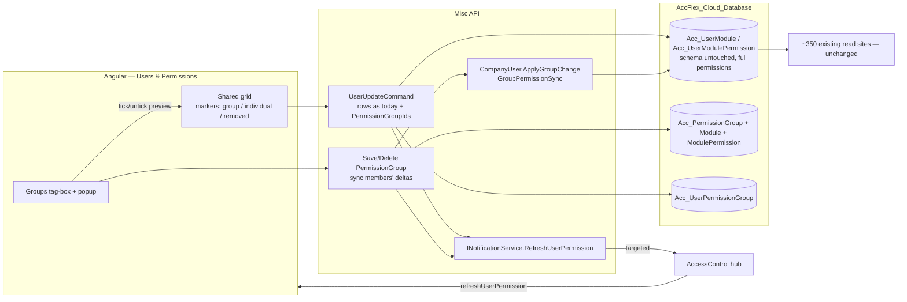

# CR-123425 — Permission Groups: Implementation Plan

> **For agentic workers:** REQUIRED SUB-SKILL: Use `superpowers:subagent-driven-development` (recommended) or `superpowers:executing-plans` to implement this plan task by task. Steps use checkbox (`- [ ]`) syntax for tracking.

> [!info] Sources
> CR text: [[CR-123425 - Source]] · Decisions (they override the CR): [[CR-123425 - Grilling Decisions]], see **Round 6** there

> [!warning] Permission id changed to 494 (2026-09-29)
> The final review found that 491 and 492 are already taken on `origin/Stage_Stable` (Payroll, WI 121335). The feature now uses **494**, the first id free on every remote branch. Check it again before merging.

> [!success] Rewritten on 2026-09-27 (Round 6)
> The first version used withhold tables and union views. The user removed both. A group is now a **template**: its permissions are written into the member's own `Acc_UserModule` / `Acc_UserModulePermission` rows, and a group edit applies only its **delta** (what was added or removed) to the members. No read site changes.

**Goal:** Admins can define permission groups on the Logistics Users & Permissions screen and tick any number of them for a user, which adds the groups' permissions to that user.
- The admin can then add or remove any permission for that user.
- The screen shows which permissions the user has beyond their groups, and which group permissions were removed from them.
- A group edit adds or removes only the changed permissions for every member, immediately, including users who are logged in.

**Architecture:**
- **Database:** four new tables (groups, a group's screen flags, a group's extra permissions, and users ↔ groups) plus extra permission **494**. `Acc_UserModule` / `Acc_UserModulePermission` keep their schema and still hold **the user's complete permissions**, so all ~350 existing read sites work unchanged.
- **Logic:** one pure rule, `GroupPermissionSync.ApplyGroupChange(user, oldGroup, newGroup, otherGroups)`:
  - add what the group newly grants;
  - remove what the group no longer grants, unless another of the user's groups still grants it;
  - leave everything else as it is.
  `CompanyUser.ApplyGroupChange` applies it to the user's rows.
- **Misc API:** group CRUD. Save and delete run the sync for every member in one `SaveChanges`. The user save stores memberships (`PermissionGroupIds`). The grid itself is saved exactly as today.
- **Live refresh:** the AccessControl broadcast gains optional target users, and Misc pushes `refreshUserPermission` only to affected users.
- **Angular:**
  - A tag-box and a `+` button above the grid, plus a groups CRUD popup.
  - Ticking or unticking a group previews the same rule in the grid.
  - An opt-in grid mode marks each permission as coming from a group, added individually (green), or removed from a group (red). These markers are computed at runtime from the user's rows compared with their groups.

**Tech stack:** SQL Server (SSDT) · .NET 8, EF Core 8, MediatR, CSharpFunctionalExtensions · NUnit 3.14, FluentAssertions 6.12 (`Misc.Logic.Test`) · ASP.NET Core SignalR (AccessControl) · Angular 18, DevExtreme, ngx-translate

## Global Constraints

- **Do not alter `Acc_UserModule` or `Acc_UserModulePermission`:** no column, constraint, index or trigger changes. They hold each user's complete permissions (for a user with no groups, that is exactly what they hold today). (User rule)
- **A group is a template.** Ticking it adds its permissions to the user. The admin may then add or remove anything for that user. Nothing is stored about "exceptions". (Round 6)
- **Group edit = delta only** (Round 6):
  - A permission newly granted by the group is added to every member.
  - A permission the group stops granting is removed from every member, **unless another of that member's groups still grants it** (Q22).
  - A permission that didn't change in the group is **never touched**, so a permission removed from one user stays removed.
- **Unticking a group** on a user removes that group's permissions, except ones another ticked group still grants (Q23). This happens as a preview in the grid before saving.
- **Sources are computed at runtime:** "added individually" = the user has it and no group grants it; "removed from group" = a group grants it and the user doesn't have it. (Round 6)
- **Groups belong to one application (`ApplicationId`).** Only Logistics (**12**) gets UI now. (Q7)
- **Groups hold screen permissions (View/Add/Edit/Delete/Print) and extra permissions only.** Data scopes stay per user. (Q8)
- **Name and NameSecondLanguage are both mandatory and both unique.** (Q5)
- **Managing groups requires the new extra permission `ManagePermissionGroups`,** id **494** on module **627** (`Module.LogisticsUsers`). (Q4)
- **Delete with members** offers two choices: **keep** (only the memberships go; members keep every permission) or **remove** (the group's permissions are removed from members, except ones another of their groups grants). (Q3, Q20)
- **Existing users are not migrated.** (Q2) **No audit logging.** (Q6)
- **Other applications' user screens behave exactly as before:** Cash, Construction, GL, Payroll, StockControl.
- **Database conventions:**
  - DDL goes only in `dbo/` model files.
  - Every new table needs an explicit `<Build Include>` in the `.sqlproj`.
  - Reference data is an idempotent MERGE in `Scripts/ReferenceDataScripts/` with no `GO`.
- **`0003_Acc_ModulePermission.sql` ends with `WHEN NOT MATCHED BY SOURCE THEN DELETE`.** New FKs to `Acc_ModulePermission` use `ON DELETE CASCADE`.
- **Build commands:**
  - Database: VS 2022 **Community** MSBuild with `/p:VisualStudioVersion=17.0`.
  - Backend: `dotnet build -c Release`. If `Logistics.API` holds a lock, pass `-p:BaseOutputPath=<scratchpad>/bin/ -m:1`.
- **Angular:**
  - i18n keys go in `src/assets/i18n/{en-US,ar-EG}/shared.json` under `"USERS"`, using `_PascalCase_`. Grep before adding. Then run `node tools/check-i18n-parity.js shared`.
  - Use theme CSS vars only (`--successColor`, `--danger`, `--mainColor`), never Tailwind colors.
  - Type-check with `npx tsc -p tsconfig.verify.json --noEmit` after adding the touched folders to `include`.
- **NSwag clients:**
  - Misc: `Miscellaneous/Misc.API.Client/nswag.json`, then paste `TSClient/src/client.ts` into `src/app/shared/services/misc-client.ts` **from line 126 down**, keeping the prelude above it.
  - AccessControl: `Identity/AccessControl.API.Client/nswag.json`, then publish a new NuGet package.

## Decisions This Plan Makes (flag to the PO)

| # | Decision | Why |
|---|---|---|
| P1 | Name uniqueness is **per application**: `UQ (ApplicationId, Name)` and `UQ (ApplicationId, NameSecondLanguage)` | Groups are per application (Q7) |
| P2 | The sync sets the flags on **every** duplicate `Acc_UserModule` row for the same (UserId, ModuleId). When the user has no row for the module, it adds one | Duplicates exist today and there is no unique constraint. Readers pick any row |
| P3 | The **user save trusts the grid** the admin submits. The group tick/untick preview runs in the browser, and the server only stores the rows (as today) plus the memberships | The admin must be able to adjust the preview before saving (Round 6) |
| P4 | **Unticking a group can remove a permission the user had before joining it**, because nothing records where a permission came from | This is the accepted cost of storing no source. The admin sees it in the preview and can re-tick it |
| P5 | "Removed from group" markers are **not** stored. Adding the permission back to the group later **does not** re-add it for a member who had it removed, unless the group newly grants it at that point | Follows "only add or remove new ones" |
| P6 | Admin users (`IsAdmin`) can't be given groups (the checklist is disabled). The sync skips them if they are members | Admins bypass all checks anyway (Q15) |

## Known Gaps / Risks to Tell the Team

- **A group edit writes the rows of every member in one transaction.** Fine for tens or hundreds of members. It isn't paged.
- **The AccessControl hub keeps connections in memory,** so pushes only reach users on a single instance. This is already true for every notification today.

---

## Data Flow



## File Map

Paths are relative to:
- **DB:** `AccFlex_Cloud_Database/AccFlex_Cloud_Database_State/AccFlex_Cloud_Database_State/`
- **ERP:** `AccFlex_Cloud_ERP/AccFlex_Cloud_ERP/`
- **SP:** `Accflex_SharedProjects_ERP/`
- **FE:** `AccFlex_Cloud_Front/accflex-erp/`

| Repo | File | Change | Responsibility |
|---|---|---|---|
| DB | `dbo/Tables/Acc_PermissionGroup.sql` | Create | Group header |
| DB | `dbo/Tables/Acc_PermissionGroupModule.sql` | Create | A group's CRUD flags for each screen |
| DB | `dbo/Tables/Acc_PermissionGroupModulePermission.sql` | Create | A group's extra permissions |
| DB | `dbo/Tables/Acc_UserPermissionGroup.sql` | Create | Users ↔ groups |
| DB | `Scripts/ReferenceDataScripts/0003_Acc_ModulePermission.sql` | Modify | Row 494 `ManagePermissionGroups` on 627 |
| DB | `AccFlex_Cloud_Database_State.sqlproj` | Modify | Register the 4 tables |
| ERP | `Shared/SharedKernel.Logic/UserAggregate/GroupPermissionSync.cs` | Create | `ModuleFlags`, `GroupSnapshot`, the delta rule |
| ERP | `Shared/SharedKernel.Logic/UserAggregate/UserPermissionGroup.cs` | Create | Membership value object |
| ERP | `Shared/SharedKernel.Logic/UserAggregate/UserModule.cs`, `UserModulePermission.cs` | Modify | Internal `ToFlags` / `Set` helpers, and an `(userId, modulePermissionId)` ctor |
| ERP | `Shared/SharedKernel.Logic/UserAggregate/CompanyUser.cs` | Modify | `UserPermissionGroupList`, `SetPermissionGroups`, `ApplyGroupChange` |
| ERP | `Shared/SharedKernel.Logic/PermissionGroupAggregate/*.cs` | Create | The group aggregate and its errors |
| ERP | `Shared/SharedKernel.Logic/Helpers/PermissionGroupConstants.cs` | Create | `ManagePermissionGroupsPermissionId = 494` |
| ERP | `Shared/SharedKernel.Data/EFConfigurations/PermissionGroup*.cs`, `UserPermissionGroupConfigurations.cs`, `UserConfigurations.cs` | Create/Modify | EF mappings |
| ERP | `Shared/SharedKernel.Data/SharedKernelContext.cs`, `ISharedKernelContext.cs` | Modify | Two DbSets |
| ERP | `Miscellaneous/Misc.Application/PermissionGroups/**` | Create | Query and commands |
| ERP | `Miscellaneous/Misc.Application/Users/Commands/UserUpdateCommand.cs` | Modify | `PermissionGroupIds`; notify |
| ERP | `Miscellaneous/Misc.Application/Users/Queries/GetUserDetailsQuery.cs` + `UserDetailsDto` | Modify | `PermissionGroupIds` |
| ERP | `Miscellaneous/Misc.Application/INotificationService.cs`, `Misc.API/Hubs/NotificationService.cs` | Modify | Targeted refresh |
| ERP | `Miscellaneous/Misc.API/Controllers/Users/PermissionGroupController.cs` | Create | Group endpoints |
| ERP | `Miscellaneous/Misc.Logic.Test/PermissionGroups/*.cs` | Create | Tests |
| ERP | `Common/Common.Logic/Resources` (AR/EN) | Modify | Error messages |
| SP | `Identity/AccessControl.Service/.../BroadcastNotificationCommand*.cs` | Modify | Optional `TargetUserGuids` |
| FE | `src/app/shared/services/misc-client.ts` | Modify | Regenerated client |
| FE | `src/app/shared/helpers/permission-sources.ts` | Create | TypeScript mirror of the rule, plus markers |
| FE | `src/app/shared/components/user-module-permissions-list/*`, `user-extra-permissions-list/*` | Modify | Opt-in `showPermissionSources` |
| FE | `projects/logistics/src/app/modules/user-permissions/components/permission-groups-selector/*` | Create | Tag-box and `+` |
| FE | `projects/logistics/src/app/modules/user-permissions/components/permission-groups-popup/*` | Create | CRUD popup |
| FE | `projects/logistics/src/app/modules/user-permissions/containers/users-permissions-shell/*` | Modify | Wiring, save, cache fix |
| FE | `src/app/shared/signalR/signal-r.service.ts`, `src/app/core/services/accflex-permissions.service.ts`, `src/app/signin-oidc/signin-oidc.component.ts` | Modify | Working listener |
| FE | `src/assets/i18n/{en-US,ar-EG}/shared.json` | Modify | `USERS` keys |

**Branch (all four repos):** `feature/CR-123425-permission-groups`

## Phases & Estimate

| Phase | Tasks | SP |
|---|---|---|
| 1 — Database | 1 | 1 |
| 2 — Domain logic | 2 | 1.5 |
| 3 — Misc API (EF, groups + sync, user save) | 3, 4, 5 | 4 |
| 4 — Live refresh | 6 | 2 |
| 5 — Front end | 7, 8, 9 | 3.5 |
| QA | 10 | 1 |
| **Total** | | **13**. The CR's 5 SP didn't include the member delta sync, the runtime source markers or the live push |

---

## Phase 1 — Database (`AccFlex_Cloud_Database`)

Run commands from `AccFlex_Cloud_Database/`:

```bash
"/c/Program Files/Microsoft Visual Studio/2022/Community/MSBuild/Current/Bin/MSBuild.exe" AccFlex_Cloud_Database_State/AccFlex_Cloud_Database_State/AccFlex_Cloud_Database_State.sqlproj /p:VisualStudioVersion=17.0 /v:quiet /nologo /clp:ErrorsOnly
```

Expected: exit code 0 and no errors. The ~520 `SQL71558` warnings are pre-existing.

### Task 1: Group and membership tables + permission 494

**Files:**
- Create: `dbo/Tables/Acc_PermissionGroup.sql`, `Acc_PermissionGroupModule.sql`, `Acc_PermissionGroupModulePermission.sql`, `Acc_UserPermissionGroup.sql`
- Modify: `Scripts/ReferenceDataScripts/0003_Acc_ModulePermission.sql`
- Modify: `AccFlex_Cloud_Database_State.sqlproj` (next to `<Build Include="dbo\Tables\Acc_UserModule.sql" />`, line 630)

**Interfaces:**
- Produces: the table and column names used by Task 3 (EF).

- [ ] **Step 1: Create `Acc_PermissionGroup.sql`**

```sql
CREATE TABLE [dbo].[Acc_PermissionGroup] (
    [PermissionGroupId]  INT            IDENTITY (1, 1) NOT NULL,
    [ApplicationId]      INT            NOT NULL,
    [Name]               NVARCHAR (200) NOT NULL,
    [NameSecondLanguage] NVARCHAR (200) NOT NULL,
    CONSTRAINT [PK_Acc_PermissionGroup] PRIMARY KEY CLUSTERED ([PermissionGroupId] ASC),
    CONSTRAINT [UQ_Acc_PermissionGroup_Application_Name] UNIQUE ([ApplicationId] ASC, [Name] ASC),
    CONSTRAINT [UQ_Acc_PermissionGroup_Application_NameSecondLanguage] UNIQUE ([ApplicationId] ASC, [NameSecondLanguage] ASC)
);
```

- [ ] **Step 2: Create `Acc_PermissionGroupModule.sql`**

```sql
CREATE TABLE [dbo].[Acc_PermissionGroupModule] (
    [PermissionGroupModuleId] INT IDENTITY (1, 1) NOT NULL,
    [PermissionGroupId]       INT NOT NULL,
    [ModuleId]                INT NOT NULL,
    [AllowView]               BIT NOT NULL,
    [AllowAdd]                BIT NOT NULL,
    [AllowEdit]               BIT NOT NULL,
    [AllowDelete]             BIT NOT NULL,
    [AllowPrint]              BIT NOT NULL,
    CONSTRAINT [PK_Acc_PermissionGroupModule] PRIMARY KEY CLUSTERED ([PermissionGroupModuleId] ASC),
    CONSTRAINT [FK_Acc_PermissionGroupModule_Acc_PermissionGroup] FOREIGN KEY ([PermissionGroupId]) REFERENCES [dbo].[Acc_PermissionGroup] ([PermissionGroupId]) ON DELETE CASCADE,
    CONSTRAINT [FK_Acc_PermissionGroupModule_Acc_Module] FOREIGN KEY ([ModuleId]) REFERENCES [dbo].[Acc_Module] ([ModuleId]),
    CONSTRAINT [UQ_Acc_PermissionGroupModule_Group_Module] UNIQUE ([PermissionGroupId] ASC, [ModuleId] ASC)
);
```

- [ ] **Step 3: Create `Acc_PermissionGroupModulePermission.sql`**

```sql
CREATE TABLE [dbo].[Acc_PermissionGroupModulePermission] (
    [PermissionGroupId]  INT NOT NULL,
    [ModulePermissionId] INT NOT NULL,
    CONSTRAINT [PK_Acc_PermissionGroupModulePermission] PRIMARY KEY CLUSTERED ([PermissionGroupId] ASC, [ModulePermissionId] ASC),
    CONSTRAINT [FK_Acc_PermissionGroupModulePermission_Acc_PermissionGroup] FOREIGN KEY ([PermissionGroupId]) REFERENCES [dbo].[Acc_PermissionGroup] ([PermissionGroupId]) ON DELETE CASCADE,
    CONSTRAINT [FK_Acc_PermissionGroupModulePermission_Acc_ModulePermission] FOREIGN KEY ([ModulePermissionId]) REFERENCES [dbo].[Acc_ModulePermission] ([ModulePermissionId]) ON DELETE CASCADE
);
```

- [ ] **Step 4: Create `Acc_UserPermissionGroup.sql`**

```sql
CREATE TABLE [dbo].[Acc_UserPermissionGroup] (
    [UserId]            INT NOT NULL,
    [PermissionGroupId] INT NOT NULL,
    CONSTRAINT [PK_Acc_UserPermissionGroup] PRIMARY KEY CLUSTERED ([UserId] ASC, [PermissionGroupId] ASC),
    CONSTRAINT [FK_Acc_UserPermissionGroup_Acc_User] FOREIGN KEY ([UserId]) REFERENCES [dbo].[Acc_User] ([UserId]),
    CONSTRAINT [FK_Acc_UserPermissionGroup_Acc_PermissionGroup] FOREIGN KEY ([PermissionGroupId]) REFERENCES [dbo].[Acc_PermissionGroup] ([PermissionGroupId]) ON DELETE CASCADE
);
GO
CREATE NONCLUSTERED INDEX [IX_Acc_UserPermissionGroup_PermissionGroupId] ON [dbo].[Acc_UserPermissionGroup]([PermissionGroupId] ASC);
```

- [ ] **Step 5: Add permission 494** to `0003_Acc_ModulePermission.sql`. First confirm that the id and name are unused (`Permission` is UNIQUE):

```bash
grep -n "(494,\|ManagePermissionGroups" AccFlex_Cloud_Database_State/AccFlex_Cloud_Database_State/Scripts/ReferenceDataScripts/0003_Acc_ModulePermission.sql
```

Expected: no output. Then insert this row after the `(493, …)` row, keeping the leading-comma style:

```sql
,(494,N'Manage Permission Groups',N'إدارة مجموعات الصلاحيات',627)
```

- [ ] **Step 6: Register the four tables** directly under line 630 of the `.sqlproj`. The second Acc_* block around line 2715 must not also list them.

```xml
<Build Include="dbo\Tables\Acc_PermissionGroup.sql" />
<Build Include="dbo\Tables\Acc_PermissionGroupModule.sql" />
<Build Include="dbo\Tables\Acc_PermissionGroupModulePermission.sql" />
<Build Include="dbo\Tables\Acc_UserPermissionGroup.sql" />
```

- [ ] **Step 7: Build.** Run the DB build command. Expected: exit 0.

- [ ] **Step 8: Commit**

```bash
git add AccFlex_Cloud_Database_State
git commit -m "CR-123425: permission group and membership tables; permission 494"
```

---

## Phase 2 — Domain Logic (`AccFlex_Cloud_ERP`)

Run commands from `AccFlex_Cloud_ERP/AccFlex_Cloud_ERP/`. `Misc.Logic.Test` uses NUnit 3.14 and FluentAssertions 6.12. It references `Misc.Logic`, which references `SharedKernel.Logic`.

```bash
dotnet test Miscellaneous/Misc.Logic.Test/Misc.Logic.Test.csproj -c Release --filter "FullyQualifiedName~PermissionGroups"
```

### Task 2: The delta rule, the group aggregate, and user membership and sync

**Files:**
- Create: `Shared/SharedKernel.Logic/UserAggregate/GroupPermissionSync.cs`, `UserPermissionGroup.cs`
- Modify: `Shared/SharedKernel.Logic/UserAggregate/UserModule.cs`, `UserModulePermission.cs`, `CompanyUser.cs` (lines 13-14 constructor and 100-101 properties)
- Create: `Shared/SharedKernel.Logic/PermissionGroupAggregate/PermissionGroup.cs`, `PermissionGroupModule.cs`, `PermissionGroupModulePermission.cs`, `PermissionGroupErrors.cs`
- Create: `Shared/SharedKernel.Logic/Helpers/PermissionGroupConstants.cs`
- Test: `Miscellaneous/Misc.Logic.Test/PermissionGroups/GroupPermissionSyncTests.cs`, `PermissionGroupTests.cs`, `CompanyUserGroupTests.cs`

**Interfaces:**
- Produces, used by Tasks 4 and 5:
  - `ModuleFlags(bool View, bool Add, bool Edit, bool Delete, bool Print)` with `None`, `Any` and `Or(ModuleFlags)`.
  - `GroupSnapshot`: `Empty`, `Flags(int moduleId)`, `ModuleIds`, `Extras`, and `static GroupSnapshot Union(IEnumerable<GroupSnapshot>)`.
  - `GroupPermissionSync.ApplyGroupChange(ModuleFlags user, ModuleFlags oldGroup, ModuleFlags newGroup, ModuleFlags otherGroups) → ModuleFlags`.
  - `GroupPermissionSync.ApplyGroupChange(IEnumerable<int> user, IEnumerable<int> oldGroup, IEnumerable<int> newGroup, IEnumerable<int> otherGroups) → IReadOnlyCollection<int>`.
  - `PermissionGroup.Create(int applicationId, string name, string nameSecondLanguage) → Result<PermissionGroup>`.
  - `PermissionGroup.Update(string name, string nameSecondLanguage, IEnumerable<(int ModuleId, ModuleFlags Flags)> modules, IEnumerable<int> extraPermissionIds) → Result`.
  - `PermissionGroup.Snapshot() → GroupSnapshot`.
  - `CompanyUser.UserPermissionGroupList`.
  - `CompanyUser.SetPermissionGroups(IEnumerable<int> groupIdsOfApplication, IEnumerable<int> newGroupIds)`.
  - `CompanyUser.ApplyGroupChange(GroupSnapshot oldGroup, GroupSnapshot newGroup, GroupSnapshot otherGroups)`.

- [ ] **Step 1: Write the failing rule tests** (`GroupPermissionSyncTests.cs`)

```csharp
using FluentAssertions;
using NUnit.Framework;
using SharedKernel.Logic.UserAggregate;

namespace Misc.Logic.Test.PermissionGroups
{
    [TestFixture]
    public class GroupPermissionSyncTests
    {
        private static ModuleFlags F(bool v = false, bool a = false, bool e = false, bool d = false, bool p = false) => new(v, a, e, d, p);

        [Test]
        public void Newly_granted_by_group_is_added()
        {
            GroupPermissionSync.ApplyGroupChange(user: F(v: true), oldGroup: F(v: true), newGroup: F(v: true, a: true), otherGroups: ModuleFlags.None)
                .Should().Be(F(v: true, a: true));
        }

        [Test]
        public void No_longer_granted_by_group_is_removed()
        {
            GroupPermissionSync.ApplyGroupChange(user: F(v: true, a: true), oldGroup: F(v: true, a: true), newGroup: F(v: true), otherGroups: ModuleFlags.None)
                .Should().Be(F(v: true));
        }

        [Test]
        public void Removal_is_skipped_when_another_group_still_grants_it()
        {
            GroupPermissionSync.ApplyGroupChange(user: F(v: true, a: true), oldGroup: F(a: true), newGroup: ModuleFlags.None, otherGroups: F(a: true))
                .Should().Be(F(v: true, a: true));
        }

        [Test]
        public void Unchanged_group_permission_the_user_had_removed_is_not_re_added()
        {
            // group keeps View; admin had removed View from this user; group only adds Print
            GroupPermissionSync.ApplyGroupChange(user: ModuleFlags.None, oldGroup: F(v: true), newGroup: F(v: true, p: true), otherGroups: ModuleFlags.None)
                .Should().Be(F(p: true));
        }

        [Test]
        public void Individual_permission_outside_the_group_is_untouched()
        {
            GroupPermissionSync.ApplyGroupChange(user: F(d: true), oldGroup: F(v: true), newGroup: ModuleFlags.None, otherGroups: ModuleFlags.None)
                .Should().Be(F(d: true));
        }

        [Test]
        public void Extra_permissions_follow_the_same_rule()
        {
            GroupPermissionSync.ApplyGroupChange(user: new[] { 1, 2, 9 }, oldGroup: new[] { 1, 2, 3 }, newGroup: new[] { 2, 3, 4 }, otherGroups: new int[0])
                .Should().BeEquivalentTo(new[] { 2, 4, 9 }); // 1 removed, 4 added, 3 unchanged-but-removed stays removed, 9 individual
        }
    }
}
```

- [ ] **Step 2: Run the tests.** Expected: the build fails (`ModuleFlags` / `GroupPermissionSync` not found).

- [ ] **Step 3: Implement `GroupPermissionSync.cs`**

```csharp
using System.Collections.Generic;
using System.Linq;

namespace SharedKernel.Logic.UserAggregate
{
    public sealed record ModuleFlags(bool View, bool Add, bool Edit, bool Delete, bool Print)
    {
        public static ModuleFlags None { get; } = new(false, false, false, false, false);
        public bool Any => View || Add || Edit || Delete || Print;
        public ModuleFlags Or(ModuleFlags o) => new(View || o.View, Add || o.Add, Edit || o.Edit, Delete || o.Delete, Print || o.Print);
    }

    /// <summary>A group's (or a union of groups') permissions at one point in time.</summary>
    public sealed class GroupSnapshot
    {
        public static GroupSnapshot Empty { get; } = new(new Dictionary<int, ModuleFlags>(), new HashSet<int>());

        private readonly IReadOnlyDictionary<int, ModuleFlags> _modules;
        public GroupSnapshot(IReadOnlyDictionary<int, ModuleFlags> modules, IReadOnlySet<int> extras) { _modules = modules; Extras = extras; }

        public IEnumerable<int> ModuleIds => _modules.Keys;
        public IReadOnlySet<int> Extras { get; }
        public ModuleFlags Flags(int moduleId) => _modules.TryGetValue(moduleId, out var f) ? f : ModuleFlags.None;

        public static GroupSnapshot Union(IEnumerable<GroupSnapshot> snapshots)
        {
            var list = snapshots.ToList();
            var modules = list.SelectMany(s => s.ModuleIds).Distinct()
                .ToDictionary(id => id, id => list.Aggregate(ModuleFlags.None, (acc, s) => acc.Or(s.Flags(id))));
            return new GroupSnapshot(modules, list.SelectMany(s => s.Extras).ToHashSet());
        }
    }

    /// <summary>
    /// CR-123425: a group edit touches members only where the group changed.
    /// Added by the group → added to the user. Removed from the group → removed from the user unless another
    /// of the user's groups still grants it. Everything else keeps the user's current value.
    /// </summary>
    public static class GroupPermissionSync
    {
        private static bool Apply(bool user, bool oldGroup, bool newGroup, bool otherGroups) =>
            newGroup && !oldGroup ? true
            : oldGroup && !newGroup && !otherGroups ? false
            : user;

        public static ModuleFlags ApplyGroupChange(ModuleFlags user, ModuleFlags oldGroup, ModuleFlags newGroup, ModuleFlags otherGroups) =>
            new(Apply(user.View, oldGroup.View, newGroup.View, otherGroups.View),
                Apply(user.Add, oldGroup.Add, newGroup.Add, otherGroups.Add),
                Apply(user.Edit, oldGroup.Edit, newGroup.Edit, otherGroups.Edit),
                Apply(user.Delete, oldGroup.Delete, newGroup.Delete, otherGroups.Delete),
                Apply(user.Print, oldGroup.Print, newGroup.Print, otherGroups.Print));

        public static IReadOnlyCollection<int> ApplyGroupChange(IEnumerable<int> user, IEnumerable<int> oldGroup, IEnumerable<int> newGroup, IEnumerable<int> otherGroups)
        {
            var result = user.ToHashSet();
            var o = oldGroup.ToHashSet();
            var n = newGroup.ToHashSet();
            var other = otherGroups.ToHashSet();
            result.UnionWith(n.Except(o));
            result.ExceptWith(o.Except(n).Where(id => !other.Contains(id)));
            return result;
        }
    }
}
```

- [ ] **Step 4: Run the tests.** Expected: 6 passed.

- [ ] **Step 5: Write the failing group aggregate tests** (`PermissionGroupTests.cs`)

```csharp
using FluentAssertions;
using NUnit.Framework;
using SharedKernel.Logic.PermissionGroupAggregate;
using SharedKernel.Logic.UserAggregate;
using System.Linq;

namespace Misc.Logic.Test.PermissionGroups
{
    [TestFixture]
    public class PermissionGroupTests
    {
        [TestCase("", "Store")]
        [TestCase("مخازن", " ")]
        public void Both_names_are_mandatory(string name, string second)
        {
            PermissionGroup.Create(12, name, second).IsFailure.Should().BeTrue();
        }

        [Test]
        public void Update_replaces_modules_and_drops_modules_without_any_flag()
        {
            var group = PermissionGroup.Create(12, " موظفي المخازن ", "Store staff").Value;
            group.Update("موظفي المخازن", "Store staff",
                new[] { (10, new ModuleFlags(true, true, false, false, false)), (11, ModuleFlags.None) },
                new[] { 5, 5, 6 }).IsSuccess.Should().BeTrue();

            group.Name.Should().Be("موظفي المخازن");
            var snap = group.Snapshot();
            snap.ModuleIds.Should().BeEquivalentTo(new[] { 10 });
            snap.Flags(10).Should().Be(new ModuleFlags(true, true, false, false, false));
            snap.Extras.Should().BeEquivalentTo(new[] { 5, 6 });
        }
    }
}
```

- [ ] **Step 6: Implement the group aggregate.** It follows `UserModule : Entity` and `UserModulePermission : ValueObject`.

`PermissionGroupErrors.cs` (the codes are resource keys; Task 4 adds the texts):

```csharp
namespace SharedKernel.Logic.PermissionGroupAggregate
{
    public static class PermissionGroupErrors
    {
        public const string NameRequired = "PermissionGroupNameRequired";
        public const string NameSecondLanguageRequired = "PermissionGroupNameSecondLanguageRequired";
        public const string DuplicateName = "PermissionGroupDuplicateName";
        public const string NotAllowed = "PermissionGroupManageNotAllowed";
        public const string NotFound = "PermissionGroupNotFound";
    }
}
```

`PermissionGroupModule.cs`:

```csharp
using SharedKernel.Logic.UserAggregate;

namespace SharedKernel.Logic.PermissionGroupAggregate
{
    public class PermissionGroupModule : Entity
    {
        private PermissionGroupModule() { }
        internal PermissionGroupModule(int moduleId, ModuleFlags flags) { ModuleId = moduleId; Set(flags); }

        public int PermissionGroupId { get; private set; }
        public int ModuleId { get; private set; }
        public bool AllowView { get; private set; }
        public bool AllowAdd { get; private set; }
        public bool AllowEdit { get; private set; }
        public bool AllowDelete { get; private set; }
        public bool AllowPrint { get; private set; }

        internal void Set(ModuleFlags f) { AllowView = f.View; AllowAdd = f.Add; AllowEdit = f.Edit; AllowDelete = f.Delete; AllowPrint = f.Print; }
        public ModuleFlags ToFlags() => new(AllowView, AllowAdd, AllowEdit, AllowDelete, AllowPrint);
    }
}
```

`PermissionGroupModulePermission.cs`:

```csharp
using CSharpFunctionalExtensions;
using System.Collections.Generic;

namespace SharedKernel.Logic.PermissionGroupAggregate
{
    public class PermissionGroupModulePermission : ValueObject
    {
        private PermissionGroupModulePermission() { }
        internal PermissionGroupModulePermission(int modulePermissionId) { ModulePermissionId = modulePermissionId; }

        public int PermissionGroupId { get; private set; }
        public int ModulePermissionId { get; private set; }

        protected override IEnumerable<object> GetEqualityComponents()
        {
            yield return PermissionGroupId;
            yield return ModulePermissionId;
        }
    }
}
```

`PermissionGroup.cs`:

```csharp
using CSharpFunctionalExtensions;
using SharedKernel.Logic.UserAggregate;
using System.Collections.Generic;
using System.Linq;

namespace SharedKernel.Logic.PermissionGroupAggregate
{
    public class PermissionGroup : Entity
    {
        private PermissionGroup() { }

        public int ApplicationId { get; private set; }
        public string Name { get; private set; }
        public string NameSecondLanguage { get; private set; }
        public List<PermissionGroupModule> Modules { get; private set; } = new();
        public List<PermissionGroupModulePermission> ExtraPermissions { get; private set; } = new();

        public static Result<PermissionGroup> Create(int applicationId, string name, string nameSecondLanguage)
        {
            var group = new PermissionGroup { ApplicationId = applicationId };
            var rename = group.Rename(name, nameSecondLanguage);
            return rename.IsFailure ? Result.Failure<PermissionGroup>(rename.Error) : Result.Success(group);
        }

        public Result Update(string name, string nameSecondLanguage,
            IEnumerable<(int ModuleId, ModuleFlags Flags)> modules, IEnumerable<int> extraPermissionIds)
        {
            var rename = Rename(name, nameSecondLanguage);
            if (rename.IsFailure) return rename;

            var wanted = modules.Where(m => m.Flags.Any).GroupBy(m => m.ModuleId).ToDictionary(g => g.Key, g => g.Last().Flags);
            Modules.RemoveAll(m => !wanted.ContainsKey(m.ModuleId));
            foreach (var (moduleId, flags) in wanted)
            {
                var existing = Modules.FirstOrDefault(m => m.ModuleId == moduleId);
                if (existing is null) Modules.Add(new PermissionGroupModule(moduleId, flags));
                else existing.Set(flags);
            }

            var wantedExtras = extraPermissionIds.ToHashSet();
            ExtraPermissions.RemoveAll(x => !wantedExtras.Contains(x.ModulePermissionId));
            foreach (var id in wantedExtras.Where(id => ExtraPermissions.All(x => x.ModulePermissionId != id)))
                ExtraPermissions.Add(new PermissionGroupModulePermission(id));
            return Result.Success();
        }

        public GroupSnapshot Snapshot() =>
            new(Modules.ToDictionary(m => m.ModuleId, m => m.ToFlags()), ExtraPermissions.Select(x => x.ModulePermissionId).ToHashSet());

        private Result Rename(string name, string nameSecondLanguage)
        {
            if (string.IsNullOrWhiteSpace(name)) return Result.Failure(PermissionGroupErrors.NameRequired);
            if (string.IsNullOrWhiteSpace(nameSecondLanguage)) return Result.Failure(PermissionGroupErrors.NameSecondLanguageRequired);
            Name = name.Trim();
            NameSecondLanguage = nameSecondLanguage.Trim();
            return Result.Success();
        }
    }
}
```

`PermissionGroupConstants.cs`:

```csharp
namespace SharedKernel.Logic.Helpers
{
    public static class PermissionGroupConstants
    {
        public const int ManagePermissionGroupsPermissionId = 494;
    }
}
```

- [ ] **Step 7: Run the tests.** Expected: the 3 `PermissionGroupTests` pass.

- [ ] **Step 8: Write the failing user tests** (`CompanyUserGroupTests.cs`). The user is built through the private parameterless constructor:

```csharp
using FluentAssertions;
using NUnit.Framework;
using SharedKernel.Logic.UserAggregate;
using System.Collections.Generic;
using System.Linq;

namespace Misc.Logic.Test.PermissionGroups
{
    [TestFixture]
    public class CompanyUserGroupTests
    {
        private static CompanyUser NewUser() => (CompanyUser)System.Activator.CreateInstance(typeof(CompanyUser), nonPublic: true);
        private static GroupSnapshot G(int moduleId, ModuleFlags f, params int[] extras) =>
            new(new Dictionary<int, ModuleFlags> { [moduleId] = f }, extras.ToHashSet());

        [Test]
        public void SetPermissionGroups_only_touches_groups_of_the_application()
        {
            var user = NewUser();
            user.UserPermissionGroupList.Add(new UserPermissionGroup(0, 99)); // another application's group
            user.UserPermissionGroupList.Add(new UserPermissionGroup(0, 1));

            user.SetPermissionGroups(groupIdsOfApplication: new[] { 1, 2 }, newGroupIds: new[] { 2 });

            user.UserPermissionGroupList.Select(x => x.PermissionGroupId).Should().BeEquivalentTo(new[] { 99, 2 });
        }

        [Test]
        public void ApplyGroupChange_adds_a_row_when_the_user_has_none_for_the_module()
        {
            var user = NewUser();
            user.ApplyGroupChange(GroupSnapshot.Empty, G(10, new ModuleFlags(true, false, false, false, false), 7), GroupSnapshot.Empty);

            user.UserModuleList.Single(m => m.ModuleId == 10).AllowView.Should().BeTrue();
            user.UserModulePermissionList.Select(p => p.ModulePermissionId).Should().BeEquivalentTo(new[] { 7 });
        }

        [Test]
        public void ApplyGroupChange_updates_every_duplicate_row()
        {
            var user = NewUser();
            user.ApplyGroupChange(GroupSnapshot.Empty, G(10, new ModuleFlags(true, true, false, false, false)), GroupSnapshot.Empty);
            user.UserModuleList.Add(user.UserModuleList[0].CloneForTest()); // duplicate row, as exists in some tenants

            user.ApplyGroupChange(G(10, new ModuleFlags(true, true, false, false, false)), G(10, new ModuleFlags(true, false, false, false, false)), GroupSnapshot.Empty);

            user.UserModuleList.Should().OnlyContain(m => m.AllowView && !m.AllowAdd);
        }
    }
}
```

`CloneForTest` is an `internal` helper on `UserModule`, next to `ToFlags`/`Set`. It returns a new `UserModule` with the same `UserId`, `ModuleId` and flags. `SharedKernel.Logic` needs `[assembly: InternalsVisibleTo("Misc.Logic.Test")]` for it. Add that in `SharedKernel.Logic.csproj` with `<InternalsVisibleTo Include="Misc.Logic.Test" />` in an `ItemGroup`, if no such entry exists yet.

- [ ] **Step 9: Implement the user side**

`UserPermissionGroup.cs`:

```csharp
using CSharpFunctionalExtensions;
using System.Collections.Generic;

namespace SharedKernel.Logic.UserAggregate
{
    public class UserPermissionGroup : ValueObject
    {
        private UserPermissionGroup() { }
        public UserPermissionGroup(int userId, int permissionGroupId) { UserId = userId; PermissionGroupId = permissionGroupId; }

        public int UserId { get; private set; }
        public int PermissionGroupId { get; private set; }

        protected override IEnumerable<object> GetEqualityComponents()
        {
            yield return UserId;
            yield return PermissionGroupId;
        }
    }
}
```

In `UserModule.cs` (setters are `internal`), add:

```csharp
internal ModuleFlags ToFlags() => new(AllowView, AllowAdd, AllowEdit, AllowDelete, AllowPrint);
internal void Set(ModuleFlags f) { AllowView = f.View; AllowAdd = f.Add; AllowEdit = f.Edit; AllowDelete = f.Delete; AllowPrint = f.Print; }
internal UserModule CloneForTest() => new() { UserId = UserId, ModuleId = ModuleId, AllowView = AllowView, AllowAdd = AllowAdd, AllowEdit = AllowEdit, AllowDelete = AllowDelete, AllowPrint = AllowPrint };
```

In `UserModulePermission.cs`, add:

```csharp
internal UserModulePermission(int userId, int modulePermissionId) { UserId = userId; ModulePermissionId = modulePermissionId; }
```

In `CompanyUser.cs`, initialise `UserPermissionGroupList = new List<UserPermissionGroup>();` in the parameterless constructor (next to lines 13-14). Then add, next to lines 100-101:

```csharp
public List<UserPermissionGroup> UserPermissionGroupList { get; set; }

/// <summary>Replaces this user's memberships among <paramref name="groupIdsOfApplication"/>; other applications' memberships are untouched.</summary>
public void SetPermissionGroups(IEnumerable<int> groupIdsOfApplication, IEnumerable<int> newGroupIds)
{
    var scope = groupIdsOfApplication.ToHashSet();
    var wanted = newGroupIds.Where(scope.Contains).ToHashSet();
    UserPermissionGroupList.RemoveAll(x => scope.Contains(x.PermissionGroupId) && !wanted.Contains(x.PermissionGroupId));
    foreach (var id in wanted.Where(id => UserPermissionGroupList.All(x => x.PermissionGroupId != id)))
        UserPermissionGroupList.Add(new UserPermissionGroup(Id, id));
}

/// <summary>CR-123425: applies one group's change (old → new) to this member's own permission rows. See GroupPermissionSync.</summary>
public void ApplyGroupChange(GroupSnapshot oldGroup, GroupSnapshot newGroup, GroupSnapshot otherGroups)
{
    foreach (var moduleId in oldGroup.ModuleIds.Union(newGroup.ModuleIds))
    {
        var rows = UserModuleList.Where(m => m.ModuleId == moduleId).ToList();
        var current = rows.Aggregate(ModuleFlags.None, (acc, r) => acc.Or(r.ToFlags()));
        var next = GroupPermissionSync.ApplyGroupChange(current, oldGroup.Flags(moduleId), newGroup.Flags(moduleId), otherGroups.Flags(moduleId));
        if (next == current && rows.Count > 0) continue;
        if (rows.Count == 0)
        {
            if (!next.Any) continue;
            var row = new UserModule { UserId = Id, ModuleId = moduleId };
            UserModuleList.Add(row);
            rows.Add(row);
        }
        foreach (var r in rows) r.Set(next);
    }

    var extras = GroupPermissionSync.ApplyGroupChange(UserModulePermissionList.Select(p => p.ModulePermissionId),
        oldGroup.Extras, newGroup.Extras, otherGroups.Extras).ToHashSet();
    UserModulePermissionList.RemoveAll(p => !extras.Contains(p.ModulePermissionId));
    foreach (var id in extras.Where(id => UserModulePermissionList.All(p => p.ModulePermissionId != id)))
        UserModulePermissionList.Add(new UserModulePermission(Id, id));
}
```

- [ ] **Step 10: Run the tests.** Expected: all 12 `PermissionGroups` tests pass.

- [ ] **Step 11: Commit**

```bash
git add Shared/SharedKernel.Logic Miscellaneous/Misc.Logic.Test
git commit -m "CR-123425: group permission delta rule, group aggregate, user membership and sync"
```

---

## Phase 3 — Misc API

### Task 3: EF mappings and DbSets

**Files:**
- Create: `Shared/SharedKernel.Data/EFConfigurations/PermissionGroupConfigurations.cs` (three classes), `UserPermissionGroupConfigurations.cs`
- Modify: `Shared/SharedKernel.Data/EFConfigurations/UserConfigurations.cs` (after lines 19-20)
- Modify: `Shared/SharedKernel.Data/SharedKernelContext.cs` (DbSets next to lines 50-52), `ISharedKernelContext.cs` (next to lines 32-34)

**Interfaces:**
- Produces: `ISharedKernelContext.PermissionGroups : DbSet<PermissionGroup>`, `ISharedKernelContext.UserPermissionGroups : DbSet<UserPermissionGroup>`, and `CompanyUser.UserPermissionGroupList` mapped.

- [ ] **Step 1: Add the configurations**

```csharp
public class PermissionGroupConfigurations : IEntityTypeConfiguration<PermissionGroup>
{
    public void Configure(EntityTypeBuilder<PermissionGroup> builder)
    {
        builder.ToTable("Acc_PermissionGroup");
        builder.Property(p => p.Id).HasColumnName("PermissionGroupId").UseIdentityColumn();
        builder.HasMany(p => p.Modules).WithOne().HasForeignKey(m => m.PermissionGroupId).OnDelete(DeleteBehavior.Cascade);
        builder.HasMany(p => p.ExtraPermissions).WithOne().HasForeignKey(m => m.PermissionGroupId).OnDelete(DeleteBehavior.Cascade);
    }
}
public class PermissionGroupModuleConfigurations : IEntityTypeConfiguration<PermissionGroupModule>
{
    public void Configure(EntityTypeBuilder<PermissionGroupModule> builder)
    {
        builder.ToTable("Acc_PermissionGroupModule");
        builder.Property(p => p.Id).HasColumnName("PermissionGroupModuleId").UseIdentityColumn();
    }
}
public class PermissionGroupModulePermissionConfigurations : IEntityTypeConfiguration<PermissionGroupModulePermission>
{
    public void Configure(EntityTypeBuilder<PermissionGroupModulePermission> builder)
    {
        builder.ToTable("Acc_PermissionGroupModulePermission");
        builder.HasKey(p => new { p.PermissionGroupId, p.ModulePermissionId });
    }
}
public class UserPermissionGroupConfigurations : IEntityTypeConfiguration<UserPermissionGroup>
{
    public void Configure(EntityTypeBuilder<UserPermissionGroup> builder)
    {
        builder.ToTable("Acc_UserPermissionGroup");
        builder.HasKey(p => new { p.UserId, p.PermissionGroupId });
    }
}
```

In `UserConfigurations.cs`, after lines 19-20, add:

```csharp
builder.HasMany(a => a.UserPermissionGroupList).WithOne().HasForeignKey(x => x.UserId);
```

- [ ] **Step 2: Add the DbSets** to `SharedKernelContext` and `ISharedKernelContext`:

```csharp
public DbSet<PermissionGroup> PermissionGroups { get; set; }
public DbSet<UserPermissionGroup> UserPermissionGroups { get; set; }
```

- [ ] **Step 3: Check that GL and IShop are unaffected.** Their contexts map their own copies of the user entities, and `UserPermissionGroupList` exists only on the SharedKernel `CompanyUser`. Build the solutions that contain SharedKernel:

```bash
dotnet build Miscellaneous/Miscellaneous.sln -c Release -p:BaseOutputPath=<scratchpad>/bin/ -m:1
```

Expected: the build succeeds.

- [ ] **Step 4: Commit**

```bash
git add Shared/SharedKernel.Data
git commit -m "CR-123425: EF mappings for permission groups and memberships"
```

### Task 4: Group queries and commands (with member delta sync) and the controller

**Files:**
- Create:
  - `Miscellaneous/Misc.Application/PermissionGroups/Dtos/PermissionGroupDto.cs`
  - `Queries/GetPermissionGroupsQuery.cs`
  - `Commands/SavePermissionGroupCommand.cs`
  - `Commands/DeletePermissionGroupCommand.cs`
  - `PermissionGroupMemberSync.cs`
- Create: `Miscellaneous/Misc.API/Controllers/Users/PermissionGroupController.cs`
- Modify: `Common/Common.Logic/Resources` AR and EN (five keys)

**Interfaces:**
- Consumes: `ISharedKernelContext` (Task 3), the Task 2 aggregate and sync, `ICompanyUserRepo.IsUserHasExtraPermission(int userId, int modulePermissionId)`, and `INotificationService.RefreshUserPermission(IEnumerable<string> userGuids)` (Task 6; until then, add the overload as a stub returning `Task.CompletedTask`).
- Produces the routes:
  - `GET api/PermissionGroup?applicationId=` → `List<PermissionGroupDto>`
  - `POST api/PermissionGroup` → `int`
  - `PUT api/PermissionGroup/{id}` → `int`
  - `DELETE api/PermissionGroup/{id}?applicationId=&keepPermissionsForMembers=` → `200`

- [ ] **Step 1: The DTOs**

```csharp
namespace Misc.Application.PermissionGroups.Dtos
{
    public class PermissionGroupModuleDto
    {
        public int ModuleId { get; set; }
        public bool AllowView { get; set; }
        public bool AllowAdd { get; set; }
        public bool AllowEdit { get; set; }
        public bool AllowDelete { get; set; }
        public bool AllowPrint { get; set; }
    }

    public class PermissionGroupDto
    {
        public int PermissionGroupId { get; set; }
        public int ApplicationId { get; set; }
        public string Name { get; set; }
        public string NameSecondLanguage { get; set; }
        public int MemberCount { get; set; }
        public List<PermissionGroupModuleDto> Modules { get; set; } = new();
        public List<int> ExtraModulePermissionIds { get; set; } = new();
    }
}
```

- [ ] **Step 2: `GetPermissionGroupsQuery`.** It returns every group of the application with its modules, extras and member count. No paging is needed, because this is the lookup list for a checklist:

```csharp
public class GetPermissionGroupsQuery : IRequest<Result<List<PermissionGroupDto>>> { public int ApplicationId { get; set; } }

public class GetPermissionGroupsQueryHandler : IRequestHandler<GetPermissionGroupsQuery, Result<List<PermissionGroupDto>>>
{
    private readonly ISharedKernelContext _ctx;
    public GetPermissionGroupsQueryHandler(ISharedKernelContext ctx) => _ctx = ctx;

    public async Task<Result<List<PermissionGroupDto>>> Handle(GetPermissionGroupsQuery request, CancellationToken ct)
    {
        var groups = await _ctx.PermissionGroups.AsNoTracking()
            .Where(g => g.ApplicationId == request.ApplicationId)
            .Include(g => g.Modules).Include(g => g.ExtraPermissions)
            .OrderBy(g => g.Name).ToListAsync(ct);
        var ids = groups.Select(g => g.Id).ToList();
        var counts = await _ctx.UserPermissionGroups.AsNoTracking().Where(x => ids.Contains(x.PermissionGroupId))
            .GroupBy(x => x.PermissionGroupId).Select(g => new { g.Key, Count = g.Count() }).ToDictionaryAsync(x => x.Key, x => x.Count, ct);

        return Result.Success(groups.Select(g => new PermissionGroupDto
        {
            PermissionGroupId = g.Id, ApplicationId = g.ApplicationId, Name = g.Name, NameSecondLanguage = g.NameSecondLanguage,
            MemberCount = counts.TryGetValue(g.Id, out var c) ? c : 0,
            Modules = g.Modules.Select(m => new PermissionGroupModuleDto { ModuleId = m.ModuleId, AllowView = m.AllowView, AllowAdd = m.AllowAdd,
                AllowEdit = m.AllowEdit, AllowDelete = m.AllowDelete, AllowPrint = m.AllowPrint }).ToList(),
            ExtraModulePermissionIds = g.ExtraPermissions.Select(x => x.ModulePermissionId).ToList()
        }).ToList());
    }
}
```

- [ ] **Step 3: The shared member sync** (`PermissionGroupMemberSync.cs`). Both Save and Delete use it:

```csharp
/// <summary>Loads a group's members and applies old → new to each one's own permission rows (CR-123425).</summary>
public static class PermissionGroupMemberSync
{
    /// <returns>UserGuidNumbers of the members that were touched, for the SignalR refresh.</returns>
    public static async Task<List<string>> ApplyAsync(ISharedKernelContext ctx, int groupId, int applicationId,
        GroupSnapshot oldGroup, GroupSnapshot newGroup, CancellationToken ct)
    {
        var memberIds = await ctx.UserPermissionGroups.Where(x => x.PermissionGroupId == groupId).Select(x => x.UserId).ToListAsync(ct);
        if (memberIds.Count == 0) return new List<string>();

        var members = await ctx.Users.AsSplitQuery()
            .Include(u => u.UserModuleList).Include(u => u.UserModulePermissionList).Include(u => u.UserPermissionGroupList)
            .Where(u => memberIds.Contains(u.Id) && !u.IsAdmin).ToListAsync(ct);   // P6

        var otherGroupIds = members.SelectMany(u => u.UserPermissionGroupList.Select(x => x.PermissionGroupId)).Where(id => id != groupId).Distinct().ToList();
        var otherGroups = (await ctx.PermissionGroups.AsNoTracking().Include(g => g.Modules).Include(g => g.ExtraPermissions)
            .Where(g => otherGroupIds.Contains(g.Id) && g.ApplicationId == applicationId).ToListAsync(ct))
            .ToDictionary(g => g.Id, g => g.Snapshot());

        foreach (var user in members)
        {
            var others = GroupSnapshot.Union(user.UserPermissionGroupList
                .Where(x => x.PermissionGroupId != groupId && otherGroups.ContainsKey(x.PermissionGroupId))
                .Select(x => otherGroups[x.PermissionGroupId]));
            user.ApplyGroupChange(oldGroup, newGroup, others);
        }
        return members.Where(u => !string.IsNullOrEmpty(u.UserGuidNumber)).Select(u => u.UserGuidNumber).ToList();
    }
}
```

Before writing it, check the property names `IsAdmin` and `UserGuidNumber` on `CompanyUser`, and `Users` on `ISharedKernelContext` (`UserUpdateCommand.cs:62` uses `_sharedKernelContext.Users`). Use the existing names if they differ.

- [ ] **Step 4: `SavePermissionGroupCommand`** (create when `PermissionGroupId == 0`, otherwise update and sync the members):

```csharp
public class SavePermissionGroupCommand : IRequest<Result<int>>
{
    public int PermissionGroupId { get; set; }
    public int ApplicationId { get; set; }
    public string Name { get; set; }
    public string NameSecondLanguage { get; set; }
    public List<PermissionGroupModuleDto> Modules { get; set; } = new();
    public List<int> ExtraModulePermissionIds { get; set; } = new();
}

public class SavePermissionGroupCommandHandler : IRequestHandler<SavePermissionGroupCommand, Result<int>>
{
    private readonly ISharedKernelContext _ctx;
    private readonly ICompanyUserRepo _users;
    private readonly IUserSession _session;
    private readonly INotificationService _notifications;

    public SavePermissionGroupCommandHandler(ISharedKernelContext ctx, ICompanyUserRepo users, IUserSession session, INotificationService notifications)
    { _ctx = ctx; _users = users; _session = session; _notifications = notifications; }

    public async Task<Result<int>> Handle(SavePermissionGroupCommand request, CancellationToken ct)
    {
        if (!_session.IsAdmin && !await _users.IsUserHasExtraPermission(_session.UserId, PermissionGroupConstants.ManagePermissionGroupsPermissionId))
            return Result.Failure<int>(PermissionGroupErrors.NotAllowed);

        var name = request.Name?.Trim();
        var second = request.NameSecondLanguage?.Trim();
        var duplicate = await _ctx.PermissionGroups.AnyAsync(g => g.ApplicationId == request.ApplicationId && g.Id != request.PermissionGroupId
            && (g.Name == name || g.NameSecondLanguage == second), ct);
        if (duplicate) return Result.Failure<int>(PermissionGroupErrors.DuplicateName);

        PermissionGroup group;
        var oldSnapshot = GroupSnapshot.Empty;
        if (request.PermissionGroupId == 0)
        {
            var created = PermissionGroup.Create(request.ApplicationId, name, second);
            if (created.IsFailure) return Result.Failure<int>(created.Error);
            group = created.Value;
            _ctx.PermissionGroups.Add(group);
        }
        else
        {
            group = await _ctx.PermissionGroups.Include(g => g.Modules).Include(g => g.ExtraPermissions)
                .FirstOrDefaultAsync(g => g.Id == request.PermissionGroupId && g.ApplicationId == request.ApplicationId, ct);
            if (group is null) return Result.Failure<int>(PermissionGroupErrors.NotFound);
            oldSnapshot = group.Snapshot();
        }

        var update = group.Update(name, second,
            request.Modules.Select(m => (m.ModuleId, new ModuleFlags(m.AllowView, m.AllowAdd, m.AllowEdit, m.AllowDelete, m.AllowPrint))),
            request.ExtraModulePermissionIds);
        if (update.IsFailure) return Result.Failure<int>(update.Error);

        var touched = request.PermissionGroupId == 0
            ? new List<string>()
            : await PermissionGroupMemberSync.ApplyAsync(_ctx, group.Id, group.ApplicationId, oldSnapshot, group.Snapshot(), ct);

        await _ctx.SaveChangesWithValidation();   // one transaction: group + all members' rows
        await _notifications.RefreshUserPermission(touched);
        return Result.Success(group.Id);
    }
}
```

Confirm that `IUserSession` exposes `IsAdmin` and `UserId` (`UserSessionMiddleware.cs:81-160` fills them in), and that `SaveChangesWithValidation` is available on `ISharedKernelContext`. If it isn't, inject the concrete `SharedKernelContext`, as `UserUpdateCommand` does.

- [ ] **Step 5: `DeletePermissionGroupCommand`**

```csharp
public class DeletePermissionGroupCommand : IRequest<Result>
{
    public int PermissionGroupId { get; set; }
    public int ApplicationId { get; set; }
    public bool KeepPermissionsForMembers { get; set; }
}

// Handler: same ctor and permission check as Save (return Result.Failure(PermissionGroupErrors.NotAllowed)). Then:
var group = await _ctx.PermissionGroups.Include(g => g.Modules).Include(g => g.ExtraPermissions)
    .FirstOrDefaultAsync(g => g.Id == request.PermissionGroupId && g.ApplicationId == request.ApplicationId, ct);
if (group is null) return Result.Failure(PermissionGroupErrors.NotFound);

// Keep  → members keep every permission; only the memberships go (cascade).
// Remove → apply "group → nothing" to every member (other groups still protect what they grant).
var touched = request.KeepPermissionsForMembers
    ? await _ctx.UserPermissionGroups.Where(x => x.PermissionGroupId == group.Id)
        .Join(_ctx.Users, m => m.UserId, u => u.Id, (m, u) => u.UserGuidNumber).Where(g => g != null).ToListAsync(ct)
    : await PermissionGroupMemberSync.ApplyAsync(_ctx, group.Id, group.ApplicationId, group.Snapshot(), GroupSnapshot.Empty, ct);

_ctx.PermissionGroups.Remove(group);   // cascades memberships, modules, extras
await _ctx.SaveChangesWithValidation();
await _notifications.RefreshUserPermission(touched);
return Result.Success();
```

- [ ] **Step 6: The controller.** It mirrors `LogisticsUserPermissionsController` (base `BaseController`, the same constructor and a `ModuleId` field). The route requires Edit on 627; the handler also requires permission 494.

```csharp
public class PermissionGroupController : BaseController
{
    public static readonly int ModuleId = SharedKernel.Logic.Modules.Module.LogisticsUsers.ModuleId;
    public PermissionGroupController(IUserSession currentSession, LinkGenerator linkGenerator, IMiscUnitOfWorkManager miscUnitOfWorkManager,
        IMapper mapper, IMediator mediator) : base(currentSession, linkGenerator, miscUnitOfWorkManager, mapper, mediator) { }

    [HttpGet, Route("api/PermissionGroup"), Authorize(Policy = "View")]
    [ProducesDefaultResponseType, ProducesResponseType(typeof(List<PermissionGroupDto>), StatusCodes.Status200OK), ProducesResponseType(typeof(ValidationProblemDetails), StatusCodes.Status400BadRequest)]
    public async Task<ActionResult<List<PermissionGroupDto>>> GetPermissionGroups(int applicationId)
    {
        var result = await _mediator.Send(new GetPermissionGroupsQuery { ApplicationId = applicationId });
        return result.IsFailure ? createProblemDetails(result.Error) : Ok(result.Value);
    }

    [HttpPost, Route("api/PermissionGroup"), Authorize(Policy = "Edit")]
    [ProducesDefaultResponseType, ProducesResponseType(typeof(int), StatusCodes.Status200OK), ProducesResponseType(typeof(ValidationProblemDetails), StatusCodes.Status400BadRequest)]
    public async Task<ActionResult<int>> PostPermissionGroup([FromBody] SavePermissionGroupCommand command)
    {
        command.PermissionGroupId = 0;
        var result = await _mediator.Send(command);
        return result.IsFailure ? createProblemDetails(result.Error) : Ok(result.Value);
    }

    [HttpPut, Route("api/PermissionGroup/{id}"), Authorize(Policy = "Edit")]
    [ProducesDefaultResponseType, ProducesResponseType(typeof(int), StatusCodes.Status200OK), ProducesResponseType(typeof(ValidationProblemDetails), StatusCodes.Status400BadRequest)]
    public async Task<ActionResult<int>> PutPermissionGroup(int id, [FromBody] SavePermissionGroupCommand command)
    {
        command.PermissionGroupId = id;
        var result = await _mediator.Send(command);
        return result.IsFailure ? createProblemDetails(result.Error) : Ok(result.Value);
    }

    [HttpDelete, Route("api/PermissionGroup/{id}"), Authorize(Policy = "Edit")]
    [ProducesDefaultResponseType, ProducesResponseType(StatusCodes.Status200OK), ProducesResponseType(typeof(ValidationProblemDetails), StatusCodes.Status400BadRequest)]
    public async Task<ActionResult> DeletePermissionGroup(int id, int applicationId, bool keepPermissionsForMembers)
    {
        var result = await _mediator.Send(new DeletePermissionGroupCommand { PermissionGroupId = id, ApplicationId = applicationId, KeepPermissionsForMembers = keepPermissionsForMembers });
        return result.IsFailure ? createProblemDetails(result.Error) : Ok();
    }
}
```

- [ ] **Step 7: Add the resource strings** (AR and EN). Check first how one existing `UserErrors` key is resolved through `createProblemDetails`:

| Key | EN | AR |
|---|---|---|
| `PermissionGroupNameRequired` | Group name is required | اسم المجموعة مطلوب |
| `PermissionGroupNameSecondLanguageRequired` | Second-language group name is required | اسم المجموعة باللغة الثانية مطلوب |
| `PermissionGroupDuplicateName` | A group with the same name already exists | يوجد مجموعة بنفس الاسم |
| `PermissionGroupManageNotAllowed` | You are not allowed to manage permission groups | ليس لديك صلاحية إدارة مجموعات الصلاحيات |
| `PermissionGroupNotFound` | Permission group not found | مجموعة الصلاحيات غير موجودة |

- [ ] **Step 8: Smoke-test in Swagger** against a dev tenant, with users U1 (member of group A) and U2 (member of groups A and B, where B grants View on module 10):
  - `PUT` A adding Add on module 10 → both U1 and U2 now have Add.
  - `PUT` A removing View on module 10 → U1 loses View; U2 keeps it (B still grants it).
  - Remove Add from U1 on the user screen, then `PUT` A adding Print → U1 gets Print and still has no Add.
  - `DELETE` A with `keepPermissionsForMembers=true` → rows unchanged and memberships gone.

  Check each step with `SELECT * FROM Acc_UserModule WHERE UserId IN (…) AND ModuleId = 10`.

- [ ] **Step 9: Build and run the Logic tests.** Expected: the build succeeds and all `PermissionGroups` tests pass.

- [ ] **Step 10: Commit**

```bash
git add Miscellaneous Common
git commit -m "CR-123425: permission group CRUD; edits and deletes sync members' deltas"
```

### Task 5: User save and user details: memberships

**Files:**
- Modify: `Miscellaneous/Misc.Application/Users/Commands/UserUpdateCommand.cs` (command class, ctor at line 53, load at lines 62-74, after save at line 231)
- Modify: `Miscellaneous/Misc.Application/Users/Queries/GetUserDetailsQuery.cs` and `UserDetailsDto` (find with `grep -rn "class UserDetailsDto" Miscellaneous`)

**Interfaces:**
- Produces:
  - `UserUpdateCommand.PermissionGroupIds : List<int>?`. `null` means memberships are untouched (other applications).
  - `UserDetailsDto.PermissionGroupIds : List<int>`.
  - The regenerated `PermissionGroupClient` in `misc-client.ts`.

- [ ] **Step 1: Add the command property.** The grid rows keep being saved exactly as today (P3):

```csharp
/// <summary>CR-123425. Null = this screen does not manage groups (other applications). Otherwise the user's groups for ApplicationId.</summary>
public List<int>? PermissionGroupIds { get; set; }
```

- [ ] **Step 2: Store the memberships.** Add `.Include(u => u.UserPermissionGroupList)` to the user load at lines 62-74. Just before `userBuilder.Update(user)` (line 227), add:

```csharp
if (request.PermissionGroupIds != null)
{
    var appGroupIds = await _sharedKernelContext.PermissionGroups.Where(g => g.ApplicationId == request.ApplicationId)
        .Select(g => g.Id).ToListAsync(cancellationToken);
    user.SetPermissionGroups(appGroupIds, request.PermissionGroupIds);
}
```

- [ ] **Step 3: Notify the edited user** after `SaveChangesWithValidation()` (line 231). Inject `INotificationService`:

```csharp
if (!string.IsNullOrEmpty(user.UserGuidNumber))
    await _notificationService.RefreshUserPermission(new[] { user.UserGuidNumber });
```

- [ ] **Step 4: Return the memberships in the details.** Add `public List<int> PermissionGroupIds { get; set; } = new();` to `UserDetailsDto`. In `GetUserDetailsQuery`, after line 86:

```csharp
dto.PermissionGroupIds = await (from m in _sharedKernelContext.UserPermissionGroups
                                join g in _sharedKernelContext.PermissionGroups on m.PermissionGroupId equals g.Id
                                where m.UserId == request.UserId && g.ApplicationId == request.ApplicationId
                                select g.Id).ToListAsync(cancellationToken);
```

Use the handler's actual name for the DTO variable.

- [ ] **Step 5: Regenerate the Misc NSwag client.** Paste `TSClient/src/client.ts` over `misc-client.ts` from line 126 down, keeping lines 1-125. `git diff --stat` should show only additions: `PermissionGroupClient`, the `PermissionGroup*Dto` types, `SavePermissionGroupCommand`, and `PermissionGroupIds` on `UserUpdateCommand` / `UserDetailsDto`.

- [ ] **Step 6: Build, then smoke-test.**
  - `PUT api/LogisticsUserPermissions/UpdateUser/{id}` with `PermissionGroupIds: [A]` → one `Acc_UserPermissionGroup` row.
  - The same call through `SafeUserPermissions` (Cash) without the property → memberships untouched and rows saved as before.

- [ ] **Step 7: Commit** (two repos)

```bash
git add Miscellaneous
git commit -m "CR-123425: user save and details carry permission group memberships"
# AccFlex_Cloud_Front
git add src/app/shared/services/misc-client.ts
git commit -m "CR-123425: regenerate Misc client (permission groups)"
```

---

## Phase 4 — Live Refresh

### Task 6: Targeted `refreshUserPermission`, from end to end

**Files:**
- Modify (SP): `Identity/AccessControl.Service/.../BroadcastNotificationCommand.cs` and its handler (find them with `grep -rn "class BroadcastNotificationCommand" Identity`)
- Modify (ERP): `Miscellaneous/Misc.Application/INotificationService.cs` (line 7), `Miscellaneous/Misc.API/Hubs/NotificationService.cs` (line 32), `Miscellaneous/Misc.API/Misc.API.csproj` (`AccessControl.API.Client` version), `Miscellaneous/Misc.API/Controllers/Users/UserController.cs` (line 141)
- Modify (FE): `src/app/shared/signalR/signal-r.service.ts` (lines 35 and 475-480), `src/app/core/services/accflex-permissions.service.ts` (lines 43-50), `src/app/signin-oidc/signin-oidc.component.ts` (line 14), `projects/logistics/src/app/app.component.ts` (line 19)

**Interfaces:**
- Produces:
  - `BroadcastNotificationCommand.TargetUserGuids : List<string>?`. `null` keeps the tenant-wide broadcast.
  - `INotificationService.RefreshUserPermission(IEnumerable<string> userGuids)`.

- [ ] **Step 1 (SP): Add the optional targets.** In `BroadcastNotificationCommand`, add:

```csharp
/// <summary>Optional. When set, only these users (UserGuidNumber = the hub's "sub" claim) receive the notification.</summary>
public List<string>? TargetUserGuids { get; set; }
```

In its handler, pass the users to the existing `IAccFlexNotificationPublisher.PublishAsync(...)` call. That call currently passes `null`, which makes `NotificationDistributer` fan out to the whole tenant. Mirror the `new UserSession(tenant, userId)` constructor used in `SignalrRealTimeNotifier`:

```csharp
var userIds = request.TargetUserGuids?.Count > 0
    ? request.TargetUserGuids.Select(g => new UserSession(request.TenantId, g)).ToArray()
    : null;
```

- [ ] **Step 2 (SP): Build, regenerate `Identity/AccessControl.API.Client/nswag.json`, and publish the NuGet package.** Note the new version.

- [ ] **Step 3 (ERP): Target the refresh.** Bump `AccessControl.API.Client` in `Misc.API.csproj`, then change:

```csharp
// INotificationService.cs
Task RefreshUserPermission(IEnumerable<string> userGuids);

// NotificationService.cs
public async Task RefreshUserPermission(IEnumerable<string> userGuids)
{
    var targets = userGuids?.Where(g => !string.IsNullOrEmpty(g)).Distinct().ToList();
    if (targets == null || targets.Count == 0) return;
    await SendNotification("refreshUserPermission", targets);
}

private async Task SendNotification(string invocationMethodName, List<string> targetUserGuids = null)
{
    var dto = new AccessControl.API.Client.Contracts.BroadcastNotificationCommand
    {
        InvocationMethodName = invocationMethodName, SourceUserId = _userSession.UserGuidNumber,
        TenantId = _tenantInfo.Id, NotificationName = invocationMethodName, TargetUserGuids = targetUserGuids
    };
    try { await _notificationPublishClient.BroadcastNotificationToTenantAsync(_userSession.CurrentRequestCulture, dto); }
    catch (Exception ex) { _logger.LogError(ex, "SignalR {Method} failed", invocationMethodName); }
}
```

Delete the unreachable call at `UserController.cs:141`.

- [ ] **Step 4 (FE): Make the listener safe.** In `signal-r.service.ts`, change `userPermissionUpdated$` (line 35) from `BehaviorSubject<void>` to `Subject<void>`. Replace lines 475-480:

```ts
private userPermissionHandlerRegistered = false;

public refreshUserPermission(): void {
  if (!this.hubConnection || this.userPermissionHandlerRegistered) return;
  this.userPermissionHandlerRegistered = true;
  this.hubConnection.on('refreshUserPermission', () => this.userPermissionUpdated$.next());
}
```

Call `this.refreshUserPermission();` in `startConnection()`, next to `registerBackGroundJobStatus()` (lines 254-266). Reset the flag wherever `hubConnection` is rebuilt.

- [ ] **Step 5 (FE): Make the consumer live for the whole app.** In `accflex-permissions.service.ts`:
  - Add `@Injectable({ providedIn: 'root' })`.
  - Subscribe **once** in the constructor to `signalRService.userPermissionUpdated$`, calling `updateApplicationPermissions()` (drop the `hubInitialized$` nesting at lines 43-50).
  - Remove `providers: [AccflexPermissionsService]` from `signin-oidc.component.ts:14`.
  - Inject the service in `projects/logistics/src/app/app.component.ts`, next to `setAllPermissionsInSession()` at line 19.

- [ ] **Step 6: Manual check.** Use two browsers: admin A and user B, on Logistics. A edits a group that B belongs to:
  - B's `localStorage['UserPermissionsLogistics']` changes without a reload.
  - A user C who is not a member receives nothing.

- [ ] **Step 7: Commit** in each repo

```bash
git commit -am "CR-123425: targeted refreshUserPermission notifications"
```

---

## Phase 5 — Front End (`AccFlex_Cloud_Front/accflex-erp`)

Type-check each task: add `projects/logistics/src/app/modules/user-permissions/**/*.ts`, `src/app/shared/components/user-module-permissions-list/**/*.ts` and `src/app/shared/helpers/permission-sources.ts` to `tsconfig.verify.json`'s `include`, then run:

```bash
npx tsc -p tsconfig.verify.json --noEmit
npx eslint <touched files>
```

Expected: no errors. There is no working component test runner, so the pure helper in Task 7 is checked with a throwaway `node` script.

### Task 7: The helper, and runtime source markers in the grid (opt-in)

**Files:**
- Create: `src/app/shared/helpers/permission-sources.ts`
- Modify: `src/app/shared/components/user-module-permissions-list/user-module-permissions-list.component.{ts,html,css}`
- Modify: `src/app/shared/components/user-extra-permissions-list/user-extra-permissions-list.component.{ts,html,css}`

**Interfaces:**
- Consumes: `PermissionGroupDto` and `UserModuleDetailsDto` from `misc-client.ts`.
- Produces:
  - `applyGroupSelection(rows, oldGroups, newGroups)`, `permissionSource(row, action, groups)`, `extraSource(row, id, groups)` and `resetRowToGroups(row, groups)`.
  - Grid `@Input() showPermissionSources = false`, `@Input() selectedGroups: PermissionGroupDto[] = []`, and `applyGroups(newGroups)`.

- [ ] **Step 1: Write `permission-sources.ts`**

```ts
import { PermissionGroupDto, UserModuleDetailsDto } from '../services/misc-client';

export type PermissionAction = 'View' | 'Add' | 'Edit' | 'Delete' | 'Print';
export const PERMISSION_ACTIONS: PermissionAction[] = ['View', 'Add', 'Edit', 'Delete', 'Print'];
export type PermissionSource = 'group' | 'individual' | 'removed' | 'none';

type Row = UserModuleDetailsDto & Record<string, unknown>;

export function groupsGrant(groups: PermissionGroupDto[], moduleId: number, action: PermissionAction): boolean {
  return groups.some(g => g.Modules?.some(m => m.ModuleId === moduleId && (m as Record<string, unknown>)[`Allow${action}`] === true));
}

export function groupsGrantExtra(groups: PermissionGroupDto[], modulePermissionId: number): boolean {
  return groups.some(g => g.ExtraModulePermissionIds?.includes(modulePermissionId));
}

/** Tick/untick preview (Q23): what the new selection adds is ticked; what it no longer grants is unticked; the rest is untouched. */
export function applyGroupSelection(rows: UserModuleDetailsDto[], oldGroups: PermissionGroupDto[], newGroups: PermissionGroupDto[]): void {
  for (const r of rows as Row[]) {
    for (const a of PERMISSION_ACTIONS) {
      const before = groupsGrant(oldGroups, r.ModuleId!, a);
      const after = groupsGrant(newGroups, r.ModuleId!, a);
      if (after && !before) r[`Allow${a}`] = true;
      else if (before && !after) r[`Allow${a}`] = false;
    }
    const selected = new Set(r.SelectedUserExtraModulePermissionDto ?? []);
    for (const p of r.DataSourceUserExtraModulePermissionDto ?? []) {
      const id = p.ModulePermissionId!;
      const before = groupsGrantExtra(oldGroups, id);
      const after = groupsGrantExtra(newGroups, id);
      if (after && !before) selected.add(id);
      else if (before && !after) selected.delete(id);
    }
    r.SelectedUserExtraModulePermissionDto = [...selected];
  }
}

/** Runtime source (Round 6): nothing about sources is stored. */
export function permissionSource(row: UserModuleDetailsDto, action: PermissionAction, groups: PermissionGroupDto[]): PermissionSource {
  const has = (row as Row)[`Allow${action}`] === true;
  const fromGroup = groupsGrant(groups, row.ModuleId!, action);
  return has && fromGroup ? 'group' : has ? 'individual' : fromGroup ? 'removed' : 'none';
}

export function extraSource(row: UserModuleDetailsDto, modulePermissionId: number, groups: PermissionGroupDto[]): PermissionSource {
  const has = (row.SelectedUserExtraModulePermissionDto ?? []).includes(modulePermissionId);
  const fromGroup = groupsGrantExtra(groups, modulePermissionId);
  return has && fromGroup ? 'group' : has ? 'individual' : fromGroup ? 'removed' : 'none';
}

export function groupNamesFor(row: UserModuleDetailsDto, action: PermissionAction, groups: PermissionGroupDto[], rtl: boolean): string {
  return groups.filter(g => groupsGrant([g], row.ModuleId!, action)).map(g => (rtl ? g.Name : g.NameSecondLanguage)).join('، ');
}

/** "Reset to groups": the row becomes exactly what the user's groups grant. */
export function resetRowToGroups(row: UserModuleDetailsDto, groups: PermissionGroupDto[]): void {
  for (const a of PERMISSION_ACTIONS) (row as Row)[`Allow${a}`] = groupsGrant(groups, row.ModuleId!, a);
  row.SelectedUserExtraModulePermissionDto = (row.DataSourceUserExtraModulePermissionDto ?? [])
    .map(p => p.ModulePermissionId!).filter(id => groupsGrantExtra(groups, id));
}
```

- [ ] **Step 2: Check the helper with a throwaway script** in the scratchpad. Compile it with `npx tsc --outDir <scratchpad>/ps --module commonjs src/app/shared/helpers/permission-sources.ts`, then assert:
  - Group A grants View and Add, and the row has View only → `permissionSource('Add') === 'removed'` and `'View' === 'group'`.
  - Row has Print, and no group grants it → `'individual'`.
  - `applyGroupSelection(rows, [A, B], [B])`, where A and B both grant View and only A grants Add → View stays, Add unticked.
  - `applyGroupSelection(rows, [], [A])` on a row where Add was unticked → Add ticked.

- [ ] **Step 3: Add the opt-in inputs to the grid component.** The defaults keep the other applications unchanged:

```ts
@Input() showPermissionSources = false;
@Input() selectedGroups: PermissionGroupDto[] = [];
@Input() isRtlEnabled = true; // already exists — reuse

public applyGroups(newGroups: PermissionGroupDto[]): void {
  applyGroupSelection(this.User.UserModules ?? [], this.selectedGroups, newGroups);
  this.selectedGroups = newGroups;
  this.gridRef.instance.refresh();
}

public resetRow(row: UserModuleDetailsDto): void {
  resetRowToGroups(row, this.selectedGroups);
  this.gridRef.instance.refresh();
}

public source(row: UserModuleDetailsDto, action: PermissionAction): PermissionSource {
  return this.showPermissionSources ? permissionSource(row, action, this.selectedGroups) : 'none';
}

public sourceTooltip(row: UserModuleDetailsDto, action: PermissionAction): string {
  const groups = groupNamesFor(row, action, this.selectedGroups, this.isRtlEnabled);
  switch (this.source(row, action)) {
    case 'group': return this.translate.instant('USERS._FromGroups_', { groups });
    case 'individual': return this.translate.instant('USERS._IndividualGrant_');
    case 'removed': return this.translate.instant('USERS._RemovedFromGroup_', { groups });
    default: return '';
  }
}
```

Markers are computed from the current `AllowX` values, so every existing edit path shows the right marker after `refresh()` with no extra work. That covers single cells, row and column Select All, and group headers.

- [ ] **Step 4: The cell templates** (`cellTemplate`, `cellTemplate1-3`, `cellTemplate5`; each one belongs to one action). Wrap the existing `dx-check-box` like this, with the literal action name in each template:

```html
<span class="perm-cell" [ngClass]="'perm-' + source(cell.data, 'View')" [title]="sourceTooltip(cell.data, 'View')">
  <!-- existing dx-check-box unchanged -->
  <i *ngIf="source(cell.data, 'View') === 'group'" class="dx-icon-group perm-icon"></i>
</span>
```

CSS, using theme variables only:

```css
.perm-cell { display: inline-flex; align-items: center; gap: 4px; border-radius: var(--borderRadius); padding: 1px 3px; }
.perm-individual { outline: 2px solid var(--successColor); }
.perm-removed { outline: 2px solid var(--danger); }
.perm-icon { color: var(--mainColor); font-size: 12px; }
```

Add a **Reset to groups** column, shown only when `showPermissionSources` is true. It holds a `dx-button` (`icon="revert"`, hint `USERS._ResetToGroups_`) calling `resetRow(cell.data)`.

- [ ] **Step 5: Extra-permission markers.** Pass `[showPermissionSources]` and `[selectedGroups]` into `<accflex-user-extra-permissions-list>` (grid html lines 26-36). In the child, use `onRowPrepared` to add the class `perm-individual` or `perm-removed` to data rows, from `extraSource(ParentRow, e.data.ModulePermissionId, selectedGroups)`. Recompute on `onSelectionChanged` with `e.component.repaint()`. Copy the same three CSS rules.

- [ ] **Step 6: Type-check and lint.** Expected: clean.

- [ ] **Step 7: Commit**

```bash
git add src/app/shared/helpers/permission-sources.ts src/app/shared/components/user-module-permissions-list src/app/shared/components/user-extra-permissions-list
git commit -m "CR-123425: runtime permission source markers and group preview in the shared grid"
```

### Task 8: Groups selector + CRUD popup

**Files:**
- Create: `projects/logistics/src/app/modules/user-permissions/components/permission-groups-selector/permission-groups-selector.component.{ts,html}`
- Create: `projects/logistics/src/app/modules/user-permissions/components/permission-groups-popup/permission-groups-popup.component.{ts,html}`
- Modify: `projects/logistics/src/app/modules/user-permissions/user-permissions.module.ts` (declarations; `PermissionGroupClient` in providers)
- Modify: `src/assets/i18n/{en-US,ar-EG}/shared.json` (`USERS` section: en line 1563, ar line 1579)

**Interfaces:**
- Consumes: `PermissionGroupClient`, `PermissionGroupDto` and `SavePermissionGroupCommand` (Task 5 regen), and the grid (Task 7).
- Produces:
  - `<log-permission-groups-selector [groups] [selectedIds] [disabled] [canManage] [isRtl] (selectedIdsChange) (manage)>`
  - `<log-permission-groups-popup [(visible)] [groups] [templateModules] (changed)>`

- [ ] **Step 1: The selector.** It follows `bill-of-material-copy-popup.component.html:188`:

```html
<div class="flex items-center gap-2 mb-2">
  <label class="font-bold">{{ 'USERS._PermissionGroups_' | translate }}</label>
  <dx-tag-box class="flex-1" [items]="groups" [value]="selectedIds" [disabled]="disabled"
              [displayExpr]="isRtl ? 'Name' : 'NameSecondLanguage'" valueExpr="PermissionGroupId"
              [showSelectionControls]="true" [searchEnabled]="true" applyValueMode="useButtons"
              (onValueChanged)="selectedIdsChange.emit($event.value)"></dx-tag-box>
  <dx-button *ngIf="canManage" icon="add" [hint]="'USERS._ManagePermissionGroups_' | translate" (onClick)="manage.emit()"></dx-button>
  <span *ngIf="disabled" class="text-sm">{{ 'USERS._AdminHasAllPermissions_' | translate }}</span>
</div>
```

```ts
@Component({ selector: 'log-permission-groups-selector', templateUrl: './permission-groups-selector.component.html' })
export class PermissionGroupsSelectorComponent {
  @Input() groups: PermissionGroupDto[] = [];
  @Input() selectedIds: number[] = [];
  @Input() disabled = false;
  @Input() canManage = false;
  @Input() isRtl = true;
  @Output() selectedIdsChange = new EventEmitter<number[]>();
  @Output() manage = new EventEmitter<void>();
}
```

- [ ] **Step 2: The popup.** Use `dx-popup` markup as in `technical-specifications-grade.component.html:88-174`, and the list + form with `Name`/`NameSecondLanguage` validators as in `crm-custom-fields` (`components/crm-custom-field-group-list|form`). Layout (RTL):
  - **Left pane:** a `dx-data-grid` of groups (columns Name, NameSecondLanguage, MemberCount) with edit and delete buttons, and a New button.
  - **Right pane:** a reactive form with `Name` (required) and `NameSecondLanguage` (required), then `<accflex-user-module-permissions-list>` with `[applicationId]="12"` and `[expandAll]="false"`, bound to a synthetic user built from the group. `showPermissionSources` stays false here.

```ts
@Input() templateModules: UserModuleDetailsDto[] = []; // every Logistics module with its extra-permission data source (from the open user)

private toSyntheticUser(group: PermissionGroupDto | null): UserDetailsDto {
  const modules = this.templateModules.map(t => {
    const gm = group?.Modules?.find(m => m.ModuleId === t.ModuleId);
    return new UserModuleDetailsDto({ ...t, UserModuleId: 0,
      AllowView: !!gm?.AllowView, AllowAdd: !!gm?.AllowAdd, AllowEdit: !!gm?.AllowEdit, AllowDelete: !!gm?.AllowDelete, AllowPrint: !!gm?.AllowPrint,
      SelectedUserExtraModulePermissionDto: (t.DataSourceUserExtraModulePermissionDto ?? [])
        .map(p => p.ModulePermissionId!).filter(id => group?.ExtraModulePermissionIds?.includes(id)) });
  });
  return new UserDetailsDto({ UserModules: modules });
}

private toCommand(group: PermissionGroupDto | null, form: { Name: string; NameSecondLanguage: string }, user: UserDetailsDto): SavePermissionGroupCommand {
  return new SavePermissionGroupCommand({
    PermissionGroupId: group?.PermissionGroupId ?? 0, ApplicationId: 12,
    Name: form.Name, NameSecondLanguage: form.NameSecondLanguage,
    Modules: (user.UserModules ?? []).map(m => new PermissionGroupModuleDto({ ModuleId: m.ModuleId, AllowView: m.AllowView,
      AllowAdd: m.AllowAdd, AllowEdit: m.AllowEdit, AllowDelete: m.AllowDelete, AllowPrint: m.AllowPrint })),
    ExtraModulePermissionIds: (user.UserModules ?? []).flatMap(m => m.SelectedUserExtraModulePermissionDto ?? [])
  });
}
```

  - **Save:** when editing a group with `MemberCount > 0`, first show `accflex-confirm-popup` with `USERS._GroupEditAffects_` (`{ count }`). Then call `postPermissionGroup` or `putPermissionGroup`, show a toast `COMMON._UpdatedDone_`, and `changed.emit()`.
  - **Delete:** when `MemberCount > 0`, a confirm with **three** buttons: `USERS._DeleteKeepPermissions_` → `deletePermissionGroup(id, 12, true)`, `USERS._DeleteRemovePermissions_` → `deletePermissionGroup(id, 12, false)`, and Cancel. When `MemberCount === 0`, a plain confirm and `deletePermissionGroup(id, 12, false)`.
  - Server errors come back as ProblemDetails, which the existing HTTP interceptor already shows as a toast.

- [ ] **Step 3: Add the i18n keys** to both files. Grep for each key first:

| Key | en-US | ar-EG |
|---|---|---|
| `_PermissionGroups_` | Permission groups | مجموعات الصلاحيات |
| `_ManagePermissionGroups_` | Manage permission groups | إدارة مجموعات الصلاحيات |
| `_AdminHasAllPermissions_` | Administrator has all permissions | المدير لديه كل الصلاحيات |
| `_GroupName_` | Group name | اسم المجموعة |
| `_GroupNameSecondLanguage_` | Group name (second language) | اسم المجموعة (اللغة الثانية) |
| `_MemberCount_` | Members | عدد المستخدمين |
| `_GroupEditAffects_` | This change will update {{count}} users. Continue? | هذا التعديل سيُطبق على {{count}} مستخدم. هل تريد المتابعة؟ |
| `_GroupDeleteAffects_` | This group has {{count}} users. | هذه المجموعة مرتبطة بـ {{count}} مستخدم. |
| `_DeleteKeepPermissions_` | Delete and keep users' permissions | حذف مع الإبقاء على صلاحيات المستخدمين |
| `_DeleteRemovePermissions_` | Delete and remove the permissions | حذف مع سحب الصلاحيات |
| `_FromGroups_` | From groups: {{groups}} | من المجموعات: {{groups}} |
| `_IndividualGrant_` | Added for this user (not from a group) | صلاحية مضافة للمستخدم (ليست من مجموعة) |
| `_RemovedFromGroup_` | Removed for this user; granted by: {{groups}} | محذوفة من المستخدم رغم أنها في: {{groups}} |
| `_ResetToGroups_` | Reset to groups | إرجاع لصلاحيات المجموعات |

Run: `node tools/check-i18n-parity.js shared`. Expected: no missing keys.

- [ ] **Step 4: Declare both components** in `user-permissions.module.ts`, and add `PermissionGroupClient` to `providers`.

- [ ] **Step 5: Type-check and lint.** Expected: clean.

- [ ] **Step 6: Commit**

```bash
git add projects/logistics/src/app/modules/user-permissions src/assets/i18n
git commit -m "CR-123425: permission groups selector and CRUD popup"
```

### Task 9: Wire the shell (load, preview, save, cache)

**Files:**
- Modify: `projects/logistics/src/app/modules/user-permissions/containers/users-permissions-shell/users-permissions-shell.component.{ts,html}` (html lines 24-54; ts `OpenUser` at 65-73, `OnSubmitPermission` at 75-108, `resetCache` at 110-114, `OnSubmitExtraPermissions` at 116-150)

**Interfaces:**
- Consumes: Tasks 7 and 8.

- [ ] **Step 1: The template.** Between `<log-user-organizations>` and `<accflex-user-module-permissions-list>`, inside `<div class="make-border dx-card">`:

```html
<log-permission-groups-selector [groups]="groups" [selectedIds]="selectedGroupIds" [disabled]="User?.IsAdmin"
    [canManage]="canManageGroups" [isRtl]="isRtlEnabled"
    (selectedIdsChange)="onGroupsChanged($event)" (manage)="groupsPopupVisible = true"></log-permission-groups-selector>
<log-permission-groups-popup [(visible)]="groupsPopupVisible" [groups]="groups" [templateModules]="User?.UserModules"
    (changed)="onGroupsEdited()"></log-permission-groups-popup>
```

Add `[showPermissionSources]="true"` and `[selectedGroups]="selectedGroups"` to the existing `<accflex-user-module-permissions-list #userModuleRef …>`. Grep `misc-client.ts` near line 10725 for the exact admin flag name on `UserDetailsDto`.

- [ ] **Step 2: The component logic**

```ts
groups: PermissionGroupDto[] = [];
selectedGroupIds: number[] = [];
groupsPopupVisible = false;
canManageGroups = false;
get selectedGroups(): PermissionGroupDto[] { return this.groups.filter(g => this.selectedGroupIds.includes(g.PermissionGroupId!)); }

ngOnInit(): void {
  // existing code …
  this.canManageGroups = this.permissionsHandleService.fetchExtraPermissionById(494); // ManagePermissionGroups; admins pass via the JWT override
  this.loadGroups();
}

private loadGroups(): void {
  this.permissionGroupClient.getPermissionGroups(ApplicationsEnum.Logistics).subscribe(res => (this.groups = res));
}

onGroupsChanged(ids: number[]): void {
  const newIds = ids ?? [];
  const newGroups = this.groups.filter(g => newIds.includes(g.PermissionGroupId!));
  this.userModuleRef.applyGroups(newGroups);   // preview: adds / removes only what the selection change affects (Q23)
  this.selectedGroupIds = newIds;
}

onGroupsEdited(): void {
  // the server already synced every member, including the open user; reload both so the grid shows the saved state
  this.loadGroups();
  if (this.User?.UserId) this.OpenUser(this.User.UserId);
}
```

In `OpenUser` (line 70, after `this.User = res`), set `this.selectedGroupIds = res.PermissionGroupIds ?? [];`. Check the real signature of `fetchExtraPermissionById` in `permissions-handle.service.ts` (it may take a moduleId) and adapt the call, and check the `OpenUser` parameter name.

- [ ] **Step 3: Save.** In both `OnSubmitPermission` (lines 75-108) and `OnSubmitExtraPermissions` (lines 116-150), before `putUser`, add:

```ts
command.PermissionGroupIds = this.selectedGroupIds;
```

The grid rows (`command.UserModules`) are sent exactly as today; they already contain the preview and any manual edits (P3).

- [ ] **Step 4: Fix `resetCache` (lines 110-114).** Remove the else branch that reloaded the admin's own permissions. The edited user now gets a SignalR push (Task 6):

```ts
private resetCache(pers: UserModuleDetailsDto[]): void {
  if (Number(this.oidcService.currentUser.profile['userId']) === this.User.UserId)
    this.setPermissionSharedService.setPermissionsDirectly(ApplicationsEnum.Logistics, pers);
}
```

- [ ] **Step 5: Type-check and lint.** Expected: clean.

- [ ] **Step 6: Commit**

```bash
git add projects/logistics/src/app/modules/user-permissions
git commit -m "CR-123425: groups on the Users & Permissions screen; preview, save memberships, drop wrong cache reload"
```

---

## Task 10: Acceptance / QA

Run on a dev tenant, with the DB published and Misc.API, AccessControl and Logistics front running.

| # | Scenario | Expected | Source |
|---|---|---|---|
| 1 | Create the group "موظفي المخازن" with View and Add on Goods Receipt, and extra permission X | The group appears in the tag-box immediately | CR §5.1-2, §5.5.1 |
| 2 | Tick it for 5 users and save | Each user's grid ticks View, Add and X (group icon and tooltip); each can open and add Goods Receipts | CR §5.5.1 |
| 3 | User in groups A (View) and B (Edit) | View and Edit ticked, both marked as from a group | Q1 |
| 4 | Untick Add for one member and save | Red "removed from group" marker; that user gets 403 on add; other members are unaffected | Round 6 |
| 5 | Tick Print for a member (no group grants it) | Green "added individually" marker | Round 6 |
| 6 | Edit the group: add Delete | Every member gets Delete. The user from #4 **still has no Add**. Their localStorage updates live; non-members receive nothing | Round 6, Q10 |
| 7 | Edit the group: remove View, for a user who is also in a group that grants View | That user keeps View; other members lose it | Q22 |
| 8 | Untick a group on a user | The preview unticks that group's permissions, except ones another ticked group gives. The admin can re-tick before saving | Q23 |
| 9 | "Reset to groups" on a row | The row equals the union of the user's groups; markers disappear | Q19 |
| 10 | Delete a group with "keep permissions" | Members keep every permission; the markers for that group disappear | Q20 |
| 11 | Delete a group with "remove permissions" | Members lose the group's permissions, except ones another of their groups grants | Q3 |
| 12 | Duplicate Name or NameSecondLanguage | Localized error | Q5 |
| 13 | User without permission 494 | No `+` button; a direct POST returns the NotAllowed error | Q4 |
| 14 | Admin user | Tag-box disabled with the note | Q15 |
| 15 | Cash, Payroll, Construction and GL user screens: save a user | Same rows as before the change (compare `Acc_UserModule` before and after) | Constraint |
| 16 | Existing users after deploy | Identical permissions (nothing is migrated) | Q2 |

---

## Risks & Mitigations

| Risk | Mitigation |
|---|---|
| Unticking a group removes a permission the user had before joining (P4) | Visible in the preview before saving; the admin re-ticks it |
| A group edit on a large group writes many rows in one transaction | Acceptable for expected sizes (tens to hundreds). If a tenant has thousands of members, move the sync to a Hangfire job later |
| Duplicate `Acc_UserModule` rows | The sync updates every duplicate (P2); readers see a consistent value |
| The NuGet bump for `AccessControl.API.Client` brings in unrelated changes | Diff the client before publishing; bump only Misc.API |
| SignalR across multiple AccessControl instances | Same limitation as every existing notification; out of scope |

## Self-Review (Plan vs CR + Decisions)

- **Checklist inside the existing screen, `+` popup, no new screen:** Tasks 8 and 9 (CR §5.1-1/2, §5.3, Q14, Q16).
- **Several groups, no limit; union:** the membership table (Task 1), `SetPermissionGroups` (Task 2), the preview (Task 7) (Q1, Q13).
- **The admin can add or remove any permission for the user, including group ones:** the grid saves the user's own rows as today (Task 5, P3) (Round 6).
- **Sources shown at runtime (added individually / removed from group):** Task 7 markers, with nothing stored (CR §5.1-8, Round 6).
- **A group edit applies only the delta; an unchanged permission the user doesn't have is not re-added:** `GroupPermissionSync` (Task 2), with tests `Unchanged_group_permission_the_user_had_removed_is_not_re_added` and `Removal_is_skipped_when_another_group_still_grants_it`; applied in Task 4 (Round 6, Q22).
- **Immediate, including active sessions:** rows are written directly (the server reads the DB on every request), plus the targeted push (Task 6) (CR §5.1-6, Q10).
- **Edit and delete warnings with the affected count; delete keep/remove:** Tasks 4 and 8 (CR §5.1-9, Q3, Q20).
- **Names mandatory and unique; permission 494:** Tasks 1, 2 and 4 (Q4, Q5).
- **`Acc_UserModule` / `Acc_UserModulePermission` schema untouched; no views; no read-site changes:** Global Constraints; the withhold tables and views are removed (Round 6).
- **Other applications unchanged:** `PermissionGroupIds == null`, QA #15.
- **Placeholder scan:** the steps that depend on existing names tell the engineer the exact file or grep to check (`IUserSession` members, `SaveChangesWithValidation` on the interface, the resource mechanism, `fetchExtraPermissionById`, the admin flag name, `OpenUser`).
- **Type consistency:** `ModuleFlags`, `GroupSnapshot`, `GroupPermissionSync.ApplyGroupChange`, `CompanyUser.ApplyGroupChange`, `PermissionGroupMemberSync.ApplyAsync`, `PermissionGroupDto`, `PermissionGroupIds` and `RefreshUserPermission(IEnumerable<string>)` are used the same way in Tasks 2-9.
