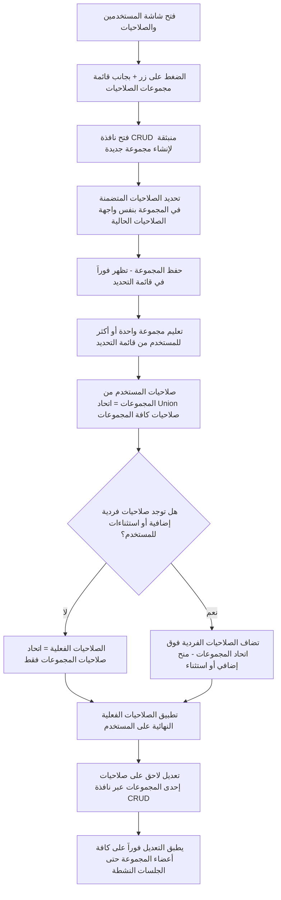

> [!note] Original CR document, copied as-is. The implementation plan is in [[CR-123425 - Plan]].

# الطلب رقم 13 - CR #123425
**إنشاء مجموعات صلاحيات (Permission Groups) قابلة للإسناد المتعدد للمستخدم، مدمجة داخل شاشة المستخدمين والصلاحيات الحالية**

---

## بطاقة البيانات الأساسية (Metadata)

| الحقل (Field) | القيمة (Value) |
| :--- | :--- |
| **CR ID** | 123425 |
| **Parent / Screen** | المستخدمين والصلاحيات (Users & Permissions) |
| **Feature** | مستخدمين الخدمات اللوجيستية (Logistics - Users 29383) |
| **Customer** | INTERNAL |
| **Category** | Paid |
| **Impact Rate** | Major |
| **Work Type** | Web |
| **Application** | logistics |
| **Industry** | All Industries |
| **Impact on Customer Business** | بيقلل وقت وجهد إعداد صلاحيات المستخدمين الجدد بشكل كبير، وبيوحد الصلاحيات للمستخدمين اللي بيعملوا نفس المهام، وبيقلل أخطاء الإعداد الفردي - حسب ما ورد في تذكرة Azure DevOps |
| **Breaking Change** | No |
| **Story Points** | 5 |

---

## 1. معلومات أساسية (Basic Information)

### الملخص (Summary)
حاليًا يتم إعداد الصلاحيات لكل مستخدم بشكل منفصل ومكرر. المطلوب حسب تذكرة **123425 Azure DevOps** إضافة إمكانية إنشاء **"مجموعات صلاحيات" (Permission Groups)**؛ بحيث تحتوي كل مجموعة على حزمة صلاحيات محددة، ويتم إسناد المجموعة لأي مستخدم، وتُطبّق الصلاحيات المعرفة داخل المجموعة تلقائيًا وبشكل مستمر على كافة المستخدمين المرتبطين بها.

---

## 2. تحليل الفجوة وتقييم الوضوح (Gap Analysis & Clarity Assessment)

### 2.1 درجة الوضوح (Clarity Score)
> **Score: 9/10**

بعد جلسة المراجعة، تم حل كافة الأسئلة التصميمية المفتوحة:
- تعدد العضوية مسموح به عبر اتحاد (**Union**) الصلاحيات بين كافة مجموعات المستخدم.
- الاستثناءات الفردية تظل متاحة فوق صلاحيات المجموعة.
- أي تعديل على صلاحيات مجموعة يُطبّق فورًا حتى على الجلسات النشطة دون الحاجة لتسجيل خروج ودخول.
- لا يوجد حد أقصى لعدد المجموعات ولا تسلسل هرمي بينها.
- تم تصحيح التصميم بناءً على توضيح مالك المنتج (Product Owner) ليكون عبارة عن قائمة تحديد (**Check List**) + زر (**CRUD**) مدمجين داخل شاشة المستخدمين والصلاحيات الحالية بدلاً من شاشة مستقلة، استناداً إلى الـ screenshot الفعلي المرفق للشاشة.

---

## 3. السياق والأثر على الأعمال (Context & Business Impact)

### 3.1 أثر الأعمال (Business Impact)
- تقليل الوقت والجهد المطلوب لإعداد صلاحيات مستخدم جديد بشكل كبير (بدل تحديد كل صلاحية منفردة، يتم إسناد مجموعة جاهزة مباشرة).
- توحيد الصلاحيات للمستخدمين الذين يؤدون نفس الدور، مما يقلل احتمالية التضارب أو السهو.
- الحد من أخطاء الإعداد الفردي للصلاحيات.
- تسهيل إدارة الصلاحيات مركزيًا (أي تعديل على المجموعة يُطبّق على جميع أعضائها تلقائيًا).

### 3.2 تقييم التغييرات الجذرية (Breaking Change Assessment)
- **Breaking Change: No**  
- التغيير لا يكسر سلوك النظام الحالي؛ هو إضافة وتحسين متوافق بالكامل مع الوضع القائم (Backward-Compatible).

---

## 4. المتطلبات والمحددات (Required Clarifications)

### 4.1 الوضع الحالي (Current State / As-Is)
1. نظام الصلاحيات الحالي يُعد لكل مستخدم بشكل منفرد دون وجود مفهوم "مجموعة جاهزة" تُسند دفعة واحدة.
2. يتطلب إعداد مستخدم جديد تكرار نفس خطوات تحديد الصلاحيات التي تمت مسبقاً لمستخدمين في نفس الدور الوظيفي.

### 4.2 الشروط المسبقة (Preconditions)
1. يجب أن يكون نظام الصلاحيات الحالي على مستوى المستخدم الفردي قابلاً لإعادة الاستخدام كوحدة بناء لمجموعات الصلاحيات.
2. نافذة الـ CRUD المنبثقة ستجمع نفس عناصر الصلاحيات الحالية لكن على مستوى مجموعة، وتُفتح من داخل شاشة المستخدمين والصلاحيات نفسها.

### 4.3 التكاملات (Integrations)
1. التكامل مع نظام الصلاحيات الحالي عبر كافة الموديولات (أي شاشة أو عملية محكومة بصلاحية ستتأثر بمصدر الصلاحية الجديد سواء كان فردياً أو عبر مجموعة).
2. تعديل شاشة المستخدمين والصلاحيات لإضافة قائمة تحديد المجموعات وزر فتح نافذة الـ CRUD دون الحاجة لشاشات مستقلة جديدة.

---

## 5. مقترح الحل الأولي (Preliminary Solution Proposal)

### 5.1 آلية العمل المستقبلية (To-Be Process)
1. **قائمة تحديد مدمجة:** إضافة قائمة اختيار (`Check List`) لمجموعات الصلاحيات داخل شاشة المستخدمين والصلاحيات (`Users & Permissions`) بجانبها زر `+` يفتح نافذة منبثقة (`CRUD Popup`) لإدارة المجموعات (إنشاء، تعديل، حذف) بنفس واجهة اختيار الصلاحيات الفردية الحالية.
2. **نافذة منبثقة موضعية:** تفتح نافذة الـ CRUD فوق الشاشة الحالية دون مغادرتها، وبمجرد الحفظ تظهر المجموعة فوراً في القائمة وجاهزة للإسناد.
3. **تعدد المجموعات:** عند إنشاء أو تعديل مستخدم، يمكن تحديد مجموعة واحدة أو أكثر دون حد أقصى.
4. **اتحاد الصلاحيات (Union):** الصلاحيات الفعلية للمستخدم = اتحاد (`Union`) كافة الصلاحيات الممنوحة في جميع المجموعات المسندة إليه دون تعارض أو أولوية.
5. **الصلاحيات الفردية والاستثناءات:** يمكن منح أو سحب صلاحيات فردية إضافية للمستخدم فوق مجموعاته (إما كإضافة أو كاستثناء/حجب).
6. **التحديث اللحظي:** أي تعديل في صلاحيات المجموعة ينعكس فوراً وتلقائياً على كل أعضائها، بما في ذلك أصحاب الجلسات النشطة دون الحاجة لتسجيل الخروج والدخول.
7. **الاستقلالية وعدم الهرمية:** لا يوجد تسلسل هرمي أو وراثة بين المجموعات؛ كل مجموعة مستقلة بذاتها.
8. **وضوح المصادر:** تعرض شاشة إدارة المستخدمين بوضوح مصادر صلاحيات المستخدم (المجموعات المرتبط بها بالإضافة للصلاحيات الفردية المخصصة).
9. **تنبيهات الحذف والتعديل:** عند تعديل أو حذف مجموعة، يظهر تنبيه يوضح عدد المستخدمين المتأثرين بهذا الإجراء.

---

### 5.2 المخطط الانسيابي (Flow Diagram)

---

### 5.3 عناصر وحقول الشاشة (Screen Selections)

قائمة الحقول الجديدة والمعدلة على الشاشة لهذا الـ CR مرتبة حسب القسم:

| # | الاسم العربي | English Name | نوع الحقل (Field Type) | نوع البيانات (Data Type) | مصدر القراءة (Read From) | التأثير (Impact In) | القيمة (Value) | معلومات إضافية (Extra Info) |
| :-: | :--- | :--- | :--- | :--- | :--- | :--- | :--- | :--- |
| **1** | **نافذة إدارة مجموعات الصلاحيات** | **CRUD Popup** | Window / Modal | — | — | — | — | داخل شاشة المستخدمين والصلاحيات |
| **2** | **اسم المجموعة** | **Group Name** | Text Field | Text | إدخال المستخدم | — | Mandatory | إلزامي عند الإنشاء أو التعديل |
| **3** | **الصلاحيات المتضمنة** | **Included Permissions** | Check List | Multi Options | شجرة الصلاحيات الحالية | كل المستخدمين المرتبطين بالمجموعة | Mandatory | نفس الشجرة المستخدمة حالياً للمستخدم الفردي |
| **4** | **مجموعات الصلاحيات** | **Permission Groups** | Check List | Multi Options | مجموعات الصلاحيات المعرفة | صلاحيات المستخدم الفعلية | Optional / Multi-select | قائمة تحديد مدمجة في الشاشة (ليست شاشة منفصلة). تدعم الاختيار المتعدد بدون حد أقصى، وصلاحيات المستخدم = اتحاد الصلاحيات + الاستثناءات |
| **5** | **إضافة / إدارة مجموعة** | **Add / Manage Group** | Button | Action | — | نافذة CRUD | Enabled | زر `+` يفتح النافذة المنبثقة لإنشاء/تعديل/حذف المجموعات دون مغادرة الشاشة |

---

### 5.4 النماذج التفاعلية (Interactive Mockups)
- **شاشة المستخدمين والصلاحيات:** تحتوي على قائمة المجموعات المدمجة الجديدة.
- **نافذة إدارة المجموعات (Groups CRUD Popup):** نافذة منبثقة لإدارة وتعديل الصلاحيات الخاصة بالمجموعات (مثل: مجموعة "موظفي المخازن").

---

### 5.5 سيناريوهات العمل الفعلية (Real-Life Workflow Scenarios)

#### 5.5.1 سيناريو المسار الإيجابي (Happy Path Scenario)
- **الهدف:** مسؤول الصلاحيات يرغب في إضافة 5 موظفين جدد في قسم المخازن يحتاجون نفس الصلاحيات تماماً.
- **الخطوات:**
  1. الدخول على شاشة المستخدمين والصلاحيات والضغط على زر `+` بجانب قائمة مجموعات الصلاحيات.
  2. إنشاء مجموعة جديدة باسم **"موظفي المخازن"** عبر النافذة المنبثقة، وتحديد كافة الصلاحيات المطلوبة مرة واحدة وحفظها.
  3. فتح ملف كل مستخدم من الموظفين الخمسة واختيار مجموعة "موظفي المخازن" من قائمة الاختيار، لتُسند الصلاحيات إليهم مباشرة وبشكل موحد.